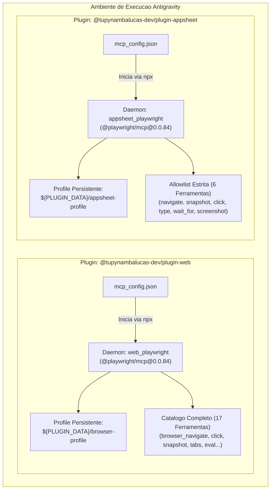
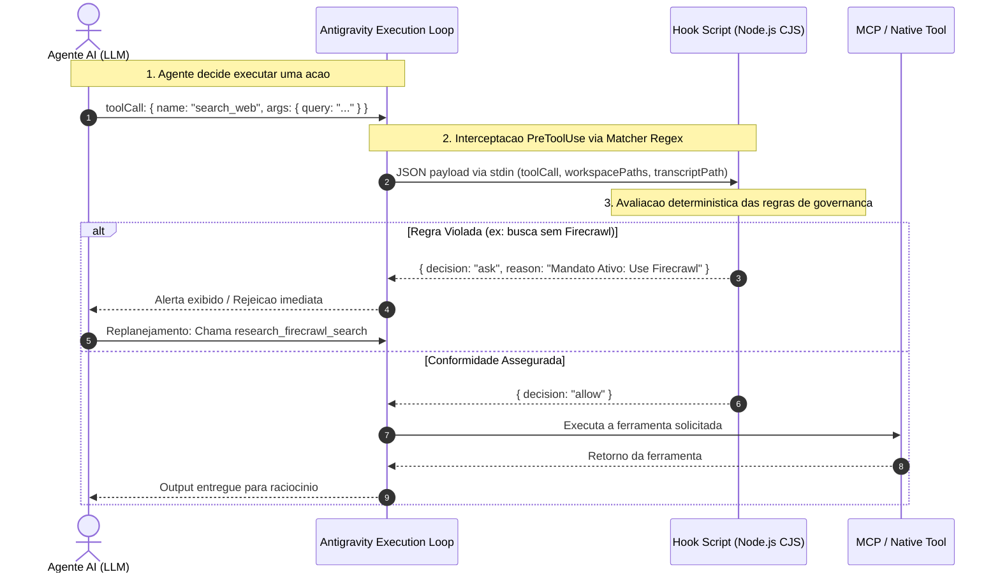

# Analise Arquitetural: Isolamento de Runtimes Playwright e Imposicao Deterministica via Lifecycle Hooks

Este documento estabelece o registro analitico e tecnico detalhado das transformacoes de arquitetura implementadas no repositorio `agent-mesh`. Ele consolida a solucao definitiva para o conflito de multiplas instancias do Playwright, a transicao de governanca de regras contextuais para hooks determinísticos do Antigravity, o endurecimento de supply chain em CI/CD e o roadmap de paridade entre o ambiente de desenvolvimento local e o cluster Kubernetes.

---

## 1. Contexto, Diagnostico e Motivacao

### 1.1 O Conflito de Instancias do Playwright
Anteriormente, tanto o plugin `plugins/packages/web` quanto o plugin `plugins/packages/appsheet` declaravam entradas para o servidor `playwright` apontando genericamente para o script `mcp-gateway-router.js`. Essa configuracao gerava quatro patologias criticas em runtime:

1. **Duplicacao de Processos Concorrentes**: O Antigravity instanciava dois daemons em background no host (`web_playwright` e `appsheet_playwright`), que disputavam sockets locais e recursos do sistema operacional.
2. **Conflito de Perfil de Navegacao (Profile Lock)**: Ambos os processos tentavam abrir ou anexar sessoes utilizando caminhos padrao do navegador, resultando em erros de concorrencia e falhas de conexao CDP (Chrome DevTools Protocol).
3. **Explosao de Tokens e Ambiguidade no LLM**: Ambas as instancias registravam 17 ferramentas cada no prompt de sistema do agente (`web_playwright:browser_*` e `appsheet_playwright:browser_*`). Isso duplicava o consumo de tokens da janela de contexto e causava hesitacao do modelo na selecao da ferramenta adequada.
4. **Dependencia Quebrada de Infraestrutura Local**: O pacote interno `@tupynambalucas-dev/mcp-playwright` tentava se conectar via CDP na porta 9222 ou caia no fallback de iniciar uma instancia headless inexistente no disco (`chrome-headless-shell.exe` nao instalado via Playwright CLI).

### 1.2 O Limite das Regras Contextuais (AGENTS.md)
As diretrizes operacionais de governanca corporativa (como "utilizar autonomamente Firecrawl e Context7", "assinar commits com chave SSH -S" e "manter o teto de 3 camadas de routers") existiam exclusivamente como texto no arquivo `AGENTS.md` e em `rules/*.md`.
Embora essas instrucoes sejam injetadas no contexto do modelo, modelos de linguagem operam probabilisticamente. Em cenarios de instrucoes complexas ou pressao de contexto, o modelo pode ignorar regras declarativas e acionar ferramentas nativas mais imediatas (como `search_web` em vez de `research_firecrawl`), resultando em violacoes de conformidade e citacoes nao auditaveis.

A engenharia corporativa de agentes estabelece o seguinte axioma:
> **Prompts sugerem; Hooks garantem.** Regras criticas de seguranca, integridade de repositorio e supply chain devem ser impostas fora da cadeia de inferencia do modelo, no proprio loop de execucao do harness do agente.

---

## 2. Nova Arquitetura de Isolamento do Playwright

Para garantir o principio de responsabilidade unica e a total independencia de cada plugin, o Playwright foi dissociado em duas camadas independentes e especializadas, consumindo a versao estavel fixada `@playwright/mcp@0.0.84`.



### 2.1 Configuracao no Plugin Web
O plugin `web` e a autoridade primaria em navegacao e inspecao web do agente. Ele expoe todas as ferramentas do protocolo com perfil persistente dedicado:

```json
{
  "mcpServers": {
    "playwright": {
      "command": "npx",
      "args": [
        "-y",
        "@playwright/mcp@0.0.84",
        "--user-data-dir",
        "${PLUGIN_DATA}/browser-profile",
        "--headless"
      ]
    },
    "playwright-desktop": {
      "command": "npx",
      "args": [
        "-y",
        "@playwright/mcp@0.0.84",
        "--extension"
      ],
      "disabled": true
    }
  }
}
```

- **Isolamento de Dados**: Utiliza `${PLUGIN_DATA}/browser-profile`, variavel nativa do Antigravity que resolve para um diretorio gravavel fora da raiz do workspace, preservando caches sem poluir o repositorio.
- **Standby para Desktop Pairing**: A entrada `playwright-desktop` permanece declarada porem desativada (`disabled: true`), permitindo que desenvolvedores a ativem sob demanda quando desejarem inspecionar abas ativas via extensao de navegador.

### 2.2 Configuracao no Plugin AppSheet
O plugin `appsheet` utiliza navegacao web exclusivamente para tarefas pontuais de administracao de console no AppSheet Studio (como a skill `appsheet-ui-architect` para acionar `Data > Tables > Regenerate Structure`).
Para evitar que ele polua a tabela de ferramentas do modelo, foi aplicada uma **allowlist estrita** atraves do campo `enabledTools`:

```json
{
  "mcpServers": {
    "playwright": {
      "command": "npx",
      "args": [
        "-y",
        "@playwright/mcp@0.0.84",
        "--user-data-dir",
        "${PLUGIN_DATA}/appsheet-profile",
        "--headless"
      ],
      "enabledTools": [
        "browser_navigate",
        "browser_snapshot",
        "browser_click",
        "browser_type",
        "browser_wait_for",
        "browser_take_screenshot"
      ]
    }
  }
}
```

- **Perfil Dedicado**: Aponta para `${PLUGIN_DATA}/appsheet-profile`. Se o desenvolvedor efetuar login corporativo Google no AppSheet Studio, as sessoes e cookies permanecem preservados nesse diretorio sem interferir na navegacao web comum.
- **Reducao Drastica de Overhead**: Apenas 6 ferramentas sao injetadas no schema JSON-RPC do `appsheet_playwright`, eliminando 11 ferramentas redundantes que geravam confusao cognitiva no modelo.

---

## 3. Imposicao Deterministica via Lifecycle Hooks

O Antigravity fornece uma infraestrutura nativa de hooks de ciclo de vida (`hooks.json`) que executa scripts locais em momentos especificos do loop do agente. Diferente de regras textuais, os hooks interceptam a chamada de ferramenta via `stdin` e devolvem instrucoes em `stdout` (`allow`, `ask`, `deny`, `overwrite`).



### 3.1 Catalogo de Hooks Ativos

#### A. Plugin Research (`plugins/packages/research/hooks.json`)
- **Evento `SessionStart`**: Executa `scripts/hooks/session-start.cjs`. Injeta uma mensagem de sistema out-of-band no historico da conversa no exato momento em que uma nova sessao inicia, instruindo o agente sobre o mandato de pesquisa autonoma com Context7 e Firecrawl.
- **Evento `PreToolUse` (`matcher: "search_web|read_url_content|scrape|research_firecrawl_scrape"` )**:
  - Intercepta chamadas de `search_web` e `read_url_content`. Se a variavel de escape `MESH_ALLOW_NATIVE_WEB=1` nao estiver presente, responde com `decision: "ask"` e exibe explicacao orientando o uso das ferramentas oficiais do mesh.
  - Intercepta chamadas de `scrape`: se o parametro `onlyMainContent` nao foi especificado, aplica `overwrite: { onlyMainContent: true }` automaticamente para proteger a janela de contexto de HTML desnecessario.

#### B. Plugin GitHub Flow (`plugins/packages/github-flow/hooks.json`)
- **Evento `PreToolUse` (`matcher: "run_command"` )**:
  - Executa `scripts/hooks/enforce-git-signing.cjs`.
  - Verifica comandos de `git commit`: se nao contiverem `-S` ou `--gpg-sign`, emite solicitacao de confirmacao exigindo assinatura criptografica SSH.
  - Bloqueia imediatamente commits que contenham emojis no texto da mensagem (`decision: "deny"`).
  - Bloqueia pushes diretos para as branches protegidas `main` ou `master` (`git push ... main`).

#### C. Plugin Atelier AI (`plugins/packages/atelier/hooks.json`)
- **Evento `PreToolUse` (`matcher: "write_file|write_to_file|edit_file|replace_file_content|multi_replace_file_content"` )**:
  - Executa `scripts/hooks/enforce-governance.cjs`.
  - Impede a criacao de arquivos `AGENTS.md` ou `README.md` abaixo do Layer 3 (proibicao estrita de proliferacao em subpastas de planejamento como `.agents/plans/`, `.agents/reports/` e quadrantes Diataxis como `docs/tutorials/`, `docs/reference/`).
  - Analisa o conteudo gravado e barra a insercao de qualquer caractere emoji.

#### D. Plugin AppSheet (`plugins/packages/appsheet/hooks.json`)
- **Evento `PreToolUse` (`matcher: "mutate_records|appsheet_mutate_records"` )**:
  - Executa `scripts/hooks/enforce-appsheet-mutation.cjs`.
  - Inspeciona os registros a serem adicionados ou editados no AppSheet REST API v2: caso as linhas nao possuam chave primaria explicita (`<Entity>Id` ou `Id`), emite alerta para prevencao de duplicacao de registros em retentativas de rede.

---

## 4. Endurecimento de Seguranca em CI/CD e Supply Chain

Como parte da evolucao empresarial, as pipelines de GitHub Actions e gerenciamento de dependencias foram auditadas e reestruturadas:

1. **Separacao de Privilegios em Workflows**:
   - Criado [`.github/workflows/ci.yml`](file:///C:/Users/tupyn/projects/organizations/tupynambalucas-dev/org-core/agent-mesh/.github/workflows/ci.yml): Executa exclusivamente em pull requests com `permissions: contents: read`. Roda validacao de tipos (`pnpm typecheck`), compilacao (`pnpm mcp:build`) e inspecao de plugins (`agy plugin validate . --strict`).
   - Hardening de [`.github/workflows/publish.yml`](file:///C:/Users/tupyn/projects/organizations/tupynambalucas-dev/org-core/agent-mesh/.github/workflows/publish.yml): Removido o gatilho inseguro de `pull_request` que concedia permissao `packages: write` para codigo nao revisado. A publicacao agora ocorre estritamente em pushes na `main` ou tags de versao (`v*`).
2. **Imutabilidade de Actions por Commit SHA**:
   - Todas as GitHub Actions de terceiros foram fixadas por SHAs completos de 40 caracteres (ex: `actions/checkout@11d5960a326750d5838078e36cf38b85af677262`), neutralizando vetores de supply chain por mutacao de tags.
3. **Instalacoes Reproduziveis com Lockfile Congelado**:
   - A flag `--no-frozen-lockfile` foi eliminada das pipelines de CI, sendo substituida obrigatoriamente por `pnpm install --frozen-lockfile`.
4. **Politica de Cooldown do Dependabot**:
   - Criado [`.github/dependabot.yml`](file:///C:/Users/tupyn/projects/organizations/tupynambalucas-dev/org-core/agent-mesh/.github/dependabot.yml) com parametro `cooldown: default-days: 7`. Pacotes recem-publicados no registro publico do npm sao retidos por 7 dias antes de serem sugeridos para atualizacao, garantindo tempo habil para deteccao e revogacao de versoes comprometidas por mantenedores upstream.

---

## 5. Como Funciona a Execucao na Pratica (Exemplo Passo a Passo)

Para entender a ordem real de execucao e prioridade a partir de agora:

### Cenário: Agente solicitando automacao no AppSheet Studio
1. O desenvolvedor solicita: *"Abra o AppSheet Studio e regenere a estrutura da tabela de Clientes"*.
2. O Antigravity consulta seu catalogo de ferramentas e identifica `appsheet_playwright:browser_navigate` (definido no plugin `appsheet`).
3. O daemon isolado `appsheet_playwright` e ativado, iniciando o Chromium com perfil em `${PLUGIN_DATA}/appsheet-profile`.
4. Caso o agente tente chamar ferramentas fora da allowlist (como `browser_evaluate`), a ferramenta sequer existe no schema do AppSheet, forcando o agente a operar apenas com o conjunto de navegacao permitido.
5. Se o desenvolvedor em seguida pedir para navegar em um portal de noticias, o Antigravity aciona `web_playwright:browser_navigate`, que roda em um processo separado com perfil em `${PLUGIN_DATA}/browser-profile`, sem causar conflito de sessao ou queda do processo anterior.

### Cenário: Agente tentando rodar `git commit` sem assinatura
1. O agente executa a ferramenta nativa `run_command` com `CommandLine: 'git commit -m "feat: add new feature"'`.
2. O loop do Antigravity intercepta a chamada e direciona o payload JSON para o hook `scripts/hooks/enforce-git-signing.cjs` do plugin `github-flow`.
3. O script analisa a linha de comando e detecta a ausencia da flag `-S`.
4. O hook retorna `{"decision": "ask", "reason": "Cryptographic Signature Invariant: All git commits must be signed with -S"}`.
5. O agente recebe o motivo da rejeicao/pergunta, ajusta seu plano e reformula o comando para `git commit -S -m "feat: add new feature"`.

---

## 6. Estado Atual das Fases do Plano Master

O plano mestre estabelecido em [`.agents/plans/plugin-independence-playwright-isolation-and-enforcement-hooks.md`](file:///C:/Users/tupyn/projects/organizations/tupynambalucas-dev/org-core/agent-mesh/.agents/plans/plugin-independence-playwright-isolation-and-enforcement-hooks.md) foi estruturado em 12 fases. E fundamental registrar com exatidao o status de cada uma:

| Fase | Descricao | Status | Detalhes de Conclusao |
|---|---|---|---|
| **Fase 0** | Validacoes e Spikes Tecnicos | **Concluida** | Validado o comportamento do `agy plugin validate . --strict`, syntax de hooks e variables `${PLUGIN_DATA}`. |
| **Fase 1** | Higiene de Manifestos | **Concluida** | Todos os 10 plugins agora passam com nota maxima em validacao estrita do Antigravity CLI. |
| **Fase 2** | Isolamento do Playwright | **Concluida** | `web` e `appsheet` rodam em perfis independentes com versoes fixadas e allowlist estrita. Mergeado no PR #11. |
| **Fase 4** | Lifecycle Hooks de Imposicao | **Concluida (Core)** | Hooks implementados e ativos em `research`, `github-flow`, `atelier` e `appsheet`. |
| **Fase 9** | Endurecimento de CI/CD | **Concluida** | Workflows `ci.yml`, `publish.yml` endurecidos e Dependabot configurado. Mergeado no PR #11. |
| **Fase 3 & 10** | Launchers Vendored e CLI Doctor | *Planejada (Workstation)* | Migracao dos outros servicos (Firecrawl/GitHub) para launchers com suporte a perfil explicito (`local` vs `cluster`) e script `mesh:doctor`. |
| **Fase 7 & 8** | Hardening de Gateway e Pods K8s | *Planejada (Platform)* | Atualizacoes no repositorio `platform` (manifestos em `platform/k8s/manifests/hub/cortex/mcp/`, correcao de nomes `mcp-*`, probes, SecurityContext e JWT). |
| **Fase 11** | Testes Contratuais Automatizados | *Planejada (Qualidade)* | Suíte de testes com Vitest garantindo imutabilidade de schemas JSON-RPC e protecao contra tool-poisoning. |
| **Fase 12** | Observabilidade e Tracing | *Planejada (Infra)* | Integracao com OpenTelemetry para correlacao de chamadas entre Gateway e servidores MCP. |

---

## 7. Conclusao

O ecossistema `agent-mesh` deu um salto de maturidade operacional:
- A causa tecnica dos conflitos de navegador foi definitivamente extirpada com a dissociacao de perfis e a adocao de allowlists por domínio.
- As regras de governanca organizacional deixaram de depender unicamente da atencao volatil do LLM e agora contam com barreiras de codigo deterministas inspecionadas em tempo real pelo Antigravity.
- O repositorio esta pronto para operar de maneira reproduzivel, com validacao automatica e protecao contra ataques de cadeia de suprimentos.
