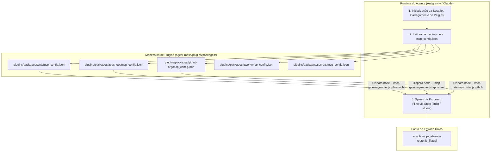
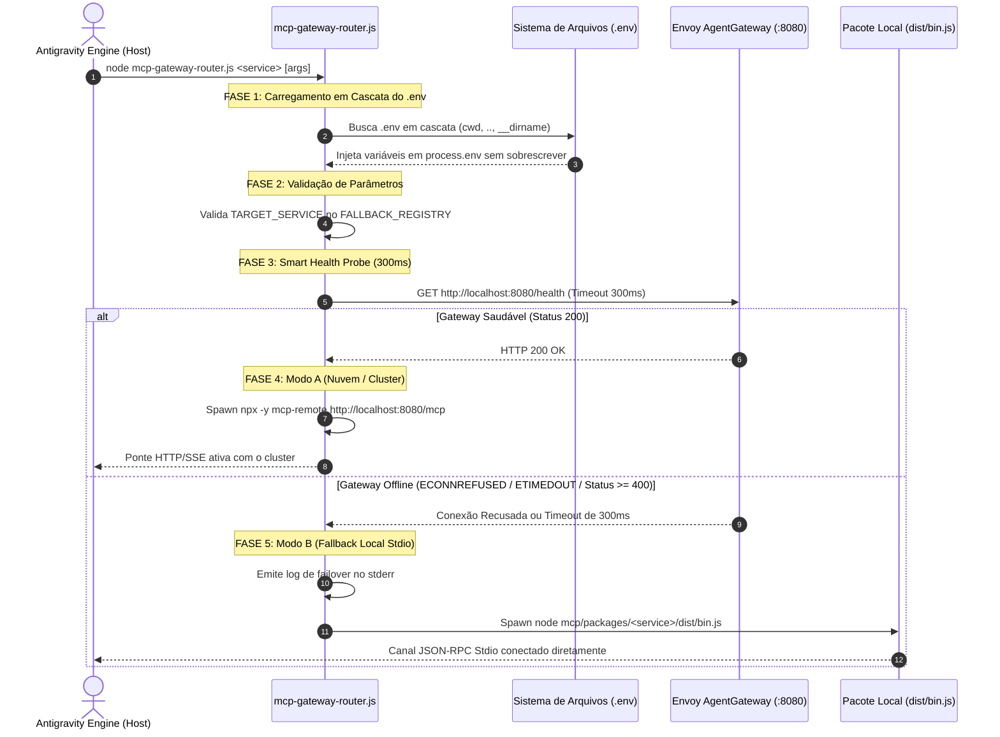
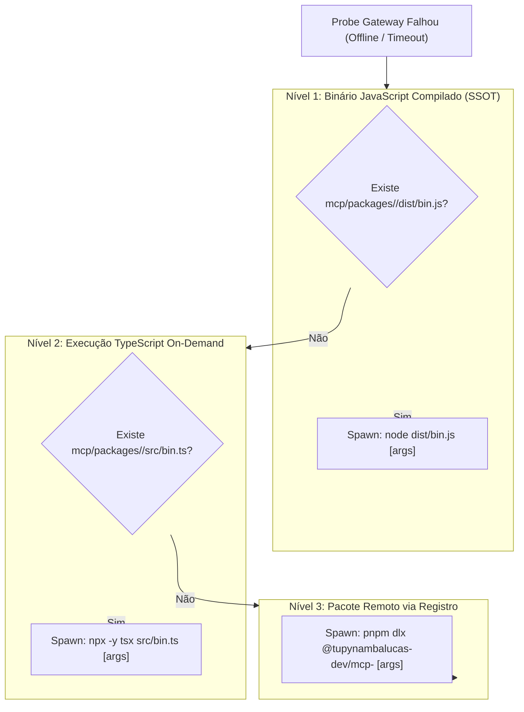

# Análise Profunda da Arquitetura e Ciclo de Vida do `mcp-gateway-router.js`

Este documento estabelece a análise técnica, arquitetural e operacional exaustiva do motor de roteamento inteligente
e failover de ferramentas Model Context Protocol (MCP) do ecossistema Tupynamba Lucas: o [`mcp-gateway-router.js`](../../scripts/mcp-gateway-router.js).

---

## 1. Visão Geral e Justificativa Arquitetural

No ecossistema corporativo `tupynambalucas-dev`, as capacidades dos agentes de inteligência artificial são divididas
entre dois grandes mundos:
1. **O Plano de Controle na Nuvem / Kubernetes (`platform`)**:
   Hospeda o **Envoy AgentGateway** (`:8080`), o proxy de segurança gRPC **MCP Guardrails** (`:9001`), o dashboard de inspeção
   `inspector` (`:6274`) e os pods de microsserviços rodando sobre manifests K8s declarativos em `platform/k8s/manifests/hub/cortex/mcp/`.
2. **A Malha Descentralizada de Agentes (`agent-mesh`)**:
   Hospeda os plugins do Antigravity/Claude em `plugins/packages/*`, as implementações TypeScript dos servidores MCP em
   `mcp/packages/*` e as skills dos agentes.

### O Desafio da Disponibilidade Contínua
Se os plugins declarassem diretamente conexões de rede para o cluster (`http://localhost:8080/mcp`), os agentes ficariam
**completamente paralisados** sempre que o desenvolvedor estivesse trabalhando offline, em trânsito ou com o cluster local
(Minikube/Kind) desligado. Por outro lado, se os plugins configurassem apenas binários locais via Stdio, perder-se-ia toda a
governança centralizada, auditoria de segurança e rate-limiting do Envoy e dos gRPC Guardrails em ambiente corporativo.

O [`mcp-gateway-router.js`](../../scripts/mcp-gateway-router.js) foi projetado para resolver esse dilema: ele atua como um
**despachante transparente de modo duplo (Dual-Mode Failover Engine)** com detecção de saúde em menos de 300 milissegundos.

---

## 2. Mapa de Trigger: Quem, Onde e Como o Script é Disparado

O ciclo de vida do script começa muito antes da execução do código Node.js. Ele é disparado pelo runtime do assistente
(Antigravity CLI, Antigravity IDE ou Claude Code) através da declaração de plugins.



### Onde o Trigger está Declarado no Código

Cada plugin soberano define a inicialização de suas ferramentas em seu respectivo `mcp_config.json`. Exemplos reais:

1. **Plugin Web (`plugins/packages/web/mcp_config.json`)**:
   ```json
   {
     "mcpServers": {
       "playwright": {
         "command": "node",
         "args": ["../../../scripts/mcp-gateway-router.js", "playwright"],
         "env": {
           "CORTEX_GATEWAY_URL": "http://localhost:8080",
           "CORTEX_PROBE_TIMEOUT_MS": "300"
         }
       },
       "firecrawl": {
         "command": "node",
         "args": ["../../../scripts/mcp-gateway-router.js", "firecrawl"]
       }
     }
   }
   ```

2. **Plugin Google Workspace (`plugins/packages/gwork/mcp_config.json`)**:
   ```json
   {
     "mcpServers": {
       "gwork": {
         "command": "node",
         "args": ["../../../scripts/mcp-gateway-router.js", "gwork"]
       }
     }
   }
   ```

3. **Plugin GitHub Org (`plugins/packages/github-org/mcp_config.json`)**:
   ```json
   {
     "mcpServers": {
       "github": {
         "command": "node",
         "args": ["../../../scripts/mcp-gateway-router.js", "github"]
       }
     }
   }
   ```

Quando o Antigravity carrega esses plugins, ele inicializa o processo via `child_process.spawn("node", ["../../../scripts/mcp-gateway-router.js", "<serviço>"])`
conectando os descritores de arquivo padrão:
- `stdin` (Canal de entrada de chamadas JSON-RPC do modelo para o MCP).
- `stdout` (Canal de saída de resultados JSON-RPC do MCP para o modelo).
- `stderr` (Canal de logs e diagnóstico, ignorado pelo parser de JSON-RPC).

---

## 3. As Fases da Lógica de Execução Passo a Passo

O fluxo interno de [`mcp-gateway-router.js`](../../scripts/mcp-gateway-router.js) ocorre em 5 fases sequenciais e determinísticas:



---

### Fase 1: Carregamento em Cascata de Variáveis de Ambiente (`loadEnvCascade`)

Em um monorepo multi-raiz, o diretório de trabalho (`cwd`) pode variar dependendo de onde o desenvolvedor abriu o terminal
ou o editor (raiz do `org-core`, subpasta `agent-mesh`, ou dentro de um pacote de plugin).

Para garantir que credenciais locais como `FIRECRAWL_API_KEY`, `PLAYWRIGHT_MCP_EXTENSION_TOKEN`, `GITHUB_TOKEN` e segredos
do Infisical sejam sempre carregados, a função `loadEnvCascade()` avalia quatro diretórios candidatos em ordem de proximidade:

```javascript
function loadEnvCascade() {
  const candidates = [
    path.resolve(process.cwd(), '.env'),
    path.resolve(process.cwd(), '..', '.env'),
    path.resolve(__dirname, '..', '.env'),
    path.resolve(__dirname, '..', '..', '.env')
  ];
  for (const envPath of candidates) {
    if (fs.existsSync(envPath)) {
      try {
        const raw = fs.readFileSync(envPath, 'utf8');
        for (const line of raw.split('\n')) {
          const trimmed = line.trim();
          if (!trimmed || trimmed.startsWith('#')) continue;
          const eqIdx = trimmed.indexOf('=');
          if (eqIdx > 0) {
            const k = trimmed.slice(0, eqIdx).trim();
            const v = trimmed.slice(eqIdx + 1).trim();
            // Injeção idempotente: não sobrescreve variáveis já presentes no ambiente
            if (!process.env[k]) process.env[k] = v;
          }
        }
      } catch (e) {}
    }
  }
}
```

**Regra de Ouro da Injeção**:
Se uma variável já foi definida pelo sistema operacional ou pelo comando pai (ex: `PLAYWRIGHT_MODE=extension`), ela **não**
é sobrescrita pelo arquivo `.env`. Isso garante a precedência de flags passadas pelo terminal.

---

### Fase 2: Validação de Parâmetros e Mapeamento de Serviços

O script captura o serviço alvo a partir do primeiro argumento de linha de comando (`process.argv[2]`):

```javascript
const TARGET_SERVICE = process.argv[2];
const GATEWAY_BASE_URL = process.env.CORTEX_GATEWAY_URL || "http://localhost:8080";
const PROBE_TIMEOUT_MS = parseInt(process.env.CORTEX_PROBE_TIMEOUT_MS || "300", 10);
```

Em seguida, o alvo é validado contra o `FALLBACK_REGISTRY`:

| Identificador do Serviço | Pacote Local Monorepo (`agent-mesh/mcp/packages/`) | Pacote Oficial de Registro |
| :--- | :--- | :--- |
| `firecrawl` | `@tupynambalucas-dev/mcp-firecrawl` | `firecrawl-mcp` |
| `memory` | `@tupynambalucas-dev/mcp-memory` | `@modelcontextprotocol/server-memory` |
| `github` | `@tupynambalucas-dev/mcp-github` | `github-mcp-server-js` |
| `gwork` / `google-workspace` | `@tupynambalucas-dev/mcp-gwork` | `@aaronsb/google-workspace-mcp` |
| `appsheet` | `@tupynambalucas-dev/mcp-appsheet` | `(in-house exclusivo)` |
| `infisical` | `@tupynambalucas-dev/mcp-infisical` | `@infisical/mcp` |
| `context7` | `@upstash/context7-mcp` | `@upstash/context7-mcp` |
| `playwright` | `@tupynambalucas-dev/mcp-playwright` | `@playwright/mcp` |

Se o argumento não constar no registro, o script encerra imediatamente:
```javascript
if (!TARGET_SERVICE || !FALLBACK_REGISTRY[TARGET_SERVICE]) {
  process.stderr.write(`[mesh-router] Error: Unknown target service '${TARGET_SERVICE}'.\n`);
  process.exit(1);
}
```

---

### Fase 3: Smart Health Probe (Sonda Ultra-Rápida de 300ms)

Esta é a inovação central do router. Em vez de esperar pelo timeout padrão do Node.js (que costuma ser de 30 a 120 segundos
em chamadas HTTP), a função `probeGateway()` impõe um teto rígido de **300 milissegundos**:

```javascript
function probeGateway(baseUrl, timeoutMs) {
  return new Promise((resolve) => {
    try {
      const parsedUrl = new URL(baseUrl);
      const client = parsedUrl.protocol === "https:" ? https : http;

      const req = client.get(
        {
          hostname: parsedUrl.hostname,
          port: parsedUrl.port || (parsedUrl.protocol === "https:" ? 443 : 80),
          path: "/health",
          timeout: timeoutMs,
          headers: {
            "User-Agent": "mesh-mcp-smart-router/1.0.0",
          },
        },
        (res) => {
          // Aceita status 2xx e 3xx como evidência de gateway online
          resolve(res.statusCode >= 200 && res.statusCode < 400);
        }
      );

      // Tratamento à prova de falhas: qualquer erro ou timeout encerra com false
      req.on("error", () => resolve(false));
      req.on("timeout", () => {
        req.destroy();
        resolve(false);
      });
    } catch {
      resolve(false);
    }
  });
}
```

**Por que 300ms?**
- É tempo mais do que suficiente para um socket TCP local (`localhost:8080`) ou em rede corporativa responder com HTTP 200.
- Caso o socket esteja fechado (`ECONNREFUSED`), o sistema operacional rejeita em 1 a 5ms.
- Se o pacote for descartado (blackhole de rede), o timeout de 300ms é imperceptível para o usuário humano e não atrasa
  a abertura da conversa no Antigravity.

---

### Fase 4: Modo A - Cluster / Nuvem via Envoy AgentGateway

Se o health check retornar `true`, significa que o cluster Kubernetes em `platform` está em execução:

```javascript
if (isGatewayHealthy) {
  process.stderr.write(`[mesh-router] AgentGateway healthy. Routing '${TARGET_SERVICE}' via ${GATEWAY_BASE_URL}/mcp\n`);

  const sseBridge = spawn("npx", [
    "-y",
    "mcp-remote",
    `${GATEWAY_BASE_URL}/mcp`
  ], {
    stdio: "inherit",
    shell: process.platform === "win32",
  });

  sseBridge.on("exit", (code) => process.exit(code || 0));
  return;
}
```

#### O que Acontece Dentro do Cluster (`platform`):
1. O `mcp-remote` converte a comunicação Stdio do agente em requisições HTTP POST e SSE direcionadas para `http://localhost:8080/mcp`.
2. O **Envoy AgentGateway** (configurado em `platform/k8s/manifests/hub/cortex/gateway/config.yaml`) intercepta a requisição.
3. O Envoy consulta o processador gRPC **mcp-guardrails** na porta `:9001` (`failureMode: failClosed`).
4. Se o guardrail aprovar a chamada, o Envoy encaminha o tráfego para o microsserviço correspondente rodando no namespace `cortex`:
   - `http://mcp-firecrawl:8080/mcp`
   - `http://mcp-playwright:8080/mcp`
   - `http://mcp-github:8080/sse`
5. A resposta retorna pelo túnel SSE até o agente.

---

### Fase 5: Modo B - Fallback Local Standalone (Três Níveis em Cascata)

Se o cluster estiver offline (`ECONNREFUSED` na porta 8080), o router inicia a estratégia de contingência local em 3 níveis:



#### Nível 1: Binário Compilado Local (`dist/bin.js`)
É o caminho de execução padrão e mais rápido dentro do repositório `agent-mesh`:
```javascript
let localMcpDir = path.resolve(__dirname, "..", "mcp", "packages", TARGET_SERVICE);
if (!fs.existsSync(localMcpDir)) {
  localMcpDir = path.resolve(__dirname, "..", "mcp", TARGET_SERVICE);
}
const localJsBin = path.join(localMcpDir, "dist", "bin.js");
const forwardedArgs = process.argv.slice(3);

if (fs.existsSync(localJsBin)) {
  process.stderr.write(`[mesh-router] AgentGateway offline. Engaging local compiled binary: node ${localJsBin} ${forwardedArgs.join(" ")}\n`);
  const localProcess = spawn("node", [localJsBin, ...forwardedArgs], {
    stdio: "inherit",
    shell: process.platform === "win32",
  });
  localProcess.on("exit", (code) => process.exit(code || 0));
  return;
}
```
- **Por que `stdio: "inherit"`?**
  Ao herdar o Stdio, o processo filho conecta seu canal `stdin` diretamente ao Antigravity e seu `stdout` de volta ao Antigravity. O script `mcp-gateway-router.js` sai do meio do tráfego de dados, garantindo zero latência de proxy e zero risco de truncar buffers grandes de resposta.

#### Nível 2: Execução TypeScript (`src/bin.ts`)
Caso o desenvolvedor tenha acabado de criar um novo servidor MCP ou limpado a pasta `dist` via `pnpm clean`, o router executa
o código TypeScript diretamente através do `tsx`:
```javascript
if (fs.existsSync(localTsBin)) {
  process.stderr.write(`[mesh-router] AgentGateway offline. Engaging local TypeScript execution: npx tsx ${localTsBin} ${forwardedArgs.join(" ")}\n`);
  const localProcess = spawn("npx", ["-y", "tsx", localTsBin, ...forwardedArgs], {
    stdio: "inherit",
    shell: process.platform === "win32",
  });
  localProcess.on("exit", (code) => process.exit(code || 0));
  return;
}
```

#### Nível 3: Execução Remota via Registro (`pnpm dlx`)
Se o desenvolvedor estiver executando o comando em outro repositório (ex: `platform` ou `docs`) onde a pasta de código-fonte
local não está presente, o router faz o download efêmero do pacote publicado no GitHub Packages:
```javascript
const targetConfig = FALLBACK_REGISTRY[TARGET_SERVICE];
const executable = targetConfig.pkg;

process.stderr.write(`[mesh-router] AgentGateway offline. Engaging registry package fallback: pnpm dlx ${executable} ${forwardedArgs.join(" ")}\n`);

const fallbackProcess = spawn("pnpm", [
  "dlx",
  executable,
  ...forwardedArgs
], {
  stdio: "inherit",
  shell: process.platform === "win32",
});
```

---

## 4. Análise de Caso Prático: O Fluxo do `playwright`

Para ilustrar o funcionamento real, vejamos o que aconteceu no teste realizado durante a nossa sessão com o Playwright:

### Cenário de Execução:
1. O plugin `web` foi acionado pelo Antigravity para inspecionar a tela ativa.
2. O Antigravity executou:
   ```bash
   node agent-mesh/scripts/mcp-gateway-router.js playwright
   ```
3. O `mcp-gateway-router.js`:
   - Executou `loadEnvCascade()`, lendo `agent-mesh/.env` e carregando `PLAYWRIGHT_MCP_EXTENSION_TOKEN`.
   - Executou `probeGateway("http://localhost:8080", 300)`.
   - A porta 8080 retornou `ECONNREFUSED` (o cluster K8s do Cortex não estava rodando localmente).
   - O router emitiu no `stderr`:
     ```text
     [mesh-router] AgentGateway offline. Engaging local compiled binary: node C:\...\agent-mesh\mcp\packages\playwright\dist\bin.js
     ```
   - Disparou `node agent-mesh/mcp/packages/playwright/dist/bin.js`.
4. O servidor local `playwright/dist/bin.js` assumiu a comunicação Stdio com o Antigravity.
5. Quando o Antigravity enviou o comando `browser_inspect_active_tab`, o servidor tentou conectar ao navegador ativo.

---

## 5. Matriz Comparativa: Modo A (Gateway) vs. Modo B (Fallback)

| Aspecto Operacional | Modo A: Envoy AgentGateway (Nuvem / K8s) | Modo B: Fallback Local (Stdio / Monorepo) |
| :--- | :--- | :--- |
| **Ambiente Alvo** | Kubernetes Cluster (Produção, Staging, Minikube). | Máquina do desenvolvedor (offline ou dev rápido). |
| **Protocolo de Rede** | HTTP POST + SSE (Server-Sent Events) na `:8080`. | Stdio puro (Pipes de `stdin` e `stdout` do SO). |
| **Políticas de Segurança** | gRPC `mcp-guardrails` valida tokens e inspeciona payloads. | Variáveis de ambiente locais via `.env`. |
| **Isolamento de Processos** | Pods dedicados no namespace `cortex`. | Processo Node.js filho spawned sob o terminal local. |
| **Latência Inicial** | ~10-25ms (overhead de rede HTTP). | ~1-3ms (comunicação direta entre processos do SO). |
| **Resiliência a Falhas** | Se cair, a próxima chamada chaveia para o Modo B em 300ms. | Execução 100% autônoma sem dependência externa. |

---

## 6. Conclusão e Diretrizes de Manutenção

O [`mcp-gateway-router.js`](../../scripts/mcp-gateway-router.js) é uma peça fundamental de infraestrutura que desacopla o
desenvolvimento ágil de software da necessidade de manter um cluster de contêineres ativo 24/7.

Para manter a integridade do router no futuro:
1. **Novos Serviços MCP**: Ao criar um novo pacote em `mcp/packages/<novo-servico>`, adicione-o imediatamente ao dicionário `FALLBACK_REGISTRY` com seu nome de pacote `@tupynambalucas-dev/mcp-<novo-servico>`.
2. **Preservação de Logs em `stderr`**: Nunca envie logs ou mensagens de debug no `stdout` dentro do router; o `stdout` é reservado exclusivamente para o protocolo JSON-RPC. Todo log de diagnóstico deve usar `process.stderr.write()`.
3. **Respeito ao Timeout de 300ms**: Nunca aumente o `PROBE_TIMEOUT_MS` além de 500ms, para evitar atrasos na percepção de resposta dos agentes.
