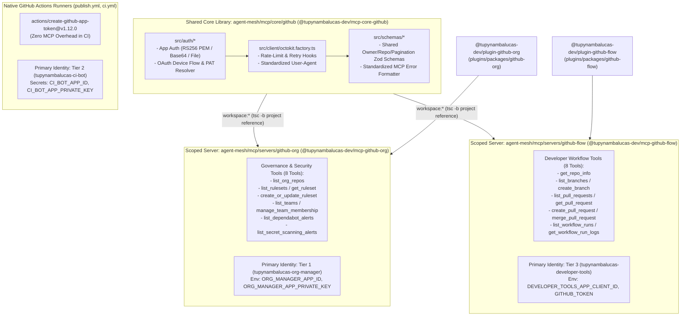
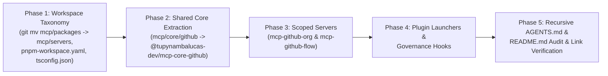

# Enterprise Architectural Analysis: Monolithic vs. Domain-Scoped MCP Servers, Bounded Context Directory Taxonomy, and Recursive Documentation Governance in Agent Mesh

**Document Reference**: `agent-mesh/.agents/analyses/mcp-architecture-single-vs-modular-github-apps.md`  
**Classification**: Senior Enterprise Architectural Analysis & Structural Decision Record  
**Target Architecture**: Tupynambalucas Agent Mesh, MCP Subsystem & Antigravity Plugins  
**Standard**: en-US Technical Specification (Strict Zero-Emoji Policy)  
**Author**: Antigravity Core AI Architecture Team  
**Date**: November 2026  

---

## 1. Executive Summary & Problem Diagnosis

The `tupynambalucas-dev` organization enforces a sovereign **Three-Tier GitHub App Identity Architecture**:
- **Tier 1 (`tupynambalucas-org-manager`)**: High-privilege administrative machine identity (App ID: `5648756`) governing organization rulesets, teams, custom roles, and security alerts via RS256 JWTs and 2048-bit RSA private keys (`ORG_MANAGER_APP_*`).
- **Tier 2 (`tupynambalucas-ci-bot`)**: Autonomous continuous delivery identity (App ID: `5650100`) executing automated packaging, releases, and dependency PRs in GitHub Actions runners (`CI_BOT_APP_*`).
- **Tier 3 (`tupynambalucas-developer-tools`)**: Public client machine identity (App ID: `5650238`) enabling human engineers on workstations via OAuth 2.0 Device Flow (`https://github.com/login/device`) without private keys (`DEVELOPER_TOOLS_APP_CLIENT_ID`).

Within `agent-mesh`, two distinct Antigravity domain plugins govern GitHub operations:
- [`@tupynambalucas-dev/plugin-github-org`](../../plugins/packages/github-org/README.md): Governs organizational policy, branch protection rulesets, security triaging, and team provisioning.
- [`@tupynambalucas-dev/plugin-github-flow`](../../plugins/packages/github-flow/README.md): Orchestrates developer Git workflows, Conventional Commits, Pull Request authoring, and CI/CD diagnosis.

### The Three Intertwined Architectural Imperatives

1. **Protocol Server Partitioning**: Should `agent-mesh` maintain a single monolithic `@tupynambalucas-dev/mcp-github` server for both `org-manager` and `developer-tools`, or partition them into dedicated, domain-scoped MCP servers (`@tupynambalucas-dev/mcp-github-org` and `@tupynambalucas-dev/mcp-github-flow`)?
2. **Monorepo Directory Taxonomy & Core Package Isolation**: Placing an internal shared core library (`github-core`) inside `agent-mesh/mcp/packages/` alongside deployable MCP servers violates Bounded Context and single-responsibility principles. How should `agent-mesh/mcp/` and `agent-mesh/plugins/` be structured to segregate **deployable servers/plugins** from **shared core packages**, and how does pnpm workspace publishing handle shared libraries?
3. **Recursive Context Router (`AGENTS.md`) & Documentation (`README.md`) Governance**: How does this structural evolution impact the **3-Layer Bounded Context Ceiling**, the **AGENTS-README Co-existence Invariant**, and all cross-references across `agent-mesh`?

---

## 2. Theoretical Framework & State-of-the-Art Evidence (Firecrawl & Context7 Research)

To ground our architectural decision in validated industry standards, we draw upon upstream documentation retrieved via Firecrawl and Context7 from the **Model Context Protocol Specification**, peer-reviewed context engineering literature, **Turborepo**, and **pnpm Workspaces**.

### 2.1 Scope Minimization & The Confused Deputy Vulnerability (MCP Security Spec)

The official **Model Context Protocol Security Specification** (`https://modelcontextprotocol.io/docs/2026-07-28/tutorials/security/security_best_practices`) explicitly cautions against monolithic tool aggregations under its *Scope Minimization* mandate:

```text
"Poor scope design increases token compromise impact, elevates user friction, 
and obscures audit trails. An attacker obtains an access token carrying broad 
scopes (files:*, db:*, admin:*) that were granted up front because the MCP server 
exposed every scope in scopes_supported and the client requested them all... 
Implement a progressive, least-privilege scope model containing only low-risk 
discovery operations and targeted challenges for privileged operations."
```

When a single MCP server aggregates both Tier 1 administrative tools (`create_team`, `update_ruleset`) and Tier 3 developer tools (`create_branch`, `open_pr`), it introduces two severe security risks:
1. **Privilege Chaining via Mixed Identity Runtimes (Confused Deputy)**: An unprivileged workflow or prompt injection acting within a developer session can attempt to invoke high-privilege administrative tools if Tier 1 credentials are present in the environment.
2. **Audit Attribution Pollution**: Operations authenticated by Tier 1 are attributed to `tupynambalucas-org-manager[bot]`, whereas developer operations must be attributed to the human engineer via Tier 3 User Access Tokens. Isolating the servers guarantees deterministic credential and audit separation.

### 2.2 Context Rot & The "Too Many Tools" Problem (Context Engineering Benchmarks)

Empirical research on retrieval-augmented MCP tooling (*RAG-MCP*, arXiv:2505.03275; `https://writer.com/engineering/rag-mcp/`) and enterprise MCP design benchmarks (`https://demiliani.com/2025/09/04/model-context-protocol-mcp-designing-effective-tools-for-ai-agents/`) demonstrate:
- **Static Token Tax**: Each tool schema registered with an LLM consumes 150 to 400 prompt tokens. A monolithic GitHub server exposing 25+ tools incurs a static tax of 4,000 to 10,000 tokens on **every conversational turn**.
- **Tool-Calling Accuracy Degradation**: Exposing more than 15-20 active tools causes a **3x increase in tool-selection errors** as semantic boundaries between administrative and workflow tools blur.
- **Hard Host Ceilings**: Cursor enforces a hard limit of **40 active MCP tools** across all registered servers; GitHub Copilot Chat caps active tools at **128**.

> *"Don't create a single MCP server for everything, but instead create different MCPs for different goals. Build your MCP server around a user's workflow rather than around the underlying API. Scoped MCP servers work substantially better."* — Stefano Demiliani (2025)

### 2.3 pnpm Workspace Protocol Rewriting & Package Publishing Semantics

Upstream documentation scraped from **pnpm Workspaces** (`https://pnpm.io/workspaces#publishing-workspace-packages`) and **`pnpm publish`** (`https://pnpm.io/cli/publish`) reveals a critical packaging invariant when extracting a shared core library (`@tupynambalucas-dev/mcp-core-github`):

```text
"When a workspace package is packed into an archive (whether it's through pnpm pack 
or one of the publish commands like pnpm publish), we dynamically replace any 
workspace: dependency by the corresponding version in the target workspace... 
Recursive publishing also checks selected versions that already exist in the 
registry. Without --batch, pnpm confirms availability before publishing dependent 
packages."
```

#### Critical Packaging Implication for `@tupynambalucas-dev/mcp-core-github`
Because `agent-mesh` compiles TypeScript packages using native **TypeScript Solution Builder (`tsc -b`)** without a code-inlining bundler (such as `tsup` or `esbuild`), the compiled JavaScript output in `mcp/servers/github-org/dist/` emits standard Node ESM imports (`import { ... } from '@tupynambalucas-dev/mcp-core-github'`).

When `pnpm -r publish` publishes `@tupynambalucas-dev/mcp-github-org` to GitHub Packages (`https://npm.pkg.github.com`), pnpm automatically rewrites:
```json
"dependencies": {
  "@tupynambalucas-dev/mcp-core-github": "workspace:*"
}
```
into:
```json
"dependencies": {
  "@tupynambalucas-dev/mcp-core-github": "1.0.0"
}
```
Consequently:
- **If `@tupynambalucas-dev/mcp-core-github` were marked `"private": true` without bundling**, any standalone repository outside the monorepo executing `npx -y @tupynambalucas-dev/mcp-github-org` would fail with `E404 Not Found: @tupynambalucas-dev/mcp-core-github@1.0.0`!
- **The Enterprise Solution (Topological Registry Publishing)**:
  - **Runtime Shared Core (`mcp/core/github` -> `@tupynambalucas-dev/mcp-core-github`)**: Published to GitHub Packages alongside the servers via `pnpm -r publish` (`"private": false`, `publishConfig.registry: "https://npm.pkg.github.com"`), mirroring `@tupynambalucas-dev/corporate-core` and `@tupynambalucas-dev/cortex-memory-core` in the `platform` monorepo. `pnpm -r publish` topologically publishes `mcp-core-github` first, verifies availability, and then publishes `mcp-github-org` and `mcp-github-flow`.
  - **Build/Dev-Only Plugin Core (`plugins/core/*` -> `@tupynambalucas-dev/plugin-core-*`)**: Because domain plugins are consumed as static manifest/markdown/CommonJS assets or validated at build time, internal build-time linters or test harnesses placed in `plugins/core/*` that are only referenced in `devDependencies` MAY be marked `"private": true`.

---

## 3. Monorepo Directory Taxonomy: Clean Architecture for `mcp/` and `plugins/`

In enterprise monorepo engineering, mixing shared SDK libraries in the same directory (`packages/`) as executable server daemons causes structural ambiguity:
- Server discovery scripts and cluster deployment generators cannot distinguish between runnable MCP servers (having `dist/bin.js` and Fastify `:8080` entrypoints) and passive library modules.
- Developers and AI agents navigating the subsystem cannot immediately distinguish executable protocol surfaces from shared foundational primitives.

### 3.1 Taxonomy Models Comparison

```text
+------------------------------------------------------------------------------------------------------+
| Model A: Flat Packages (Legacy State - Rejected)                                                     |
| agent-mesh/mcp/packages/github-core   <-- Anti-pattern: Non-executable library mixed with servers    |
| agent-mesh/mcp/packages/github        <-- Deployable server                                          |
+------------------------------------------------------------------------------------------------------+
| Model B: Subsystem-Internal Partitioning (Recommended Enterprise Standard)                           |
| agent-mesh/mcp/servers/*              <-- Deployable MCP servers (@tupynambalucas-dev/mcp-*)         |
| agent-mesh/mcp/core/*                 <-- Shared MCP core libraries (@tupynambalucas-dev/mcp-core-*) |
| agent-mesh/plugins/packages/*         <-- Deployable domain plugins (@tupynambalucas-dev/plugin-*)   |
| agent-mesh/plugins/core/*             <-- Shared plugin governance & hook libraries                  |
+------------------------------------------------------------------------------------------------------+
| Model C: Monorepo Root Core Partitioning (Rejected)                                                  |
| agent-mesh/mcp/packages/*             <-- Deployable MCP servers                                     |
| agent-mesh/plugins/packages/*         <-- Deployable domain plugins                                  |
| agent-mesh/core/*                     <-- Breaks subsystem boundary isolation                        |
+------------------------------------------------------------------------------------------------------+
```

### 3.2 Why Model B (Subsystem-Internal Partitioning) is Superior

1. **Strict Bounded Context Cohesion**:
   - The MCP subsystem (`agent-mesh/mcp/`) owns the Fastify, `@modelcontextprotocol/sdk`, and `@octokit/*` dependency stack (`catalog:mcp-stack`). Keeping `mcp/core/github` inside `agent-mesh/mcp/` prevents MCP protocol dependencies from leaking into the root monorepo or the `plugins/` subsystem.
   - The Plugins subsystem (`agent-mesh/plugins/`) owns the Antigravity and Claude Code plugin lifecycle (`plugin.json`, `hooks.json`, `rules/AGENTS.md`, `skills/`). Placing shared hook runners or validator libraries inside `agent-mesh/plugins/core/` preserves complete subsystem autonomy.
2. **Deterministic Role Separation**:
   - `mcp/servers/<slug>`: Executable dual-transport MCP servers (`src/bin.ts` Stdio + `src/index.ts` Fastify Streamable HTTP on `:8080`). Every directory here corresponds 1-to-1 with a runnable MCP daemon and a Cortex Kubernetes deployment target.
   - `mcp/core/<slug>`: Non-executable shared TypeScript libraries (`src/index.ts` exports only; zero `bin` field, zero Fastify listener).
   - `plugins/packages/<slug>`: Deployable Antigravity/Claude Code domain plugins containing `plugin.json`. Importantly, preserving `plugins/packages/*` maintains 100% backward compatibility with `.agents/plugins.json` (`"path": "agent-mesh/plugins/packages"`) and `.claude-plugin/marketplace.json`.
   - `plugins/core/<slug>`: Shared internal plugin utilities, hook helpers, and schema validators ignored by `agy plugin validate`.

---

## 4. Package Naming and Domain Taxonomy Matrix

In accordance with Organization Rule 6 (*Enterprise Package Name & Scope Invariant*) and `monorepo-architect` Invariant 1 (which mandates `mcp-` and `plugin-` discriminator prefixes in `agent-mesh`), all packages follow a deterministic naming formula:

| Physical Directory Path | Package Name (`package.json`) | Package Role | Registry Visibility | Consumed Identity / Purpose |
| :--- | :--- | :--- | :--- | :--- |
| `mcp/core/github` | `@tupynambalucas-dev/mcp-core-github` | Shared MCP Library | Public (`npm.pkg.github.com`) | Shared Octokit factory, RS256/Base64/File/Device Flow auth engine, common Zod schemas |
| `mcp/servers/github-org` | `@tupynambalucas-dev/mcp-github-org` | Deployable MCP Server | Public (`npm.pkg.github.com`) | Tier 1 (`org-manager`): Org rulesets, teams, RBAC, Dependabot & Secret Scanning |
| `mcp/servers/github-flow` | `@tupynambalucas-dev/mcp-github-flow` | Deployable MCP Server | Public (`npm.pkg.github.com`) | Tier 3 (`developer-tools`): Branches, PRs, reviews, commits, Actions workflow diagnostics |
| `mcp/servers/appsheet` | `@tupynambalucas-dev/mcp-appsheet` | Deployable MCP Server | Public (`npm.pkg.github.com`) | AppSheet REST API v2 CRUD operator |
| `mcp/servers/firecrawl` | `@tupynambalucas-dev/mcp-firecrawl` | Deployable MCP Server | Public (`npm.pkg.github.com`) | Web scraping, crawling, site mapping, and markdown extraction |
| `mcp/servers/gwork` | `@tupynambalucas-dev/mcp-gwork` | Deployable MCP Server | Public (`npm.pkg.github.com`) | Google Workspace Drive, 1NF Sheets, and Docs automation |
| `mcp/servers/infisical` | `@tupynambalucas-dev/mcp-infisical` | Deployable MCP Server | Public (`npm.pkg.github.com`) | Infisical Vault Universal Auth & secret CRUD |
| `mcp/servers/memory` | `@tupynambalucas-dev/mcp-memory` | Deployable MCP Server | Public (`npm.pkg.github.com`) | Cortex semantic RAG vector store & knowledge graph |
| `mcp/servers/playwright` | `@tupynambalucas-dev/mcp-playwright` | Deployable MCP Server | Public (`npm.pkg.github.com`) | Sovereign browser engine staged for Kubernetes Cortex cluster |
| `plugins/packages/github-org` | `@tupynambalucas-dev/plugin-github-org` | Domain Plugin | Public (`npm.pkg.github.com`) | Binds exclusively to `@tupynambalucas-dev/mcp-github-org` |
| `plugins/packages/github-flow` | `@tupynambalucas-dev/plugin-github-flow` | Domain Plugin | Public (`npm.pkg.github.com`) | Binds exclusively to `@tupynambalucas-dev/mcp-github-flow` |
| `plugins/packages/<slug>` | `@tupynambalucas-dev/plugin-<slug>` | Domain Plugin | Public (`npm.pkg.github.com`) | Remaining 8 sovereign domain plugins (`appsheet`, `atelier`, `docusaurus`, `gwork`, `repo`, `research`, `secrets`, `web`) |
| `plugins/core/<slug>` | `@tupynambalucas-dev/plugin-core-<slug>` | Shared Plugin Library | `private: true` (or Public if runtime) | Shared governance hook utilities and manifest validators |

> [!IMPORTANT]
> Naming the shared MCP library `@tupynambalucas-dev/mcp-core-github` (with the `mcp-core-` prefix) satisfies two critical invariants simultaneously:
> 1. It preserves the `mcp-` subsystem discriminator mandated by `monorepo-architect` so that root Turborepo filters (`--filter="@tupynambalucas-dev/mcp-*"`) automatically include the core library during `pnpm mcp:build` and `pnpm mcp:typecheck`.
> 2. It explicitly distinguishes library packages (`mcp-core-*`) from executable server packages (`mcp-<service>`).

---

## 5. Architectural Topology: Scoped Surface with Shared Core



---

## 6. Monorepo Configuration & Pipeline Impact Analysis

### 6.1 `pnpm-workspace.yaml`
```yaml
packages:
  - 'mcp/servers/*'
  - 'mcp/core/*'
  - 'plugins/packages/*'
  - 'plugins/core/*'

registries:
  default: 'https://registry.npmjs.org/'
  '@tupynambalucas-dev': 'https://npm.pkg.github.com/'

catalog:
  '@types/node': ^22.13.4
  rimraf: ^6.0.1
  tsx: ^4.19.2
  turbo: ^2.4.2
  typescript: ^5.7.3

catalogs:
  shared:
    dotenv: ^16.4.7
    zod: ^3.24.2

  mcp-stack:
    '@firecrawl/firecrawl-js': ^1.16.0
    '@infisical/sdk': ^3.1.1
    '@modelcontextprotocol/sdk': ^1.6.1
    '@octokit/auth-app': ^7.1.5
    '@octokit/core': ^6.1.4
    '@playwright/mcp': ^0.0.84
    fastify: ^5.2.1
    googleapis: ^146.0.0
    playwright: ^1.50.1
    ws: ^8.22.1
```

### 6.2 Turborepo Task Graph (`turbo.json`)
Because `@tupynambalucas-dev/mcp-github-org` and `@tupynambalucas-dev/mcp-github-flow` declare `"@tupynambalucas-dev/mcp-core-github": "workspace:*"` in `dependencies`, Turborepo's `"dependsOn": ["^build"]` and `"dependsOn": ["^typecheck"]` directives guarantee that `mcp/core/github` is always built and typechecked before its dependent servers.

### 6.3 TypeScript Solution Architecture (`tsconfig.json` & Package `tsconfig.json`)
The root solution `tsconfig.json` updates its references:
```json
{
  "$schema": "https://json.schemastore.org/tsconfig",
  "files": [],
  "references": [
    { "path": "./mcp/core/github" },
    { "path": "./mcp/servers/appsheet" },
    { "path": "./mcp/servers/firecrawl" },
    { "path": "./mcp/servers/github-flow" },
    { "path": "./mcp/servers/github-org" },
    { "path": "./mcp/servers/gwork" },
    { "path": "./mcp/servers/infisical" },
    { "path": "./mcp/servers/memory" },
    { "path": "./mcp/servers/playwright" }
  ]
}
```
Each dependent server (`mcp/servers/github-org/tsconfig.json` and `mcp/servers/github-flow/tsconfig.json`) declares:
```json
{
  "extends": "../../../tsconfig.base.json",
  "compilerOptions": {
    "composite": true,
    "outDir": "./dist",
    "rootDir": "./src"
  },
  "include": ["src/**/*"],
  "exclude": ["node_modules", "dist"],
  "references": [
    { "path": "../../core/github" }
  ]
}
```

### 6.4 Root `package.json` Scripts
```json
{
  "scripts": {
    "build": "turbo run build",
    "dev": "turbo run dev",
    "clean": "turbo run clean",
    "typecheck": "turbo run typecheck",
    "mcp:build": "turbo run build --filter=\"@tupynambalucas-dev/mcp-*\"",
    "mcp:dev": "turbo run dev --filter=\"@tupynambalucas-dev/mcp-*\"",
    "mcp:clean": "turbo run clean --filter=\"@tupynambalucas-dev/mcp-*\"",
    "mcp:typecheck": "turbo run typecheck --filter=\"@tupynambalucas-dev/mcp-*\"",
    "mcp:core-github:build": "pnpm --filter @tupynambalucas-dev/mcp-core-github build",
    "mcp:appsheet:build": "pnpm --filter @tupynambalucas-dev/mcp-appsheet build",
    "mcp:appsheet:dev": "pnpm --filter @tupynambalucas-dev/mcp-appsheet dev",
    "mcp:firecrawl:build": "pnpm --filter @tupynambalucas-dev/mcp-firecrawl build",
    "mcp:firecrawl:dev": "pnpm --filter @tupynambalucas-dev/mcp-firecrawl dev",
    "mcp:github-org:build": "pnpm --filter @tupynambalucas-dev/mcp-github-org build",
    "mcp:github-org:dev": "pnpm --filter @tupynambalucas-dev/mcp-github-org dev",
    "mcp:github-flow:build": "pnpm --filter @tupynambalucas-dev/mcp-github-flow build",
    "mcp:github-flow:dev": "pnpm --filter @tupynambalucas-dev/mcp-github-flow dev",
    "mcp:gwork:build": "pnpm --filter @tupynambalucas-dev/mcp-gwork build",
    "mcp:gwork:dev": "pnpm --filter @tupynambalucas-dev/mcp-gwork dev",
    "mcp:infisical:build": "pnpm --filter @tupynambalucas-dev/mcp-infisical build",
    "mcp:infisical:dev": "pnpm --filter @tupynambalucas-dev/mcp-infisical dev",
    "mcp:memory:build": "pnpm --filter @tupynambalucas-dev/mcp-memory build",
    "mcp:memory:dev": "pnpm --filter @tupynambalucas-dev/mcp-memory dev",
    "mcp:playwright:build": "pnpm --filter @tupynambalucas-dev/mcp-playwright build",
    "mcp:playwright:dev": "pnpm --filter @tupynambalucas-dev/mcp-playwright dev",
    "packages:publish": "pnpm -r publish --access public --no-git-checks --report-summary"
  }
}
```

### 6.5 Sovereign Plugin Launchers (`launcher.cjs`), Actions & Package Admin Scripts
1. **All 7 Plugin `launcher.cjs` Scripts (`appsheet`, `github-flow`, `github-org`, `gwork`, `research`, `secrets`, `web`)**:
   - Update local binary resolution from:
     `path.resolve(__dirname, '..', '..', '..', '..', 'mcp', 'packages', serviceConfig.monorepoDir)`
     to:
     `path.resolve(__dirname, '..', '..', '..', '..', 'mcp', 'servers', serviceConfig.monorepoDir)`
   - In `plugins/packages/github-org/scripts/launcher.cjs`, update `SERVICE_CONFIGS.github` (or `github-org`) to target `pkg: '@tupynambalucas-dev/mcp-github-org'` and `monorepoDir: 'github-org'`.
   - In `plugins/packages/github-flow/scripts/launcher.cjs`, update `SERVICE_CONFIGS.github` (or `github-flow`) to target `pkg: '@tupynambalucas-dev/mcp-github-flow'` and `monorepoDir: 'github-flow'`.
2. **GitHub Packages Lifecycle Script (`.github/scripts/manage-packages.js`)**:
   - Line 25 currently hardcodes `const dirs = ['mcp/packages', 'plugins/packages'];`.
   - Must be updated to `const dirs = ['mcp/servers', 'mcp/core', 'plugins/packages', 'plugins/core'];` while skipping any `package.json` where `pkg.private === true`.
   - **Bonus Operational Benefit**: Once `@tupynambalucas-dev/mcp-github` is replaced by `mcp-github-org` and `mcp-github-flow`, running `admin-packages.yml` with `ACTION=purge-obsolete` will automatically detect `@tupynambalucas-dev/mcp-github` on GitHub Packages as `OBSOLETE / ORPHAN` and cleanly decommission it.

---

## 7. Recursive `AGENTS.md` & `README.md` Governance Audit

A core requirement of the `tupynambalucas-dev` enterprise architecture (`router-architect` and `readme-architect` skills, plus Atelier Rule 6 and Repo Rule 1 & 2) is that every directory restructuring MUST preserve the **3-Layer Bounded Context Ceiling**, the **AGENTS-README Co-existence Invariant**, and **100% Stale-Free Recursive Navigation Links**.

### 7.1 The 3-Layer Bounded Context Hierarchy & Intermediate Grouping Rule

When partitioning `mcp/` into `mcp/servers/*` and `mcp/core/*` (and `plugins/` into `plugins/packages/*` and `plugins/core/*`), how are the 3 architectural layers mapped?

```text
Layer 1 (Monorepo Root)
├── AGENTS.md  <-->  README.md
│
├── Layer 2 (Subsystem Bounded Contexts)
│   ├── mcp/AGENTS.md         <-->  mcp/README.md
│   ├── plugins/AGENTS.md     <-->  plugins/README.md
│   ├── references/AGENTS.md  <-->  references/README.md
│   ├── scripts/AGENTS.md     <-->  scripts/README.md
│   └── .agents/AGENTS.md     <-->  .agents/README.md
│
│   [Intermediate Grouping Directories - ZERO AGENTS.md / ZERO README.md]
│   ├── mcp/servers/          (Grouping container only - no router)
│   ├── mcp/core/             (Grouping container only - no router)
│   ├── plugins/packages/     (Grouping container only - no router)
│   └── plugins/core/         (Grouping container only - no router)
│
└── Layer 3 (Sovereign Package / Domain Bounded Contexts)
    ├── mcp/servers/<server>/AGENTS.md      <-->  mcp/servers/<server>/README.md
    ├── mcp/core/<lib>/AGENTS.md            <-->  mcp/core/<lib>/README.md
    ├── plugins/packages/<plugin>/README.md  +    plugins/packages/<plugin>/rules/AGENTS.md (Engine rule asset)
    └── plugins/core/<lib>/AGENTS.md        <-->  plugins/core/<lib>/README.md
```

> [!IMPORTANT]
> **Why Intermediate Grouping Directories (`mcp/servers/`, `mcp/core/`, `plugins/packages/`, `plugins/core/`) MUST NOT Contain `AGENTS.md` or `README.md`:**
> 1. **Preserving the 3-Layer Ceiling**: Just as `mcp/packages/` and `plugins/packages/` today do not contain `AGENTS.md` or `README.md`, `mcp/servers/` and `mcp/core/` are structural filesystem grouping directories rather than autonomous agent bounded contexts. Placing a router in `mcp/servers/AGENTS.md` would push `mcp/servers/github-org/AGENTS.md` to Layer 4, violating the 3-Layer Ceiling and triggering context window flooding.
> 2. **Preserving XML `<context-hierarchy>` Relative Paths**: Because `mcp/servers/<server>/AGENTS.md` and `mcp/core/<lib>/AGENTS.md` sit at the exact same directory depth as the former `mcp/packages/<server>/AGENTS.md` (3 levels below the monorepo root), their XML parent declarations remain unchanged:
>    ```xml
>    <context-hierarchy>
>      <parent src="../../AGENTS.md" type="bounded-context-rules" />
>      <parent src="../../../AGENTS.md" type="global-rules" />
>    </context-hierarchy>
>    ```
> 3. **Pre-Tool Hook Enforcement (`enforce-governance.cjs`)**: The Atelier governance hook (`plugins/packages/atelier/scripts/hooks/enforce-governance.cjs`) should be updated so its forbidden directory regex blocks accidental creation of `AGENTS.md` or `README.md` inside `.agents/(analyses|plans|reports)`, `(docs|references)/(tutorials|how-to-guides|reference|explanation)`, and directly inside `(mcp/(servers|core)|plugins/(packages|core))/(AGENTS|README)\.md$`.

---

### 7.2 Exhaustive Recursive File-by-File Update Matrix in `agent-mesh`

Every `AGENTS.md`, `README.md`, skill, reference document, and configuration file in `agent-mesh` has been audited. Below is the complete inventory of files requiring recursive updates during migration:

#### Group A: Layer 1 & Layer 2 Context Routers (`AGENTS.md`) and `README.md` Files (10 Files)

| File Path | Layer | Required Recursive Updates |
| :--- | :--- | :--- |
| `AGENTS.md` | Layer 1 | Update **Dual-Transport MCP Servers** bullet from `mcp/packages/*` to `mcp/servers/*`; add **Shared MCP Core Libraries** bullet (`mcp/core/*`); update `mcp/packages/playwright` reference to `mcp/servers/playwright`. |
| `README.md` | Layer 1 | Update **8 MCP Servers** count (`mcp/servers/*`) + **1 Shared MCP Core Library** (`mcp/core/github`); update ASCII directory tree (`mcp/servers/*`, `mcp/core/github`, `plugins/packages/*`, `plugins/core/`). |
| `mcp/AGENTS.md` | Layer 2 | Split **Packages Directory Layout** into **Section 1: Deployable MCP Servers (`servers/*`)** (8 servers: `appsheet`, `firecrawl`, `github-flow`, `github-org`, `gwork`, `infisical`, `memory`, `playwright`) and **Section 2: Shared Core Libraries (`core/*`)** (`core/github`); update all relative links (`./servers/<name>/AGENTS.md`, `./servers/<name>/README.md`, `./core/github/AGENTS.md`, `./core/github/README.md`). |
| `mcp/README.md` | Layer 2 | Update **Server Matrix** table links to `./servers/<name>/README.md`; add **Core Libraries Matrix** table linking to `./core/github/README.md`; update individual build commands (`pnpm mcp:github-org:build`, `pnpm mcp:github-flow:build`, `pnpm mcp:core-github:build`). |
| `plugins/AGENTS.md` | Layer 2 | Document `plugins/packages/*` (deployable domain plugins) and `plugins/core/*` (shared plugin utilities) in the subsystem overview. |
| `plugins/README.md` | Layer 2 | Update **Plugin Matrix** row for `packages/github-flow/` to list MCP server `github-flow` (`@tupynambalucas-dev/mcp-github-flow`) and `packages/github-org/` to list `github-org` (`@tupynambalucas-dev/mcp-github-org`). |
| `scripts/AGENTS.md` | Layer 2 | Verify launcher notice references `plugins/packages/<plugin>/scripts/launcher.cjs` and `mcp/servers/<service>/dist/bin.js`. |
| `scripts/README.md` | Layer 2 | Line 26: Update `mcp/packages/<service>/dist/bin.js` to `mcp/servers/<service>/dist/bin.js`. |
| `.agents/AGENTS.md` | Layer 2 | Register `[Monolithic vs. Domain-Scoped MCP Servers Analysis](./analyses/mcp-architecture-single-vs-modular-github-apps.md)` under `analyses/`. |
| `.agents/README.md` | Layer 2 | Register `[Monolithic vs. Domain-Scoped MCP Servers Analysis](./analyses/mcp-architecture-single-vs-modular-github-apps.md)` under Section 2.1 (`analyses/`). |

#### Group B: Layer 3 MCP Packages & Domain Plugins (`AGENTS.md`, `README.md`, `SKILL.md`, `references/`) (26 Files)

| File Path | Layer | Required Recursive Updates |
| :--- | :--- | :--- |
| `mcp/core/github/AGENTS.md` | Layer 3 (New) | Author Layer 3 context router with `<parent src="../../AGENTS.md" />` and `<parent src="../../../AGENTS.md" />`, documenting `src/auth/`, `src/client/`, `src/schemas/`, and `[README.md](./README.md)`. |
| `mcp/core/github/README.md` | Layer 3 (New) | Author developer documentation for `@tupynambalucas-dev/mcp-core-github`, exported functions, authentication priority cascade, and build scripts. |
| `mcp/servers/github-org/AGENTS.md` | Layer 3 (Moved & Scoped) | Rename from `mcp/packages/github/AGENTS.md`; update context name to `@tupynambalucas-dev/mcp-github-org`; reference `@tupynambalucas-dev/mcp-core-github` and Tier 1 `ORG_MANAGER_APP_*` credentials. |
| `mcp/servers/github-org/README.md` | Layer 3 (Moved & Scoped) | Rename from `mcp/packages/github/README.md`; document Tier 1 governance & security tools and `ORG_MANAGER_APP_ID`, `ORG_MANAGER_APP_PRIVATE_KEY`, `ORG_MANAGER_APP_INSTALLATION_ID` variables. |
| `mcp/servers/github-flow/AGENTS.md` | Layer 3 (New) | Author Layer 3 context router for `@tupynambalucas-dev/mcp-github-flow` with `<parent src="../../AGENTS.md" />` and `<parent src="../../../AGENTS.md" />`, documenting developer workflow tools and Tier 3 auth. |
| `mcp/servers/github-flow/README.md` | Layer 3 (New) | Author developer documentation for `@tupynambalucas-dev/mcp-github-flow`, exposed PR/branch/Actions tools, and `DEVELOPER_TOOLS_APP_CLIENT_ID` / `GITHUB_TOKEN` configuration. |
| `mcp/servers/{appsheet,firecrawl,gwork,infisical,memory,playwright}/AGENTS.md` (6 files) | Layer 3 (Moved) | Move via `git mv` from `mcp/packages/<name>/AGENTS.md` to `mcp/servers/<name>/AGENTS.md`; verify relative links (`../../AGENTS.md`, `../../../AGENTS.md`, `./README.md`). |
| `mcp/servers/{appsheet,firecrawl,gwork,infisical,memory,playwright}/README.md` (6 files) | Layer 3 (Moved) | Move via `git mv` from `mcp/packages/<name>/README.md` to `mcp/servers/<name>/README.md`. |
| `plugins/packages/github-org/README.md` | Layer 3 | Update `mcp.json` description to `@tupynambalucas-dev/mcp-github-org`; update Section 4 env vars table from `GITHUB_APP_*` to `ORG_MANAGER_APP_ID`, `ORG_MANAGER_APP_PRIVATE_KEY`, `ORG_MANAGER_APP_INSTALLATION_ID`. |
| `plugins/packages/github-org/references/github-app-mcp-spec.md` | Layer 3 Ref | Update server reference to `@tupynambalucas-dev/mcp-github-org` and `@tupynambalucas-dev/mcp-core-github`, and update env var names to `ORG_MANAGER_APP_*`. |
| `plugins/packages/github-flow/README.md` | Layer 3 | Update `mcp.json` description to `@tupynambalucas-dev/mcp-github-flow`; update Section 4 env vars table to include `DEVELOPER_TOOLS_APP_CLIENT_ID` and `GITHUB_TOKEN`. |
| `plugins/packages/repo/skills/monorepo-architect/SKILL.md` | Layer 3 Skill | Update Section 2.1 (`agent-mesh` Workspace Taxonomy table) and Section 3 (`tsconfig.json` example) to reflect `mcp/servers/<service>`, `mcp/core/<domain>`, `plugins/packages/<domain>`, and `plugins/core/<domain>`. |
| `plugins/packages/atelier/skills/router-architect/SKILL.md` | Layer 3 Skill | Clarify in Section 3 that Layer 3 routers reside at `/<subsystem>/servers/<pkg>/AGENTS.md`, `/<subsystem>/core/<pkg>/AGENTS.md`, or `/<subsystem>/packages/<pkg>/AGENTS.md`, while intermediate grouping folders (`servers/`, `core/`, `packages/`) never declare routers. |
| `plugins/packages/atelier/references/naming-conventions-standard.md` | Layer 3 Ref | Update Section 2 & Section 4 tables to list `@tupynambalucas-dev/mcp-github-org`, `@tupynambalucas-dev/mcp-github-flow`, and `@tupynambalucas-dev/mcp-core-<slug>`. |

#### Group C: Diátaxis Documentation Hub (`agent-mesh/references/`) (7 Files)

| File Path | Diátaxis Quadrant | Required Recursive Updates |
| :--- | :--- | :--- |
| `references/reference/naming-conventions-and-scoping-standard.md` | Reference | Update Section 1.1 Taxonomy Table & Section 2 Directory Alignment Invariants to define `mcp/servers/<slug>` (`@tupynambalucas-dev/mcp-<slug>`), `mcp/core/<slug>` (`@tupynambalucas-dev/mcp-core-<slug>`), `plugins/packages/<slug>`, and `plugins/core/<slug>`. |
| `references/reference/mcp-server-catalog.md` | Reference | Update paths from `mcp/packages/*` to `mcp/servers/*`; split Section 3 (`@tupynambalucas-dev/mcp-github`) into `@tupynambalucas-dev/mcp-github-org` and `@tupynambalucas-dev/mcp-github-flow`, and document `@tupynambalucas-dev/mcp-core-github`. |
| `references/reference/domain-plugin-catalog.md` | Reference | Update MCP Bindings column for `github-flow` (`github-flow`) and `github-org` (`github-org`). |
| `references/explanation/agent-mesh-architecture-and-topology.md` | Explanation | Update ASCII tree on lines 25-26 from `mcp/packages/` to `mcp/servers/` and `mcp/core/`. |
| `references/explanation/dual-transport-and-zero-downtime-failover.md` | Explanation | Update lines 19 & 60 from `mcp/packages/<target>/dist/bin.js` to `mcp/servers/<target>/dist/bin.js`. |
| `references/how-to-guides/configuring-smart-gateway-local-failover.md` | How-To Guide | Update lines 12 & 51 from `mcp/packages/<target>/dist/bin.js` to `mcp/servers/<target>/dist/bin.js`. |
| `references/tutorials/getting-started-with-agent-mesh.md` | Tutorial | Update lines 42-48 from `mcp/packages/*` to `mcp/servers/*` and `mcp/core/github`. |

#### Group D: Cross-Repository Synchronization Touchpoints (`org-core`, `.github`, `platform`, `docs`)

When the refactoring is executed, the following sibling repositories in the `org-core` Mani workspace should be synchronized:
1. **`.github/references/`**:
   - `explanation/github-app-identity-architecture.md`: Update Section 4 from the legacy single-server diagram (`mcp/packages/github`) to the scoped dual-server + shared-core topology (`mcp/core/github`, `mcp/servers/github-org`, `mcp/servers/github-flow`).
   - `how-to-guides/generating-and-configuring-github-app-keys.md`: Update paths from `agent-mesh/mcp/packages/github` to `agent-mesh/mcp/servers/github-org` and `agent-mesh/mcp/core/github`.
   - `reference/github-apps-catalog-and-credentials.md`: Update Primary Runtime Consumers table to map Tier 1 to `@tupynambalucas-dev/mcp-github-org` and Tier 3 to `@tupynambalucas-dev/mcp-github-flow`.
2. **`platform/k8s/` & `platform/hub/cortex/AGENTS.md`**:
   - Update Kubernetes manifests (`k8s/manifests/hub/cortex/mcp/github.yaml` and AgentGateway routes) when deploying scoped cluster pods (`mcp-github-org` and `mcp-github-flow`).
3. **`docs/` (Docusaurus Portal)**:
   - Update `collections/docs/docs-portal/workspaces/cortex/` (English source only, respecting the Crowdin Localization Barrier).

---

## 8. Implementation & Migration Roadmap



1. **Phase 1: Directory Restructuring**:
   - Use `git mv mcp/packages mcp/servers` to preserve Git blame history.
   - Create `mcp/core/github` and `plugins/core/.gitkeep`.
   - Update `pnpm-workspace.yaml`, root `tsconfig.json`, and root `package.json`.
2. **Phase 2: Shared Core Extraction (`@tupynambalucas-dev/mcp-core-github`)**:
   - Extract `config.ts`, `auth/github-app.auth.ts`, Device Flow/PAT resolvers, Octokit client factory, and shared Zod schemas into `mcp/core/github`.
   - Configure `composite: true` in `mcp/core/github/tsconfig.json` and `publishConfig` in `mcp/core/github/package.json`.
3. **Phase 3: Scoped Servers Implementation (`mcp-github-org` & `mcp-github-flow`)**:
   - Move `mcp/servers/github` to `mcp/servers/github-org` (`@tupynambalucas-dev/mcp-github-org`) scoped strictly to Tier 1 (`org-manager`) administrative and security tools.
   - Create `mcp/servers/github-flow` (`@tupynambalucas-dev/mcp-github-flow`) scoped strictly to Tier 3 (`developer-tools`) repository, branch, PR, and Actions workflow tools.
   - Reference `@tupynambalucas-dev/mcp-core-github: "workspace:*"` in both servers.
4. **Phase 4: Plugin Binding, Launchers & Package Admin**:
   - Update all 7 `plugins/packages/*/scripts/launcher.cjs` files to resolve `mcp/servers/<service>`.
   - Bind `plugin-github-org` to `mcp-github-org` and `plugin-github-flow` to `mcp-github-flow`.
   - Update `.github/scripts/manage-packages.js` and `plugins/packages/atelier/scripts/hooks/enforce-governance.cjs`.
5. **Phase 5: Recursive `AGENTS.md`, `README.md` & `references/` Synchronization**:
   - Execute all updates across Groups A, B, C, and D documented in Section 7.2.
   - Run automated relative-link verification, `pnpm install`, `pnpm build`, `pnpm typecheck`, and `agy plugin validate` across all packages.

---

## 9. Conclusion

Adopting **Subsystem-Internal Partitioning** (`mcp/servers/*` + `mcp/core/*` and `plugins/packages/*` + `plugins/core/*`) paired with **Domain-Scoped GitHub MCP Servers** (`@tupynambalucas-dev/mcp-github-org` and `@tupynambalucas-dev/mcp-github-flow` backed by `@tupynambalucas-dev/mcp-core-github`) resolves all security, context-window, and monorepo packaging concerns:
- **Zero Confused Deputy Risk**: Tier 1 administrative tools and credentials never mix with Tier 3 developer tools.
- **Zero Context Rot**: Each plugin loads only 6-8 domain-relevant tools (~1,200 tokens) instead of a bloated monolithic catalog.
- **Zero Standalone `npx` 404 Failures**: Topological workspace publishing via `pnpm -r publish` ensures `@tupynambalucas-dev/mcp-core-github` is resolvable both inside the monorepo (`workspace:*`) and from GitHub Packages.
- **100% Bounded Context & Documentation Integrity**: The 3-Layer Context Router Ceiling and AGENTS-README Co-existence Invariant are preserved across every directory in `agent-mesh`.
