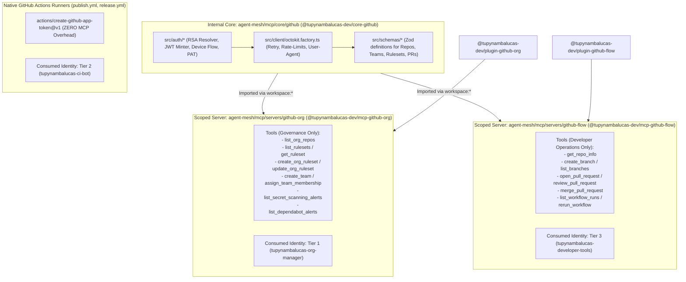
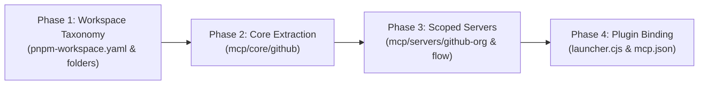

# Enterprise Architectural Analysis: Monolithic vs. Domain-Scoped MCP Servers and Bounded Context Directory Taxonomy in Agent Mesh

**Document Reference**: `agent-mesh/.agents/analyses/mcp-architecture-single-vs-modular-github-apps.md`  
**Classification**: Senior Enterprise Architectural Analysis & Structural Decision Record  
**Target Architecture**: Tupynambalucas Agent Mesh, MCP Subsystem & Antigravity Plugins  
**Standard**: en-US Technical Specification (Strict Zero-Emoji Policy)  
**Author**: Antigravity Core AI Architecture Team  
**Date**: November 2026  

---

## 1. Executive Summary & Problem Diagnosis

The `tupynambalucas-dev` organization enforces a sovereign **Three-Tier GitHub App Identity Architecture**:
- **Tier 1 (`tupynambalucas-org-manager`)**: High-privilege administrative machine identity (App ID: `5648756`) governing organization rulesets, teams, custom roles, and security alerts via RS256 JWTs and 2048-bit RSA private keys.
- **Tier 2 (`tupynambalucas-ci-bot`)**: Autonomous continuous delivery identity (App ID: `5650100`) executing automated packaging, releases, and dependency PRs in GitHub Actions runners.
- **Tier 3 (`tupynambalucas-developer-tools`)**: Public client machine identity (App ID: `5650238`) enabling human engineers on workstations via OAuth 2.0 Device Flow (`https://github.com/login/device`) without private keys.

Within `agent-mesh`, two distinct Antigravity domain plugins govern GitHub operations:
- [`@tupynambalucas-dev/plugin-github-org`](../../plugins/packages/github-org): Governs organizational policy, branch protection rulesets, security triaging, and team provisioning.
- [`@tupynambalucas-dev/plugin-github-flow`](../../plugins/packages/github-flow): Orchestrates developer Git workflows, Conventional Commits, Pull Request authoring, and CI/CD diagnosis.

### The Two Intertwined Architectural Dilemmas

1. **Protocol Server Partitioning**: Should `agent-mesh` maintain a single monolithic `@tupynambalucas-dev/mcp-github` server for both `org-manager` and `developer-tools`, or should it partition them into dedicated, domain-scoped MCP servers (`@tupynambalucas-dev/mcp-github-org` and `@tupynambalucas-dev/mcp-github-flow`)?
2. **Monorepo Directory Taxonomy & Core Package Isolation**: If domain-scoped MCP servers are created, placing an internal shared core library (e.g. `github-core`) inside `agent-mesh/mcp/packages/` violates the Bounded Context and single-responsibility principles. The folder `packages/` is conventionally understood as deployable/publishable targets. How should `agent-mesh/mcp/` and `agent-mesh/plugins/` be structured to cleanly segregate **deployable servers/plugins** from **internal shared core packages**, and how does this impact `pnpm-workspace.yaml`, `turbo.json`, `tsconfig.json`, and CI/CD actions?

---

## 2. Theoretical Framework & State-of-the-Art Evidence (Firecrawl Research)

To ground our architectural decision in validated industry standards, we draw upon research retrieved from the official **Model Context Protocol Specification**, peer-reviewed context engineering literature (arXiv:2505.03275), and distributed MCP gateway engineering.

### 2.1 Scope Minimization & The Confused Deputy Vulnerability (MCP Security Spec)

The official **Model Context Protocol Security Specification** (`modelcontextprotocol.io/tutorials/security/security_best_practices`) explicitly cautions against monolithic tool aggregations under its *Scope Minimization* mandate:

```
"Poor scope design increases token compromise impact, elevates user friction, 
and obscures audit trails. An attacker obtains an access token carrying broad 
scopes (files:*, db:*, admin:*) that were granted up front because the MCP server 
exposed every scope in scopes_supported and the client requested them all... 
Implement a progressive, least-privilege scope model containing only low-risk 
discovery operations and targeted challenges for privileged operations."
```

When a single MCP server aggregates both administrative tools (`create_team`, `update_ruleset`) and developer tools (`create_branch`, `open_pr`), it introduces two severe security vulnerabilities:
1. **Privilege Chaining via Mixed Identity Runtimes**: An unprivileged agent acting on behalf of a standard developer can attempt to invoke high-privilege administrative tools. If the server is authenticated via Tier 1 credentials (e.g. on a lead architect machine or cluster pod), the developer agent accidentally gains administrative reach—a classic **Confused Deputy** attack.
2. **Audit Attribution Pollution**: In GitHub Enterprise audit logs, operations signed by Tier 1 are attributed to `@tupynambalucas-org-manager[bot]`, whereas developer operations must be attributed to the individual human developer via Tier 3 User Access Tokens. A monolithic server muddies attribution boundaries.

### 2.2 Context Rot & The "Too Many Tools" Problem (Context Engineering Benchmarks)

In modern LLM agent orchestration, stuffing dozens of tool schemas into a single model prompt triggers **Context Rot**—a phenomenon where excessive tool definitions degrade reasoning, induce parameter hallucinations, and consume disproportionate token budgets.

Recent empirical research on retrieval-augmented MCP tooling (*RAG-MCP*, Weaver et al., 2025; arXiv:2505.03275) and enterprise MCP gateway benchmarks demonstrate:
- **Token Tax**: Each tool schema registered with an LLM consumes between 150 and 400 prompt tokens. A monolithic GitHub server exposing 25 comprehensive tools incurs a static tax of 4,000 to 10,000 tokens on **every single conversational turn**, consuming 15% to 25% of standard context windows before developer code is even ingested.
- **Tool-Calling Accuracy Degradation**: Studies confirm that exposing more than 15-20 active tools to an agent causes a **3x increase in tool-selection errors**, as semantic boundaries between similar tools blur.
- **Hard Host Constraints**: Leading MCP host environments enforce strict hard ceilings on active tools:
  - **Cursor**: Hard limit of **40 active MCP tools** across all registered servers. Exceeding this limit causes Cursor to truncate remaining tools without notice.
  - **GitHub Copilot Chat**: Hard ceiling of **128 tools** before forcing virtual tool pruning.

As concluded by enterprise MCP architects:
> *"Don't create a single MCP server for everything, but instead create different MCPs for different goals. Build your MCP server around a user's workflow rather than around the underlying API. Scoped MCP servers work substantially better."* (Demiliani, Microsoft MVP, 2025).

---

## 3. Monorepo Directory Taxonomy: Clean Architecture for `mcp/` and `plugins/`

In enterprise monorepo engineering (Turborepo, pnpm workspaces, Nx), bundling internal shared libraries in the same directory as deployable applications causes operational ambiguity:
- Build tools struggle to distinguish between packages meant for public distribution and packages meant purely for internal composition.
- CI/CD publish scripts (`pnpm -r publish`) require fragile manual exclusion filters.
- Developers navigating the codebase cannot easily identify entrypoints versus shared utilities.

### 3.1 Taxonomy Models Comparison

```
+---------------------------------------------------------------------------------------------------+
| Model A: Flat Packages (Current State)                                                            |
| agent-mesh/mcp/packages/github-core  <-- Anti-pattern: Internal library mixed with servers        |
| agent-mesh/mcp/packages/github       <-- Deployable server                                        |
+---------------------------------------------------------------------------------------------------+
| Model B: Subsystem-Internal Partitioning (Recommended Enterprise Pattern)                         |
| agent-mesh/mcp/servers/*             <-- Deployable MCP servers (@tupynambalucas-dev/mcp-*)       |
| agent-mesh/mcp/core/*                <-- Internal shared MCP libraries (@tupynambalucas-dev/core-*)|
| agent-mesh/plugins/packages/*        <-- Deployable domain plugins (@tupynambalucas-dev/plugin-*) |
| agent-mesh/plugins/core/*            <-- Internal shared plugin utilities                         |
+---------------------------------------------------------------------------------------------------+
| Model C: Monorepo Root Core Partitioning                                                          |
| agent-mesh/mcp/packages/*            <-- Deployable MCP servers                                   |
| agent-mesh/plugins/packages/*        <-- Deployable domain plugins                                |
| agent-mesh/core/*                    <-- Generic shared libraries at the root                     |
+---------------------------------------------------------------------------------------------------+
```

### 3.2 Why Model B (Subsystem-Internal Partitioning) is Superior

Model B aligns with **Domain-Driven Design (DDD)** and the **3-Layer Bounded Context Ceiling** enforced by our enterprise rules:
1. **High Subsystem Cohesion**:
   - The MCP protocol stack (`Fastify`, `@modelcontextprotocol/sdk`, `@octokit/auth-app`, `Octokit`) is unique to the MCP subsystem. Placing `github-core` under `agent-mesh/mcp/core/github` keeps MCP dependencies isolated from the root monorepo.
   - Domain plugins (`plugin-*`) operate under the Antigravity manifest schema (`plugin.json`, `mcp_config.json`, `rules/`, `skills/`). If plugins require shared governance utilities (e.g. shared AST linters, hook helpers), they belong in `agent-mesh/plugins/core/`.
2. **Clear Intent and Role Naming**:
   - `mcp/servers/<name>`: Contains executable server daemons exporting JSON-RPC tools.
   - `mcp/core/<name>`: Contains non-executable, reusable library modules exporting typed functions, client factories, and schemas.
   - `plugins/packages/<name>`: Contains deployable Antigravity domain plugins loaded by agents.
   - `plugins/core/<name>`: Contains reusable rule engines, hook validators, or shared skill assets.
3. **Publication Hygiene via `private: true`**:
   - Packages in `mcp/core/*` and `plugins/core/*` declare `"private": true` in their `package.json`.
   - Native `pnpm -r publish` automatically ignores private packages, guaranteeing that internal libraries are never accidentally published to npm or GitHub Packages.

---

## 4. Package Naming and Domain Taxonomy Matrix

In compliance with Organization Rule 6 (*Enterprise Package Name & Scope Invariant*), all packages across the organization use the `@tupynambalucas-dev/` npm scope:

| Physical Directory Path | Package Name (`package.json`) | Package Type | Visibility | Consumed Identity / Purpose |
| :--- | :--- | :--- | :--- | :--- |
| `mcp/core/github` | `@tupynambalucas-dev/core-github` (or `@tupynambalucas-dev/mcp-core-github`) | Internal Library | `private: true` | Shared Octokit factory, RSA/Base64/Device Flow auth engine, Zod schemas |
| `mcp/servers/github-org` | `@tupynambalucas-dev/mcp-github-org` | Deployable Server | Public (`publishConfig`) | Tier 1 (`org-manager`): Org rulesets, teams, custom roles, secret scanning |
| `mcp/servers/github-flow` | `@tupynambalucas-dev/mcp-github-flow` | Deployable Server | Public (`publishConfig`) | Tier 3 (`developer-tools`): PRs, issues, commits, branches, workflow checks |
| `mcp/servers/playwright` | `@tupynambalucas-dev/mcp-playwright` | Deployable Server | Public (`publishConfig`) | Headless browser automation daemon |
| `mcp/servers/appsheet` | `@tupynambalucas-dev/mcp-appsheet` | Deployable Server | Public (`publishConfig`) | AppSheet REST API v2 operator |
| `mcp/servers/gwork` | `@tupynambalucas-dev/mcp-gwork` | Deployable Server | Public (`publishConfig`) | Google Workspace Drive & Sheets synthesizer |
| `mcp/servers/infisical` | `@tupynambalucas-dev/mcp-infisical` | Deployable Server | Public (`publishConfig`) | Infisical Vault secret management |
| `mcp/servers/memory` | `@tupynambalucas-dev/mcp-memory` | Deployable Server | Public (`publishConfig`) | Cortex agent memory backend |
| `plugins/packages/github-org` | `@tupynambalucas-dev/plugin-github-org` | Antigravity Plugin | Public (`publishConfig`) | Binds to `mcp-github-org` |
| `plugins/packages/github-flow` | `@tupynambalucas-dev/plugin-github-flow` | Antigravity Plugin | Public (`publishConfig`) | Binds to `mcp-github-flow` |
| `plugins/packages/*` | `@tupynambalucas-dev/plugin-<slug>` | Antigravity Plugin | Public (`publishConfig`) | Domain-specific agent plugins |
| `plugins/core/*` | `@tupynambalucas-dev/plugin-core-<slug>` | Internal Library | `private: true` | Shared plugin hooks, linters, preflight scripts |

---

## 5. Architectural Topology: Scoped Surface with Shared Core

The complete architecture decouples protocol execution, shared logic, and machine identities:



---

## 6. Monorepo Configuration Impact Analysis

Restructuring `mcp/` and `plugins/` into `servers/` and `core/` touches the following configuration boundaries across `agent-mesh`:

### 6.1 `pnpm-workspace.yaml`
The workspace manifest must register both the deployable packages and the core libraries:

```yaml
packages:
  - 'mcp/servers/*'
  - 'mcp/core/*'
  - 'plugins/packages/*'
  - 'plugins/core/*'

registries:
  default: 'https://registry.npmjs.org/'
  '@tupynambalucas-dev': 'https://npm.pkg.github.com/'

catalogs:
  shared:
    zod: ^3.24.2
    dotenv: ^16.4.7

  mcp-stack:
    '@modelcontextprotocol/sdk': ^1.6.1
    fastify: ^5.2.1
    '@octokit/auth-app': ^7.1.5
    '@octokit/core': ^6.1.4
```

### 6.2 Turborepo Task Graph (`turbo.json`)
Turborepo handles internal package dependencies automatically using topological sorting:

```json
{
  "$schema": "https://turbo.build/schema.json",
  "globalEnv": ["NODE_ENV"],
  "tasks": {
    "build": {
      "dependsOn": ["^build"],
      "inputs": ["$TURBO_DEFAULT$", ".env*"],
      "outputs": ["dist/**"]
    },
    "typecheck": {
      "dependsOn": ["^typecheck"]
    }
  }
}
```
Because `mcp-github-org` declares `"@tupynambalucas-dev/core-github": "workspace:*"` in its dependencies, `"dependsOn": ["^build"]` guarantees that Turborepo **always compiles `core-github` first**, before initiating compilation of `mcp-github-org`.

### 6.3 TypeScript Solution Architecture (`tsconfig.json` & `tsconfig.base.json`)
The solution-style root `tsconfig.json` must reference both core libraries and server implementations:

```json
{
  "$schema": "https://json.schemastore.org/tsconfig",
  "files": [],
  "references": [
    { "path": "./mcp/core/github" },
    { "path": "./mcp/servers/github-org" },
    { "path": "./mcp/servers/github-flow" },
    { "path": "./mcp/servers/playwright" },
    { "path": "./mcp/servers/appsheet" },
    { "path": "./mcp/servers/firecrawl" },
    { "path": "./mcp/servers/gwork" },
    { "path": "./mcp/servers/infisical" },
    { "path": "./mcp/servers/memory" }
  ]
}
```
In `mcp/servers/github-org/tsconfig.json`:
```json
{
  "extends": "../../../tsconfig.base.json",
  "compilerOptions": {
    "outDir": "./dist",
    "rootDir": "./src"
  },
  "references": [
    { "path": "../../core/github" }
  ]
}
```

### 6.4 Root `package.json` Scripts
Root scripts are updated to account for the new taxonomy:

```json
{
  "scripts": {
    "build": "turbo run build",
    "mcp:build": "turbo run build --filter=\"@tupynambalucas-dev/mcp-*\" --filter=\"@tupynambalucas-dev/core-*\"",
    "packages:publish": "pnpm -r publish --access public --no-git-checks --report-summary"
  }
}
```
When `packages:publish` runs, `pnpm` inspects all packages in the workspace. Any package with `"private": true` (such as `@tupynambalucas-dev/core-github`) is automatically skipped, ensuring zero accidental publication.

### 6.5 GitHub Actions Workflows & Composite Actions
1. **`.github/actions/build-mcp/action.yml`**:
   No changes required; it executes `pnpm mcp:build`, which Turborepo orchestrates via dependency graph.
2. **`.github/actions/validate-plugins/action.yml`**:
   Scans `plugins/packages/` for `plugin.json` manifests, ignoring `plugins/core/` internal libraries.
3. **`.github/workflows/publish.yml`**:
   Continues to publish workspace packages using `pnpm run packages:publish` without modification.
4. **Plugin Launchers (`launcher.cjs`)**:
   Updated to resolve local binaries at `../../mcp/servers/<name>/dist/bin.js` instead of `../../mcp/packages/<name>/dist/bin.js`.

---

## 7. Migration Roadmap

To transition `agent-mesh` into this enterprise standard without disruption:



1. **Phase 1: Directory Restructuring**:
   - Rename `agent-mesh/mcp/packages/` to `agent-mesh/mcp/servers/`.
   - Create `agent-mesh/mcp/core/` and `agent-mesh/plugins/core/`.
   - Update `pnpm-workspace.yaml` and `tsconfig.json`.
2. **Phase 2: Shared Core Extraction (`@tupynambalucas-dev/core-github`)**:
   - Extract `config.ts`, `auth/`, and Octokit client creation into `mcp/core/github`.
   - Mark as `"private": true` and expose TypeScript project reference.
3. **Phase 3: Scoped Servers Implementation**:
   - Rename existing server to `@tupynambalucas-dev/mcp-github-org` (Tier 1 governance tools).
   - Scaffold `@tupynambalucas-dev/mcp-github-flow` (Tier 3 developer tools).
   - Depend on `@tupynambalucas-dev/core-github: "workspace:*"`.
4. **Phase 4: Plugin Binding & Validation**:
   - Update `plugins/packages/github-org/mcp.json` to launch `github-org`.
   - Update `plugins/packages/github-flow/mcp.json` to launch `github-flow`.
   - Run `pnpm build`, `pnpm typecheck`, and contract tests.

---

## 8. Conclusion

The user's insight is architecturally sound: mixing internal libraries inside a generic `packages/` directory creates confusion, complicates publishing, and breaks Bounded Context separation.

By adopting **Subsystem-Internal Partitioning**:
- `agent-mesh/mcp/servers/` houses deployable Model Context Protocol daemons.
- `agent-mesh/mcp/core/` houses private, shared internal libraries.
- `agent-mesh/plugins/packages/` houses sovereign Antigravity domain plugins.
- `agent-mesh/plugins/core/` houses shared plugin governance and AST linters.

This establishes a modular, audit-compliant, and token-efficient AI agent mesh aligned with Google Antigravity, Turborepo, and modern MCP security specifications.
