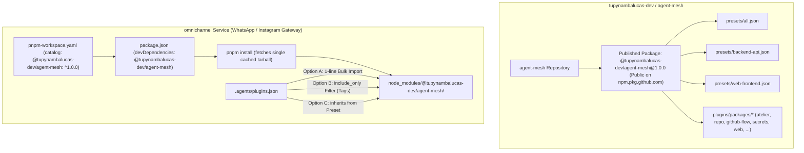

# Agent Plugins Enterprise Distribution, Presets & Cross-Repository Consumption Architecture
**Organization**: `tupynambalucas-dev`  
**Target Monorepo**: `tupynambalucas-dev/agent-mesh`  
**Consumer Workspaces**: `omnichannel` (WhatsApp/Instagram API), `platform`, `docs`  
**Domain**: AI Agent Plugins Distribution, Umbrella Meta-Packages, Antigravity Discovery & pnpm Catalogs  
**Document Standard**: en-US Technical Specification (Strict Zero-Emoji Policy)

---

## 1. Executive Summary & Diagnostic of Current State

In the `tupynambalucas-dev` ecosystem, autonomous AI agents operating across standalone repositories (such as the `omnichannel` WhatsApp and Instagram messaging gateway service) require access to the enterprise plugins authored and maintained in `agent-mesh` (`atelier`, `repo`, `github-flow`, `github-org`, `secrets`, `research`, `web`, `docusaurus`, `appsheet`, `gwork`).

An audit of current cross-repository consumption across the organization reveals three distinct, suboptimal integration patterns:

### 1.1 The `omnichannel` Pattern: Git Path Repetition & Manual Explosion
In `omnichannel` (`C:/Users/tupyn/projects/organizations/tupynambalucas-dev/omnichannel`):
- **`pnpm-workspace.yaml`**: Declares 8 individual git subpath dependencies under `catalogs.plugins-stack`:
  ```yaml
  plugins-stack:
    '@tupynambalucas-dev/plugin-atelier': 'github:tupynambalucas-dev/agent-mesh#path:plugins/packages/atelier'
    '@tupynambalucas-dev/plugin-docusaurus': 'github:tupynambalucas-dev/agent-mesh#path:plugins/packages/docusaurus'
    '@tupynambalucas-dev/plugin-github-flow': 'github:tupynambalucas-dev/agent-mesh#path:plugins/packages/github-flow'
    '@tupynambalucas-dev/plugin-github-org': 'github:tupynambalucas-dev/agent-mesh#path:plugins/packages/github-org'
    '@tupynambalucas-dev/plugin-repo': 'github:tupynambalucas-dev/agent-mesh#path:plugins/packages/repo'
    '@tupynambalucas-dev/plugin-research': 'github:tupynambalucas-dev/agent-mesh#path:plugins/packages/research'
    '@tupynambalucas-dev/plugin-secrets': 'github:tupynambalucas-dev/agent-mesh#path:plugins/packages/secrets'
    '@tupynambalucas-dev/plugin-web': 'github:tupynambalucas-dev/agent-mesh#path:plugins/packages/web'
  ```
- **`package.json`**: Lists all 8 plugins individually in `devDependencies`.
- **`.agents/plugins.json`**: Manually lists all 8 entries pointing to `node_modules/@tupynambalucas-dev/plugin-*`.

**Failure Modes**:
1. **Slow Git Installs**: Installing 8 distinct `github:...#path:...` subtrees clones git archives repeatedly, bypassing pnpm's content-addressable tarball cache.
2. **Maintenance Overhead**: Every time a plugin is renamed, deprecated, or added in `agent-mesh`, every consumer service must update 3 separate configuration files across 24 manual lines.
3. **No Domain Tagging**: A backend messaging service (`omnichannel`) has no need for `docusaurus` or `atelier`, but lacks an ergonomic way to declare "give me the backend developer stack".

### 1.2 The `platform` Pattern: Path Traversal Anti-Pattern
In `platform/.agents/plugins.json`:
- Declares `{ "path": "../../agent-mesh/plugins/packages" }`.
- **Critical Failure Mode**: This relative directory traversal breaks immediately whenever `platform` is cloned outside the umbrella `org-core` directory (e.g., in CI/CD runners, Docker containers, or isolated engineer workstations).

### 1.3 The `docs` Pattern: Unpublished Root Dependency
In `docs/package.json`:
- Declares `"@tupynambalucas-dev/agent-mesh": "github:tupynambalucas-dev/agent-mesh"`.
- Because `@tupynambalucas-dev/agent-mesh` has `"private": true`, it cannot be fetched from `npm.pkg.github.com`, forcing a raw git repository clone during `pnpm install`.

---

## 2. Upstream Technical Capabilities & Runtime Specifications

To design an enterprise-grade solution, we synthesize four official platform mechanisms:

### 2.1 Antigravity Customization Discovery Engine (`.agents/plugins.json`)
Per official Google Antigravity runtime documentation (`C:/Users/tupyn/.gemini/antigravity-cli/builtin/skills/agy-customizations/docs/json_configs.md`):

1. **One-Level-Deep Subdirectory Scanning**:
   When an entry in `plugins.json` points to a directory (e.g. `node_modules/@tupynambalucas-dev/agent-mesh/plugins/packages`), the engine **automatically scans all subdirectories one level deep** for `plugin.json` markers. It does NOT require listing each child plugin explicitly.
2. **`include_only` & `exclude` Pattern Filtering**:
   An entry supports tag-like regex or glob filtering:
   ```json
   {
     "entries": [
       {
         "path": "node_modules/@tupynambalucas-dev/agent-mesh/plugins/packages",
         "include_only": ["repo", "github-flow", "secrets", "research", "web"]
       }
     ]
   }
   ```
3. **`inherits` Shared Configuration**:
   A repository's `plugins.json` can inherit presets from an installed dependency:
   ```json
   {
     "inherits": [
       {
         "path": "node_modules/@tupynambalucas-dev/agent-mesh/presets/backend-api.json"
       }
     ]
   }
   ```

### 2.2 pnpm Catalogs (`pnpm-workspace.yaml`)
Per pnpm 9+ and 10+ catalog specifications:
- Catalogs centralize dependency versions across workspace packages.
- When consuming packages published to GitHub Packages (`npm.pkg.github.com`), pnpm resolves them natively using `.npmrc` (`@tupynambalucas-dev:registry=https://npm.pkg.github.com`).
- Standard semver strings (`^1.0.0`) replace fragile `github:...#path:...` git URLs, leveraging pnpm's content-addressable store for sub-second installs.

### 2.3 NPM Umbrella / Bundle Meta-Package Pattern
In major industry ecosystems (e.g., Babel's `@babel/preset-env`, Radix UI's `@radix-ui/react-primitive`, ESLint's plugin suites):
- An **Umbrella Meta-Package** bundles either:
  1. Direct subpath distributions (`package.json` `"files": ["plugins/"]`), shipping all plugin manifests and assets within a single tarball.
  2. Orchestrated dependencies (`dependencies` referencing all individual scoped packages `@tupynambalucas-dev/plugin-*`).

---

## 3. Comparative Architecture Evaluation: 4 Strategic Approaches

| Evaluation Criteria | Approach 1: Granular Registry Packages via pnpm Catalog | Approach 2: Sovereign Umbrella Package (`@tupynambalucas-dev/agent-mesh`) | Approach 3: Domain Presets / Tag Packages (`@tupynambalucas-dev/agent-plugins-*`) | Approach 4: Hybrid Umbrella + Declarative Antigravity Presets (Recommended) |
| :--- | :--- | :--- | :--- | :--- |
| **Number of `package.json` lines in consumer** | High (8-10 lines) | **Minimal (1 line)** | Low (1-2 lines per domain) | **Minimal (1 line)** |
| **`.agents/plugins.json` complexity** | 8-10 entries | 1 directory entry | 1 entry per preset | **1 entry (with `include_only`) OR 1 `inherits` line** |
| **Installation Speed & Network Overhead** | Fast (Registry tarballs) | Fast (Single tarball download) | Fast (Small subset tarballs) | **Maximum (Single cached tarball)** |
| **Granular Tag / Category Selection** | Manual package filtering | Via `include_only` in `plugins.json` | Via preset package choice | **Both: Via preset file OR via `include_only` filter** |
| **Decoupling from Filesystem Paths** | High (in node_modules) | High (in node_modules) | High (in node_modules) | **High (Standard `node_modules` structure)** |
| **Maintenance Burden on Plugin Evolution** | High (consumer must update lists) | **Zero (umbrella auto-includes new plugins)** | Low (update preset definitions) | **Zero (automatic 1-level-deep discovery)** |

---

## 4. The Recommended Enterprise Solution: Hybrid Umbrella + Declarative Presets

We implement **Approach 4**: Transforming `@tupynambalucas-dev/agent-mesh` into a published public umbrella package on GitHub Packages that ships:
1. All domain plugins under `plugins/packages/*`.
2. Standardized declarative preset files under `presets/*.json`.
3. Support for both bulk import ("all plugins at once") and tag/domain filtering ("only backend API plugins") without declaring individual packages.



---

## 5. Ergonomic Consumption Specifications for External Repositories

### 5.1 In `omnichannel` (and any external service)

#### Step 1: Update `.npmrc` (already configured in `omnichannel`)
```ini
@tupynambalucas-dev:registry=https://npm.pkg.github.com
```

#### Step 2: Declare in `pnpm-workspace.yaml`
Replace the 8 individual git lines with a single, clean catalog entry:
```yaml
catalogs:
  plugins-stack:
    '@tupynambalucas-dev/agent-mesh': ^1.0.0
```

#### Step 3: Declare in `package.json`
Remove the 8 individual plugin dependencies. Add only the umbrella package:
```json
{
  "devDependencies": {
    "@tupynambalucas-dev/agent-mesh": "catalog:plugins-stack"
  }
}
```

#### Step 4: Configure `.agents/plugins.json`

Developers have three clean, enterprise options depending on their granularity needs:

##### Pattern A: Zero-Declaration Bulk Import (All Current and Future Plugins)
Scans all plugins in the umbrella package automatically with **a single line**:
```json
{
  "entries": [
    {
      "path": "node_modules/@tupynambalucas-dev/agent-mesh/plugins/packages"
    }
  ]
}
```
*Benefit*: When `agent-mesh` publishes a new plugin, `omnichannel` automatically receives it on `pnpm update` with zero configuration changes.

##### Pattern B: Tag-Based / Subset Import via `include_only`
Imports only the exact domain plugins relevant to the messaging service without installing separate packages:
```json
{
  "entries": [
    {
      "path": "node_modules/@tupynambalucas-dev/agent-mesh/plugins/packages",
      "include_only": [
        "repo",
        "github-flow",
        "secrets",
        "research",
        "web"
      ]
    }
  ]
}
```
*Benefit*: Excludes `docusaurus`, `appsheet`, and `atelier` from the agent's active context window, saving LLM token budget.

##### Pattern C: Declarative Preset Inheritance (`inherits`)
Points to an authoritative preset provided by the umbrella package:
```json
{
  "inherits": [
    {
      "path": "node_modules/@tupynambalucas-dev/agent-mesh/presets/backend-api.json"
    }
  ]
}
```
*Benefit*: Centralizes what "backend-api" means inside `agent-mesh`, so all backend microservices share identical plugin presets.

---

## 6. Implementation Architecture in `agent-mesh`

To enable this model, `agent-mesh` requires three concrete enhancements:

### 6.1 Publishing `@tupynambalucas-dev/agent-mesh` as a Public Package
In `agent-mesh/package.json`:
- Change `"private": true` to `"private": false` (or retain root private and declare a dedicated package `@tupynambalucas-dev/agent-mesh` via `publishConfig`).
- Ensure `"files"` includes:
  ```json
  "files": [
    "plugins/packages/",
    "presets/",
    ".claude-plugin/",
    "README.md",
    "LICENSE"
  ]
  ```

### 6.2 Authoring Authoritative Domain Presets in `agent-mesh/presets/`
Create standardized preset manifests:
- **`agent-mesh/presets/all.json`**:
  ```json
  {
    "entries": [
      { "path": "../plugins/packages" }
    ]
  }
  ```
- **`agent-mesh/presets/backend-api.json`** (Tailored for services like `omnichannel`):
  ```json
  {
    "entries": [
      {
        "path": "../plugins/packages",
        "include_only": ["repo", "github-flow", "secrets", "research", "web"]
      }
    ]
  }
  ```
- **`agent-mesh/presets/documentation-portal.json`** (Tailored for `docs`):
  ```json
  {
    "entries": [
      {
        "path": "../plugins/packages",
        "include_only": ["repo", "github-flow", "docusaurus", "research"]
      }
    ]
  }
  ```

### 6.3 Updating `manage-packages.js` Reconciler
In `agent-mesh/.github/scripts/manage-packages.js`:
- Include `agent-mesh` in `getActivePackages()` when `private === false`.
- Ensure `fetchPackages()` reconciles `@tupynambalucas-dev/agent-mesh` alongside the 19 individual child packages.

---

## 7. Migration Roadmap

1. **Phase 1: Package & Presets Authoring in `agent-mesh`**:
   - Create `presets/` directory with `all.json`, `backend-api.json`, and `documentation-portal.json`.
   - Configure root `package.json` for publishing with explicit `"files"`.
   - Validate publication to `npm.pkg.github.com` via `publish.yml`.
2. **Phase 2: Migration of `omnichannel`**:
   - Replace 8 Git URLs in `pnpm-workspace.yaml` with `@tupynambalucas-dev/agent-mesh: ^1.0.0`.
   - Update `package.json` to depend only on `@tupynambalucas-dev/agent-mesh`.
   - Update `.agents/plugins.json` to use Pattern B (`include_only`) or Pattern C (`inherits`).
   - Run `pnpm install` and verify agent plugin discovery via Antigravity.
3. **Phase 3: Migration of `platform` and `docs`**:
   - Eliminate `../../agent-mesh/plugins/packages` traversal in `platform/.agents/plugins.json`.
   - Replace `github:tupynambalucas-dev/agent-mesh` with registry dependency in `docs`.
