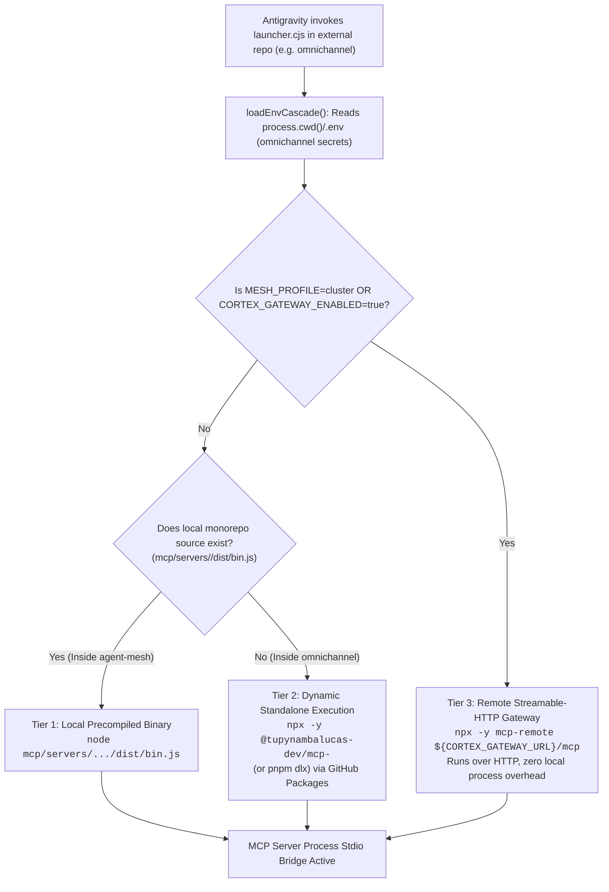
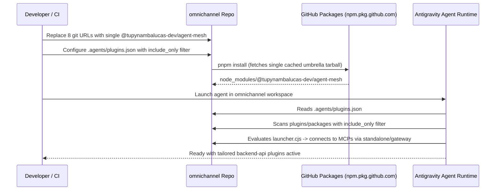

# Agent Plugins Enterprise Distribution, Presets & Cross-Repository Consumption Architecture
**Organization**: `tupynambalucas-dev`  
**Target Monorepo**: `tupynambalucas-dev/agent-mesh`  
**Consumer Workspaces**: `omnichannel` (WhatsApp/Instagram Gateway API), `platform`, `docs`  
**Domain**: AI Agent Plugins Distribution, Umbrella Meta-Packages, Antigravity Discovery, Cross-Repo MCP Runtimes  
**Document Standard**: en-US Technical Specification (Strict Zero-Emoji Policy)

> [!IMPORTANT]
> **Implementation Status & Post-Execution Evolution (`v1.2.0`)**:
> This architectural blueprint has been implemented and extended with **Self-Contained `tsup` MCP Bundling (`dist/bin.cjs`)**, **Two-Tier Sovereign Launchers**, and **Zero-Token Git Package Distribution (`github:tupynambalucas-dev/agent-mesh`)** to bypass GitHub Packages' mandatory `read:packages` token requirement on unauthenticated installs. For the active operational specification, see [Umbrella Package & Presets Specification](../../references/reference/umbrella-package-and-presets.md) and [Consuming Plugins in Antigravity and Claude Code](../../references/how-to-guides/consuming-plugins-in-antigravity-and-claude.md).

---

## 1. Executive Summary & Diagnostic of Current State

In the `tupynambalucas-dev` ecosystem, autonomous AI agents operating across standalone repositories (such as the `omnichannel` WhatsApp and Instagram messaging gateway service) require access to the enterprise plugins authored and maintained in `agent-mesh` (`atelier`, `repo`, `github-flow`, `github-org`, `secrets`, `research`, `web`, `docusaurus`, `appsheet`, `gwork`).

An audit of current cross-repository consumption across the organization reveals three distinct, suboptimal integration patterns:

### 1.1 The `omnichannel` Pattern: Git Path Repetition & Manual Explosion
In `omnichannel` (`C:/Users/tupyn/projects/organizations/tupynambalucas-dev/omnichannel`):
- **`pnpm-workspace.yaml`**: Declares 8 individual git subpath dependencies under `catalogs.plugins-stack`:
  ```yaml
  plugins-stack:
    '@tupynambalucas-dev/plugin-atelier': 'github:tupynambalucas-dev/agent-mesh#path:plugins/packages/atelier'
    '@tupynambalucas-dev/plugin-docusaurus': 'github:tupynambalucas-dev/agent-mesh#path:plugins/packages/docusaurus'
    '@tupynambalucas-dev/plugin-github-flow': 'github:tupynambalucas-dev/agent-mesh#path:plugins/packages/github-flow'
    '@tupynambalucas-dev/plugin-github-org': 'github:tupynambalucas-dev/agent-mesh#path:plugins/packages/github-org'
    '@tupynambalucas-dev/plugin-repo': 'github:tupynambalucas-dev/agent-mesh#path:plugins/packages/repo'
    '@tupynambalucas-dev/plugin-research': 'github:tupynambalucas-dev/agent-mesh#path:plugins/packages/research'
    '@tupynambalucas-dev/plugin-secrets': 'github:tupynambalucas-dev/agent-mesh#path:plugins/packages/secrets'
    '@tupynambalucas-dev/plugin-web': 'github:tupynambalucas-dev/agent-mesh#path:plugins/packages/web'
  ```
- **`package.json`**: Lists all 8 plugins individually in `devDependencies`.
- **`.agents/plugins.json`**: Manually lists all 8 entries pointing to `node_modules/@tupynambalucas-dev/plugin-*`.

**Failure Modes**:
1. **Slow Git Installs**: Installing 8 distinct `github:...#path:...` subtrees clones git archives repeatedly, bypassing pnpm's content-addressable tarball cache.
2. **Maintenance Overhead**: Every time a plugin is renamed, deprecated, or added in `agent-mesh`, every consumer service must update 3 separate configuration files across 24 manual lines.
3. **No Domain Tagging**: A backend messaging service (`omnichannel`) has no need for `docusaurus` or `atelier`, but lacks an ergonomic way to declare "give me the backend developer stack".

### 1.2 The `platform` Pattern: Path Traversal Anti-Pattern
In `platform/.agents/plugins.json`:
- Declares `{ "path": "../../agent-mesh/plugins/packages" }`.
- **Critical Failure Mode**: This relative directory traversal breaks immediately whenever `platform` is cloned outside the umbrella `org-core` directory (e.g., in CI/CD runners, Docker containers, or isolated engineer workstations).

### 1.3 The `docs` Pattern: Unpublished Root Dependency
In `docs/package.json`:
- Declares `"@tupynambalucas-dev/agent-mesh": "github:tupynambalucas-dev/agent-mesh"`.
- Because `@tupynambalucas-dev/agent-mesh` has `"private": true`, it cannot be fetched from `npm.pkg.github.com`, forcing a raw git repository clone during `pnpm install`.

---

## 2. Upstream Runtime Capabilities: Antigravity Discovery & Packaging

Antigravity operates as a filesystem-based agent customization engine. To evaluate packaging approaches, we analyze how it discovers and evaluates plugin manifests:

### 2.1 Antigravity Customization Discovery Engine (`.agents/plugins.json`)
Per official Google Antigravity runtime documentation (`~/.gemini/antigravity-cli/builtin/skills/agy-customizations/docs/json_configs.md`):

1. **One-Level-Deep Subdirectory Scanning**:
   When an entry in `plugins.json` points to a directory (e.g. `node_modules/@tupynambalucas-dev/agent-mesh/plugins/packages`), the engine **automatically scans all subdirectories one level deep** for `plugin.json` markers. It does NOT require listing each child plugin explicitly.
2. **`include_only` & `exclude` Pattern Filtering**:
   An entry supports tag-like regex or glob filtering:
   ```json
   {
     "entries": [
       {
         "path": "node_modules/@tupynambalucas-dev/agent-mesh/plugins/packages",
         "include_only": ["repo", "github-flow", "secrets", "research", "web"]
       }
     ]
   }
   ```
3. **`inherits` Shared Configuration**:
   A repository's `plugins.json` can inherit presets from an installed dependency:
   ```json
   {
     "inherits": [
       {
         "path": "node_modules/@tupynambalucas-dev/agent-mesh/presets/backend-api.json"
       }
     ]
   }
   ```
4. **Machine-Wide Discovery (`~/.gemini/config/plugins/`)**:
   Antigravity scans the user's home configuration directory (`~/.gemini/config/plugins/` or `%USERPROFILE%\.gemini\config\plugins\` on Windows) by default. Any directory placed in this folder containing a `plugin.json` is loaded across every project on the workstation without local repository configuration.

---

## 3. Analysis: Is `node_modules` Strictly Required? (Evaluation of 3 Installation Modalities)

A primary architectural question is whether consuming repositories MUST install `@tupynambalucas-dev/agent-mesh` into local `node_modules`, or if zero-`node_modules` consumption is feasible and enterprise-compliant.

```mermaid
flowchart TD
    subgraph Modality1 ["Modality 1: Project-Scoped node_modules (Standard Enterprise)"]
        A1["External Repo (omnichannel)"] --> B1["pnpm add -D @tupynambalucas-dev/agent-mesh"]
        B1 --> C1["node_modules/@tupynambalucas-dev/agent-mesh"]
        C1 --> D1[".agents/plugins.json points to node_modules"]
        D1 --> E1["Deterministic in CI/CD, Git, and Dev Machines"]
    end

    subgraph Modality2 ["Modality 2: Machine-Wide Global Plugin Cache (Zero node_modules in Project)"]
        A2["Engineer Workstation"] --> B2["gh tl onboard OR pnpm add -g @tupynambalucas-dev/agent-mesh"]
        B2 --> C2["~/.gemini/config/plugins/agent-mesh"]
        C2 --> D2["External Repo has 0 lines in package.json & 0 node_modules"]
        D2 --> E2["Requires local environment setup; breaks on vanilla CI"]
    end

    subgraph Modality3 ["Modality 3: Git Sparse-Checkout / Cache Directory (Zero NPM)"]
        A3["External Repo"] --> B3["git clone --depth 1 into .agents/mesh"]
        B3 --> C3[".agents/plugins.json points to .agents/mesh/plugins/packages"]
        C3 --> D3["Zero NPM registry dependencies"]
        D3 --> E3["Requires Git sub-tree sync scripts"]
    end
```



### 3.1 Modality Comparison Matrix

| Criteria | Modality 1: Project `node_modules` (Recommended) | Modality 2: Global `~/.gemini/config/plugins/` | Modality 3: Sparse Git Tree `.agents/mesh/` |
| :--- | :--- | :--- | :--- |
| **Project `node_modules` Presence** | Yes (in `devDependencies`) | **Zero (Clean repo)** | **Zero (Clean repo)** |
| **Reproducibility in CI/CD** | **100% (Locked in `pnpm-lock.yaml`)** | Low (Requires CI provisioning step) | Medium (Requires git clone step in CI) |
| **Team Synchronization** | **Automatic on `pnpm install`** | Manual (Engineers must run CLI setup) | Requires composite git actions |
| **Version Pinning & Semver** | **Strict (`^1.0.0` or pinned version)** | Unpinned (Machine-wide version) | Git commit ref / tag |
| **Config Complexity in Consumer** | 1 line in `pnpm-workspace.yaml`, 1 in `plugins.json` | **0 lines in `package.json`, 0 in `plugins.json`** | 1 line in `plugins.json` + checkout script |
| **Suitability for Production CI** | **Enterprise Standard** | Developer Workstation Only | Air-Gapped Git Environments |

### 3.2 Verdict on `node_modules`
- **For Local Development**: Engineers CAN use Modality 2 (installing or symlinking `@tupynambalucas-dev/agent-mesh` into `~/.gemini/config/plugins/agent-mesh`), completely bypassing `node_modules` in their local repositories.
- **For Organizational Production (Enterprise Standard)**: Modality 1 (consuming `@tupynambalucas-dev/agent-mesh` via `node_modules` locked by pnpm) remains the canonical, tamper-proof pattern because it guarantees that GitHub Actions CI, Docker builds, and new team members experience identical agent behavior without out-of-band machine configuration.

---

## 4. Cross-Repository MCP Server Execution Architecture

A critical architectural consideration is: **How do our MCP servers (`@tupynambalucas-dev/mcp-*`) work when invoked from an external repository like `omnichannel`?**

### 4.1 The Three-Tier MCP Launcher Architecture
Every plugin authored in `agent-mesh` includes an authoritative sovereign launcher: `plugins/packages/<plugin>/scripts/launcher.cjs`. When Antigravity activates a plugin from `node_modules` in an external repository, it invokes the launcher via `mcp_config.json`:

```json
{
  "mcpServers": {
    "github-org": {
      "command": "node",
      "args": ["./scripts/launcher.cjs", "github-org"]
    }
  }
}
```

The launcher dynamically resolves the execution environment across three hierarchical tiers:



### 4.2 Tier Breakdown:
1. **Tier 1 (Internal Monorepo Fast-Path)**:
   - When running directly inside `agent-mesh`, the launcher detects `mcp/servers/<service>/dist/bin.js` and runs the precompiled binary directly.
2. **Tier 2 (External Repository Standalone Execution - The `omnichannel` Case)**:
   - When running inside `omnichannel`, the local monorepo path does not exist.
   - The launcher immediately falls back to `npx -y @tupynambalucas-dev/mcp-<service>`.
   - Because `omnichannel` has `.npmrc` configured with `@tupynambalucas-dev:registry=https://npm.pkg.github.com`, npm/pnpm downloads and runs the published MCP server package on demand.
3. **Tier 3 (Centralized Kubernetes Cluster Gateway)**:
   - When operating inside a cluster or cloud environment (`MESH_PROFILE=cluster`), the launcher routes tool execution via `mcp-remote` to the centralized Kubernetes Cortex Gateway (`http://gateway.cortex.svc.cluster.local:8080/mcp`).
   - Requires zero local Node.js binaries or dependencies.

### 4.3 Environment Variable & Secret Cascade Across Repositories
How do MCP tools get credentials (`GITHUB_TOKEN`, `INFISICAL_*`, `APPSHEET_*`) when running from another repository?
- In `launcher.cjs`, `loadEnvCascade()` inspects `path.resolve(process.cwd(), '.env')`.
- When Antigravity runs in `omnichannel`, `process.cwd()` is `C:/.../omnichannel`.
- Therefore, `omnichannel/.env` is read automatically into `process.env`.
- Any token configured in the consumer repository (or injected via Infisical Universal Auth) is inherited by the spawned MCP process with zero cross-repository leakage and zero hardcoded credentials.

---

## 5. Granular vs. Bulk vs. Tagged Plugin Consumption in Hybrid Umbrella

The **Hybrid Umbrella** architecture solves the dilemma of importing all plugins vs. importing only selected ones, while requiring only ONE package installation in the consumer repository:

```
@tupynambalucas-dev/agent-mesh (Single Package on GitHub Packages)
├── plugins/
│   └── packages/
│       ├── atelier/         (Agent plugins, hooks, context routers)
│       ├── repo/            (README, licenses, monorepo, standards)
│       ├── github-flow/     (Git flow, PRs, actions)
│       ├── github-org/      (Teams, RBAC, rulesets, security)
│       ├── secrets/         (Infisical vault, secret rotation)
│       ├── research/        (Firecrawl, Context7)
│       ├── web/             (Playwright browser automation)
│       ├── docusaurus/      (Docusaurus v3 documentation)
│       ├── appsheet/        (AppSheet relational models & API)
│       └── gwork/           (Google Workspace, Sheets, Docs, Drive)
└── presets/
    ├── all.json             (Imports all 10 plugins)
    ├── backend-api.json     (repo, github-flow, secrets, research, web)
    ├── frontend-web.json    (repo, github-flow, secrets, web, research)
    └── docs-portal.json     (repo, github-flow, docusaurus, research)
```

### 5.1 Pattern 1: Bulk Import (All Plugins at Once)
For projects that want the complete organizational agent capability:
- **`package.json`**:
  ```json
  {
    "devDependencies": {
      "@tupynambalucas-dev/agent-mesh": "catalog:plugins-stack"
    }
  }
  ```
- **`.agents/plugins.json`**:
  ```json
  {
    "entries": [
      {
        "path": "node_modules/@tupynambalucas-dev/agent-mesh/plugins/packages"
      }
    ]
  }
  ```
Because Antigravity automatically scans 1 level deep, pointing to `plugins/packages` instantly mounts all 10 plugins.

### 5.2 Pattern 2: Tag-Based / Filtered Selection (Selective Import)
For projects like `omnichannel` that want only specific capabilities without downloading multiple packages:
- **`package.json`**: Exactly the same single package (`@tupynambalucas-dev/agent-mesh`).
- **`.agents/plugins.json`**:
  ```json
  {
    "entries": [
      {
        "path": "node_modules/@tupynambalucas-dev/agent-mesh/plugins/packages",
        "include_only": [
          "repo",
          "github-flow",
          "secrets",
          "research",
          "web"
        ]
      }
    ]
  }
  ```
*Benefit*: Only loads the 5 specified plugins into the agent's prompt context, saving LLM tokens while maintaining single-dependency simplicity.

### 5.3 Pattern 3: Declarative Preset Inheritance
For microservices wanting standardized configurations without maintaining plugin lists:
- **`.agents/plugins.json`**:
  ```json
  {
    "inherits": [
      {
        "path": "node_modules/@tupynambalucas-dev/agent-mesh/presets/backend-api.json"
      }
    ]
  }
  ```

### 5.4 Pattern 4: Individual Standalone Packages (Granular Fallback)
If a consumer repository strictly refuses to download the umbrella package and only wants a single plugin (e.g. only `@tupynambalucas-dev/plugin-repo`):
- All 10 `@tupynambalucas-dev/plugin-*` packages remain published as standalone packages on GitHub Packages.
- The consumer installs only `@tupynambalucas-dev/plugin-repo` and points `"path": "node_modules/@tupynambalucas-dev/plugin-repo"`.

---

## 6. Implementation Architecture in `agent-mesh`

To activate the Hybrid Umbrella across the organization:

### 6.1 Publishing `@tupynambalucas-dev/agent-mesh`
In `agent-mesh/package.json`:
- Change `"private": true` to `"private": false`.
- Configure `publishConfig`:
  ```json
  "publishConfig": {
    "registry": "https://npm.pkg.github.com",
    "access": "public"
  }
  ```
- Declare explicit publication payload:
  ```json
  "files": [
    "plugins/packages/",
    "presets/",
    ".claude-plugin/",
    "README.md",
    "LICENSE"
  ]
  ```

### 6.2 Authoring Presets in `agent-mesh/presets/`
Create standardized preset manifests:
- `agent-mesh/presets/all.json`
- `agent-mesh/presets/backend-api.json` (Tailored for `omnichannel`)
- `agent-mesh/presets/frontend-web.json`
- `agent-mesh/presets/docs-portal.json` (Tailored for `docs`)

### 6.3 Updating `manage-packages.js` Reconciler
In `agent-mesh/.github/scripts/manage-packages.js`:
- Reconcile `@tupynambalucas-dev/agent-mesh` alongside individual packages, ensuring its GitHub Packages visibility is set to `public`.

---

## 7. Migration Plan for `omnichannel`



1. **Step 1**: In `omnichannel/pnpm-workspace.yaml`, replace 8 git lines with:
   ```yaml
   plugins-stack:
     '@tupynambalucas-dev/agent-mesh': ^1.0.0
   ```
2. **Step 2**: In `omnichannel/package.json`, replace 8 plugin dependencies with:
   ```json
   "@tupynambalucas-dev/agent-mesh": "catalog:plugins-stack"
   ```
3. **Step 3**: In `omnichannel/.agents/plugins.json`, use Pattern B or C.
4. **Step 4**: Run `pnpm install` and verify zero git clone overhead.
