# GitHub App Machine Identity & Token Governance Strategy
**Organization**: `tupynambalucas-dev`  
**Domain**: Enterprise CI/CD Governance & Machine Identity Architecture  
**Document Standard**: en-US Technical Specification (Zero-Emoji Policy)

---

## 1. Executive Summary & Problem Formulation

In managing autonomous agent workflows, monorepo package distribution (`@tupynambalucas-dev/*`), and repository security within `tupynambalucas-dev`, the selection of authentication tokens is a critical architectural decision.

When administering GitHub Packages (`npm.pkg.github.com`)—such as listing organization packages or executing an administrative purge of obsolete packages—the default workflow credential (`GITHUB_TOKEN`) is blocked by GitHub's security boundary:
- `GITHUB_TOKEN` is repository-scoped and is explicitly prohibited from deleting packages at the organization level (`DELETE /orgs/{org}/packages/...`).
- Fine-grained Personal Access Tokens (user PATs) currently do not support organization-level package management endpoints.
- Personal Access Tokens (Classic) present significant security, auditability, and lifecycle risks.

The **GitHub App** machine identity model represents GitHub's official enterprise standard for automated systems and CI/CD pipelines. This document details the architectural evaluation, REST API verification, and concrete provisioning runbook for establishing `tupynambalucas-org-manager` as the sovereign identity of the organization.

---

## 2. Comparative Matrix: Token Architectures

| Dimension | Default `GITHUB_TOKEN` | Fine-Grained User PAT | Classic User PAT | GitHub App (`tupynambalucas-org-manager`) |
| :--- | :--- | :--- | :--- | :--- |
| **Identity Principal** | Ephemeral GitHub Actions runner | Individual human user account | Individual human user account | **Sovereign Organization Bot** (`[bot]`) |
| **Audit Log Attribution** | `github-actions[bot]` | Personal username | Personal username | **`tupynambalucas-org-manager[bot]`** |
| **Credential Lifecycle** | Job-scoped (destroyed on job completion) | Fixed expiration (maximum 1 year, recommended 30-90 days) | Manual / Optional expiration | **Dynamic ephemeral JWT -> 1-hour Installation Tokens** |
| **Private Key Cryptography** | N/A (platform generated) | N/A (shared secret string) | N/A (shared secret string) | **2048-bit RSA Private Key (`.pem`)** |
| **Package Management Support** | Read & Write (current repo only; **Delete blocked**) | **Blocked on Org-level endpoints** (`/orgs/{org}/packages`) | Full support via `read:packages` + `delete:packages` | **Full support for list, publish, and delete** via `packages: write` |
| **Workflow Triggering** | Cannot trigger downstream workflows (anti-recursion) | Can trigger downstream workflows | Can trigger downstream workflows | **Can trigger downstream workflows cleanly** |
| **Rate Limits** | 1,000 req/hour | 5,000 req/hour (shared with personal usage) | 5,000 req/hour (shared with personal usage) | **5,000 to 15,000 req/hour dedicated exclusively to org** |
| **Enterprise Governance** | Standard | Weak (breaks when developer rotates credentials) | Prohibited in zero-trust architectures | **Gold Standard (Zero-Trust Compliant)** |

---

## 3. Official GitHub REST API Evidence

According to official GitHub REST API documentation for GitHub Packages (`https://docs.github.com/en/rest/packages/packages`):

### 3.1 Organization Package Deletion (`DELETE /orgs/{org}/packages/{package_type}/{package_name}`)
- **Requirements**:
  - Personal Access Token (classic) with `read:packages` and `delete:packages` scopes.
  - **OR GitHub App installation access token** (`IAT`) issued to an installation on the organization.
- **Limitation**: Fine-grained user PATs are **not supported** by this endpoint.

### 3.2 Organization Package Listing (`GET /orgs/{org}/packages`)
- **Requirements**:
  - Personal Access Token (classic) with `read:packages` scope.
  - **OR GitHub App installation access token** (`IAT`).
- **Limitation**: The repository-scoped `GITHUB_TOKEN` returns an empty array `[]` when querying the organization namespace, whereas the GitHub App installation token receives full multi-page results.

---

## 4. End-to-End Architectural Flow

The following sequence details how the GitHub App machine identity mints credentials on demand without human intervention during CI/CD:

```mermaid
sequenceDiagram
    autonumber
    participant Runner as GitHub Actions Runner
    participant Action as actions/create-github-app-token
    participant GitHubAPI as GitHub REST API
    participant Registry as npm.pkg.github.com

    Runner->>Action: Provide APP_ID & APP_PRIVATE_KEY
    Action->>Action: Sign RS256 JWT using RSA Private Key
    Action->>GitHubAPI: POST /app/installations/{id}/access_tokens
    GitHubAPI-->>Action: Ephemeral Installation Token (Valid for 60m)
    Action-->>Runner: Expose token via outputs.token
    
    rect rgb(25, 30, 40)
        Note over Runner,Registry: Package Administration or Publication Phase
        Runner->>GitHubAPI: DELETE /orgs/tupynambalucas-dev/packages/npm/...
        GitHubAPI-->>Runner: 204 No Content (Deleted)
        Runner->>Registry: pnpm -r publish (NODE_AUTH_TOKEN: app_token)
        Registry-->>Runner: 200 OK (Clean Inaugural Release Published)
    end
```



---

## 5. Automated Provisioning Runbook (Manifest Flow)

Rather than requiring manual form completion in the GitHub UI, the organization maintains an automated provisioning script leveraging the **GitHub App Manifest Flow**:

### 5.1 Script Location
- Script: `plugins/packages/github-org/skills/github-app-operator/scripts/provision-app.js`

### 5.2 Configured Manifest Profile (`manager`)
```javascript
{
  name: "tupynambalucas-org-manager",
  url: "https://docs.tupynambalucas.dev",
  description: "High-privilege organizational governance operator for tupynambalucas-dev.",
  default_permissions: {
    organization_administration: "write",
    members: "write",
    administration: "write",
    contents: "write",
    pull_requests: "write",
    issues: "write",
    actions: "write",
    packages: "write",
    secret_scanning_alerts: "write",
    dependabot_alerts: "write"
  }
}
```

### 5.3 Execution Steps
1. Run the local provisioning helper:
   ```bash
   node plugins/packages/github-org/skills/github-app-operator/scripts/provision-app.js --profile=manager
   ```
2. The helper launches an ephemeral HTTP server on `http://localhost:3333` and opens your default browser directly to GitHub's pre-filled manifest confirmation page.
3. Click **Create GitHub App**.
4. GitHub automatically redirects to the local callback endpoint, which:
   - Exchanges the conversion code for `app_id`, `client_id`, and `pem` (RSA private key).
   - Saves the private key locally as `tupynambalucas-org-manager.private-key.pem` (ignored by `.gitignore`).
   - Opens the GitHub installation page: `https://github.com/organizations/tupynambalucas-dev/settings/apps/tupynambalucas-org-manager/installations`.
5. In the browser, install the app on `tupynambalucas-dev` selecting **All repositories**.

---

## 6. Secret Governance & Vault Integration

In adherence to organizational rule 4 (Secret Hygiene):

### 6.1 Infisical Cloud Vault (`tupynambalucas-dev-platform` / dev & prod)
Store the generated credentials via the Infisical MCP tools or Infisical Web Vault:
- `GITHUB_APP_ID`: Numeric App ID (e.g., `1234567`).
- `GITHUB_APP_CLIENT_ID`: OAuth Client ID (e.g., `Iv23...`).
- `GITHUB_APP_PRIVATE_KEY`: Complete content of the `.pem` file with escaped newlines (`\n`).
- `GITHUB_APP_INSTALLATION_ID`: Installation ID found in the installation URL.

### 6.2 GitHub Actions Secrets
Configure at the Organization level (`https://github.com/organizations/tupynambalucas-dev/settings/secrets/actions`) or in `agent-mesh`:
- `ORGANIZATION_APP_ID`: Set to the numeric App ID.
- `ORGANIZATION_APP_PRIVATE_KEY`: Content of `tupynambalucas-org-manager.private-key.pem`.

---

## 7. Workflow Standardization

Once the secrets are configured, our workflows integrate the official `actions/create-github-app-token` composite step:

### 7.1 Package Administration (`admin-packages.yml`)
```yaml
      - name: Generate GitHub App Token
        if: env.APP_ID != '' && env.APP_PRIVATE_KEY != ''
        id: app-token
        uses: actions/create-github-app-token@v1
        with:
          app-id: ${{ secrets.ORGANIZATION_APP_ID }}
          private-key: ${{ secrets.ORGANIZATION_APP_PRIVATE_KEY }}
          owner: ${{ github.repository_owner }}

      - name: Execute Package Administration Script
        env:
          ADMIN_ACTION: ${{ inputs.action }}
          TARGET_PACKAGE: ${{ inputs.package_name }}
          DRY_RUN: ${{ inputs.dry_run }}
          ADMIN_TOKEN: ${{ steps.app-token.outputs.token || secrets.ADMIN_PACKAGES_TOKEN || secrets.GITHUB_TOKEN }}
        run: node .github/scripts/manage-packages.js
```

### 7.2 Native Publication (`publish.yml`)
```yaml
      - name: Generate GitHub App Token
        if: env.APP_ID != '' && env.APP_PRIVATE_KEY != ''
        id: app-token
        uses: actions/create-github-app-token@v1
        with:
          app-id: ${{ secrets.ORGANIZATION_APP_ID }}
          private-key: ${{ secrets.ORGANIZATION_APP_PRIVATE_KEY }}
          owner: ${{ github.repository_owner }}

      - name: Publish Workspace Packages Idempotently (Native pnpm)
        env:
          NODE_AUTH_TOKEN: ${{ steps.app-token.outputs.token || secrets.GITHUB_TOKEN }}
        run: pnpm run packages:publish
```

---

## 8. Summary of Findings & Next Steps

1. **Why Personal Tokens Are Inadequate**:
   - Fine-grained user PATs cannot delete or list organization-level packages via GitHub REST API.
   - Classic PATs bind organizational automations to an individual person's identity and cannot be renewed without manual overhead.
2. **Why GitHub App is Definitive**:
   - Native support for `DELETE /orgs/{org}/packages` and `GET /orgs/{org}/packages`.
   - Automated token renewal via RSA cryptographic keys (Zero human rotation required).
   - Organization-wide scope: one single app installation governs all repositories (`agent-mesh`, `platform`, `docs`, `gh-tl`).
3. **Immediate Action Item**:
   - Execute `node plugins/packages/github-org/skills/github-app-operator/scripts/provision-app.js --profile=manager` to instantiate `tupynambalucas-org-manager` on GitHub in under 30 seconds.
