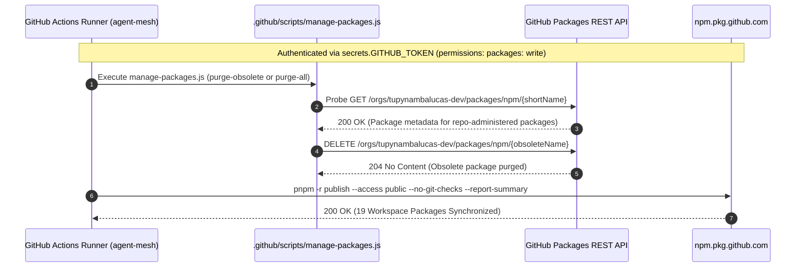
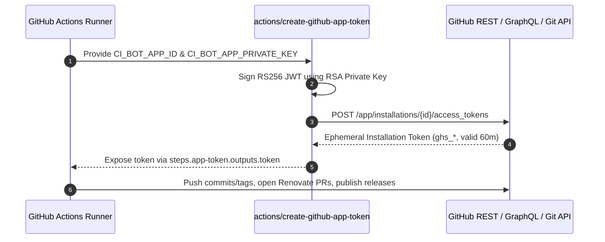

# GitHub App Machine Identity & Token Governance Strategy
**Organization**: `tupynambalucas-dev`  
**Domain**: Enterprise CI/CD Governance & Machine Identity Architecture  
**Document Standard**: en-US Technical Specification (Zero-Emoji Policy)

---

## 1. Executive Summary & Architectural Boundary

In managing autonomous agent workflows, monorepo package distribution (`@tupynambalucas-dev/*`), and repository security within `tupynambalucas-dev`, authentication credentials must be aligned with GitHub's upstream subsystem boundaries:

1. **Git, REST/GraphQL Governance, Pull Requests, Releases & Workflow Cascades (3-Tier GitHub Apps)**:
   - Fine-grained and Classic Personal Access Tokens (PATs) tie organizational automation to an individual user's identity and require manual rotation.
   - Default `GITHUB_TOKEN` cannot trigger downstream workflows (anti-recursion) or manage organization-wide settings, teams, rulesets, or cross-repository operations.
   - Therefore, our 3-Tier GitHub App architecture (`tupynambalucas-org-manager`, `tupynambalucas-ci-bot`, `tupynambalucas-developer-tools`) serves as the sovereign machine identity across MCP servers and Git/Release/PR automation workflows.

2. **GitHub Packages Registry (`npm.pkg.github.com`) & Granular Package Administration (`publish.yml` / `admin-packages.yml`)**:
   - Per official GitHub Packages documentation ([Working with the npm registry](https://docs.github.com/en/packages/working-with-a-github-packages-registry/working-with-the-npm-registry) and [Deleting and restoring a package](https://docs.github.com/en/packages/learn-github-packages/deleting-and-restoring-a-package#packages-api-support)), `npm.pkg.github.com` and granular-permission packages (`npm`, `container`, `nuget`, `rubygems`) **do not support GitHub App installation access tokens (`ghs_*`) or fine-grained PATs**.
   - Instead, when a GitHub Actions workflow in `agent-mesh` publishes a package using `secrets.GITHUB_TOKEN` (`permissions: packages: write`), GitHub automatically grants the `agent-mesh` repository the **`admin` role** on that package.
   - Consequently, inside `agent-mesh` workflows (`publish.yml` and `admin-packages.yml`), `secrets.GITHUB_TOKEN` has native authority to publish (`pnpm -r publish`), inspect (`GET /orgs/{org}/packages/npm/{name}`), and delete (`DELETE /orgs/{org}/packages/npm/{name}`) every package owned by `agent-mesh`.

---

## 2. Comparative Matrix: Token Architectures by Subsystem

| Dimension | Default `GITHUB_TOKEN` (in `agent-mesh` Actions) | Fine-Grained User PAT | Classic User PAT | 3-Tier GitHub Apps (`org-manager`, `ci-bot`, `developer-tools`) |
| :--- | :--- | :--- | :--- | :--- |
| **Identity Principal** | Ephemeral GitHub Actions repository runner | Individual human user account | Individual human user account | **Sovereign Organization Bot** (`[bot]`) |
| **Audit Log Attribution** | `github-actions[bot]` | Personal username | Personal username | **`tupynambalucas-*[bot]`** |
| **Credential Lifecycle** | Job-scoped (destroyed on job completion) | Fixed expiration (max 1 year) | Manual / Optional expiration | **Dynamic RS256 JWT -> 1-hour Installation Tokens** |
| **`npm.pkg.github.com` Publish & Install** | **Supported (Recommended in Actions)** | Not supported | Supported (`write:packages`) | **Not supported by GitHub Packages npm registry** |
| **Granular Package Delete (`DELETE /orgs/{org}/packages/npm/{name}`)** | **Supported for packages owned by the publishing repo (`admin` role)** | Not supported | Supported (`delete:packages` + `read:packages`) | **Not supported for granular-permission packages** |
| **Org Governance, Rulesets, Teams, Security Alerts, PRs, Releases** | Limited to single repo; no workflow cascade | Tied to personal account | Prohibited in zero-trust architectures | **Gold Standard (Dedicated 5,000-15,000 req/hr & full cascade)** |

---

## 3. Official GitHub Documentation & Empirical Verification

### 3.1 Why `GITHUB_TOKEN` Works for Direct Package Endpoints (`GET` / `DELETE /orgs/{org}/packages/npm/{name}`)
- In organizations, npm packages published to `npm.pkg.github.com` are created with **`private` visibility by default** under GitHub's granular permissions model.
- Calling the organization-wide listing endpoint (`GET /orgs/tupynambalucas-dev/packages?package_type=npm`) with a repository-scoped `GITHUB_TOKEN` returns `[]` because `GITHUB_TOKEN` is not an org-wide Classic PAT.
- **However**, because the `agent-mesh` repository is automatically granted the **`admin` role** on every package it publishes, calling `GET /orgs/tupynambalucas-dev/packages/npm/{short_name}` and `DELETE /orgs/tupynambalucas-dev/packages/npm/{short_name}` directly by unscoped package name with `secrets.GITHUB_TOKEN` succeeds with **`200 OK`** and **`204 No Content`**.
- Therefore, `.github/scripts/manage-packages.js` combines organization listing with direct candidate probing across all active workspace packages (`mcp/core/*`, `mcp/servers/*`, `plugins/packages/*`) and known historical/obsolete package names (`mcp-github`, `mcp-router`, etc.).

### 3.2 Where the 3-Tier GitHub Apps Operate
- **Tier 1 (`tupynambalucas-org-manager` — `ORG_MANAGER_APP_ID` / `ORG_MANAGER_APP_PRIVATE_KEY`)**:
  - Used by `@tupynambalucas-dev/mcp-github-org` and `@tupynambalucas-dev/plugin-github-org` for organization administration, team management, repository provisioning, ruleset enforcement, Dependabot alerts, and Secret Scanning alerts.
- **Tier 2 (`tupynambalucas-ci-bot` — `CI_BOT_APP_ID` / `CI_BOT_APP_PRIVATE_KEY`)**:
  - Used in GitHub Actions workflows that push commits, tags, releases, or automated PRs (`platform/.github/workflows/renovate.yml`, `platform/.github/workflows/renderer-generate.yml`, `docs/.github/workflows/deploy-docs.yaml`, `gh-tl/.github/workflows/release.yml`).
- **Tier 3 (`tupynambalucas-developer-tools` — `DEVELOPER_TOOLS_APP_ID` / `DEVELOPER_TOOLS_APP_PRIVATE_KEY`)**:
  - Used by `@tupynambalucas-dev/mcp-github-flow` and `@tupynambalucas-dev/plugin-github-flow` for day-to-day developer branch, pull request, and GitHub Actions workflow diagnostics.

---

## 4. End-to-End Architectural Flows

### 4.1 Package Registry Reconciliation & Publication (`agent-mesh`)



### 4.2 CI/CD Git, PR, and Release Automation (`platform`, `docs`, `gh-tl`)



---

## 5. Secret Governance & Naming Standard

### 5.1 GitHub Actions Organization Secrets (`tupynambalucas-dev`)
Configured at the Organization level (`https://github.com/organizations/tupynambalucas-dev/settings/secrets/actions`):
- `ORG_MANAGER_APP_ID`: Numeric App ID (`5648756`) for `tupynambalucas-org-manager`.
- `ORG_MANAGER_APP_PRIVATE_KEY`: RSA private key (`.pem`) for `tupynambalucas-org-manager`.
- `CI_BOT_APP_ID`: Numeric App ID (`5650100`) for `tupynambalucas-ci-bot`.
- `CI_BOT_APP_PRIVATE_KEY`: RSA private key (`.pem`) for `tupynambalucas-ci-bot`.

### 5.2 Local & Infisical Environment Variables (`agent-mesh/.env.example`)
- Tier 1 (`@tupynambalucas-dev/mcp-github-org`): `ORG_MANAGER_APP_ID`, `ORG_MANAGER_APP_CLIENT_ID`, `ORG_MANAGER_APP_INSTALLATION_ID`, `ORG_MANAGER_APP_PRIVATE_KEY_BASE64`.
- Tier 2 (`tupynambalucas-ci-bot`): `CI_BOT_APP_ID`, `CI_BOT_APP_CLIENT_ID`, `CI_BOT_APP_INSTALLATION_ID`, `CI_BOT_APP_PRIVATE_KEY_BASE64`.
- Tier 3 (`@tupynambalucas-dev/mcp-github-flow`): `DEVELOPER_TOOLS_APP_ID`, `DEVELOPER_TOOLS_APP_CLIENT_ID`, `DEVELOPER_TOOLS_APP_INSTALLATION_ID`, `DEVELOPER_TOOLS_APP_PRIVATE_KEY_BASE64`.

---

## 6. Standardized Package Workflows in `agent-mesh`

### 6.1 Package Administration (`admin-packages.yml`)
```yaml
      - name: Execute Package Administration Script
        env:
          ADMIN_TOKEN: ${{ inputs.admin_token || secrets.ADMIN_PACKAGES_TOKEN || secrets.GITHUB_TOKEN }}
          ADMIN_ACTION: ${{ inputs.action }}
          TARGET_PACKAGE: ${{ inputs.package_name }}
          DRY_RUN: ${{ inputs.dry_run }}
        run: node .github/scripts/manage-packages.js
```

### 6.2 Automated Obsolete Purge & Native Publication (`publish.yml`)
```yaml
      - name: Reconcile Registry & Purge Obsolete Packages
        env:
          ADMIN_TOKEN: ${{ secrets.ADMIN_PACKAGES_TOKEN || secrets.GITHUB_TOKEN }}
          ADMIN_ACTION: ${{ inputs.force_republish && 'purge-all' || 'purge-obsolete' }}
          DRY_RUN: "false"
        run: node .github/scripts/manage-packages.js

      - name: Publish Workspace Packages Idempotently (Native pnpm)
        env:
          NODE_AUTH_TOKEN: ${{ secrets.GITHUB_TOKEN }}
        run: pnpm run packages:publish
```
