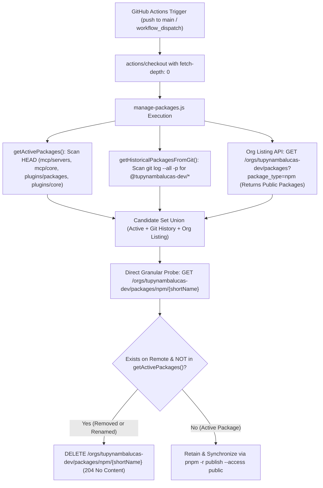

# GitHub Packages Visibility & Dynamic Zero-Declaration Lifecycle Governance
**Organization**: `tupynambalucas-dev`  
**Repository**: `tupynambalucas-dev/agent-mesh`  
**Domain**: Enterprise Package Registry Architecture, Visibility Control & Automated Reconciliation  
**Document Standard**: en-US Technical Specification (Zero-Emoji Policy)

---

## 1. Executive Summary

This blueprint defines the architecture, upstream GitHub Packages constraints, visibility governance, and automated lifecycle reconciliation for all npm packages (`@tupynambalucas-dev/*`) published by the `agent-mesh` monorepo to `npm.pkg.github.com`.

It addresses two primary architectural mandates:
1. **Automated Public Package Provisioning (`visibility: public`)**: How enabling **Public** package creation in Organization Settings (`https://github.com/organizations/tupynambalucas-dev/settings/packages`) combined with `pnpm -r publish --access public` and `publish.yml` (`force_republish: true` -> `purge-all`) provisions all 19 workspace packages with `public` visibility automatically—without manually editing individual package settings or bumping package versions.
2. **Dynamic, Zero-Declaration Obsolete Package Reconciliation**: How `agent-mesh` automatically detects and purges removed or renamed packages on every merge to `main` using organization listing (`GET /orgs/tupynambalucas-dev/packages?package_type=npm`) plus full Git commit history inspection (`git log --all -p -- "**/package.json" "package.json"`), requiring zero hardcoded obsolete package lists in the repository.

---

## 2. GitHub Packages Visibility Architecture (`npm.pkg.github.com`)

### 2.1 Canonical Upstream References
- [Configuring a package's access control and visibility](https://docs.github.com/en/packages/learn-github-packages/configuring-a-packages-access-control-and-visibility)
- [Working with the npm registry](https://docs.github.com/en/packages/working-with-a-github-packages-registry/working-with-the-npm-registry)
- [Deleting and restoring a package](https://docs.github.com/en/packages/learn-github-packages/deleting-and-restoring-a-package)
- [REST API endpoints for packages](https://docs.github.com/en/rest/packages/packages?apiVersion=2026-03-10)

### 2.2 How Initial Visibility Is Determined on `npm.pkg.github.com`
The GitHub Packages npm registry (`npm.pkg.github.com`) uses a **granular permissions** model scoped to the organization and linked repository (`tupynambalucas-dev/agent-mesh`):

1. **Before Enabling Organization Public Package Creation**:
   - By default, GitHub Organizations only allow `private` package creation under **Organization Settings -> Packages -> Package Creation**.
   - Any package first published while `Public` creation is unchecked is initialized with `visibility: private` (even when `pnpm -r publish --access public` is passed).
   - Once a package record already exists on GitHub Packages as `private`, subsequent `pnpm -r publish --access public` runs preserve the existing package's `private` visibility (and skip already-published versions).

2. **After Enabling Organization Public Package Creation (`force_republish: true`)**:
   - Once an organization owner enables **Public** under `https://github.com/organizations/tupynambalucas-dev/settings/packages` (**Package Creation -> Public**), newly created packages published with `pnpm -r publish --access public` honor the public visibility setting upon creation.
   - To transition already-published `private` packages to `public` in bulk **without changing package versions and without clicking through each package's UI settings**, triggering `publish.yml` with `force_republish: true`:
     1. Executes `node .github/scripts/manage-packages.js` with `ADMIN_ACTION: purge-all`, deleting all existing `private` package records via `DELETE /orgs/tupynambalucas-dev/packages/npm/{shortName}`.
     2. Executes `pnpm run packages:publish` (`pnpm -r publish --access public --no-git-checks --report-summary`), recreating all 19 packages from scratch at their current version (`1.0.0`) with **`visibility: public`**.

3. **Platform Invariants for Public Packages**:
   - **Irreversibility**: Once a package is `public`, it cannot be switched back to `private` via settings (unless deleted and recreated while `private` is configured).
   - **API Deletion Lock at Scale**: Under GitHub policy, a `public` package can be deleted via REST API (`DELETE /orgs/{org}/packages/npm/{package_name}`) only while all versions remain under **5,000 downloads**.
   - **Persistent Read Authentication on `npm.pkg.github.com`**: Unlike `ghcr.io`, the GitHub npm registry still requires `NODE_AUTH_TOKEN` (`GITHUB_TOKEN` or a PAT with `read:packages`) when running `pnpm install`, even for `public` packages. However, `public` packages are visible anonymously in the GitHub UI (`https://github.com/orgs/tupynambalucas-dev/packages`) and are returned directly by `GET /orgs/tupynambalucas-dev/packages?package_type=npm` to any token.

### 2.3 Comparative Matrix: `private` vs. `public` npm Packages on GitHub Packages

| Architectural Dimension | `private` Visibility | `public` Visibility (Active Organization Standard) |
| :--- | :--- | :--- |
| **Creation Prerequisite** | Default when Org `Public` package creation is disabled | Automatic on new publish (`--access public`) when Org `Public` package creation is enabled |
| **Bulk Migration Without Version Bump** | N/A | Automated via `publish.yml` (`force_republish: true` -> `purge-all` + `pnpm -r publish --access public`) |
| **Visibility on Org `Packages` Tab** | Visible only to authenticated org members | Visible publicly on `github.com/orgs/tupynambalucas-dev/packages` |
| **Org Listing API (`GET /orgs/{org}/packages`)** | Omitted when queried with repo `GITHUB_TOKEN` | **Returned directly (all 19 packages) to `GITHUB_TOKEN` and GitHub Apps** |
| **Direct Package API (`GET` / `DELETE .../npm/{name}`)** | `200 OK` / `204 No Content` via `agent-mesh` `GITHUB_TOKEN` | `200 OK` / `204 No Content` via `agent-mesh` `GITHUB_TOKEN` (under 5,000 downloads) |
| **`pnpm install` Authentication** | Requires `NODE_AUTH_TOKEN` | Requires `NODE_AUTH_TOKEN` on `npm.pkg.github.com` |

---

## 3. Dynamic Zero-Declaration Lifecycle Governance

### 3.1 Dual-Source Discovery (`GET /orgs/{org}/packages` + `getHistoricalPackagesFromGit`)
In `agent-mesh`, MCP servers (`mcp/servers/*`, `mcp/core/*`) and domain plugins (`plugins/packages/*`, `plugins/core/*`) evolve continuously without maintaining any static list of obsolete packages inside `.github/scripts/manage-packages.js`.

`.github/scripts/manage-packages.js` combines two complementary discovery mechanisms at runtime:
1. **Organization Package Listing (`GET /orgs/tupynambalucas-dev/packages?package_type=npm`)**:
   - Because all `agent-mesh` packages are now published as `public`, this endpoint immediately returns all public npm packages in the organization.
2. **Git Commit History Discovery (`getHistoricalPackagesFromGit`)**:
   - By combining `fetch-depth: 0` in GitHub Actions with `git log --all -p -- "**/package.json" "package.json"`, the script extracts every `"name": "@tupynambalucas-dev/<shortName>"` ever committed across the repository's history and probes `GET /orgs/tupynambalucas-dev/packages/npm/{shortName}` directly—ensuring even legacy `private` packages are discovered and purged.

### 3.2 Implementation Architecture in `agent-mesh`

1. **[`.github/scripts/manage-packages.js`](../../.github/scripts/manage-packages.js)**:
   - **`getActivePackages()`**: Scans the current working tree (`mcp/servers`, `mcp/core`, `plugins/packages`, `plugins/core`) and collects all non-private `@tupynambalucas-dev/<shortName>` packages currently active in `HEAD`.
   - **`getHistoricalPackagesFromGit()`**: Executes `execFileSync('git', ['log', '--all', '-p', '--', '**/package.json', 'package.json'])` and extracts every `@tupynambalucas-dev/<shortName>` identifier ever committed across the repository's history.
   - **`fetchPackages(activePackages)`**: Queries `GET /orgs/tupynambalucas-dev/packages?package_type=npm` and supplements with `GET /orgs/tupynambalucas-dev/packages/npm/<shortName>` for every candidate in Git history or the active workspace.
   - **`purge-obsolete` / `purge-all` Actions**: Deletes obsolete or all remote packages via `DELETE /orgs/tupynambalucas-dev/packages/npm/<shortName>` using `secrets.GITHUB_TOKEN`.

2. **[`.github/workflows/publish.yml`](../../.github/workflows/publish.yml)**:
   - Checks out `agent-mesh` with `fetch-depth: 0`.
   - Builds and validates all workspace packages.
   - Runs `node .github/scripts/manage-packages.js` with `ADMIN_ACTION: purge-obsolete` (or `purge-all` when triggered manually with `force_republish: true`).
   - Publishes all active workspace packages via `pnpm run packages:publish` (`pnpm -r publish --access public --no-git-checks --report-summary`).

3. **[`.github/workflows/admin-packages.yml`](../../.github/workflows/admin-packages.yml)**:
   - Provides on-demand `workflow_dispatch` administration (`list`, `delete-one`, `purge-obsolete`, `purge-all`) with `fetch-depth: 0` and `secrets.GITHUB_TOKEN` default authentication.

---

## 4. Lifecycle Scenarios & Developer Experience

| Developer / Agent Operation in `agent-mesh` | Required Config in `.github/` | Automated CI/CD Outcome on Merge to `main` |
| :--- | :--- | :--- |
| **Create a new package** (`@tupynambalucas-dev/mcp-new`) | None | `getActivePackages()` includes `mcp-new`; `pnpm -r publish --access public` publishes `mcp-new@1.0.0` with **`visibility: public`**. |
| **Delete an existing package** (remove folder & `package.json`) | None | `fetchPackages()` discovers the package via Org Listing & Git history; `manage-packages.js` deletes it from GitHub Packages (`204 No Content`). |
| **Rename a package** (`mcp-old` -> `mcp-renamed`) | None | `manage-packages.js` automatically deletes `mcp-old` (`204 No Content`), and `pnpm -r publish --access public` publishes `mcp-renamed` as **`public`**. |
| **Bump package version** (`1.0.0` -> `1.1.0`) | None | `manage-packages.js` retains all active packages; `pnpm -r publish` publishes version `1.1.0` as **`public`**. |
| **Recreate / overwrite current version tarballs** (`force_republish: true`) | None | `publish.yml` runs `ADMIN_ACTION: purge-all`, deletes all 19 remote packages, and freshly republishes all 19 active packages as **`public`** at their current version. |

---

## 5. Production Verification Evidence

Verified on GitHub Actions (`tupynambalucas-dev/agent-mesh`):
- **Workflow Run `42421839942` (`publish.yml`)**: Purged 18 legacy packages (`@tupynambalucas-dev/mcp-github` + 17 `agent-mcp-*` / `agent-plugin-*` packages).
- **Workflow Run `42475922307` (`publish.yml` with Dynamic Git History Discovery on commit `c60c0a3`)**:
  - Inspected full Git commit history in `0.33s` (`45` unique historical `@tupynambalucas-dev/*` package identifiers) and automatically purged `@tupynambalucas-dev/agent-toolkit` (`204 No Content`).
- **Workflow Run `42476787297` (`publish.yml` with `force_republish: true` after enabling Organization Public Package Creation)**:
  - Purged all 19 `private` packages via `purge-all` and republished all 19 packages at `v1.0.0` via `pnpm -r publish --access public`.
  - Verified via `GET /orgs/tupynambalucas-dev/packages?package_type=npm`: all **19 active packages** (`mcp-appsheet`, `mcp-core-github`, `mcp-firecrawl`, `mcp-github-flow`, `mcp-github-org`, `mcp-gwork`, `mcp-infisical`, `mcp-memory`, `mcp-playwright`, `plugin-appsheet`, `plugin-atelier`, `plugin-docusaurus`, `plugin-github-flow`, `plugin-github-org`, `plugin-gwork`, `plugin-repo`, `plugin-research`, `plugin-secrets`, `plugin-web`) are now live with **`visibility: public`**.
