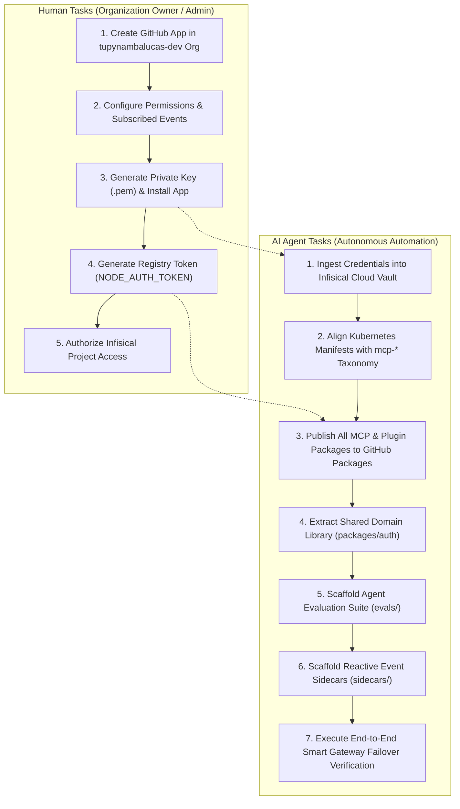

# Autonomous Agent Mesh & Cortex MCP Master Implementation Plan

This document establishes the comprehensive, actionable implementation roadmap for completing the
integration between the **Cortex MCP Control Plane** (in `platform`) and the **Autonomous Agent Mesh**
(in `agent-mesh`).

It delineates every remaining work item, providing exhaustive configuration specifications for the
organizational **GitHub App**, Kubernetes manifest reconciliation, package distribution, evaluation
harnesses, and background sidecars. Every task is explicitly categorized by execution actor:
**Human Action Items** (manual UI and administrative workflows) versus **AI Agent Action Items**
(automated code authoring, manifest migration, package publishing, and validation).

---

## 1. Executive Summary & Architecture Roadmap

The consolidation of the agent substrate into `agent-mesh` has successfully decoupled domain plugins
and established modular TypeScript Model Context Protocol (MCP) servers. However, four critical
dependencies remain before the system achieves autonomous production maturity:

1. **Machine Identity Gap**: Tool execution currently relies on human Personal Access Tokens (PAT),
   which are blocked with `HTTP 403` on organization security endpoints (rulesets, secret scanning,
   Dependabot alerts) and lack audit non-repudiation.
2. **Registry Distribution Gap**: In-house MCP servers (`@tupynambalucas-dev/mcp-*`) have not been
   published to the GitHub Packages registry (`npm.pkg.github.com`), preventing Kubernetes deployments
   from downloading container dependencies via `npx -y`.
3. **Manifest Taxonomy Disconnect**: Kubernetes manifests in `platform/k8s/manifests/hub/cortex/mcp/`
   reference legacy package names (`@tupynambalucas-dev/cortex-mcp-*`) rather than the standardized
   `@tupynambalucas-dev/mcp-*` naming standard.
4. **Autonomous Testing & Event Substrate**: Shared authentication packages (`packages/auth`), agent
   regression evaluation suites (`evals/`), and reactive event receivers (`sidecars/`) have not yet
   been scaffolded.



---

## 2. Human Action Items (Manual Prerequisites & External UI Tasks)

The following procedures require elevated administrative authority across GitHub Organization Settings
and must be executed by an organization owner through the web interface.

### 2.1 GitHub App Provisioning (`tupynambalucas-org-manager`)

To grant AI agents native organization-level execution without exposing developer personal credentials,
a dedicated GitHub App must be registered.

#### Step 1: Open the GitHub App Registration Portal
1. Navigate to: `https://github.com/organizations/tupynambalucas-dev/settings/apps/new`
   *(Alternatively: GitHub -> `tupynambalucas-dev` Organization Settings -> Developer settings -> GitHub Apps -> New GitHub App)*.

#### Step 2: Configure Basic Information
- **GitHub App name**: `tupynambalucas-org-manager`
- **Description**: `Official autonomous agent machine identity for tupynambalucas-dev organization management, security triage, ruleset enforcement, and CI/CD operations.`
- **Homepage URL**: `https://github.com/tupynambalucas-dev`
- **Callback URL**: `http://localhost:8080/callback` *(leave blank or set to localhost for now)*
- **Expire user authorization tokens**: Checked (Recommended)
- **Request user authorization (OAuth) during installation**: Unchecked

#### Step 3: Configure Webhook Settings
- **Active**: Checked
- **Webhook URL**: `https://cortex.tupynambalucas.dev/webhooks/github` *(or temporary tunnel for local dev)*
- **Webhook secret**: Generate a secure 32-character random string (e.g., via `openssl rand -hex 20`). Save this value for Infisical.
- **SSL verification**: Enable SSL verification

#### Step 4: Granular Permissions Contract

The App requires specific permissions to perform autonomous operations across repositories and the
organization:

##### A. Repository Permissions
| Permission Category | Access Level | Architectural Justification |
| :--- | :--- | :--- |
| **Actions** | Read and write | Triggering workflow dispatches, re-running failed jobs, and querying CI statuses. |
| **Administration** | Read and write | Managing repository settings, branch protection overrides, and team access. |
| **Checks** | Read and write | Inspecting commit check runs and reporting status checks. |
| **Commit statuses** | Read and write | Reading and setting commit SHA verification statuses. |
| **Contents** | Read and write | Reading repository trees, committing code changes, creating release tags. |
| **Dependabot alerts** | Read-only | Reading security advisories and vulnerable package states. |
| **Issues** | Read and write | Opening triage issues, commenting, assigning labels and milestones. |
| **Metadata** | Read-only | Mandatory default; allows reading repository names and basic metadata. |
| **Pull requests** | Read and write | Opening PRs, modifying reviews, adding review comments, merging pull requests. |
| **Repository rulesets** | Read and write | Reading, auditing, and enforcing branch protection and commit signing rulesets. |
| **Repository security advisories** | Read and write | Creating and auditing private vulnerability reports. |
| **Secret scanning alerts** | Read-only | Triaging leaked credentials and verifying remediation across repositories. |
| **Workflows** | Read and write | Updating `.github/workflows/*.yaml` workflow definitions. |

##### B. Organization Permissions
| Permission Category | Access Level | Architectural Justification |
| :--- | :--- | :--- |
| **Members** | Read and write | Auditing team memberships, inviting collaborators, verifying RBAC state. |
| **Organization administration** | Read and write | Auditing organization settings and inspecting audit logs. |
| **Organization custom repository roles** | Read-only | Inspecting custom role bindings across organizational repositories. |
| **Organization projects** | Read and write | Managing project boards, sprint backlogs, and roadmap items. |

##### C. Account Permissions
| Permission Category | Access Level | Architectural Justification |
| :--- | :--- | :--- |
| **Email addresses** | Read-only | Resolving developer email associations during PR assignment. |

#### Step 5: Subscribed Webhook Events
Under **Subscribe to events**, select the following triggers for reactive agent handling:
- `Check run`
- `Check suite`
- `Create` (tags, branches)
- `Delete`
- `Dependabot alert`
- `Issue comment`
- `Issues`
- `Pull request`
- `Pull request review`
- `Pull request review comment`
- `Push`
- `Repository`
- `Repository ruleset`
- `Secret scanning alert`
- `Security advisory`
- `Workflow dispatch`
- `Workflow job`
- `Workflow run`

#### Step 6: Installation & Key Generation
1. Click **Create GitHub App**.
2. Note the displayed **App ID** (numeric, e.g., `1048291`).
3. Scroll down to **Private keys** and click **Generate a private key**.
   - A `.pem` file will download to your local system (e.g., `tupynambalucas-org-manager.2026-11-02.private-key.pem`).
4. In the left navigation, click **Install App**.
5. Locate the `tupynambalucas-dev` organization and click **Install**.
6. Select **All repositories**.
7. Click **Install**.
8. Inspect the resulting URL: `https://github.com/organizations/tupynambalucas-dev/settings/installations/<INSTALLATION_ID>`.
   - Note the numeric **Installation ID** at the end of the URL.

---

### 2.2 GitHub Packages Publishing Token Generation

To enable `npm.pkg.github.com` publishing of the `@tupynambalucas-dev/*` scoped packages:

1. Navigate to: `https://github.com/settings/tokens/new` (or Developer Settings -> Personal access tokens -> Tokens (classic)).
2. Token name: `tupynambalucas-dev-package-publisher`
3. Expiration: 90 days (or organizational standard)
4. Select scopes:
   - `write:packages` (Upload packages to GitHub Package Registry)
   - `read:packages` (Download packages from GitHub Package Registry)
   - `delete:packages` (Delete specific package versions if necessary)
   - `repo` (Full repository access to resolve package associations)
5. Click **Generate token**.
6. Securely copy the token string (`ghp_...`). Save as `NODE_AUTH_TOKEN`.

---

### 2.3 Infisical Project Access Verification

1. Verify that you have access to Infisical Cloud: `https://app.infisical.com`.
2. Locate workspace project: `tupynambalucas-dev-platform` (ID: `134783dd-8a83-4dfc-9fd5-979b52bed86d`).
3. Ensure the `dev`, `staging`, and `prod` environments exist.

---

## 3. AI Agent Action Items (Automated Execution & Code Engineering)

Once the human administrator provides the App credentials and token, the AI agent can autonomously
execute all remaining engineering phases.

---

### 3.1 Secret Ingestion into Infisical Cloud Vault

Using the Infisical MCP tools (`infisical_create_secret` / `infisical_update_secret`), inject the
following secrets into the `tupynambalucas-dev-platform` project:

```bash
# Target Environment: dev, staging, prod
# Secret Path: /
```

| Secret Key Name | Content Description | Ingestion Source |
| :--- | :--- | :--- |
| `GITHUB_APP_ID` | Numeric App ID | Extracted from GitHub App overview page. |
| `GITHUB_APP_INSTALLATION_ID` | Numeric Installation ID | Extracted from GitHub App installation URL. |
| `GITHUB_APP_PRIVATE_KEY` | Entire PEM file string with `\n` escaping | Content of downloaded `.pem` private key. |
| `GITHUB_APP_WEBHOOK_SECRET` | 32-character hex secret string | Generated during Webhook setup. |
| `NODE_AUTH_TOKEN` | GitHub PAT with `write:packages` scope | Used by `publish-packages.js` and K8s container bootstrap. |

---

### 3.2 Kubernetes Manifests Realignment (`platform`)

The manifests in `platform/k8s/manifests/hub/cortex/mcp/` must be aligned with the authoritative
naming standard `@tupynambalucas-dev/mcp-*`.

#### Files to Update:
1. `platform/k8s/manifests/hub/cortex/mcp/firecrawl.yaml`:
   - Change package reference from `@tupynambalucas-dev/cortex-mcp-firecrawl` to `@tupynambalucas-dev/mcp-firecrawl`.
2. `platform/k8s/manifests/hub/cortex/mcp/google-workspace.yaml`:
   - Change package reference from `@tupynambalucas-dev/cortex-mcp-gwork` to `@tupynambalucas-dev/mcp-gwork`.
3. `platform/k8s/manifests/hub/cortex/mcp/appsheet.yaml`:
   - Change package reference from `@tupynambalucas-dev/cortex-mcp-appsheet` to `@tupynambalucas-dev/mcp-appsheet`.
4. `platform/k8s/manifests/hub/cortex/mcp/memory.yaml`:
   - Change package reference from `@tupynambalucas-dev/cortex-mcp-memory` to `@tupynambalucas-dev/mcp-memory`.
5. `platform/k8s/manifests/hub/cortex/mcp/github.yaml`:
   - Replace the upstream `ghcr.io/github/github-mcp-server:latest` deployment with the in-house Zero-Dockerfile standard:
   ```yaml
   apiVersion: apps/v1
   kind: Deployment
   metadata:
     name: mcp-github
     namespace: cortex
     labels:
       app: mcp-github
   spec:
     replicas: 1
     selector:
       matchLabels:
         app: mcp-github
     template:
       metadata:
         labels:
           app: mcp-github
       spec:
         containers:
           - name: mcp-github
             image: node:22-alpine
             command: ["sh", "-c"]
             args:
               - |
                 if [ -n "$NODE_AUTH_TOKEN" ]; then
                   npm config set //npm.pkg.github.com/:_authToken ${NODE_AUTH_TOKEN}
                   npm config set @tupynambalucas-dev:registry https://npm.pkg.github.com
                 fi
                 npx -y @tupynambalucas-dev/mcp-github
             ports:
               - containerPort: 8080
             resources:
               requests:
                 memory: '64Mi'
                 cpu: '25m'
               limits:
                 memory: '256Mi'
                 cpu: '200m'
             env:
               - name: NODE_AUTH_TOKEN
                 valueFrom:
                   secretKeyRef:
                     name: cortex-secrets
                     key: NODE_AUTH_TOKEN
                     optional: true
               - name: GITHUB_APP_ID
                 valueFrom:
                   secretKeyRef:
                     name: cortex-secrets
                     key: GITHUB_APP_ID
               - name: GITHUB_APP_INSTALLATION_ID
                 valueFrom:
                   secretKeyRef:
                     name: cortex-secrets
                     key: GITHUB_APP_INSTALLATION_ID
               - name: GITHUB_APP_PRIVATE_KEY
                 valueFrom:
                   secretKeyRef:
                     name: cortex-secrets
                     key: GITHUB_APP_PRIVATE_KEY
   ```

---

### 3.3 Multi-Package Publishing to GitHub Packages Registry

Execute publication of all 7 in-house MCP servers and 10 plugins using `scripts/publish-packages.js`:

```powershell
# Set token in local session
$env:NODE_AUTH_TOKEN = "<GH_PACKAGES_TOKEN>"

# Run publication script
node agent-mesh/scripts/publish-packages.js
```

#### Verification Gate:
Verify each published package on GitHub:
- `https://github.com/orgs/tupynambalucas-dev/packages?repo_name=agent-mesh`
- Confirm `1.0.0` tags exist for `@tupynambalucas-dev/mcp-github`, `@tupynambalucas-dev/mcp-firecrawl`, `@tupynambalucas-dev/mcp-gwork`, `@tupynambalucas-dev/mcp-appsheet`, `@tupynambalucas-dev/mcp-memory`, `@tupynambalucas-dev/mcp-infisical`, `@tupynambalucas-dev/mcp-playwright`.

---

### 3.4 Shared Domain Library Extraction (`packages/`)

To eliminate duplicate authentication and cryptographic logic across MCP servers:

#### 1. Scaffold `packages/auth` (`@tupynambalucas-dev/agent-auth`):
```plaintext
agent-mesh/packages/auth/
├── package.json
├── tsconfig.json
├── README.md
└── src/
    ├── index.ts
    ├── github-app.ts         # Centralized Octokit App JWT minter
    └── google-auth.ts        # Centralized GoogleAuth / Service Account token minter
```

#### 2. Update `agent-mesh/pnpm-workspace.yaml`:
```yaml
packages:
  - 'plugins/packages/*'
  - 'mcp/packages/*'
  - 'packages/*'
```

#### 3. Refactor Consumers:
- Update `agent-mesh/mcp/packages/github` to import `{ getOctokitClient }` from `@tupynambalucas-dev/agent-auth`.
- Update `agent-mesh/mcp/packages/gwork` to import `{ getGoogleAuth }` from `@tupynambalucas-dev/agent-auth`.

---

### 3.5 Agent Evaluation Suite Implementation (`evals/`)

Create an automated verification harness to prevent behavioral regressions, broken links, non-conventional commits, or unverified code pushes:

```plaintext
agent-mesh/evals/
├── package.json               # @tupynambalucas-dev/agent-evals
├── tsconfig.json
├── README.md
├── suites/
│   ├── commit-conventions.eval.yaml      # Verifies git commits follow conventional commit standard
│   ├── ssh-signing.eval.yaml             # Verifies commits require -S flag
│   ├── zero-emoji.eval.yaml              # Verifies no emojis are emitted in output
│   ├── secret-hygiene.eval.yaml          # Verifies plaintext tokens are never returned
│   └── diataxis-link-audit.eval.yaml     # Scans markdown files for broken relative links
└── src/
    ├── runner.ts                         # Executes test cases and asserts trajectory outputs
    └── matchers.ts                       # Custom validation assertions
```

---

### 3.6 Reactive Background Sidecars (`sidecars/`)

Implement the background microservices required for asynchronous, non-blocking agent interactions:

#### 1. `sidecars/github-webhook-listener`:
- Fastify/Node.js service listening on `:3000`.
- Validates HMAC SHA-256 signatures using `GITHUB_APP_WEBHOOK_SECRET`.
- Parses incoming GitHub events (`pull_request.opened`, `issues.labeled`).
- Bridges events to Antigravity CLI invocations (`agy prompt ...`) or queues tasks for background workers.

#### 2. `sidecars/browser-daemon`:
- Persistent Playwright browser instance listening on CDP / WebSocket.
- Provides persistent browser contexts for AppSheet schema extraction and UI automation without cold-start browser spawning penalties.

---

### 3.7 Smart Gateway Probe Integration & End-to-End Validation

Execute comprehensive testing of `agent-mesh/scripts/mcp-gateway-router.js` in two execution states:

#### State 1: Active Gateway Execution (Cluster Mode)
1. Start local mock or K8s port-forward: `kubectl port-forward svc/agentgateway 8080:8080 -n cortex`.
2. Execute tool query: `node agent-mesh/scripts/mcp-gateway-router.js firecrawl`.
3. Assert: HTTP status `200 OK`, request routed through Envoy `:8080` without triggering local fallback.

#### State 2: Simulated Gateway Failure (Decentralized Local Fallback)
1. Stop port-forward (simulate cluster offline).
2. Execute tool query: `node agent-mesh/scripts/mcp-gateway-router.js firecrawl`.
3. Assert: Probe detects timeout (`300ms`), logs `[cortex-mcp] Gateway offline; activating local fallback` to `stderr`, and spawns `pnpm dlx @tupynambalucas-dev/mcp-firecrawl` via Stdio.

#### State 3: Write Verification Report
- Commit verification report to `agent-mesh/.agents/reports/cortex-mcp-execution-state-and-fallback-verification.md`.

---

## 4. Responsibility Matrix & RACI Breakdown

| Implementation Phase | Action Item | Primary Actor | Supporting Actor | Verification Standard |
| :--- | :--- | :--- | :--- | :--- |
| **Phase 1: Identity** | Register `tupynambalucas-org-manager` GitHub App | **Human (Org Owner)** | AI (Provides Spec) | App ID and Installation ID generated. |
| **Phase 1: Identity** | Generate Private Key (`.pem`) & Download | **Human (Org Owner)** | None | `.pem` file downloaded securely. |
| **Phase 1: Identity** | Install App on `tupynambalucas-dev` Org | **Human (Org Owner)** | None | App listed under Installed GitHub Apps. |
| **Phase 1: Identity** | Generate Registry PAT (`NODE_AUTH_TOKEN`) | **Human (Org Owner)** | None | Token with `write:packages` scope. |
| **Phase 2: Secrets** | Inject App ID, Key & Tokens into Infisical | **AI Agent** | Human (Provides values) | Infisical Vault has all 5 keys in `dev`/`prod`. |
| **Phase 3: Manifests**| Align K8s YAML with `@tupynambalucas-dev/mcp-*` | **AI Agent** | None | 0 stale package references in `platform`. |
| **Phase 3: Manifests**| Update `github.yaml` to in-house MCP server | **AI Agent** | None | K8s manifest uses `@tupynambalucas-dev/mcp-github`. |
| **Phase 4: Registry** | Publish all 7 MCPs & 10 Plugins to GitHub Packages| **AI Agent** | None | Packages visible on GitHub Packages with v1.0.0. |
| **Phase 5: Code** | Extract `packages/auth` library | **AI Agent** | None | Clean compilation, zero duplicate auth code. |
| **Phase 6: Evals** | Author `evals/` benchmark test suites | **AI Agent** | None | `pnpm test:evals` passes with 0 failures. |
| **Phase 7: Sidecars** | Implement `github-webhook-listener` daemon | **AI Agent** | None | HMAC verification passes, webhook dispatches work. |
| **Phase 8: Audit** | End-to-End Gateway Failover Verification | **AI Agent** | None | Verification report authored in `.agents/reports/`. |

---

## 5. Sequential Execution Runbook

```plaintext
STEP 1 [HUMAN]:
  Navigate to GitHub Organization Developer Settings.
  Create GitHub App "tupynambalucas-org-manager" using Section 2.1 specifications.
  Install App on "tupynambalucas-dev" organization (All repositories).
  Generate Private Key (.pem).
  Generate GitHub Packages PAT (NODE_AUTH_TOKEN).
  Provide App ID, Installation ID, .pem content, and NODE_AUTH_TOKEN to AI Agent.

STEP 2 [AI AGENT]:
  Call Infisical tools to store secrets in "tupynambalucas-dev-platform" project.
  Verify secret presence using infisical_list_secrets.

STEP 3 [AI AGENT]:
  Edit platform/k8s/manifests/hub/cortex/mcp/*.yaml:
    - Replace @tupynambalucas-dev/cortex-mcp-* with @tupynambalucas-dev/mcp-*.
    - Replace upstream github-mcp-server with @tupynambalucas-dev/mcp-github.
  Validate Kustomize manifests:
    - kubectl kustomize platform/k8s/manifests/hub/cortex/mcp

STEP 4 [AI AGENT]:
  Execute publish-packages.js:
    - $env:NODE_AUTH_TOKEN = "<token>"
    - node agent-mesh/scripts/publish-packages.js
  Verify all packages publish successfully to npm.pkg.github.com.

STEP 5 [AI AGENT]:
  Scaffold agent-mesh/packages/auth:
    - Centralize GitHub App and Google Auth logic.
    - Update pnpm-workspace.yaml to include "packages/*".
    - Link packages in mcp/packages/github and mcp/packages/gwork.

STEP 6 [AI AGENT]:
  Scaffold agent-mesh/evals:
    - Author YAML evaluation suites for conventional commits, SSH signing, zero-emoji.
    - Implement vitest runner.

STEP 7 [AI AGENT]:
  Execute Smart Gateway failover test:
    - Validate HTTP probe vs. Stdio fallback.
    - Author verification report in agent-mesh/.agents/reports/.
    - Sign Git commits with SSH (-S).
```
