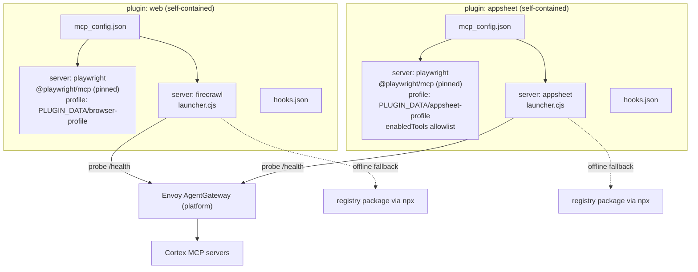

# Plugin Independence, Playwright Isolation, and Enforcement Hooks Plan

This plan makes every plugin in `agent-mesh/plugins/packages` fully self-contained, gives the `web` and
`appsheet` plugins independent Playwright runtimes that cannot conflict, replaces the monolithic
[`mcp-gateway-router.js`](../../scripts/mcp-gateway-router.js) with a per-plugin launcher model, and adds
lifecycle hooks so that the plugin mandates are enforced deterministically instead of relying on the
model to remember rules.

Status: proposed. Nothing in this document has been implemented yet. Revision 2 adds the cluster and local parity audit (sections 7 to 9), including the consolidated list of decisions the repository owner must make.

---

## 1. Problem Statement

| # | Problem | Evidence |
|---|---------|----------|
| P1 | Plugins are not installable on their own. Every `mcp_config.json` and `mcp.json` points to `../../../scripts/mcp-gateway-router.js`, which exists only inside the monorepo checkout. | `plugins/packages/*/mcp_config.json`; installed plugins are unpacked to `~/.gemini/config/plugins/<plugin-name>` (read-only), where `../../../scripts` does not exist. |
| P2 | `web` and `appsheet` both declare a `playwright` server, producing two daemons (`web_playwright`, `appsheet_playwright`) with 17 duplicated tools each, fighting over the same browser endpoint. | Prior analysis, section 5 of `analyses/analise-profunda-mcp-gateway-router.md`. |
| P3 | The router routes Playwright through a cloud gateway or a repo-local binary. A browser attached to the developer desktop is inherently local, so gateway routing is meaningless in that mode. | `FALLBACK_REGISTRY.playwright` in the router. |
| P4 | The in-house `@tupynambalucas-dev/mcp-playwright` attaches with `chromium.connectOverCDP('http://localhost:9222')`, which does not match how the Playwright browser extension connects, and falls back to a headless shell that is not installed. | `mcp/packages/playwright/src/browser/session-manager.ts`. |
| P5 | Plugin mandates ("autonomously use Firecrawl and Context7", "sign every commit", "no emoji") exist only as always-on rule text. The model can and did ignore them. | Research session on 2026-11-02: `search_web` was used instead of Firecrawl. |
| P6 | Two manifests per plugin (`mcp.json` and `mcp_config.json`) with identical content. Only `mcp_config.json` is documented for Antigravity. | `plugins/packages/web`, `appsheet`, others. |
| P7 | The router loads `.env` through paths relative to `process.cwd()` and `__dirname`, and its registry fallback uses `pnpm dlx` against `npm.pkg.github.com`. Both assumptions fail inside an installed plugin. | `loadEnvCascade()` and `FALLBACK_REGISTRY` in the router. |

---

## 2. Research Findings

Sources marked (scraped) were fetched in full with Firecrawl `scrape` and `onlyMainContent: true`.
Sources marked (snippet) were seen only as Firecrawl search result excerpts and must be re-verified
before being treated as authoritative.

### 2.1 Antigravity plugin model

- Plugins bundle skills, MCP servers, custom agents, rules, and lifecycle hooks. Bundled MCP tools are
  namespaced `<plugin-name>_<server-name>`. (scraped) <https://antigravity.google/docs/plugins/>
- Component files (`skills/`, `agents/`, `rules/`, `scripts/`, `mcp_config.json`, `hooks.json`) live at
  the plugin root. `plugin.json` is the only required file. (scraped) <https://antigravity.google/docs/build-plugins>
- Installed plugins are unpacked into a read-only directory `~/.gemini/config/plugins/<plugin-name>` that
  is replaced on update. Plugins must reference `${PLUGIN_ROOT}` (read-only plugin root) and
  `${PLUGIN_DATA}` (persistent writable directory outside the workspace) in `args`, `cwd`, and custom
  `env` of MCP definitions instead of hardcoded or repo-relative paths. (scraped)
  <https://antigravity.google/docs/build-plugins>
- Plugin MCP entries may declare `variables` (user-prompted credentials, interpolated as `${NAME}`) and
  `oauth`. The documentation recommends cross-platform `"command": "node"` scripts or remote HTTPS
  endpoints. (scraped) <https://antigravity.google/docs/build-plugins>
- The documented plugin manifest has no `dependencies` field. There is no formal plugin-to-plugin
  dependency mechanism, so independence must be achieved by self-containment. (scraped, absence
  confirmed on the build-plugins page) <https://antigravity.google/docs/build-plugins>
- MCP server entries support `command`, `args`, `env`, `cwd`, `disabled`, `enabledTools` (allowlist),
  `disabledTools` (denylist), and `timeoutSeconds`. (scraped) <https://antigravity.google/docs/mcp>
- `agy plugin validate --strict` validates a plugin before publishing. (scraped)
  <https://antigravity.google/docs/build-plugins>

### 2.2 Rules and why prompts alone are insufficient

- `AGENTS.md` is always on, but only the workspace root and its parents up to the repository root are
  loaded; subfolders below the workspace folder are not. (scraped) <https://antigravity.google/docs/rules>
- All always-on and global rules share a 20,000-token budget and a 24 KB per-file cap. When exceeded, the
  largest rules are demoted to a one-line pointer (`path: description`). (scraped)
  <https://antigravity.google/docs/rules>
- Rules are text injected into context. Industry guidance states that "hooks guarantee behavior; prompts
  suggest it" and that agent rule files are suggestions, not controls. (snippet)
  <https://dotzlaw.com/insights/claude-hooks/>, <https://blog.gitguardian.com/ai-hooks-ai-coding-assistants/>

### 2.3 Hooks

- Events: `SessionStart`, `PreToolUse`, `PostToolUse`, `PreInvocation`, `PostInvocation`, `Stop`.
  Hooks receive JSON on stdin and answer with JSON on stdout. (scraped)
  <https://antigravity.google/docs/hooks/>
- `PreToolUse` matches by tool name with a regular expression (for example `browser_.*`) and answers
  `decision` of `allow`, `auto_approve`, `deny`, `ask`, `force_ask`, or `deny_unless_prior_grant`, with an
  optional `reason`, `overwrite` (shallow argument merge), and `permissionOverrides`. (scraped)
  <https://antigravity.google/docs/hooks/>
- `SessionStart` and `PreInvocation` can return `injectSteps` containing `systemMessage`, `userMessage`,
  `ephemeralMessage`, or `toolCall`. (scraped) <https://antigravity.google/docs/hooks/>
- Plugin hooks live in the plugin `hooks.json`. Hooks can launch commands but are not a process
  supervisor, so they are the wrong mechanism to start or keep alive an MCP server. (scraped; the
  conclusion is derived from the documented event contract)
- Open question: a forum report states plugin hooks may not execute in the Antigravity IDE while skills
  and rules from the same plugin load. The CLI exposes `/hooks` to inspect loaded hooks. (snippet)
  <https://discuss.ai.google.dev/t/do-antigravity-ide-2-0-actually-execute-plugin-hooks-pretooluse-posttooluse-or-is-that-cli-only-right-now/176814>

### 2.4 Playwright MCP isolation

- The official `@playwright/mcp` supports `--isolated`, `--user-data-dir` (a temporary directory is
  created if unset), `--executable-path`, `--extension` (Edge or Chrome, requires the Playwright
  extension), `--profile-dir-name`, `--endpoint`, `--cdp-endpoint`, `--port`, and an environment variable
  equivalent for every flag (`PLAYWRIGHT_MCP_*`). (scraped) <https://github.com/microsoft/playwright-mcp>
- To run several clients in parallel, start each with `--isolated` or a distinct `--user-data-dir`.
  (snippet) <https://mcpservers.org/servers/playwright-mcp-server>; a maintainer thread reports that
  parallel agents work in isolated mode when each client gets its own server (snippet)
  <https://github.com/microsoft/playwright-mcp/issues/893>
- Pinning the package version in the server `args` is the recommended reproducible setup. (snippet)
  <https://qaskills.sh/blog/playwright-mcp-browser-automation-guide>

### 2.5 Gateway versus proxy versus launcher

- An MCP gateway adds identity, per-tool policy, routing, and audit across servers. An MCP proxy only
  bridges transports (for example stdio to Streamable HTTP) or aggregates servers. A gateway is warranted
  by many servers used by many clients or teams, per-user isolation, or compliance audit; it is not
  warranted for a single team connecting a handful of servers it supervises. (snippet)
  <https://nango.dev/blog/mcp-gateway-vs-mcp-proxy/>
- Proxies cover aggregation, translation, and control. (snippet)
  <https://www.getmaxim.ai/articles/mcp-proxy-server-explained-architecture-and-use-cases/>

### 2.6 Conclusions drawn from the research

1. Independence in Antigravity means a plugin carries everything it needs and addresses it through
   `${PLUGIN_ROOT}` and `${PLUGIN_DATA}`. There is no dependency field to lean on.
2. The existing router is a proxy plus failover launcher, not a gateway. The gateway is the Envoy
   AgentGateway in `platform`. Conflating the two is the root of the design confusion.
3. Playwright against a desktop browser must never be gateway-routed.
4. Hooks are the correct mechanism for enforcement and reminders, and the incorrect mechanism for
   launching servers.

---

## 3. Target Architecture

### 3.1 Decision D1: launcher model

| Option | Description | Verdict |
|--------|-------------|---------|
| A | Keep one monolithic router in `agent-mesh/scripts` | Rejected. Breaks self-containment (P1, P7) and carries a registry of every service into every plugin. |
| B | One shared router published to npm and run with `npx -y` | Rejected as default. Adds network latency to every session start and a runtime dependency on a private registry that requires authentication. |
| C | One generated launcher vendored into each plugin, configured for only that plugin's servers | Recommended for gateway-capable servers (Firecrawl, Context7, GitHub, Infisical, Google Workspace, AppSheet). |
| D | No launcher: call the upstream MCP server directly with pinned arguments | Recommended for Playwright. Nothing to route, nothing to fail over. |
| E | Use hooks to start servers | Rejected. Hooks are event handlers, not a supervisor. |

Option C is implemented as build-time vendoring: a single source of truth in
`agent-mesh/plugins/shared/launcher/` is copied into each plugin's `scripts/` by a build step, and CI fails
if a vendored copy drifts from the source. The result is independent plugins without hand-maintained
duplication.

### 3.2 Decision D2: Playwright runtime per plugin

| Plugin | Server name | Runtime | Profile directory | Tool exposure |
|--------|-------------|---------|-------------------|---------------|
| web | `playwright` | `npx -y @playwright/mcp@<pinned>` headless, persistent profile | `${PLUGIN_DATA}/browser-profile` | All tools |
| web | `playwright-desktop` (optional, `disabled: true` by default) | `@playwright/mcp --extension` or `--cdp-endpoint`, `--executable-path` set to the user browser | The real desktop profile, never written by the plugin | All tools, enabled only when the user opts in |
| appsheet | `playwright` | `npx -y @playwright/mcp@<pinned>` headed or headless, persistent profile so the Google login survives | `${PLUGIN_DATA}/appsheet-profile` | `enabledTools` allowlist of the Studio automation subset |

Why this removes the conflict:

1. Each plugin owns a separate `--user-data-dir`, so there is no shared profile lock and no shared login
   state.
2. Neither default server attaches to the desktop browser, so there is no contention for the extension or
   for port 9222. Only the opt-in `playwright-desktop` entry does, and only `web` ships it.
3. The `appsheet` allowlist trims the duplicated tool schemas from the model context.
4. The pinned version removes `@latest` drift.
5. Both servers keep the plugin-scoped names `web_playwright` and `appsheet_playwright`, so the model can
   tell them apart.

Decision D3 (needs a human choice): keep or retire `@tupynambalucas-dev/mcp-playwright`.
The official package already provides isolation, profile control, extension attach, and CDP attach, and
the in-house package does not match the extension handshake (P4). Recommended: use the official package in
plugins, and keep the in-house package only for the cloud HTTP deployment (`src/index.ts` with Fastify)
where a headless sandbox in a pod is the goal, after fixing or removing its CDP/extension modes.

---

## 4. Hook Catalog

All hooks are Node scripts (`.cjs`, no dependencies, cross-platform) shipped in the plugin under
`scripts/hooks/` and registered in the plugin `hooks.json`. Each script reads the stdin JSON payload and
prints a decision. Every `deny` carries a `reason` that names the correct tool or procedure so the agent
self-corrects. Every blocking hook honors an explicit escape variable such as `MESH_ALLOW_NATIVE_WEB=1` so
a down dependency never deadlocks work.

Matchers must use the real tool names of the running surface. The documentation lists names such as
`write_to_file` and `run_command`; the current CLI session exposes `write_file`, `edit_file`, and
`run_command`. Matchers therefore use alternations (`write_file|write_to_file|edit_file|replace_file_content`)
until validated (see V2).

| Plugin | Event and matcher | Behavior | Mandate enforced |
|--------|-------------------|----------|------------------|
| research | `SessionStart` | Inject a short `systemMessage`: use Firecrawl and Context7, cite sources. | Rule 0 autonomous domain mandate |
| research | `PreToolUse` `search_web\|read_url_content` | `deny` with reason naming `research_firecrawl` `search`/`scrape` and `research_context7`; allow when `MESH_ALLOW_NATIVE_WEB=1`. | Rules 0, 1 |
| research | `PreToolUse` `scrape` | `overwrite` forcing `onlyMainContent: true` when missing. | Rule 2 |
| github-flow | `PreToolUse` `run_command` | `deny` `git commit` lacking `-S`; `deny` commit messages that violate Conventional Commits or exceed 100 characters; `deny` `git push` to `main` or `master`; `deny` messages containing emoji. | Rules 1, 2, 3, 5 |
| github-flow | `PreToolUse` `run_command` | `force_ask` for `gh pr merge --admin`. | Rule 3 |
| github-org | `PreToolUse` `run_command` and GitHub MCP tools | `force_ask` for destructive `gh api -X DELETE`, repository transfer, and ruleset mutation. | Rule 3 |
| secrets | `PreToolUse` `run_command` | `deny` commands that print secrets (`printenv`, `echo $...KEY`, `infisical secrets get` without redaction, `--plain`). | Rule 1 |
| secrets | `PreToolUse` `infisical_get_secret\|infisical_list_secrets` | `deny` when `environment` is `prod`. | Rule 3 |
| atelier | `PreToolUse` file write tools | `deny` creating `AGENTS.md` or `README.md` below Layer 3 or inside `plans/`, `reports/`, and Diataxis quadrants; `deny` content containing emoji. | Atelier rules 3, 6 |
| repo | `PreToolUse` file write tools on `package.json` | `deny` a name outside the `@tupynambalucas-dev/` scope and raw version strings where `catalog:` is required; `deny` `tsconfig.build.json` creation. | Repo rules 5, 6 |
| docusaurus | `PreToolUse` file write tools | `deny` any path under `i18n/`; `deny` `<!--` in `.mdx`; `deny` emoji. | Docusaurus rules 2, 3, 4 |
| web | `PreToolUse` `browser_evaluate` | `ask` before arbitrary JavaScript execution. | Rule 2 |
| web | `PreToolUse` `browser_navigate` | `ask` for origins outside an allowlist file shipped in the plugin. | Safety |
| appsheet | `PreToolUse` `mutate_records` | `deny` Add/Edit rows without an explicit key; `force_ask` for `Delete`. | Rule 4 |
| appsheet | `PreToolUse` `browser_navigate` on `appsheet_playwright` | `deny` URLs outside `appsheet.com` and Google sign-in origins. | Scope control |
| gwork | `PreToolUse` `create_document\|create_spreadsheet` | `deny` when `folderId` is missing or the file name does not match `[Environment] - [Domain] - [Entity]`. | Rule 3 |
| platform k8s plugin | `PreToolUse` file write tools | `deny` creating a `guides/` directory; `deny` emoji. | k8s rules 1, 2 |

Cross-cutting invariants shared by many plugins (zero emoji, signed commits) are implemented once in
`agent-mesh/plugins/shared/hook-kit/` and vendored into each plugin by the same build step as the
launcher, so plugins remain independent while the logic stays single-sourced. The signed-commit hook lives
only in `github-flow`; `github-org` keeps organization-specific gates, avoiding double evaluation.

Known limits to document in each plugin README:

- Hooks gate tool calls and inject context. They cannot rewrite model output or redact tool results.
- Plugin hooks may not execute in the Antigravity IDE. Treat the CLI as the enforcing surface until V1
  proves otherwise.

---

## 5. Implementation Phases

Actor legend: AI means automated code authoring; HUMAN means an action only the repository owner can take.

### Phase 0: Validation spikes (AI, then HUMAN confirms)

| ID | Question | Method | Blocks |
|----|----------|--------|--------|
| V1 | Do plugin-level `hooks.json` hooks execute in the CLI and in the IDE, and how is a hook `command` path resolved (relative to what, is `${PLUGIN_ROOT}` expanded)? | Install a throwaway plugin with a logging `SessionStart` hook; inspect `/hooks` and the log file. | Phase 4 |
| V2 | What are the exact tool names a hook matcher sees for native tools and for MCP tools (for example `browser_click` versus `web_playwright_browser_click`)? | Logging `PreToolUse` hook with matcher `.*`. | Phase 4 |
| V3 | Does `enabledTools` apply to plugin-bundled servers, and are `variables` optional? | Test plugin with an allowlist. | Phase 2 |
| V4 | Does `@playwright/mcp --extension` work with Vivaldi through `--executable-path`, or must the desktop attach use `--cdp-endpoint` with `--remote-debugging-port`? | Manual run against the real browser. | Optional desktop server |
| V5 | Does GitHub Packages require an authentication token to install the public `@tupynambalucas-dev/mcp-*` packages? | `npx` from a clean machine without `.npmrc`. | Phase 3 fallback |
| V6 | Does `agy plugin validate --strict` accept the current manifests, and is `mcp.json` ignored? | Run the validator per plugin. | Phase 1 |

### Phase 1: Manifest hygiene (AI)

1. Remove the duplicate `mcp.json` from every plugin after V6 confirms `mcp_config.json` is the loaded file.
2. Add `scripts/` to each plugin that needs a launcher.
3. Run `agy plugin validate --strict` on every plugin and fix findings.

### Phase 2: Independent Playwright (AI)

1. Rewrite `plugins/packages/web/mcp_config.json`: `playwright` with
   `["-y", "@playwright/mcp@<pinned>", "--user-data-dir", "${PLUGIN_DATA}/browser-profile"]`, plus an
   optional `playwright-desktop` entry with `disabled: true`.
2. Rewrite `plugins/packages/appsheet/mcp_config.json`: keep `playwright`, switch to
   `${PLUGIN_DATA}/appsheet-profile`, add the `enabledTools` allowlist, keep the `appsheet` server.
3. Delete the Playwright entry from `FALLBACK_REGISTRY` once nothing routes through it.
4. Update `appsheet-ui-architect` and `browser-operator` skills to state which server each uses.
5. Acceptance: starting both plugins together yields exactly two Playwright processes with distinct
   profile directories, both tool lists respond, and no `EADDRINUSE` or profile-lock errors appear.

### Phase 3: Per-plugin launcher (AI)

1. Create `plugins/shared/launcher/` containing a parameterized launcher: probe gateway `/health`, bridge
   via `mcp-remote`, otherwise run the registry package, all driven by a per-plugin JSON map (one service
   per entry). Remove `loadEnvCascade()`; credentials come from `variables`, the process environment, or
   `infisical run --`, per the secrets rules.
2. Add a build step (`pnpm build:plugins`) that vendors the launcher and hook kit into each plugin's
   `scripts/`, and a CI check that fails on drift.
3. Point each gateway-capable server at `["${PLUGIN_ROOT}/scripts/mcp-launcher.cjs", "<service>"]`.
4. Resolve V5. If authentication is required, document the `.npmrc` setup or publish the fallback
   packages to a public registry.
5. Retire `agent-mesh/scripts/mcp-gateway-router.js` after all plugins migrate; keep a deprecation stub for
   one release.
6. Acceptance: copy one plugin alone to a temporary `~/.gemini/config/plugins/<name>` directory and confirm
   its servers start with the gateway down and up.

### Phase 4: Hooks (AI; depends on V1 and V2)

1. Implement `plugins/shared/hook-kit/` (emoji detector, Conventional Commit parser, path classifiers).
2. Ship `hooks.json` and `scripts/hooks/*.cjs` per the catalog in section 4, starting with `research`
   (fixes P5 directly), then `github-flow`, `secrets`, `atelier`, `docusaurus`, `appsheet`, `gwork`, `web`,
   `repo`, `github-org`, and the `platform` k8s plugin.
3. Add node test cases per hook with sample stdin payloads and expected decisions.
4. Acceptance: in a fresh CLI session, `search_web` is denied with the Firecrawl hint, an unsigned
   `git commit` is denied, and `mutate_records` without a key is denied.

### Phase 5: Rules budget and skill triggers (AI)

1. Measure the total always-on rule size against the 20,000-token budget. Consolidate the repeated
   "Autonomous Domain Mandate" blocks and demote verbose domain rules to `trigger: model_decision` with
   precise descriptions.
2. Rewrite each skill `description` so it begins with its trigger condition, because only `name` and
   `description` are loaded at session start.
3. Add the new plan and any new analyses to the `.agents` index files.

### Phase 6: Documentation and release (AI, then HUMAN)

1. Update `agent-mesh/docs` references: plugin independence contract, launcher model, hook catalog.
2. Open a pull request per phase with signed commits and Conventional Commit messages.
3. HUMAN: approve and merge with the organization administrator bypass, then publish package updates.

---

## 6. Risks and Mitigations

| Risk | Impact | Mitigation |
|------|--------|------------|
| Hooks do not execute for plugins in the IDE (V1) | Enforcement silently absent in that surface | Keep critical invariants also in always-on `AGENTS.md`; document the CLI as enforcing surface; add a `SessionStart` self-check message. |
| A `deny` hook blocks legitimate work when a dependency is down | Work stalls | Escape environment variables; prefer `ask` for ambiguous cases; every `deny` states the fix. |
| Vendored launcher drifts between plugins | Inconsistent behavior | Single source plus CI drift check. |
| `@playwright/mcp` pin goes stale | Missed fixes | Renovate-style update PR; pinned in one shared constant used by the build step. |
| Two plugins enabled together still contend for one resource | Reintroduces conflict | Distinct `--user-data-dir` per plugin; desktop attach exists only in `web` and is off by default. |
| Hook scripts add latency to every tool call | Slower sessions | Keep scripts dependency-free and early-exit on non-matching tools; `timeout` of a few seconds. |

---

## 7. Deep Audit Addendum: Cluster and Local Parity

This section records a second, repository-wide audit of `agent-mesh` and of the `platform` manifests that
consume it. The goal is one set of artifacts that behaves the same on a developer workstation and in the
cluster. Severity reflects impact on correctness, security, or developer onboarding.

Evidence was collected from `agent-mesh/mcp/packages/*/src`, `agent-mesh/.github/workflows`,
`agent-mesh/pnpm-workspace.yaml`, `platform/k8s/manifests/hub/cortex/gateway`, and
`platform/k8s/manifests/hub/cortex/mcp`.

### 7.1 Cluster findings

| ID | Severity | Finding | Evidence | Remediation phase |
|----|----------|---------|----------|-------------------|
| C1 | Critical | Pod manifests run `npx -y @tupynambalucas-dev/cortex-mcp-<name>` (appsheet, firecrawl, gwork, memory) but the workspace packages are named `@tupynambalucas-dev/mcp-<name>`. Unless legacy names were published, these pods cannot start. | `mcp/*.yaml` `args`; `mcp/packages/*/package.json` `name`. Needs confirmation (V7). | 8 |
| C2 | High | Workloads install the server from the registry at every pod start with `npx -y`: unpinned version, network and registry token required on each restart, slow cold start, and no lockfile. | `firecrawl.yaml` and siblings (`NODE_AUTH_TOKEN` from `GITHUB_PACKAGES_TOKEN`). | 8 |
| C3 | High | None of the seven in-house HTTP servers validates the `Origin` header or authenticates callers, and six bind `0.0.0.0`. The MCP transport specification says servers MUST validate `Origin` and SHOULD authenticate. | `mcp/packages/*/src/index.ts` (zero matches for `origin`, `authorization`, `bearer`, `jwt`). | 7, 8 |
| C4 | High | The gateway has no `mcpAuthentication` or `mcpAuthorization` policy, allows CORS origin `*`, and is exposed on three public Ingress hosts. `CORTEX_MCP_TOKEN` is mounted into the pod but no policy consumes it, and the router never sends a credential. | `gateway/config.yaml`; `gateway/agentgateway.yaml`; router Mode A spawns `mcp-remote <url>/mcp` without `--header`. | 7 |
| C5 | High | The gateway multiplexes all nine targets behind one `/mcp` endpoint. Any client, including the `firecrawl` plugin, receives the tools of `kubectl`, `grafana`, `github`, and every other target. This breaks least privilege, enables tool shadowing, and bloats model context. The router ignores which service the plugin asked for. | `config.yaml` single `mcp.targets` list; router Mode A. | 7 |
| C6 | High | Floating `:latest` tags on the gateway, Playwright, GitHub, Grafana, and kubectl images, plus `cortex-mcp-guardrails:latest` and `cortex-mcp-inspector:latest`. The kubectl server image comes from a personal GitHub account and is given cluster access. | `gateway/agentgateway.yaml`; `mcp/*.yaml` `image:`. | 8 |
| C7 | Medium | No readiness or liveness probes, no `securityContext`, no `NetworkPolicy`, no `PodDisruptionBudget`, single replica. Playwright runs with `--no-sandbox` and `ALLOWED_HOSTS: '*'`. | Zero matches for those keywords across `mcp/*.yaml`. | 8 |
| C8 | Medium | Every secret reference is `optional: true`, so a missing secret yields a running pod that fails at the first tool call. The gateway still authenticates to GitHub with a personal access token, contradicting the GitHub App plan. | `agentgateway.yaml` env; `config.yaml` `backendAuth`. | 8 |
| C9 | Medium | The in-house `github` and `infisical` servers are not deployed. The cluster runs the upstream GitHub image behind `/sse` while every other target uses `/mcp`. | `mcp/` manifest list; `config.yaml` targets. | 8 |
| C10 | Medium | `failureMode: failOpen` on the MCP surface lets traffic pass when the policy layer fails. | `config.yaml`. | 7 |
| C11 | Medium | Every HTTP handler calls `reply.hijack()` and, on error, only logs. The client socket is left open without a JSON-RPC error until a timeout. | 14 `fastify.log.error(err)` occurrences in `mcp/packages/*/src/index.ts`. | 11 |
| C12 | Low | Servers log with default Fastify settings and no request correlation, while the gateway exports JSON logs and OTLP traces. | `index.ts`; `config.yaml` `tracing`. | 12 |

### 7.2 Local developer findings

| ID | Severity | Finding | Evidence | Remediation phase |
|----|----------|---------|----------|-------------------|
| L1 | High | Three different gateway addresses exist: router default `http://localhost:8080`, `.env.example` `https://mcp.tupynambalucas.dev/mcp`, and Ingress hosts `agentgateway*.tupynambalucas.dev`. The routing mode is chosen by a 300 ms health probe at session start, so the same plugin behaves differently depending on the network at that instant. | Router `GATEWAY_BASE_URL`; `.env.example`; `agentgateway.yaml` Ingress. | 10 |
| L2 | High | The local fallback needs a GitHub Packages token even for public packages (V5), so a new developer without `.npmrc` credentials cannot start any MCP server outside the monorepo. | `publishConfig.registry`; router registry fallback via `pnpm dlx`. | 10 |
| L3 | Medium | There is no single command that checks Node version, registry authentication, gateway reachability, browser availability, and required variables. | No script under `scripts/` beyond the router and the publisher. | 10 |
| L4 | Medium | On Windows the router spawns with `shell: true` and forwards `process.argv`, which causes quoting problems and permits argument injection. Earlier sessions hit PowerShell quoting failures with paths containing spaces. | Router `spawn(..., { shell: process.platform === "win32" })`. | 3, 10 |
| L5 | Low | Each server calls `dotenv.config()`, which reads `.env` from the process working directory. Inside a plugin that directory is the user's workspace, so unrelated variables can leak in. | `mcp/packages/*/src/config.ts`. | 10 |
| L6 | Low | Playwright browser binaries are not guaranteed to exist; the original conflict ended in a missing headless shell. | Prior analysis, cause 3. | 2, 10 |

### 7.3 Quality and supply chain findings

| ID | Severity | Finding | Evidence | Remediation phase |
|----|----------|---------|----------|-------------------|
| Q1 | High | The repository has zero automated tests, no `test` or `lint` script in any package, and CI only builds. | File search for `*.test.ts` and `*.spec.ts`; `package.json` scripts. | 11 |
| Q2 | High | The single workflow runs on `pull_request` with `packages: write`, installs with `--no-frozen-lockfile`, pipes `curl ... \| bash \|\| true` to install the CLI so validation can be silently skipped, references actions by tag rather than commit SHA, and publishes the root package whose `main` is the router. | `.github/workflows/publish.yml`; root `package.json`. | 9 |
| Q3 | Medium | Naming drift: the Cortex master plan names `cortex-mcp-*` and `agent-plugin-*`, the repository rules require `mcp-<slug>` and `plugin-<slug>`, and the code uses `mcp-*` and `plugin-*`. | `plans/cortex-gateway-and-self-contained-agent-mesh-architecture.md`; `package.json` names; repo rule 6. | 8, 13 |
| Q4 | Medium | There is no defense against tool poisoning or rug pulls: nothing records or verifies the tool descriptions each server exposes. | No tool-list snapshot or hash anywhere. | 11 |
| Q5 | Medium | `pnpm-workspace.yaml` sets no `minimumReleaseAge`, no `trustPolicy`, and the repository has no Dependabot configuration with a cooldown. | `pnpm-workspace.yaml`; `.github/` contents. | 9 |
| Q6 | Low | The Infisical rule text tells plugins to use `InfisicalSecret` custom resources, which the operator documentation lists as deprecated in favor of `InfisicalStaticSecret` (v1beta1). | Secrets plugin `rules/AGENTS.md`; Infisical operator docs. | 8 |

### 7.4 Research supporting the audit

- The MCP transport specification requires Streamable HTTP servers to validate `Origin` and return 403 for
  an invalid one, recommends binding local servers to `127.0.0.1`, and recommends authentication. (snippet)
  <https://modelcontextprotocol.io/specification/2025-03-26/basic/transports>,
  <https://restfulapi.net/mcp-transports-stdio-vs-streamable-http/>
- agentgateway offers two topologies: several targets in one backend (multiplexing, one federated tool
  list) or one backend per route (separate paths, one MCP server per path). Targets can also carry a CEL
  `condition`, for example on an `x-mcp-target` header, and the documentation warns that a client-supplied
  header alone does not establish identity. (scraped)
  <https://agentgateway.dev/docs/standalone/latest/documentation/mcp/configuration-modes/>
- agentgateway protects MCP routes with `policies.mcpAuthentication` (JWT validation with issuer, audience,
  JWKS, required claims) and filters individual tools with `policies.mcpAuthorization` CEL rules that can
  reference `jwt.sub` and `mcp.tool.name`. `agentgateway --validate-only -f config.yaml` validates a config
  offline. (snippet) <https://agentgateway.dev/docs/standalone/latest/documentation/configuration/security/mcp-authn/>,
  <https://learncloudnative.com/blog/2026-08-14-7-practical-mcp-policies-agentgateway>
- `mcp-remote` forwards custom headers with `--header "Authorization:${AUTH_HEADER}"` and keeps tokens in
  `~/.mcp-auth`. (snippet) <https://www.npmjs.com/package/mcp-remote>
- Kubernetes Pod Security Standards "restricted" requires non-root, a defined seccomp profile, and dropped
  privileges; `readOnlyRootFilesystem` and `allowPrivilegeEscalation: false` are standard hardening. (snippet)
  <https://kubernetes.io/docs/concepts/security/pod-security-standards/>,
  <https://www.wiz.io/academy/container-security/kubernetes-security-context-best-practices>
- GitHub recommends pinning third-party actions to a full-length commit SHA and granting the workflow token
  least privilege. (snippet) <https://docs.github.com/en/actions/reference/security/secure-use>
- pnpm supports `minimumReleaseAge` (a cooldown before new versions are installable), `trustPolicy:
  no-downgrade`, and strict dependency build controls; Dependabot supports a matching `cooldown`. Exact
  pinning plus a committed lockfile plus `--frozen-lockfile` is the baseline. (snippet)
  <https://pnpm.io/supply-chain-security>, <https://conermurphy.com/blog/mitigating-npm-supply-chain-attacks-with-pnpm/>,
  <https://www.armorcode.com/blog/defending-against-npm-supply-chain-attacks-a-practical-guide>
- MCP tool poisoning and rug pulls change tool descriptions after approval; the recommended defense is
  version and hash pinning of tool definitions, a curated server allowlist, and gateway inspection. (snippet)
  <https://invariantlabs.ai/blog/mcp-security-notification-tool-poisoning-attacks>,
  <https://www.speakeasy.com/resources/mcp-tool-poisoning>
- The Infisical operator can roll deployments when a managed secret changes through the annotation
  `secrets.infisical.com/auto-reload: "true"`, and lists `InfisicalSecret` as deprecated in favor of
  `InfisicalStaticSecret`. (snippet) <https://infisical.com/docs/integrations/platforms/kubernetes/infisical-secret-crd>,
  <https://infisical.com/docs/integrations/platforms/kubernetes/overview>
- Turborepo and pnpm monorepo CI guidance favors affected-only execution and remote caching. (snippet)
  <https://turborepo.dev/docs/guides/ci-vendors/github-actions>,
  <https://www.warpbuild.com/blog/github-actions-monorepo-guide>

### 7.5 Senior design principles derived from the audit

1. One artifact, two transports. Each MCP server is built once and runs over stdio on a workstation and
   over Streamable HTTP in the cluster, configured only through environment variables. Contract tests run
   against both transports.
2. Explicit profile over auto-detection. A plugin runs in a declared profile (`local` or `cluster`) set by
   a plugin `variable`. A health probe can inform diagnostics but must not silently change behavior.
3. Defense at three layers for remote servers: network (default-deny `NetworkPolicy`), gateway
   (authentication and per-tool authorization), and server (`Origin` validation and bearer check).
4. Immutable inputs: exact versions, digests instead of `latest`, a frozen lockfile, SHA-pinned actions.
5. Least privilege per plugin: a plugin reaches only its own backend, never the federated union.
6. Evidence over assertion: every phase has an acceptance test that can fail.

### 7.6 Amendments to earlier sections

- Section 3.1, option C: the vendored launcher no longer probes the gateway to choose a mode. It reads the
  explicit profile. In `local` it starts the bundled stdio server. In `cluster` it runs `mcp-remote` with an
  `Authorization` header and the per-service path or `x-mcp-target` header chosen in DEC-05.
- Phase 3, step 1: replace "probe gateway `/health`" with "resolve the declared profile". Keep a probe only
  inside the doctor command.
- Phase 3, step 3: launcher invocation uses `spawn` with `shell: false` and resolves `npx.cmd` on Windows
  (L4).

---

## 8. Additional Implementation Phases

Phases 7, 8, 9, and 12 touch the `platform` repository or repository settings and need their own pull
requests there. Actor legend as in section 5.

### Phase 7: Gateway hardening (AI in `platform`; HUMAN for identity provider and secrets)

1. Switch to either separate paths per service or header-selected targets (DEC-05) so each plugin sees
   only its backend.
2. Add `policies.mcpAuthentication` (JWT) or the interim static bearer (DEC-06) and `mcpAuthorization` CEL
   rules scoped per client identity.
3. Replace CORS `*` with the explicit origin list; set `failureMode: failClosed` for the MCP surface.
4. Pin the gateway image by digest. Add a CI step running `agentgateway --validate-only`.
5. Acceptance: an unauthenticated `tools/list` returns 401; a `firecrawl` credential lists only Firecrawl
   tools; a forged `Origin` is rejected.

### Phase 8: Cluster workload hardening (AI in `platform`)

1. Resolve C1 first: confirm which package names exist in the registry (V7) and fix manifests or names.
2. Apply DEC-04: build one immutable image per MCP server in CI and reference it by digest, or pin exact
   package versions.
3. Add readiness and liveness probes against `/health`, `securityContext` meeting the restricted standard,
   resource limits, a default-deny `NetworkPolicy` that admits only the gateway, and a
   `PodDisruptionBudget` where replicas exceed one.
4. Remove `optional: true` from required secrets. Migrate secrets to `InfisicalStaticSecret` with the
   auto-reload annotation. Update the Infisical rule text (Q6).
5. Pin or remove third-party images (DEC-08). Give any kubectl server a read-only `ServiceAccount`.
6. Deploy the in-house `github` (GitHub App) and `infisical` servers, or document why not (C9).
7. Acceptance: `kubectl apply` succeeds with admission set to restricted; deleting a secret fails the pod
   at startup instead of at first use; a pod outside the gateway cannot reach an MCP service.

### Phase 9: CI/CD and supply chain (AI; HUMAN for required status checks)

1. Split `publish.yml` into `ci.yml` (pull requests, read-only token, `pnpm install --frozen-lockfile`,
   typecheck, tests, plugin validation, manifest and config validation) and `release.yml` (tags only,
   `id-token: write`, publish with provenance).
2. Pin all actions to full commit SHAs. Remove `curl | bash || true`; fetch a pinned CLI release or fail
   the job.
3. Add `minimumReleaseAge`, `trustPolicy: no-downgrade`, and `strictDepBuilds` to `pnpm-workspace.yaml`.
   Add Dependabot for `npm` and `github-actions` with a matching `cooldown`.
4. Stop publishing the root package once the router is retired. Remove its `main`.
5. HUMAN: mark `ci` as a required status check in the `enterprise-production-main` ruleset.
6. Acceptance: a pull request from a fork has no write token; the lockfile cannot drift; `main` cannot
   merge with a failing `ci`.

### Phase 10: Local developer experience (AI)

1. Implement DEC-04 locally: bundle each MCP server into a single file shipped under the plugin
   `scripts/servers/`, so a workstation needs no registry, no token, and no network at start.
2. Add the explicit profile variable (DEC-09) and a one-line setup per profile.
3. Add `pnpm mesh:doctor`: Node version, browser availability, required variables, profile resolution,
   optional gateway reachability, and a clear remediation message per failure.
4. Remove `dotenv.config()` from stdio entry points; configuration arrives through the environment (L5).
5. Make `.env.example` the single source for variable names, with the one canonical gateway URL.
6. Acceptance: on a clean Windows machine with only Node installed, a plugin starts in `local` profile with
   no registry credential and `mesh:doctor` reports green.

### Phase 11: Quality gates (AI)

1. Add `vitest` with contract tests per server: start over stdio, call `tools/list`, assert against a
   committed snapshot, and call each tool with a mocked upstream.
2. Fail CI when a `tools/list` snapshot changes without an explicit snapshot update, and record a hash per
   server for tool-pinning (Q4).
3. Add the hook tests from Phase 4 and launcher tests (profile resolution, Windows argument handling).
4. Fix the hijacked-request error path so every failure returns a JSON-RPC error (C11).
5. Add `lint` and `test` scripts and wire them into Turborepo.
6. Acceptance: breaking a tool schema or a hook decision turns CI red.

### Phase 12: Observability (AI)

1. Add structured logging with a request identifier propagated from the gateway.
2. Export OpenTelemetry traces from each HTTP server to the existing collector.
3. Acceptance: one tool call is traceable from gateway to server in a single trace.

---

## 9. Decisions Required From the Repository Owner

Each decision lists the options, the recommendation, and what it unblocks. Decisions marked Blocking gate
Phases 1 to 3 and 7 to 10. Decisions marked Defaulted proceed with the recommended option unless you object.

### 9.1 Blocking

| ID | Decision | Options | Recommendation | Unblocks |
|----|----------|---------|----------------|----------|
| DEC-04 | How MCP servers are distributed and run | (a) One bundled single-file build shipped inside each plugin for local use, plus one immutable OCI image per release, pinned by digest, for the cluster. (b) Keep GitHub Packages and `npx -y`, pinned to exact versions. (c) Publish to the public npm registry. | (a). It removes the registry token from every developer, removes pod-start installs, and gives content-addressed artifacts. It reverses the earlier "zero Dockerfiles" decision for in-house servers; Dockerfiles become small and generated. | C1, C2, L2, Phases 8 and 10 |
| DEC-05 | How the gateway exposes backends to plugins | (a) Separate path per service, for example `/mcp/firecrawl`. (b) One endpoint with `x-mcp-target` header conditions combined with JWT claims. (c) Keep one federated endpoint and rely on `mcpAuthorization` to filter tools. | (a). Simplest to reason about, one URL per plugin, no shared tool union. | C5, Phase 7 |
| DEC-06 | How callers authenticate to the gateway | (a) JWT through `mcpAuthentication` with an identity provider you choose (name the provider). (b) Interim static bearer token from Infisical, then migrate to (a). (c) Network-only protection through a private network or an access proxy. | (b) now, (a) as the target. Tell me which identity provider you operate or prefer. | C4, Phase 7 |
| DEC-07 | Whether the gateway hostnames stay publicly reachable | (a) Public with authentication. (b) Private behind a VPN or access proxy; developers connect through it. | Your call. If (a), DEC-06 must be done first. If (b), tell me the mechanism. | C4, L1 |
| DEC-09 | How a plugin picks local or cluster mode | (a) Explicit `profile` variable, `local` by default. (b) Keep the automatic 300 ms probe. | (a). Auto-detection makes behavior depend on network timing and is hard to debug. | L1, Phase 3, Phase 10 |
| DEC-01 | Fate of the in-house `@tupynambalucas-dev/mcp-playwright` | (a) Keep only for the cloud HTTP deployment after removing its CDP and extension modes. (b) Retire it and use the official image in the cluster. (c) Fix it to match the extension handshake. | (b) if the official `mcr.microsoft.com/playwright/mcp` image meets your needs, otherwise (a). | P4, Phase 2 |
| DEC-13 | Canonical package names | (a) Keep `mcp-<slug>` and `plugin-<slug>` as the code and the repository rules use, and fix the cluster manifests and plan documents. (b) Rename packages to `cortex-mcp-*` and `agent-plugin-*`. | (a). It matches repo rule 6 and needs no republishing. | C1, Q3 |

### 9.2 Needed before the cluster phases

| ID | Decision | Options | Recommendation |
|----|----------|---------|----------------|
| DEC-08 | Third-party MCP images in the cluster (`kubectl-mcp-server` from a personal account, `grafana`, upstream `github`) | (a) Keep, pin by digest, run with a read-only `ServiceAccount`. (b) Replace with in-house servers. (c) Remove `kubectl` entirely. | (c) for `kubectl` until a read-only role is defined, (a) for `grafana`, (b) for `github` through the GitHub App server. |
| DEC-10 | Secrets migration | Move the gateway and `github` target from the personal access token to the GitHub App now, or after the publishing work. Adopt `InfisicalStaticSecret`. | Now for the GitHub App, since it is already planned; adopt `InfisicalStaticSecret` in the same pull request. |
| DEC-11 | Make CI a required status check in the `enterprise-production-main` ruleset | Yes or no. | Yes, after Phase 9 lands. This is an organization administrator action. |

### 9.3 Defaulted unless you object

| ID | Decision | Default |
|----|----------|---------|
| DEC-02 | Ship the optional desktop-attach Playwright server in `web` | Ship it disabled by default, after V4. |
| DEC-03 | Hook strictness during rollout | `ask` for the first week, then `deny` for `search_web` and unsigned commits. |
| DEC-12 | Supply chain policy values | `minimumReleaseAge` of 7 days, `trustPolicy: no-downgrade`, Dependabot cooldown of 7 days. |
| DEC-14 | Test scope | Contract tests per server plus hook and launcher tests; no tests against live third-party APIs. |
| DEC-15 | Observability timing | Phase 12 after the security phases. |

### 9.4 Recommended order of execution

1. Answer DEC-04, DEC-05, DEC-06, DEC-07, DEC-09, DEC-01, DEC-13.
2. Phase 0 validation spikes (V1 to V7).
3. Phases 1 and 2 (manifest hygiene, independent Playwright). These are low risk and fix the immediate
   conflict.
4. Phase 9 (CI and supply chain), so every later change is validated.
5. Phases 3 and 10 (launcher, bundles, profiles, doctor).
6. Phases 7 and 8 (gateway and cluster hardening) in the `platform` repository.
7. Phases 4, 11, 5, 12 (hooks, quality gates, rules budget, observability).

### 9.5 Additional validation spike

| ID | Question | Method | Blocks |
|----|----------|--------|--------|
| V7 | Do `@tupynambalucas-dev/cortex-mcp-*` packages exist in the registry, or only `mcp-*`? | `npm view` against `npm.pkg.github.com` with a token. | Phase 8 |

---

## 10. Source Index

- Antigravity plugins: <https://antigravity.google/docs/plugins/>
- Antigravity build plugins: <https://antigravity.google/docs/build-plugins>
- Antigravity rules: <https://antigravity.google/docs/rules>
- Antigravity hooks: <https://antigravity.google/docs/hooks/>
- Antigravity MCP: <https://antigravity.google/docs/mcp>
- Playwright MCP repository: <https://github.com/microsoft/playwright-mcp>
- Playwright MCP isolation (snippet): <https://mcpservers.org/servers/playwright-mcp-server>
- Parallel agents thread (snippet): <https://github.com/microsoft/playwright-mcp/issues/893>
- Playwright MCP guide (snippet): <https://qaskills.sh/blog/playwright-mcp-browser-automation-guide>
- Gateway versus proxy (snippet): <https://nango.dev/blog/mcp-gateway-vs-mcp-proxy/>
- Proxy architecture (snippet): <https://www.getmaxim.ai/articles/mcp-proxy-server-explained-architecture-and-use-cases/>
- Hooks as deterministic control (snippet): <https://dotzlaw.com/insights/claude-hooks/>, <https://blog.gitguardian.com/ai-hooks-ai-coding-assistants/>
- Plugin hooks execution report (snippet): <https://discuss.ai.google.dev/t/do-antigravity-ide-2-0-actually-execute-plugin-hooks-pretooluse-posttooluse-or-is-that-cli-only-right-now/176814>
- MCP transports specification (snippet): <https://modelcontextprotocol.io/specification/2025-03-26/basic/transports>
- MCP transport security boundaries (snippet): <https://www.pomerium.com/learn/guides/mcp-transport-security-boundaries>
- agentgateway MCP configuration modes (scraped): <https://agentgateway.dev/docs/standalone/latest/documentation/mcp/configuration-modes/>
- agentgateway MCP authentication (snippet): <https://agentgateway.dev/docs/standalone/latest/documentation/configuration/security/mcp-authn/>
- agentgateway MCP policies (snippet): <https://learncloudnative.com/blog/2026-08-14-7-practical-mcp-policies-agentgateway>
- mcp-remote custom headers (snippet): <https://www.npmjs.com/package/mcp-remote>
- Kubernetes Pod Security Standards (snippet): <https://kubernetes.io/docs/concepts/security/pod-security-standards/>
- Kubernetes security context practices (snippet): <https://www.wiz.io/academy/container-security/kubernetes-security-context-best-practices>
- GitHub Actions secure use (snippet): <https://docs.github.com/en/actions/reference/security/secure-use>
- pnpm supply chain security (snippet): <https://pnpm.io/supply-chain-security>
- pnpm hardening with GitHub Actions and Dependabot (snippet): <https://conermurphy.com/blog/mitigating-npm-supply-chain-attacks-with-pnpm/>
- npm supply chain defenses (snippet): <https://www.armorcode.com/blog/defending-against-npm-supply-chain-attacks-a-practical-guide>
- MCP tool poisoning (snippet): <https://invariantlabs.ai/blog/mcp-security-notification-tool-poisoning-attacks>, <https://www.speakeasy.com/resources/mcp-tool-poisoning>
- Infisical Kubernetes operator (snippet): <https://infisical.com/docs/integrations/platforms/kubernetes/infisical-secret-crd>, <https://infisical.com/docs/integrations/platforms/kubernetes/overview>
- Turborepo on GitHub Actions (snippet): <https://turborepo.dev/docs/guides/ci-vendors/github-actions>