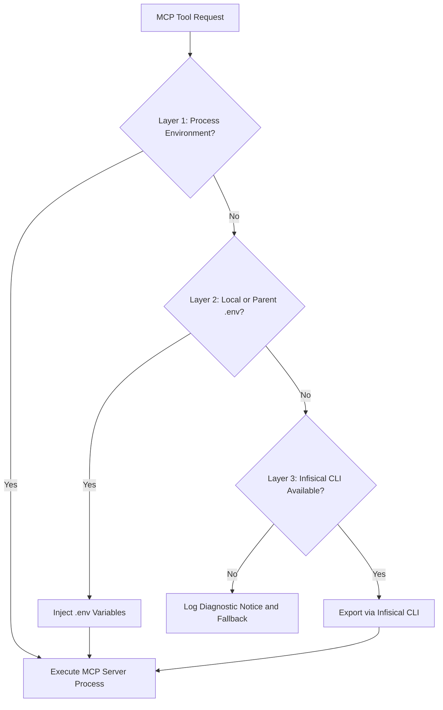

# Universal Agent Toolkit (`@tupynambalucas-dev/agent-toolkit`)

Universal enterprise AI agent governance, security guardrails, shared MCP connectors, and domain routing skills for the `tupynambalucas-dev` organization.

Compatible natively with **Google Antigravity (`agy`)**, **Anthropic Claude Code**, **Cursor**, and **GitHub Copilot**.

---

## 1. Directory Structure

```text
agent-toolkit/
├── package.json             # NPM package manifest for GitHub Packages
├── plugin.json              # Antigravity & Agent Plugins 1.0 manifest
├── .claude-plugin/
│   └── plugin.json          # Claude Code plugin manifest
├── mcp_config.json          # Standardized MCP server configuration definitions
├── rules/
│   └── AGENTS.md            # Enterprise governance constraints and always-on rules
├── skills/
│   ├── agent-router-expert/ # Domain query orchestrator and AGENTS.md router
│   ├── markdown-expert/     # Syntax, Prettier formatting, and Markdown standards
│   ├── plugin-expert/       # Antigravity and Agent plugin authoring standards
│   ├── skill-expert/        # Skill validation, evaluation, and progressive disclosure
│   ├── secrets-expert/      # Infisical integration, Universal Auth, and secret hygiene
│   └── github-org-manager/  # GitHub RBAC, functional teams, and ruleset enforcement
└── scripts/
    ├── mcp-runner.js        # 3-tier fallback environment loader for MCP servers
    └── mcp-gateway-router.js# Zero-downtime healthcheck proxy for gateway tools
```

---

## 2. Environment Variables and Secret Governance

The plugin requires API credentials and configuration tokens to operate its MCP connectors. To prevent blocking developers during local development, `scripts/mcp-runner.js` implements a **3-tier fallback resolution pipeline**:



### Execution Scenarios

#### A. Execution Inside `org-core` (Meta-Repository)

When `agent-toolkit` is run from within the root `org-core` directory:

- `scripts/mcp-runner.js` automatically searches up the directory tree to find `org-core/.env`.
- Alternatively, launch the agent session using Infisical:
  ```bash
  infisical run --projectId <PROJECT_ID> --env dev -- agy
  ```
- All environment variables are inherited seamlessly across the entire workspace.

#### B. Execution as a Standalone Workspace

When opening `agent-toolkit` independently:

- Copy the provided template to create a local `.env`:
  ```bash
  cp .env.example .env
  ```
- Populate `.env` with development tokens. This allows complete functionality without needing `infisical login`.
- If using Infisical directly:
  ```bash
  infisical run --projectId <AGENT_TOOLKIT_PROJECT_ID> --env dev -- npm test
  ```

### Required Environment Variables

| Variable Name | Required By | Description & Permissions |
| :--- | :--- | :--- |
| `GITHUB_TOKEN` | `github-mcp` | Fine-Grained PAT with `repo`, `members:write`, and `secrets:write` scopes. |
| `INFISICAL_UNIVERSAL_AUTH_CLIENT_ID` | `infisical-mcp` | Machine Identity Client ID configured in Infisical Cloud. |
| `INFISICAL_UNIVERSAL_AUTH_CLIENT_SECRET` | `infisical-mcp` | Machine Identity Client Secret with access to organization projects. |
| `INFISICAL_PROJECT_ID` | `infisical-mcp` | Target Infisical Project ID. |
| `INFISICAL_ENVIRONMENT` | `infisical-mcp` | Environment slug (`dev`, `staging`, `prod`). |
| `CONTEXT7_API_KEY` | `context7-mcp` | Context7 API key for querying technical documentation. |
| `FIRECRAWL_API_KEY` | `firecrawl-mcp` | Firecrawl API key for deep web and API documentation crawling. |
| `TUPYNAMBA_GATEWAY_TOKEN` | `enterprise-gateway` | Shared bearer token for internal Cortex AgentGateway proxy. |

---

## 3. Installation and Setup

### A. Antigravity CLI Plugin Installation

```bash
# Global installation from remote repository
agy plugin install https://github.com/tupynambalucas-dev/agent-toolkit

# Local development installation from workspace root
agy plugin install ./agent-toolkit
```

### B. Claude Code Installation

```bash
/plugin marketplace add tupynambalucas-dev/agent-toolkit
/plugin install agent-toolkit
```

### C. Repository DevDependency (GitHub Packages)

```bash
pnpm add -D @tupynambalucas-dev/agent-toolkit
```

Reference in `.agents/plugins.json`:

```json
{
  "entries": [
    { "path": "node_modules/@tupynambalucas-dev/agent-toolkit" }
  ]
}
```

---

## 4. Verification and Validation

Verify plugin integrity and strict manifest conformance using the Antigravity CLI:

```bash
agy plugin validate . --strict
```

---

## 5. Governance Constraints

All contributions and agent executions must adhere to organizational policies:

1. **Cryptographic Signing**: Every Git commit must be signed using SSH (`git commit -S -m "..."`).
2. **Conventional Commits**: Commit messages must adhere to the Conventional Commits v1.0.0 specification.
3. **Zero-Emoji Policy**: Emojis are strictly forbidden across all code, PRs, comments, and agent interactions.
4. **Secret Hygiene**: Plaintext credentials must never be committed to source control or logged in terminal outputs.

---

## License

This package is licensed under the [MIT License](https://github.com/tupynambalucas-dev/.github/blob/main/LICENSE).
