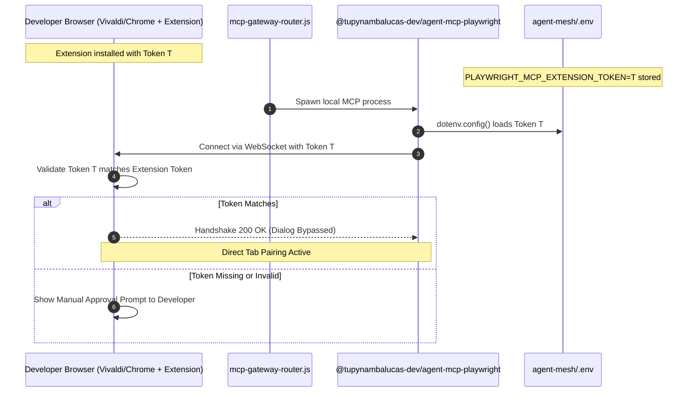

# Playwright MCP Extension Bridge & Token Architecture

This specification documents the **Playwright MCP Browser Extension Bridge** and the role of the **`PLAYWRIGHT_MCP_EXTENSION_TOKEN`** environment variable, derived from official Playwright MCP specifications and Chrome Web Store extension protocols.

---

## 1. What is the Playwright MCP Browser Extension?

The **Playwright Extension** (available on the Chrome Web Store and Microsoft Edge Add-ons) bridges the MCP server directly to the developer's everyday browser window (Vivaldi, Google Chrome, Microsoft Edge, Brave, Opera GX).

### Why the Extension Exists
In traditional headless or spawned browser automation:
- The agent launches an isolated browser process.
- The browser lacks the developer's saved sessions, active GitHub logins, SSO cookies, and open workspaces.
- Running parallel instances with the same user profile triggers Chromium profile lock errors (`User Data directory already in use`).

The Extension Bridge solves this by running **inside the existing browser instance**:
- Zero process conflicts.
- Zero need to restart the browser.
- Direct access to active authenticated tabs.
- Cross-platform parity across Windows, macOS, and Linux.

---

## 2. The Role of `PLAYWRIGHT_MCP_EXTENSION_TOKEN`

When the Playwright Extension is installed, it displays the following notification:

```
No clients are currently connected. You can connect from the Playwright CLI or MCP server by passing the --extension flag.
Set this environment variable to bypass the connection dialog:
PLAYWRIGHT_MCP_EXTENSION_TOKEN=<unique_token>
```

### 2.1 Security Boundary
Without authentication, any malicious local process running on the developer's workstation could open a WebSocket connection to the extension port and silently take control of open tabs (extracting banking credentials, email sessions, or sensitive code).

To prevent unauthorized hijacking:
1. **Default Mode (Without Token)**:
   Whenever an MCP client or agent connects to the extension, a browser dialog pops up asking:
   `"Allow Playwright MCP client to connect to this browser session? [Allow] [Deny]"`
   The developer must manually click "Allow" on every connection attempt.
2. **Authenticated Mode (With `PLAYWRIGHT_MCP_EXTENSION_TOKEN`)**:
   When the MCP server provides the matching token during the WebSocket handshake, the extension validates the cryptographic signature and **automatically bypasses the connection approval dialog**.
   Result: The agent connects seamlessly in the background without interrupting the developer's typing.

---

## 3. Automated Injection Strategy: Do We Need to Inject on Every Run?

**Answer: NO.** The developer does **not** need to manually pass or inject the token on every run.

In the Tupynamba Lucas enterprise monorepo architecture, environment variables cascade through deterministic layers:

### Layer 1: Developer Workstation Local `.env` (Zero Git Commit)
The token is written once to `agent-mesh/.env`:
```bash
PLAYWRIGHT_MCP_EXTENSION_TOKEN=IFfNwHXwLCURaEPRlwZbPkvgd8bzXT4dUNFbdeNuC-Q
```
Because `agent-mesh/.gitignore` strictly excludes `.env`, this secret is never exposed to Git repositories or remote branches.

### Layer 2: Runtime Automatic Loading via `dotenv`
The package `@tupynambalucas-dev/agent-mcp-playwright` executes `dotenv.config()` at the very top of `src/config.ts`. Any variable present in `agent-mesh/.env` is automatically parsed into `process.env` before any server logic executes.

### Layer 3: Infisical Machine Identity (Enterprise Sync)
For team members and CI synchronization, the token can be securely stored in Infisical:
```bash
infisical secrets set PLAYWRIGHT_MCP_EXTENSION_TOKEN="<token>" --env=dev
```
Developers running `infisical run -- pnpm dev` automatically receive their secrets in memory.

### Layer 4: MCP Client Environment Inheritance
In Antigravity plugins (`plugins/packages/web/mcp_config.json`), child MCP server processes automatically inherit the parent agent's `process.env`. Therefore, there is zero need to declare `${PLAYWRIGHT_MCP_EXTENSION_TOKEN}` manually in the `env` block of `mcp_config.json`—the token loaded into the developer session or sourced via `.env` propagates directly to the spawned process.

---

## 4. Operational Handshake Sequence


