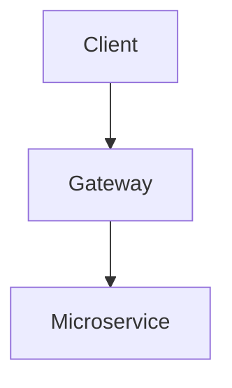

# Diátaxis Quadrant Templates Reference

## 1. Tutorial Template (`tutorials/`)
*Learning-oriented: Takes a beginner from zero to a working baseline.*

```markdown
---
sidebar_position: 1
title: Getting Started with [Topic]
description: Step-by-step introduction to setting up and running [Topic].
---

# Getting Started with [Topic]

Welcome to the [Topic] tutorial. In this guide, you will build [Product/Outcome] from scratch.

## Prerequisites
- Node.js v22+
- Access to [Environment]

## Step 1: Initialization
Run the setup command:
```bash
pnpm create [topic]
```

## Step 2: Configuration
Configure your initial state in `config.json`:
```json
{
  "active": true
}
```

## Step 3: Verification
Verify that your installation is running:
```bash
pnpm run test
```

## Next Steps
Now that you have a running instance, explore the [How-To Guides](../how-to-guides/) for specialized operations.
```

---

## 2. How-To Guide Template (`how-to-guides/`)
*Problem-oriented: Solves a specific real-world task.*

```markdown
---
title: How to [Accomplish Task]
description: Step-by-step instructions to [accomplish task] in [system].
---

# How to [Accomplish Task]

This guide explains how to [accomplish task] when [condition/problem occurs].

## Problem Context
When [scenario occurs], you need to [action].

## Solution Steps

### 1. Step Title
Run the command:
```bash
pnpm run fix
```

### 2. Verify Output
Inspect status:
```bash
git status
```

## Troubleshooting
- **Error X**: Check that [requirement] is fulfilled.
```

---

## 3. Reference Template (`reference/`)
*Information-oriented: Definitive technical specifications, tables, and APIs.*

```markdown
---
title: [Service/Component] Specification Reference
description: API parameters, schemas, and configurations for [Service/Component].
---

# [Service/Component] Reference

## Configuration Schema

| Parameter | Type | Required | Default | Description |
| :--- | :--- | :---: | :--- | :--- |
| `host` | string | Yes | N/A | Target host address |
| `port` | number | No | `8080` | Listening port |

## API Endpoints

### `GET /health`
Returns system health state.
```

---

## 4. Explanation Template (`explanation/`)
*Understanding-oriented: Architectural context, design trade-offs, and history.*

```markdown
---
title: Architecture and Rationale for [System]
description: Deep dive into the architectural design decisions behind [System].
---

# Architecture and Rationale for [System]

## Background
Explain why the system was created and the problem it addresses.

## Architectural Decisions
Discuss alternative designs considered and why the chosen topology was selected.

## System Topology

```
