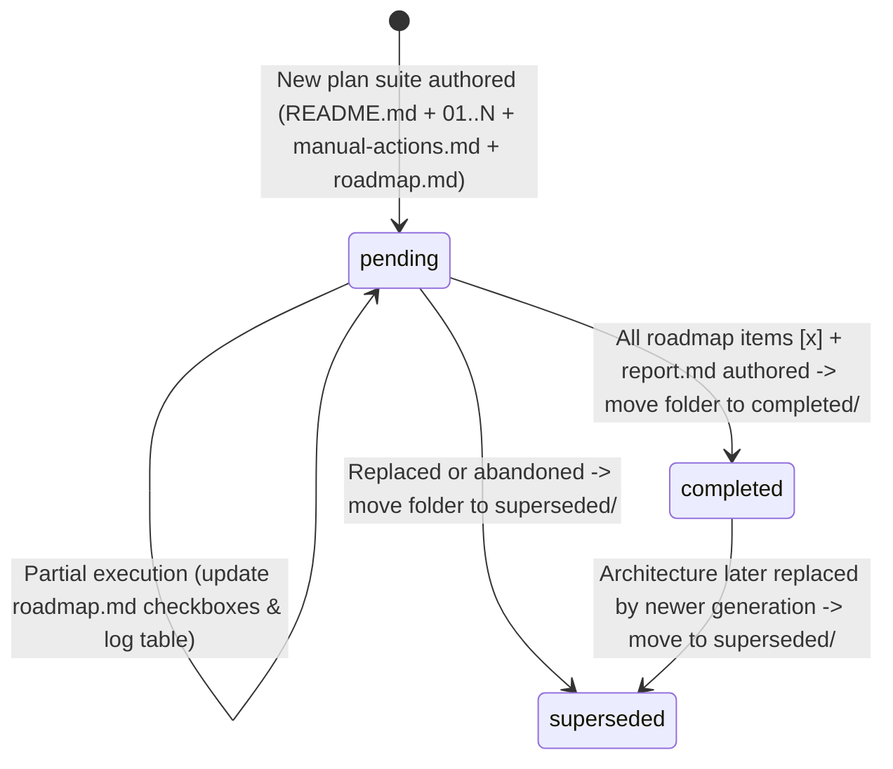

# Plan Lifecycle State Machine & Governance Rules

Detailed operational rules governing state transitions, multi-session continuity, Dual-Storage parity, and consolidation across `<target-repo>/.agents/plans/`.

## Contents
- [1. Lifecycle State Machine](#1-lifecycle-state-machine)
- [2. Multi-Session Continuity Protocol](#2-multi-session-continuity-protocol)
- [3. Target Repository Resolution Matrix](#3-target-repository-resolution-matrix)
- [4. Dual-Storage Synchronization Rules](#4-dual-storage-synchronization-rules)

---

## 1. Lifecycle State Machine

### Mandatory Transition Guards
1. **Creation Guard (`[*] -> pending/`)**:
   - Every new plan MUST be created inside `<target-repo>/.agents/plans/pending/<plan-slug>/`.
   - Never create loose markdown files at `<target-repo>/.agents/plans/<slug>.md`.
   - Must include at minimum: `README.md`, at least one ordered specification (`01-*.md`), `manual-actions.md`, and `roadmap.md`.
2. **Incremental Progress Guard (`pending/ -> pending/`)**:
   - Whenever an agent executes only part of a plan (for example, Phase 1 out of 4), the agent MUST update `roadmap.md` before ending the turn:
     - Mark finished checkboxes `- [x]` with commit/PR/test references.
     - Append a timestamped row to the **Registro Incremental de Execucao** table stating the exact next step.
3. **Completion Guard (`pending/ -> completed/`)**:
   - A plan folder MUST NOT be moved to `completed/` until:
     1. Every actionable checkbox in `roadmap.md` is `[x]` (or explicitly marked canceled with rationale).
     2. `report.md` is authored inside `<plan-slug>/` containing verifiable test/build/API evidence.
   - Move the **entire `<plan-slug>/` directory** into `<target-repo>/.agents/plans/completed/<plan-slug>/` so plans, roadmaps, manual actions, and execution reports stay permanently co-located.
4. **Supersession Guard (`pending|completed -> superseded/`)**:
   - When consolidating fragmented plans or retiring obsolete drafts, move the old files/folders to `<target-repo>/.agents/plans/superseded/` rather than leaving stale drafts in `pending/`.
   - Document the replaced files in the new suite's lineage table.

---

## 2. Multi-Session Continuity Protocol

When resuming work on an existing plan in a new agent session:
1. Inspect `<target-repo>/.agents/plans/pending/` first to locate active suites.
2. Read `pending/<plan-slug>/roadmap.md` and `README.md` before making assumptions about progress.
3. Verify live repository/cloud state (`git status`, `gh pr list`, API probes) against the checked boxes in `roadmap.md`.
4. Resume from the first unchecked (`- [ ]`) phase, updating `roadmap.md` immediately upon finishing each phase.

---

## 3. Target Repository Resolution Matrix

| Domain / Scope | Authoritative `<target-repo>` |
| :--- | :--- |
| Identity Portal, Token Broker, GitHub App manifests, WSL2 distros, `gh-tl`, IDE environment | `foundation/.agents/plans/` |
| AI Plugins, Skills, Rules, Hooks, MCP Servers, Presets, Antigravity Models docs | `agent-mesh/.agents/plans/` |
| Core Backend Services, Kubernetes Cortex manifests, Platform Apps | `platform/.agents/plans/` |
| Docusaurus Documentation Hub & Crowdin Localization | `docs/.agents/plans/` |
| Org-wide GitHub community health, starter workflows, `.github` policies | `.github/.agents/plans/` |
| Commercial Products (`omnichannel`, `elo-organico`, `tessel`) | `ecosystem/commercial/<product>/.agents/plans/` |
| Pure Multi-Repo Meta-Orchestration (`mani.yaml`, `.code-workspace`, multi-account `.gitconfig`) | `org/.agents/plans/` |

---

## 4. Dual-Storage Synchronization Rules

1. **Workspace Copy**: `<target-repo>/.agents/plans/{pending,completed}/<plan-slug>/` (git-ignored via `.gitignore`, searchable via `.ignore` + `.rgignore` negation `!.agents/plans/**`).
2. **Session Brain Mirror**: `<appDataDir>/brain/<conversation-id>/<plan-slug>/` (byte-for-byte identical SHA-256 hashes).
3. **Update Discipline**: Every edit to `roadmap.md`, `manual-actions.md`, numbered modules, or `report.md` MUST synchronize both copies and pass `scripts/validate-plan.cjs`.
