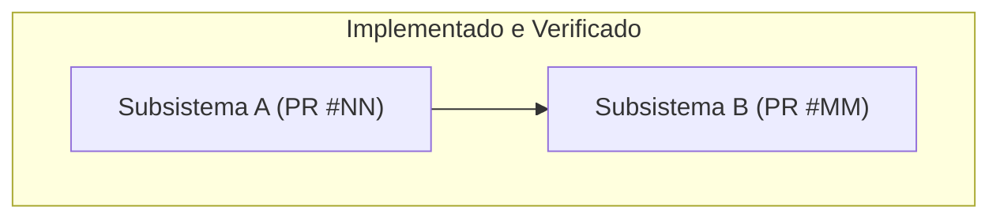

# Enterprise Plan Suite Templates (`pt-BR`)

Authoritative Brazilian Portuguese (`pt-BR`) templates for every file inside `<target-repo>/.agents/plans/{pending,completed}/<plan-slug>/`.

## Contents
- [1. Master `README.md` Template](#1-master-readmemd-template)
- [2. Numbered Technical Specification (`01-*.md`) Template](#2-numbered-technical-specification-01-md-template)
- [3. Living `roadmap.md` Template](#3-living-roadmapmd-template)
- [4. Dedicated `manual-actions.md` Template](#4-dedicated-manual-actionsmd-template)
- [5. Post-Execution `report.md` Template](#5-post-execution-reportmd-template)

---

## 1. Master `README.md` Template

```markdown
# [Titulo do Plano]: Suite Arquitetural e Plano de Execucao

Plano arquitetural mestre, especificacao tecnica modular e roteiro de execucao para [Sistema/Dominio] no repositorio `<target-repo>`.

**Status**: Pendente (Em Execucao)
**Repositorio Alvo**: `tupynambalucas-dev/<target-repo>`
**Data de Criacao**: YYYY-MM-DD
**Ultima Atualizacao**: YYYY-MM-DD

---

## 1. Sumario Executivo e Baseline Estrategico

- **Resultado Esperado**: Descricao objetiva e mensuravel do estado final.
- **Escopo Incluido**: Componentes, servicos e integracoes cobertos.
- **Fora de Escopo**: Fronteiras explicitas que nao devem ser alteradas nesta entrega.
- **Decisoes Arquiteturais Ratificadas**: Padroes, seguranca, segregacao de funcoes e restricoes tecnicas.

---

## 2. Arquitetura e Topologia

\`\`\`mermaid
flowchart TD
    subgraph CamadaA ["Dominio A"]
        CompA["Componente A"]
    end
    subgraph CamadaB ["Dominio B"]
        CompB["Componente B"]
    end
    CompA --> CompB
\`\`\`

---

## 3. Catalogo da Suite de Documentos (Ordem de Execucao)

| # | Documento | Foco Principal | Quando Consultar |
| :-: | :--- | :--- | :--- |
| **01** | [01 - Diagnostico e Estado Atual](./01-diagnostico-e-estado-atual.md) | Auditoria do codigo atual, lacunas e pre-requisitos. | Antes de iniciar qualquer alteracao |
| **02** | [02 - Especificacao Tecnica](./02-especificacao-tecnica.md) | Contratos, schemas, APIs e implementacao detalhada. | Durante a codificacao |
| **M** | [Acoes Manuais do Mantenedor](./manual-actions.md) | Passos obrigatorios em paineis web, OAuth ou cofres de segredos. | Etapas Human-in-the-Loop |
| **R** | [Roadmap Vivo de Execucao](./roadmap.md) | Checklist sequencial atualizado apos cada etapa concluida. | A cada turno de execucao |
| **F** | [Relatorio de Execucao](./report.md) *(gerado ao concluir)* | Evidencias finais, PRs, testes e encerramento antes de mover para `completed/`. | Ao finalizar 100% do plano |

---

## 4. Navegacao

- [Planos Pendentes](../)
- [Planos Concluidos](../../completed/)
- [Planos Substituidos](../../superseded/)
- [Contexto Raiz do Repositorio](../../../../AGENTS.md)
```

---

## 2. Numbered Technical Specification (`01-*.md`) Template

```markdown
# 01 - [Titulo do Modulo Tecnico]

Especificacao detalhada da etapa [N] do plano `[plan-slug]`, cobrindo contratos, alteracoes de codigo e criterios de validacao.

---

## 1. Contexto e Premissas

Resumo objetivo do estado atual verificado no repositorio alvo e restricoes tecnicas aplicaveis.

---

## 2. Especificacao de Alteracoes

### 2.1. Componente / Arquivo Alvo
- **Arquivo**: `caminho/relativo/do/arquivo.ts`
- **Alteracao**: Descricao precisa da mudanca, assinaturas, tipos e comportamento esperado.
- **Criterios de Aceite**: Comandos de teste e assercoes mensuraveis.

---

## 3. Fluxo de Dados / Sequencia

\`\`\`mermaid
sequenceDiagram
    autonumber
    participant A as Origem
    participant B as Destino
    A->>B: Requisicao validada
    B-->>A: Resposta deterministica
\`\`\`
```

---

## 3. Living `roadmap.md` Template

Update this file at the end of EVERY turn where any task or phase is executed.

```markdown
# Roadmap Vivo de Execucao (`<plan-slug>`)

Checklist sequencial e rastreabilidade incremental de execucao. Deve ser atualizado ao termino de cada etapa executada para preservar estado exato entre sessoes.

**Estado do Plano**: `pending` (mover para `completed/` somente apos 100% `[x]` e geracao de `report.md`)
**Ultima Atualizacao**: YYYY-MM-DD

---

## 1. Fases de Execucao

### Fase 1: [Nome da Fase]
- [ ] Tarefa 1.1: Descricao acionavel com arquivo alvo e criterio verificavel.
- [ ] Tarefa 1.2: Validacao automatizada (`pnpm typecheck`, testes unitarios).

### Fase 2: [Nome da Fase]
- [ ] Tarefa 2.1: Descricao acionavel.
- [ ] Tarefa 2.2: Integracao ponta a ponta e verificacao ao vivo.

### Fase Final: Encerramento e Arquivamento
- [ ] Executar todas as acoes pendentes em [manual-actions.md](./manual-actions.md).
- [ ] Criar o relatorio final de verificacao em `report.md`.
- [ ] Mover a pasta `<plan-slug>/` de `pending/` para `completed/` e sincronizar Dual-Storage.

---

## 2. Registro Incremental de Execucao

| Data | Fase / Etapa | Status | Evidencia (Commit / PR / Validacao) | Proxima Etapa |
| :--- | :--- | :--- | :--- | :--- |
| YYYY-MM-DD | Criacao da suite | Criado | Suite validada via `validate-plan.cjs` | Fase 1 |
```

---

## 4. Dedicated `manual-actions.md` Template

Always separate human-in-the-loop operations from automated agent tasks.

```markdown
# Acoes Manuais do Mantenedor (`<plan-slug>`)

Runbook dedicado exclusivamente as acoes que exigem intervencao manual do mantenedor (paineis web com 2FA/Sudo Mode, autorizacoes OAuth, cadastro de segredos em cofres externos ou confirmacoes destrutivas).

*(Caso o plano seja 100% automatizado, registre explicitamente: "Nenhuma acao manual necessaria neste plano.")*

---

## 1. Pre-Requisitos

- Conta autenticada com privilegio adequado no provedor alvo.
- Acesso ao cofre de segredos (Infisical Cloud / `.env` local).

---

## 2. Procedimentos Manuais Passo a Passo

### Acao Manual 1: [Titulo Claro da Acao]
- **Quando executar**: Apos a Fase [N] estar concluida.
- **URL Direta**: `https://...`
- **Passos Exatos**:
  1. Acesse a URL informada e localize a secao **[Nome Exato da Secao]**.
  2. Preencha o campo **[Nome do Campo]** com o valor exato: `valor`.
  3. Clique em **[Nome do Botao]** para salvar e confirmar.
- **Validacao no Terminal**:
  ```bash
  # Comando deterministico para comprovar que a acao manual surtiu efeito
  ```
- **Checklist**:
  - [ ] Acao Manual 1 concluida e verificada.
```

---

## 5. Robust Living & Post-Execution `report.md` Template

Author a living `report.md` inside `pending/<plan-slug>/report.md` whenever automated phases pause for human-in-the-loop manual steps, and finalize it (`Status Final: Concluido e Verificado`) immediately before moving the suite to `completed/<plan-slug>/`. Reports MUST explain the actual implemented capabilities in deep technical detail (endpoints, bindings, security controls, contracts, and operational flows) — never produce a superficial summary.

```markdown
# Relatorio Tecnico de Execucao e Funcionalidades Atuais (`<plan-slug>`)

Relatorio forense detalhado que documenta integralmente as funcionalidades atualmente implementadas, a arquitetura tecnica ativa, os contratos de API e seguranca, as evidencias de testes/CI/CodeQL e o encerramento formal do plano `<plan-slug>` no repositorio `<target-repo>`.

**Status**: Em Andamento (Fases 0..N concluidas) | Concluido e Verificado
**Repositorio Alvo**: `tupynambalucas-dev/<target-repo>`
**Ultima Atualizacao**: YYYY-MM-DD

---

## 1. Resumo Executivo e Estado Atual da Arquitetura

Sintese objetiva do estado atual do sistema, diferenciando o que ja esta implementado/verificado em codigo do que ainda aguarda ativacao (quando aplicavel).



---

## 2. Funcionalidades Atuais Implementadas (Detalhamento Tecnico por Subsistema)

### 2.1. [Nome do Subsistema / Servico] (`caminho/do/modulo/` — PR `#NN`)
- **Arquitetura e Configuracao**: Bindings, manifestos, tipos gerados, flags de runtime e observabilidade.
- **Endpoints, Comandos e Contratos**: Rotas HTTP, ferramentas MCP, schemas de entrada/saida, tratamento de idempotencia e limites de plataforma.
- **Controles de Seguranca e Isolamento**: Verificacao criptografica (HMAC/JWT/JWKS), segregacao de funcoes (SoD), gestao de segredos e higiene de logs.

### 2.2. [Proximo Subsistema / Integracao] (`caminho/` — PR `#MM`)
- Detalhamento objetivo das capacidades implementadas, arquivos modificados e fluxo operacional resultante.

---

## 3. Matriz de PRs, Commits e Status de CI/CodeQL

| Fase | PR | Branch / Commit(s) | SSH Verified | CI / Testes | CodeQL |
| :---: | :--- | :--- | :---: | :---: | :---: |
| Fase 1 | `<repo>#NN` | `feat/<slug>` (`<sha>`) | Sim | `SUCCESS` | `SUCCESS` |

---

## 4. Evidencias Forenses de Testes, Build e Auditoria

```text
# Saidas reais de testes unitarios, build, typecheck, dry-run, lint e auditorias ao vivo
```

---

## 5. Desvios Tecnicos, Decisoes de Engenharia e Licoes Aprendidas

- Documentar ajustes feitos em relacao ao desenho inicial, limites de plataforma descobertos em documentacao oficial, alertas de seguranca corrigidos (ex: CodeQL) e justificativas tecnicas.

---

## 6. Pendencias Restantes e Checklist de Encerramento Formal

- [ ] Todos os itens de [roadmap.md](./roadmap.md) concluidos (`100% [x]`).
- [ ] Todas as acoes de [manual-actions.md](./manual-actions.md) concluidas.
- [ ] Relatorio finalizado com evidencias ponta a ponta e suite movida para `completed/<plan-slug>/` com paridade Dual-Storage.
```
