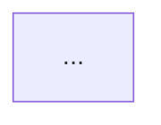

# Enterprise README.md Architecture & Template Standard

This document establishes the authoritative enterprise specification for authoring, structuring, and auditing `README.md` files across all meta-repositories (`org`, `ecosystem`), monorepos, governance repositories, subsystems, and packages in the `tupynambalucas-dev` organization and external consumer workspaces.

---

## 1. Canonical Upstream Standards & Attribution

This specification synthesizes industry-standard documentation engineering benchmarks with enterprise monorepo governance:

1. **Standard Readme Specification v1.3.1 (`standard-readme`)**: Canonical section ordering, title-to-package naming alignment, short/long description separation, installation, usage, contributing, and SPDX license footer requirements. Source: [https://github.com/RichardLitt/standard-readme/blob/main/spec.md](https://github.com/RichardLitt/standard-readme/blob/main/spec.md)
2. **GitHub Official Repository README Guidelines**: Relative path resolution across branches, automatic outline table-of-contents generation from numbered headings, `.github` / root / `docs` precedence, and 500 KiB rendering ceilings. Source: [https://docs.github.com/en/repositories/managing-your-repositorys-settings-and-features/customizing-your-repository/about-readmes](https://docs.github.com/en/repositories/managing-your-repositorys-settings-and-features/customizing-your-repository/about-readmes)
3. **Make a README (`makeareadme.com`)**: Developer onboarding clarity, explicit prerequisites, copy-paste-ready command blocks, and separation of user quick-start from maintainer workflows. Source: [https://www.makeareadme.com/](https://www.makeareadme.com/)
4. **Zalando Open Source Enterprise README Template**: Enterprise product framing, architectural overview, prerequisite verification, testing/quality gates, and governance links. Source: [https://github.com/zalando-incubator/new-project](https://github.com/zalando-incubator/new-project)

---

## 2. Universal Syntax & Typography Invariants

Every `README.md` file across all repository layers MUST obey the following non-negotiable formatting invariants:

1. **Canonical H1 Title (`#`)**:
   - Format: `# <Human-Readable Title> (\`<canonical-identifier>\`)`
   - For npm/pnpm monorepos and packages, `<canonical-identifier>` MUST match the `"name"` field in `package.json` (e.g., `# Core Platform Monorepo (\`@tupynambalucas-dev/platform\`)`).
   - For Mani meta-repositories, Go monorepos, or GitHub administrative repositories without a root `package.json`, `<canonical-identifier>` MUST match `<org>/<repo>` (e.g., `# Umbrella Meta-Repository (\`tupynambalucas-dev/org\`)`).
2. **Executive Summary Paragraph**:
   - Immediately following the H1 heading, provide a concise 1–2 sentence executive summary explaining **what** the repository/module is, **what problem** it solves, and **what core technologies** power it.
   - Do NOT prefix the executive summary with a blockquote (`> `). Reserve blockquotes strictly for GitHub Flavored Markdown (GFM) alerts (`> [!NOTE]`, `> [!IMPORTANT]`, `> [!TIP]`, `> [!WARNING]`, `> [!CAUTION]`).
3. **Numbered H2 Sections & Horizontal Dividers**:
   - All top-level sections (`##`) in root and subsystem `README.md` files MUST use sequential Arabic numerals (`## 1. ...`, `## 2. ...`, etc.) separated by horizontal rules (`---`).
   - GitHub automatically generates a navigable document outline from headings; numbered H2 headings provide deterministic anchor links and unambiguous cross-referencing in engineering reviews and agent prompts.
4. **Strict Relative Linking**:
   - All links pointing to files or directories inside the repository MUST use relative paths starting with `./` or `../` (e.g., `[core/README.md](./core/README.md)`).
   - Hardcoded filesystem paths (`C:/...`, `/Users/...`, `file:///...`) are strictly forbidden.
   - Every linked file or directory MUST exist on disk at the time the `README.md` is saved.
5. **Code Fence Language Identifiers**:
   - Every fenced code block MUST declare an explicit language tag (`bash`, `powershell`, `json`, `yaml`, `typescript`, `text`, `mermaid`). Bare triple backticks (` ``` `) are prohibited.
6. **Table Formatting**:
   - All Markdown tables MUST declare explicit column alignment delimiters (`| :--- | :--- |` or `| :-: | :--- |`) and balanced pipe delimiters.
7. **Zero-Emoji & Language Invariants**:
   - Emojis are strictly prohibited in headings, body text, tables, badges, and callouts.
   - All `README.md` files MUST be written strictly in English (`en-US`).

---

## 3. Repository Archetype Templates

Every repository or package belongs to one of four structural archetypes. Agents MUST select the matching archetype template below when authoring or refactoring a `README.md`.

### Archetype A: Meta-Repository / Mani Orchestrator Root (`org`, `ecosystem`)

Use this template for umbrella repositories that orchestrate multiple independent Git repositories via `mani.yaml` and `.code-workspace`.

````markdown
# <Meta-Repository Title> (`<org>/<repo>`)

<Concise 1-2 sentence executive summary describing the meta-repository scope, Mani orchestration model, and independent Git lifecycle preservation.>

---

## 1. Architecture Overview

<Brief paragraph explaining the ecosystem topology and multi-repository boundaries.>



---

## 2. Managed Repositories & Navigation

| Repository | Path / Namespace | Branch | Documentation | Agent Context | Purpose |
| :--- | :--- | :--- | :--- | :--- | :--- |
| [`<repo-slug>`](./<path>/README.md) | `<path>` | `main` | [`README.md`](./<path>/README.md) | [`AGENTS.md`](./<path>/AGENTS.md) | <Concise responsibility summary.> |

### Multi-Root IDE Workspace

Open [`tupynambalucas-dev-<domain>.code-workspace`](./tupynambalucas-dev-<domain>.code-workspace) in VS Code or Antigravity IDE to mount all managed repositories in a unified workspace with integrated Mani tasks.

---

## 3. Environment, Secret & Plugin Governance

<Document the 3-tier secret resolution architecture (Process Environment -> Local/Ancestor `.env` -> Infisical CLI) and the AI Agent Mesh Dual Consumption Model.>

---

## 4. Getting Started

### Prerequisites

- **Git**: `>= 2.40` (with SSH commit signing configured)
- **Mani CLI**: `>= 0.30`
- **Infisical CLI**: `>= 0.31` (optional for cloud secret injection)

### Workspace Initialization

```bash
git clone git@github.com:<org>/<repo>.git
cd <repo>
mani sync
```

---

## 5. Multi-Repository Operations

| Command | Target Scope | Description |
| :--- | :--- | :--- |
| `mani sync` | All repositories | Clones and synchronizes all managed repositories declared in `mani.yaml`. |
| `mani run status` | All repositories | Executes `git status -s` across all managed repositories. |
| `mani run fetch` | All repositories | Fetches remote updates and prunes stale references across all projects. |
| `mani run pull` | All repositories | Pulls latest `main` branch updates across all projects. |
| `mani run branch` | All repositories | Displays the active Git branch for each managed repository in a table. |

---

## 6. Governance & Contributing Standards

All contributions across managed repositories must comply with organizational engineering governance:

1. **Cryptographic Commit Signing**: All Git commits and annotated tags MUST be signed using SSH (`git commit -S -m "..."`).
2. **Conventional Commits**: Commit messages must follow the Conventional Commits v1.0.0 specification (`<type>(<scope>): <description>`).
3. **Single-Branch GitHub Flow**: Feature and bugfix branches (`feat/<slug>`, `fix/<slug>`, `docs/<slug>`, `chore/<slug>`) branch off `main` and merge via reviewed Pull Requests.
4. **Zero-Emoji Invariant**: Emojis are strictly prohibited across code, documentation, commit messages, and pull requests.
5. **Secret Hygiene**: Plaintext credentials must never be committed; secrets resolve via Infisical or local `.env` files.
6. **AI Agent Context**: Autonomous agents operating in this workspace MUST read [AGENTS.md](./AGENTS.md) prior to executing tasks.

---

## 7. License

Licensed under the [Apache License 2.0](./LICENSE). Copyright (c) 2026 tupynambalucas.dev.
````

---

### Archetype B: Monorepo, Product, or Service Root (`agent-mesh`, `platform`, `docs`, `workstation`, `omnichannel`, `tessel`)

Use this template for sovereign product monorepos, service repositories, documentation hubs, and developer workstation monorepos.

````markdown
# <Project Title> (`<@scope/package-or-repo-id>`)

<Concise 1-2 sentence executive summary stating what the project does, the problem it solves, and the core technology stack.>

> [!NOTE]
> <Optional contextual callout linking to the public documentation portal, upstream mesh, or runtime highlights.>

---

## 1. Architecture Overview

<1-2 paragraphs explaining the bounded-context partitioning, runtime architecture, and data/control flow.>


```text
<repo-root>/
├── <subsystem-a>/           # <Responsibility description>
├── <subsystem-b>/           # <Responsibility description>
├── AGENTS.md                # Sovereign Layer-1 AI agent context router
├── README.md                # Primary developer documentation
└── package.json             # Root workspace manifest and pipeline scripts
```

---

## 2. Subsystems & Navigation

| Subsystem / Workspace | Package / Scope | Documentation | Agent Context | Responsibilities |
| :--- | :--- | :--- | :--- | :--- |
| **`<path>`** | `<@scope/pkg>` | [`<path>/README.md`](./<path>/README.md) | [`<path>/AGENTS.md`](./<path>/AGENTS.md) | <Concise description of domain boundaries and exports.> |

---

## 3. Environment & Secret Governance

<Explain how environment variables and secrets are injected (Infisical CLI `infisical run`, `.env.example` -> `.env` fallback, and key environment variables table if applicable).>

---

## 4. Getting Started

### Prerequisites

- **Node.js**: `<version>` (or **Go** / **Docker** / **WSL2** as applicable)
- **pnpm**: `<version>` (configured with workspace catalogs)

### Installation & Local Startup

```bash
# 1. Clone the repository
git clone git@github.com:<org>/<repo>.git
cd <repo>

# 2. Install workspace dependencies
pnpm install

# 3. Start local development pipeline
pnpm dev
```

---

## 5. Development & Pipeline Scripts

| Command | Description |
| :--- | :--- |
| `pnpm <script>` | <Exact description matching the script defined in root `package.json`> |

---

## 6. Governance & Contributing Standards

1. **Cryptographic Commit Signing**: All Git commits and annotated tags MUST be signed using SSH (`git commit -S -m "..."`).
2. **Conventional Commits**: Commit messages must follow the Conventional Commits v1.0.0 specification (`<type>(<scope>): <description>`).
3. **Single-Branch GitHub Flow**: Short-lived branches (`feat/<slug>`, `fix/<slug>`, `docs/<slug>`, `chore/<slug>`) branch from and merge back into `main` via Pull Request.
4. **Zero-Emoji Invariant**: Emojis are strictly prohibited across source code, documentation, commit messages, and pull requests.
5. **Secret Hygiene**: Never commit `.env` files or plaintext credentials; use `.env.example` placeholders and Infisical secret injection.
6. **AI Agent Context**: Autonomous agents operating in this repository MUST read [AGENTS.md](./AGENTS.md) before modifying files.

---

## 7. License

Licensed under the [Apache License 2.0](./LICENSE.md). Copyright (c) 2026 tupynambalucas.dev.
````

---

### Archetype C: Organization Governance & Administrative Repository Root (`.github`, `.github-private`)

Use this template for specialized GitHub organization governance repositories.

````markdown
# <Governance Repository Title> (`<org>/<repo>`)

<Concise 1-2 sentence executive summary explaining the administrative role of the repository within the GitHub organization.>

---

## 1. Architecture Overview

<Explanation of GitHub native platform behavior (public fallback inheritance or private member profile + Copilot enterprise governance) and annotated ASCII directory tree.>

---

## 2. Subsystems & Navigation

| Subsystem / File | Agent Context | Documentation / Entrypoint | Purpose |
| :--- | :--- | :--- | :--- |
| **`<subsystem>`** | [`<path>/AGENTS.md`](./<path>/AGENTS.md) | [`<path>/README.md`](./<path>/README.md) | <Concise description.> |

---

## 3. Core Capabilities & Governance Model

<Detailed breakdown of profile rendering, community health inheritance, or the `.github` vs `.github-private` responsibility matrix.>

---

## 4. Connected Ecosystem

| Repository / Portal | Location | Role |
| :--- | :--- | :--- |
| **Umbrella Meta-Repository** | [`tupynambalucas-dev/org`](https://github.com/tupynambalucas-dev/org) | Multi-repository Mani orchestrator and canonical multi-root workspace. |

---

## 5. Governance & Contributing Standards

1. **Cryptographic Commit Signing**: All Git commits and annotated tags MUST be signed using SSH (`git commit -S -m "..."`).
2. **Conventional Commits**: All commit messages MUST conform to Conventional Commits v1.0.0 (`<type>(<scope>): <description>`).
3. **Single-Branch GitHub Flow**: All changes must be proposed via short-lived branches (`feat/*`, `fix/*`, `docs/*`, `chore/*`) targeting `main`.
4. **Zero-Emoji Invariant**: Emojis are strictly prohibited across all documentation, templates, commit messages, and pull requests.
5. **Secret Hygiene**: Real credentials must never be committed; all secrets resolve via Infisical Universal Auth.
6. **AI Agent Context**: Autonomous agents operating in this repository MUST read [AGENTS.md](./AGENTS.md) before modifying files.

---

## 6. License

Licensed under the [Apache License 2.0](./LICENSE). Copyright (c) 2026 tupynambalucas.dev.
````

---

### Archetype D: Layer-2 Subsystem & Layer-3 Package (`plugins/packages/*`, `mcp/servers/*`, `apps/*`, `packages/*`)

Use this template for internal monorepo subsystems and publishable or private workspace packages.

````markdown
# <Subsystem or Package Title> (`<@scope/package-name>`)

<Concise 1-2 sentence summary of the package or subsystem responsibilities and runtime target.>

---

## 1. Overview

<Architectural role of the package within the parent monorepo and its key domain contracts.>

---

## 2. Capabilities / Exports Catalog

<Structured table or bulleted specification of exported modules, CLI commands, Agent Skills, or MCP tools.>

---

## 3. Directory Layout

```text
<package-dir>/
├── src/                     # Source implementation
├── package.json             # Package manifest and scripts
├── tsconfig.json            # Composite TypeScript configuration
└── README.md                # Package documentation
```

---

## 4. Configuration & Usage

<Environment variables, import examples, or plugin registration snippets.>

---

## 5. Development Scripts

| Command | Description |
| :--- | :--- |
| `pnpm build` | Compiles TypeScript sources to `dist/`. |
| `pnpm typecheck` | Verifies TypeScript types without emitting files. |
| `pnpm lint` | Runs ESLint static analysis across package sources. |

---

## 6. Governance & Context

- **Parent Monorepo**: [`../../README.md`](../../README.md)
- **Agent Context Router**: [`./AGENTS.md`](./AGENTS.md) (or parent [`../AGENTS.md`](../AGENTS.md))
- **Zero-Emoji & Language Policy**: Strictly authored in `en-US` with zero emojis.
````
