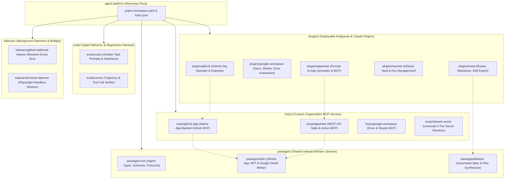
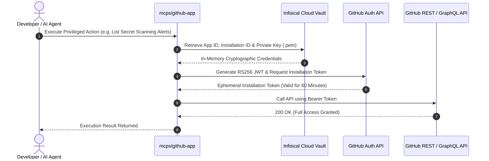

# Agent Ecosystem Monorepo & GitHub App Architecture Specification

This specification defines the architectural blueprint for restructuring `agent-toolkit` from a monolithic
plugin container into an enterprise-grade, bounded-context **Autonomous Agent Monorepo** powered by
`pnpm workspace`. It also formalizes the implementation strategy for transitioning `github-org-manager` and
associated agent tools to a dedicated **GitHub App** machine identity.

---

## 1. Executive Vision & Repository Nomenclature Analysis

### 1.1 The Limitations of the Current Monolithic Structure
The existing `agent-toolkit` repository currently bundles all skills (`github-org-manager`, `secrets-expert`,
`agent-router-expert`, `markdown-expert`, `skill-expert`, `plugin-expert`) and all MCP configurations into a
single root `plugin.json` manifest. While effective for initial prototyping, this monolithic model creates
several architectural bottlenecks:
1. **Context Pollution**: Agents loading the plugin are exposed to tools, skills, and instructions outside
   their active task domain.
2. **Coupled Lifecycles**: A change to a GitHub management skill requires re-evaluating the entire toolkit.
3. **Inability to Support Specialized Plugins**: Greenfield workflows like Google Workspace automation and
   AppSheet generation require distinct credentials, dependencies, and MCP runners that should not be
   forced onto basic coding tasks.
4. **Lack of Internal Modularization**: No shared domain libraries (`@tupynambalucas-dev/agent-core`,
   `@tupynambalucas-dev/agent-auth`) can be published or consumed by other submodules.

### 1.2 Repository Naming Evaluation

To align with enterprise standards across `tupynambalucas-dev` and reflect its expanded role as an
organization-wide intelligence substrate, three naming strategies have been evaluated:

| Proposed Name | Semantic Focus | Advantages | Trade-offs & Migration Cost |
| :--- | :--- | :--- | :--- |
| **`agent-toolkit` (Current)** | Tooling & Utilities | Zero migration cost; already pinned in `org-core` submodules, npm dependencies, and Git pointers. | Suboptimal branding: implies a passive collection of scripts rather than an active autonomous system. |
| **`agent-platform`** | Enterprise Substrate | Mirrors `platform` monorepo. Clearly communicates that this is the primary agentic engine of the organization. | Requires updating git submodules, package names (`@tupynambalucas-dev/agent-platform`), and documentation. |
| **`agent-mesh`** | Distributed Network | Emphasizes the decentralized, interconnected nature of specialized plugins, MCP servers, and autonomous subagents. | Slightly more abstract terminology; requires full submodule pointer migration. |
| **`cortex`** | Cognitive Hub | Directly links with `platform/hub/cortex` services. High technical elegance. | Collides with existing `cortex-*` packages inside `platform`. |

> [!NOTE]
> **Architectural Recommendation**: The name **`agent-platform`** (or **`agent-mesh`**) is the superior
> long-term nomenclature for the repository. However, the directory restructuring defined in this document
> is 100% decoupled from the repository name and can be implemented immediately within the existing
> `agent-toolkit` workspace, followed by an atomic repository rename when convenient.

---

## 2. Bounded-Context Monorepo Topology (`pnpm workspace`)

Following the architectural patterns established in [platform](file:///C:/Users/tupyn/projects/organizations/tupynambalucas-dev/org-core/platform),
the agent monorepo adopts a 6-tier bounded-context topology:



---

## 3. Directory Layout Specification

```plaintext
agent-toolkit/ (or agent-platform/)
├── pnpm-workspace.yaml                    # Declares packages, plugins, mcps, sidecars, evals
├── package.json                           # Root scripts (turbo, lint, typecheck, prepare: husky)
├── turbo.json                             # Pipeline orchestration for builds and evals
├── tsconfig.base.json                     # Root TypeScript compiler options
├── .npmrc                                 # Package manager invariants
│
├── plugins/                               # BOUNDED CONTEXT 1: Deployable Plugins
│   ├── github/                            # GitHub Enterprise Operator Plugin
│   │   ├── plugin.json                    # Plugin manifest: name "github-operator"
│   │   ├── mcp_config.json                # Declares connection to mcps/github-app
│   │   ├── skills/
│   │   │   └── github-org-manager/
│   │   │       ├── SKILL.md
│   │   │       └── scripts/
│   │   └── rules/
│   │       └── git-governance.md
│   │
│   ├── google-workspace/                  # Google Workspace Automation Plugin
│   │   ├── plugin.json                    # Plugin manifest: name "google-workspace"
│   │   ├── mcp_config.json                # Connects to mcps/google-workspace
│   │   └── skills/
│   │       └── workspace-automator/
│   │           └── SKILL.md
│   │
│   ├── appsheet/                          # AppSheet Lifecycle Plugin
│   │   ├── plugin.json                    # Plugin manifest: name "appsheet"
│   │   ├── mcp_config.json                # Connects to mcps/appsheet
│   │   └── skills/
│   │       └── appsheet-architect/
│   │           ├── SKILL.md
│   │           └── references/            # Derived from appsheet-antigravity plan
│   │
│   ├── secrets/                           # Infisical Security Plugin
│   │   ├── plugin.json                    # Plugin manifest: name "secrets-governance"
│   │   └── skills/
│   │       └── secrets-expert/
│   │           └── SKILL.md
│   │
│   └── meta/                              # Meta-Architecture & Core Authoring
│       ├── plugin.json                    # Plugin manifest: name "meta-agent-skills"
│       └── skills/
│           ├── agent-router-expert/
│           ├── markdown-expert/
│           └── skill-expert/
│
├── mcps/                                  # BOUNDED CONTEXT 2: Custom MCP Tool Servers
│   ├── github-app/                        # Native GitHub App-authenticated MCP Server
│   │   ├── package.json                   # @tupynambalucas-dev/mcp-github
│   │   ├── src/
│   │   │   ├── index.ts                   # Stdio transport & tool routing
│   │   │   ├── auth.ts                    # Octokit App authentication
│   │   │   └── tools/                     # Domain 1, 2, and 3 tool definitions
│   │   └── tsconfig.json
│   │
│   ├── appsheet/                          # AppSheet REST API Ingestion & Query MCP
│   │   ├── package.json                   # @tupynambalucas-dev/mcp-appsheet
│   │   └── src/                           # Table schema discovery, Add/Edit/Delete/Find
│   │
│   ├── google-workspace/                  # Drive, Sheets, and Docs MCP
│   │   ├── package.json                   # @tupynambalucas-dev/mcp-google-workspace
│   │   └── src/                           # Google Sheets programmatic workbook creation
│   │
│   └── shared-runner/                     # Layered secret runner (Infisical + env resolution)
│       ├── package.json                   # @tupynambalucas-dev/mcp-runner
│       └── src/index.ts
│
├── packages/                              # BOUNDED CONTEXT 3: Shared Core Libraries
│   ├── core/                              # Base schemas, agent IPC, Zod types
│   │   ├── package.json                   # @tupynambalucas-dev/agent-core
│   │   └── src/index.ts
│   │
│   ├── auth/                              # Cryptographic token minter
│   │   ├── package.json                   # @tupynambalucas-dev/agent-auth
│   │   └── src/
│   │       ├── github-app.ts              # Signs JWT with Ed25519/RSA and fetches token
│   │       └── google-service-account.ts  # Mint GCP Bearer tokens
│   │
│   └── diataxis-engine/                   # Automated Diátaxis document synthesizer
│       ├── package.json                   # @tupynambalucas-dev/diataxis-engine
│       └── src/
│
├── evals/                                 # BOUNDED CONTEXT 4: Agent Evaluation Suite
│   ├── suites/                            # Declarative benchmark cases
│   │   ├── github-pr-creation.yaml        # Tests PR creation with conventional commits
│   │   ├── appsheet-generation.yaml       # Tests sheet schema synthesis from prompt
│   │   └── secret-leak-prevention.yaml    # Tests that secrets are never logged
│   ├── package.json                       # @tupynambalucas-dev/agent-evals
│   └── src/runner.ts                      # Compares agent tool trajectories against expected
│
├── sidecars/                              # BOUNDED CONTEXT 5: Background Daemons
│   ├── github-webhook-listener/           # Webhook receiver for real-time PR/issue events
│   └── browser-daemon/                    # Headless Playwright runner for AppSheet UI mutations
│
└── tools/                                 # BOUNDED CONTEXT 6: Developer & Build CLI
    ├── plugin-builder/                    # Validates plugin.json manifests and packages plugins
    └── marketplace-registry/              # Distributes plugins to local or remote registries
```

---

## 4. Expanding the Monorepo: Beyond Basic Plugins

In addition to hosting Antigravity and Claude Code plugins, the restructured monorepo serves four critical
enterprise functions:

### 4.1 Custom Model Context Protocol (MCP) Servers (`mcps/`)
Rather than relying solely on generic community MCP packages (e.g., `github-mcp-server-js`), the monorepo houses
tailored, high-security MCP servers built with `@modelcontextprotocol/sdk`:
- **`mcps/github-app`**: Bridges directly with GitHub using `@octokit/auth-app`. Resolves the `Resource not accessible by personal access token` error by granting full organization-level privileges without human PAT maintenance.
- **`mcps/appsheet`**: Implements the dual-mode AppSheet architecture defined in
  [appsheet-antigravity-integration-architecture.md](file:///C:/Users/tupyn/projects/organizations/tupynambalucas-dev/org-core/.github/.agents/plans/appsheet-antigravity-integration-architecture.md),
  enabling row mutations (`Add`, `Edit`, `Delete`, `Find`) and webhook triggers.
- **`mcps/google-workspace`**: Enables deterministic Google Sheets provisioning with frozen header rows, validation dropdowns, and canonical primary keys (`UUID`).

### 4.2 Shared Authentication & Crypto SDK (`packages/auth/`)
All authentication logic is centralized in `@tupynambalucas-dev/agent-auth`:
- Minting 1-hour GitHub App installation access tokens from private keys stored in Infisical.
- Exchanging Google Cloud Service Account credentials for scoped Google Sheets / Drive API tokens.
- Secure, non-leaking memory buffers that automatically scrub credentials upon process termination.

### 4.3 Agent Evaluation & Behavioral Benchmarking (`evals/`)
To guarantee deterministic execution and prevent hallucination loops:
- Evals test agent trajectories against golden standards.
- Tests verify that `github-org-manager` never commits without `-S`, never writes non-conventional commit messages, and never accepts plain-text secrets in prompt outputs.
- Can be executed in CI (`pnpm test:evals`) before merging changes to plugin skills or rules.

### 4.4 Reactive Background Sidecars (`sidecars/`)
Autonomous operations often require asynchronous event handling:
- **`github-webhook-listener`**: Receives webhook events from GitHub (e.g., `pull_request.opened`, `check_run.completed`) and invokes specialized agents to triage, review, or merge.
- **`browser-daemon`**: Headless Playwright instance enabling programmatic interaction with graphical configuration panels (such as the AppSheet App Editor) that lack complete REST APIs.

---

## 5. Transitioning Org Manager to a GitHub App

### 5.1 Why a GitHub App is Mandatory for Complete Freedom

As demonstrated during diagnostic audits, using a Personal Access Token (PAT) restricts agent autonomy.
A GitHub App eliminates these limitations completely:



| Security & Operational Vector | Personal Access Token (PAT) | GitHub App Identity (`@tupynambalucas-org-manager[bot]`) |
| :--- | :--- | :--- |
| **Audit Identity** | Commits and PRs appear under the developer's personal user identity. | Commits and PRs appear as the official organizational bot identity. |
| **Commit Signing** | Requires individual developer SSH keys loaded locally. Headless CI fails unless private keys are shared. | Commits created via GitHub API are automatically **signed by GitHub** with a green `Verified` badge. |
| **Secret Scanning & Security Alerts** | Blocked with `HTTP 403: Resource not accessible by personal access token`. | **Fully accessible**: App holds explicit `secret_scanning_alerts: read` permissions. |
| **Organization Rulesets** | Blocked on organization-wide scopes (`/orgs/{org}/rulesets`). | **Fully accessible**: App holds `organization_administration: write` and `repository_rules: write`. |
| **Token Expiration & Maintenance** | Requires manual regeneration (every 30-90 days), causing sudden pipeline breaks. | **Zero maintenance**: Generates short-lived (1-hour) ephemeral tokens on the fly from an RSA private key. |
| **API Rate Limits** | 5,000 requests per hour shared with developer's personal browser/tool usage. | 5,000 to 15,000 requests per hour dedicated exclusively to organization automations. |

---

## 6. GitHub App Provisioning & Implementation Runbook

### 6.1 Step 1: Create the Organization GitHub App
1. Navigate to: `GitHub Organization Settings -> Developer settings -> GitHub Apps -> New GitHub App`.
2. Configure App Metadata:
   - **GitHub App name**: `tupynambalucas-org-manager`
   - **Homepage URL**: `https://docs.tupynambalucas.dev`
   - **Webhook**: Active if using `sidecars/github-webhook-listener`, otherwise Uncheck *Active*.
3. Configure Required Permissions:
   - **Repository Permissions**:
     - `Actions`: Read and write
     - `Administration`: Read and write
     - `Commit statuses`: Read and write
     - `Contents`: Read and write
     - `Dependabot alerts`: Read-only
     - `Issues`: Read and write
     - `Pull requests`: Read and write
     - `Secret scanning alerts`: Read-only
     - `Workflows`: Read and write
   - **Organization Permissions**:
     - `Members`: Read and write
     - `Organization administration`: Read and write
     - `Organization projects`: Read and write
     - `Organization custom repository roles`: Read-only
4. Generate and download a **Private Key** (`.pem` format).
5. Note the **App ID** and install the App on the `tupynambalucas-dev` organization (selecting *All repositories*). Note the **Installation ID**.

### 6.2 Step 2: Store Credentials in Infisical
Store the credentials in Infisical Cloud Vault under the `tupynambalucas-dev-platform` project:
- `GITHUB_APP_ID`: e.g. `1234567`
- `GITHUB_APP_INSTALLATION_ID`: e.g. `98765432`
- `GITHUB_APP_PRIVATE_KEY`: Content of the `.pem` file (escaped newlines).

### 6.3 Step 3: Implement Token Minting in `packages/auth/src/github-app.ts`

```typescript
import { createAppAuth } from "@octokit/auth-app";
import { Octokit } from "octokit";

export interface GitHubAppCredentials {
  appId: string;
  privateKey: string;
  installationId: string;
}

export async function createAuthenticatedOctokit(creds: GitHubAppCredentials): Promise<Octokit> {
  const auth = createAppAuth({
    appId: creds.appId,
    privateKey: creds.privateKey.replace(/\\n/g, "\n"),
    installationId: creds.installationId,
  });

  return new Octokit({
    authStrategy: createAppAuth,
    auth: {
      appId: creds.appId,
      privateKey: creds.privateKey.replace(/\\n/g, "\n"),
      installationId: creds.installationId,
    },
  });
}

export async function getInstallationToken(creds: GitHubAppCredentials): Promise<string> {
  const auth = createAppAuth({
    appId: creds.appId,
    privateKey: creds.privateKey.replace(/\\n/g, "\n"),
    installationId: creds.installationId,
  });

  const installationAuth = await auth({ type: "installation" });
  return installationAuth.token;
}
```

### 6.4 Step 4: Inject Token into `mcps/github-app` and MCP Runner
When starting `mcps/github-app`, the runner automatically evaluates whether GitHub App credentials exist in
Infisical. If present, it mints a fresh token and passes it as `process.env.GITHUB_TOKEN`. This allows all
underlying MCP tools to execute with full administrative authorization while maintaining non-repudiation.

---

## 7. Migration Roadmap

| Milestone | Action Item | Target Scope | Output Deliverable |
| :--- | :--- | :--- | :--- |
| **Stage 1** | Monorepo Scaffolding | Root Workspace | `pnpm-workspace.yaml`, root `package.json`, `turbo.json`. |
| **Stage 2** | Isolate GitHub Operator Plugin | `plugins/github/` | Relocate `github-org-manager` skill, rules, and scoped manifest. |
| **Stage 3** | Isolate Meta Skills Plugin | `plugins/meta/` | Package `agent-router-expert`, `skill-expert`, `markdown-expert`. |
| **Stage 4** | Build Native GitHub App MCP Server | `mcps/github-app/` | Octokit App auth with full Security & Org Ruleset tool endpoints. |
| **Stage 5** | Author AppSheet & Google Workspace Plugins | `plugins/appsheet/` | Ingest specifications from [appsheet-antigravity plan](file:///C:/Users/tupyn/projects/organizations/tupynambalucas-dev/org-core/.github/.agents/plans/appsheet-antigravity-integration-architecture.md). |
| **Stage 6** | Implement Evaluation Harness | `evals/` | Automated test suite verifying tool call correctness before release. |
