# Cortex MCP Engine & Self-Contained Agent Mesh Architecture

This specification establishes the authoritative enterprise architecture linking the **Cortex MCP Engine**
in [platform/hub/cortex/mcp](file:///C:/Users/tupyn/projects/organizations/tupynambalucas-dev/org-core/platform/hub/cortex/mcp)
with the **Agent Mesh Workspace** in `agent-mesh` (formerly `agent-toolkit`).

It codifies six foundational architectural decisions:
1. **Renaming to `agent-mesh`**: Resolves semantic collision with `platform` and `cortex`. The repository represents the decentralized, composable mesh of agent plugins, personas, rules, and skills.
2. **Canonical MCP Services in `platform/hub/cortex/mcp/services/*`**: Eliminates redundant `packages/` directory fragmentation. All MCP servers live in `services/*` as unified, dual-target components serving as both Kubernetes cluster microservices (HTTP/Streamable HTTP) and standalone publishable CLI tools (Stdio via `pnpm dlx`).
3. **Enterprise Google Workspace & AppSheet MCPs**: Implements dedicated services for Google Workspace automation (`@tupynambalucas-dev/cortex-mcp-gwork`) and AppSheet hybrid lifecycle management (`@tupynambalucas-dev/cortex-mcp-appsheet`).
4. **Environment-Aware Playwright Isolation**: Formalizes the operational divergence between containerized headless Playwright daemons in Kubernetes and local headed/DevTools-attached browser automation.
5. **Autonomous Plugins with `agent-plugin-` Prefix**: Every plugin in `agent-mesh/plugins/<domain>` is an independent pnpm workspace package named `@tupynambalucas-dev/agent-plugin-<domain>`, containing modularized, professional skills broken into focused sub-capabilities.
6. **Zero-Installation Tool Execution via `pnpm dlx`**: Plugins execute MCP tools locally on demand using `pnpm dlx @tupynambalucas-dev/cortex-mcp-*` or upstream equivalents, providing instant cold-start execution without polluting repository `node_modules`.

---

## 1. High-Level Architecture & Component Boundaries

```mermaid
flowchart TD
    subgraph PlatformRepo ["platform/ (Cloud Services, GitOps & Infrastructure Monorepo)"]
        subgraph CortexMCP ["platform/hub/cortex/mcp/ (MCP Data Plane - SSOT)"]
            subgraph MCPServices ["services/ (Unified Dual-Target MCP Services)"]
                MCPFirecrawl["services/firecrawl (@tupynambalucas-dev/cortex-mcp-firecrawl)"]
                MCPMemory["services/memory (@tupynambalucas-dev/cortex-mcp-memory)"]
                MCPGitHub["services/github (@tupynambalucas-dev/cortex-mcp-github)"]
                MCPGoogleWorkspace["services/google-workspace (@tupynambalucas-dev/cortex-mcp-gwork)"]
                MCPAppSheet["services/appsheet (@tupynambalucas-dev/cortex-mcp-appsheet)"]
                MCPPlaywright["services/playwright (Headless Container Daemon)"]
                MCPContext7["services/context7 (Framework Doc Engine)"]
                MCPGrafana["services/grafana (LGTM Observability)"]
                MCPKubectl["services/kubectl (K8s Diagnostics)"]
            end
            ExtMCPGuardrails["guardrails/ (gRPC ExtMCP Transparent Policy Proxy)"]
        end
        EnvoyGateway["AgentGateway (Envoy Ingress :8080)"]
        MCPServices -->|HTTP / Streamable HTTP :8080| EnvoyGateway
        ExtMCPGuardrails -.->|Request Mutation / Validation| EnvoyGateway
        MCPServices -. "pnpm publish (bin: Stdio)" .-> GitHubPackages["GitHub Packages Registry (@tupynambalucas-dev)"]
    end

    subgraph AgentMeshRepo ["agent-mesh/ (Autonomous Agent Mesh Monorepo)"]
        subgraph PluginsWorkspace ["plugins/ (Self-Contained Antigravity & agy Plugins)"]
            PluginGH["@tupynambalucas-dev/agent-plugin-github"]
            PluginDocusaurus["@tupynambalucas-dev/agent-plugin-docusaurus"]
            PluginMeta["@tupynambalucas-dev/agent-plugin-meta (Router, Skills, Markdown)"]
            PluginWeb["@tupynambalucas-dev/agent-plugin-web (Firecrawl / Browser)"]
            PluginKnowledge["@tupynambalucas-dev/agent-plugin-knowledge (Memory / Context7)"]
            PluginGoogleWorkspace["@tupynambalucas-dev/agent-plugin-google-workspace"]
            PluginSecrets["@tupynambalucas-dev/agent-plugin-secrets (Infisical)"]
        end
    end

    subgraph ConsumingProjects ["Consuming Workspaces & Developers"]
        DocsApp["docs/ (Consumes agent-plugin-docusaurus, agent-plugin-meta)"]
        CoreUmbrella["org-core/ (Consumes all plugins)"]
        ExternalDev["External Developer (agy plugin install / pnpm add)"]
    end

    GitHubPackages ==>|pnpm dlx on-demand execution (Stdio fallback)| PluginsWorkspace
    EnvoyGateway ==>|Direct HTTP / SSE streaming (Cluster mode)| PluginsWorkspace
    PluginsWorkspace ==>|Installed via agy plugin / npm| ConsumingProjects
```

---

## 2. Resolving Repository Naming Redundancy

To eliminate architectural ambiguity across organizational repositories, nomenclature is strictly aligned:

| Candidate Name | Analysis | Final Decision |
| :--- | :--- | :--- |
| **`agent-platform`** | Ambiguous: Collides directly with the foundational `platform/` monorepo. Developers cannot distinguish between cloud infrastructure and agent tooling. | **REJECTED** |
| **`cortex`** | Conflicting: `cortex` is the internal AI microservice suite in `platform/hub/cortex` (Fastify API, AgentGateway, MongoDB vector RAG). | **REJECTED** |
| **`agent-toolkit` (Current)** | Constrained: Suggests a static collection of utility scripts rather than a multi-package plugin registry and decentralized mesh. | **TRANSITIONAL** |
| **`agent-mesh`** | **Optimal**: Represents the decentralized, composable network of autonomous plugins, skills, behavioral rules, and fallback MCP tools. Zero collisions with `platform` or `cortex`. | **ADOPTED AS OFFICIAL TARGET** |

---

## 3. Directory Taxonomy: Why `services/` is the Correct Standard

A critical architectural decision is preserving `platform/hub/cortex/mcp/services/` rather than introducing a split `packages/` directory:

### 3.1 Why a Separate `packages/` Directory Was Discarded
1. **Elimination of Artificial Fragmentation**:
   Creating a parallel `packages/` directory inside `platform/hub/cortex/mcp/` introduces code duplication and mental overhead. Each tool implementation would exist either twice or as an artificial split where `packages/` has the TypeScript code and `services/` has only a Dockerfile.
2. **Prevention of Cluster vs CLI Drift**:
   By keeping the code in a single directory (`services/<name>`), the exact same tool handlers, Zod schemas, and business logic that run in Kubernetes also execute in the standalone CLI. There is zero drift between what the agent runs in production and what it runs locally.
3. **Workspace Package Capability**:
   In `pnpm` and `npm`, a package is defined by its `package.json`, not by the directory name containing it. Any directory under `services/*` is already a full-fledged workspace package that can be built, tested, and published to GitHub Packages or npm.

### 3.2 Why `services/` is the Architectural Standard in `platform`
- **Monorepo Uniformity**: Across all bounded contexts in `platform`, containerized workloads and domain services live in `services/`:
  - `platform/corporate/services/*`
  - `platform/hub/cortex/memory/services/*`
  - `platform/hub/cortex/mcp/services/*`
- **Kubernetes & GitOps Mapping**: Every folder in `services/` maps directly to a Kubernetes `Deployment` and `Service` in Helm charts and Skaffold pipeline manifests (`skaffold.yaml`). Renaming to `servers/` breaks Kubernetes taxonomy (Kubernetes manages *Services*, not *Servers*).
- **pnpm Workspace Configuration**: `platform/pnpm-workspace.yaml` cleanly includes `'hub/cortex/mcp/services/*'`, giving every MCP service full access to catalog dependencies and shared configs (`@tupynambalucas-dev/shared-config`).

---

## 4. Google Workspace & Google AppSheet MCP Architecture

The agent ecosystem requires enterprise-grade access to Google Workspace (Drive, Docs, Sheets, Gmail, Calendar) and Google AppSheet.

### 4.1 Authentication Patterns: Cluster Infra vs Local Plugins

Connecting to Google APIs requires distinct authentication strategies depending on execution context:

| Context | Recommended Method | Technical Implementation | Security Posture |
| :--- | :--- | :--- | :--- |
| **K8s Infra (Microservice behind Gateway)** | **Google Service Account with Domain-Wide Delegation** or **Workload Identity Federation** | Mounted JSON credentials via Infisical / K8s Secret (`GOOGLE_APPLICATION_CREDENTIALS`). Uses `google-auth-library` JWT signing in-memory. | **Zero Human Interaction**: Headless, deterministic, scoped strictly to organizational service account or delegated user. |
| **Local Plugin (`pnpm dlx` / Stdio Fallback)** | **Local Service Account Key** or **OAuth 2.0 PKCE User Token** | Reads `GOOGLE_SERVICE_ACCOUNT_JSON` or cached token in `~/.gemini/auth/google-oauth.json`. Can trigger browser consent on initial setup. | **Interactive**: Developer authorizes personal or test Google account on localhost callback. |

### 4.2 Google Workspace MCP (`services/google-workspace`)
Published as `@tupynambalucas-dev/cortex-mcp-gwork`, this service unifies core Workspace capabilities:
- **Google Sheets API v4**: Reading ranges, appending rows, updating cell formatting, setting frozen headers, adding data validation dropdowns, batch updates.
- **Google Drive API v3**: Creating folders, searching files (`name contains '...'`), setting permissions (`anyoneWithLink`, `domain`, `user`), moving files.
- **Google Docs API v1**: Creating documents, batch inserting styled text, generating Diátaxis templates.
- **Gmail & Calendar APIs**: Reading thread metadata, creating draft emails, querying calendar event free/busy blocks.

### 4.3 Google AppSheet MCP (`services/appsheet`)
Published as `@tupynambalucas-dev/cortex-mcp-appsheet`, this service executes the **Hybrid AppSheet Lifecycle**:

```mermaid
flowchart TD
    subgraph GreenfieldTrajectory ["Greenfield Flow: Prompt-to-App Generation"]
        NLPrompt["User Prompt: 'Build a Field Service Inspection App'"]
        EntityModeler["Antigravity Data Modeler (AppSheet Conventions)"]
        GSheetsAPI["Google Sheets API v4 (Provision Multi-Tab Workbook)"]
        InitEndpoint["AppSheet Direct Ingestion (/start/initialize?docId=...)"]
        AppEditor["AppSheet App Generated with Tables & Views"]

        NLPrompt --> EntityModeler
        EntityModeler --> GSheetsAPI
        GSheetsAPI -->|docId| InitEndpoint
        InitEndpoint --> AppEditor
    end

    subgraph BrownfieldTrajectory ["Brownfield Flow: Operational Management via MCP"]
        AgentAction["Agent Operation (Query / Mutation / Action)"]
        AppSheetMCP["AppSheet MCP Server (cortex-mcp-appsheet)"]
        InboundREST["AppSheet Inbound REST API v2 (/api/v2/apps/.../Action)"]
        DataStore["Underlying Database (Google Sheets / Cloud SQL)"]

        AgentAction --> AppSheetMCP
        AppSheetMCP -->|REST POST + ApplicationAccessKey| InboundREST
        InboundREST <--> DataStore
    end
```



#### Core AppSheet MCP Tools:
1. `appsheet_list_tables`: Lists all configured tables in target application.
2. `appsheet_get_schema`: Retrieves columns, keys, types, and virtual column formulas.
3. `appsheet_query_data`: Queries records using AppSheet expressions (`Filter(Table, [Status] = "Open")`).
4. `appsheet_mutate_rows`: Executes `Add`, `Edit`, or `Delete` actions on table records.
5. `appsheet_invoke_action`: Dispatches configured AppSheet actions, bots, and webhook notifications.
6. `appsheet_sync_underlying_db`: Evolves Google Sheets schema with new column headers and triggers table structure regeneration.

---

## 5. Playwright MCP: Cluster Headless Daemon vs Local DevTools

A common architectural trap is treating browser automation identically across cloud clusters and local workstations. The operational constraints differ fundamentally:

| Dimension | K8s Infrastructure Daemon (`services/playwright`) | Local Workstation Execution (`agent-mesh`) |
| :--- | :--- | :--- |
| **Execution Environment** | Alpine Linux container in Kubernetes pod behind `agentgateway`. | Developer machine OS (Windows 11, macOS, Linux). |
| **Browser Binary** | Containerized Chromium (`/usr/bin/chromium-browser`) launched with `--no-sandbox --disable-dev-shm-usage`. | Local Chrome / Chromium or Chrome DevTools MCP. |
| **Display Mode** | **Headless Only**: Runs with `headless: true` (or virtual Xvfb framebuffer). No window appears. | **Headed or Headless**: Can render browser window for interactive debugging. |
| **Authentication & Sessions** | **Pre-Authenticated Cookies**: Reads `storageState.json` mounted from K8s Secret. Cannot prompt for human MFA or CAPTCHA. | **Interactive Auth**: Can open login screen, allow Google 2FA, and export session to `~/.gemini/auth/`. |
| **Network & DNS** | Operates inside Kubernetes cluster network; uses `host.docker.internal` (via guardrail mutation) to reach host. | Operates directly on host network; connects to `localhost:3000`, `localhost:5173`. |
| **Chrome DevTools Connection** | Disconnected from developer's desktop browser. | Can attach to active Chrome instance via `--remote-debugging-port=9222`. |

---

## 6. Envoy AgentGateway Configuration (`platform/k8s/manifests/hub/cortex/gateway`)

In the Kubernetes cluster, Envoy `agentgateway` acts as the unified reverse proxy, authenticating agents and mutating payloads via gRPC ExtMCP guardrails:

```yaml
# platform/k8s/manifests/hub/cortex/gateway/config.yaml
config:
  adminAddr: '[::]:15000'
  statsAddr: '[::]:15001'
  logging:
    format: json
  tracing:
    otlpEndpoint: http://otel-collector:4317
    randomSampling: true

gateways:
  default:
    port: 8080

mcp:
  gateways: [default]
  statefulMode: stateless
  prefixMode: conditional
  failureMode: failOpen
  policies:
    cors:
      allowOrigins:
        - '*'
        - 'https://agentgateway.tupynambalucas.dev'
      allowMethods:
        - GET
        - POST
        - OPTIONS
      allowHeaders:
        - '*'
      exposeHeaders:
        - Mcp-Session-Id
    mcpGuardrails:
      processors:
        - kind: remote
          host: 'mcp-guardrails:9001'
          failureMode: failClosed
          methods:
            tools/call: request
            tools/list: response
  targets:
    - name: github
      mcp:
        host: http://mcp-github:8080/sse
      policies:
        backendAuth:
          key: '$GITHUB_PERSONAL_ACCESS_TOKEN'
    - name: context7
      mcp:
        host: https://mcp.context7.com/mcp
      policies:
        backendAuth:
          key: '$CONTEXT7_API_KEY'
    - name: firecrawl
      mcp:
        host: http://mcp-firecrawl:8080/mcp
    - name: google-workspace
      mcp:
        host: http://mcp-google-workspace:8080/mcp
    - name: appsheet
      mcp:
        host: http://mcp-appsheet:8080/mcp
    - name: playwright
      mcp:
        host: http://mcp-playwright:8080/mcp
    - name: memory
      mcp:
        host: http://mcp-memory:8080/mcp
    - name: grafana
      mcp:
        host: http://mcp-grafana:8080/mcp
    - name: kubectl
      mcp:
        host: http://mcp-kubectl:8080/mcp
```

---

## 7. The Agent Mesh Workspace Structure (`agent-mesh`)

In `agent-mesh` (within `agent-toolkit`), plugins are structured as independent pnpm workspace packages. Skills are broken down into **modular, single-responsibility capabilities**:

```plaintext
agent-mesh/
├── pnpm-workspace.yaml
├── package.json                       # Root workspace orchestration
│
├── plugins/
│   ├── docusaurus/                    # Dedicated Sovereign Documentation Plugin
│   │   ├── package.json               # @tupynambalucas-dev/agent-plugin-docusaurus
│   │   ├── plugin.json                # Antigravity manifest: name "docusaurus-engineer"
│   │   └── skills/
│   │       ├── docusaurus-architect/  # Diátaxis framework, navigation, _category_.json
│   │       ├── docusaurus-mdx-author/ # MDX v3 parser compliance, React components, JSX
│   │       └── docusaurus-validator/  # Broken link auditing, linting, Crowdin sync
│   │
│   ├── meta/                          # Consolidated AI Meta-Engineering Plugin
│   │   ├── package.json               # @tupynambalucas-dev/agent-plugin-meta
│   │   ├── plugin.json                # Antigravity manifest: name "meta-agent-skills"
│   │   └── skills/
│   │       ├── markdown-architect/    # GFM standards, tables, zero-emoji validation
│   │       ├── agent-router-architect/# AGENTS.md context routers, XML tags, hierarchy
│   │       ├── skill-architect/       # SKILL.md authoring, frontmatter schemas, evals
│   │       └── plugin-manifest-architect/ # plugin.json authoring, MCP config bindings
│   │
│   ├── github/                        # GitHub App Operator Plugin
│   │   ├── package.json               # @tupynambalucas-dev/agent-plugin-github
│   │   ├── plugin.json                # Antigravity manifest: name "github-operator"
│   │   ├── mcp_config.json            # Gateway with Stdio fallback
│   │   └── skills/
│   │       └── github-org-manager/
│   │
│   ├── google-workspace/              # Google Workspace & AppSheet Automation Plugin
│   │   ├── package.json               # @tupynambalucas-dev/agent-plugin-google-workspace
│   │   ├── plugin.json                # Antigravity manifest: name "google-workspace"
│   │   ├── mcp_config.json            # Gateway with Stdio fallback
│   │   └── skills/
│   │       ├── appsheet-architect/    # Prompt-to-app modeling, Sheets provisioning
│   │       └── workspace-automator/   # Drive, Docs, and Sheets automation
│   │
│   ├── web/                           # Web Scraping & Headless Automation Plugin
│   │   ├── package.json               # @tupynambalucas-dev/agent-plugin-web
│   │   ├── plugin.json                # Antigravity manifest: name "web-researcher"
│   │   ├── mcp_config.json            # Executes cortex-mcp-firecrawl via pnpm dlx
│   │   └── skills/
│   │       ├── web-scraper/
│   │       └── browser-automator/
│   │
│   ├── knowledge/                     # Memory & Framework Documentation Plugin
│   │   ├── package.json               # @tupynambalucas-dev/agent-plugin-knowledge
│   │   ├── plugin.json                # Antigravity manifest: name "knowledge-retriever"
│   │   ├── mcp_config.json            # Executes cortex-mcp-memory & context7 via pnpm dlx
│   │   └── skills/
│   │       └── rag-retriever/
│   │
│   └── secrets/                       # Enterprise Secrets Governance Plugin
│       ├── package.json               # @tupynambalucas-dev/agent-plugin-secrets
│       ├── plugin.json                # Antigravity manifest: name "secrets-governance"
│       └── skills/
│           └── secrets-expert/
│
└── packages/                          # Shared Plugin Support Libraries
    ├── core/                          # Base Zod schemas, types, and IPC helpers
    └── runner/                        # Smart Gateway probing & fallback router
```

---

## 8. Smart Gateway Probe & Fallback Router Mechanics

To prevent agent failures when the Kubernetes cluster is offline, every MCP runner executes the **Smart Gateway Probe**:

```mermaid
sequenceDiagram
    autonumber
    actor Agent as Antigravity Agent
    participant Runner as MCP Smart Runner (scripts/mcp-runner.js)
    participant Gateway as AgentGateway (http://localhost:8080)
    participant CloudService as Cluster Microservice (Pod)
    participant LocalProcess as Local Fallback Engine (pnpm dlx)

    Agent->>Runner: Execute MCP Tool Request
    Runner->>Gateway: Fast Health Probe (GET /health, 300ms timeout)
    alt Gateway Healthy (Status 200 OK)
        Gateway-->>Runner: 200 OK
        Runner->>Gateway: Dispatch Tool Request over Streamable HTTP / SSE
        Gateway->>CloudService: Forward via gRPC Guardrails
        CloudService-->>Gateway: Execution Result
        Gateway-->>Runner: Streamed Response
    else Gateway Offline (ECONNREFUSED / ETIMEDOUT)
        Runner->>Runner: Log to stderr: "[cortex-mcp] Gateway offline; activating local fallback"
        Runner->>LocalProcess: Spawn in-process Stdio transport (pnpm dlx @tupynambalucas-dev/cortex-mcp-*)
        LocalProcess-->>Runner: Tool Execution Result via stdout
    end
    Runner-->>Agent: Deliver Result to Agent Context
```

---

## 9. Migration & Implementation Checklist

1. [x] Audit `platform/hub/cortex/mcp/services/*` structure and eliminate redundant `packages/` directory.
2. [x] Revert `platform/pnpm-workspace.yaml` to track `hub/cortex/mcp/services/*` as canonical workspace packages.
3. [x] Document Google Workspace (`services/google-workspace`) and AppSheet (`services/appsheet`) MCP specifications.
4. [x] Document Playwright operational differences between K8s container daemons and local workstations.
5. [x] Update AgentGateway configuration to define targets for Workspace, AppSheet, Playwright, and custom MCPs.
6. [ ] Scaffold `agent-mesh/plugins/docusaurus` with modular Diátaxis skills (`docusaurus-architect`, `docusaurus-mdx-author`, `docusaurus-validator`).
7. [ ] Scaffold `agent-mesh/plugins/meta` consolidating `markdown-architect`, `agent-router-architect`, `skill-architect`, and `plugin-manifest-architect`.
8. [ ] Implement the Smart Gateway Probe in `scripts/mcp-runner.js` with 300ms health-checking and dynamic Stdio fallback.
9. [ ] Create dedicated runtime specification: `agent-toolkit/references/cortex-mcp-infrastructure-vs-local-fallback-runtime.md`.
