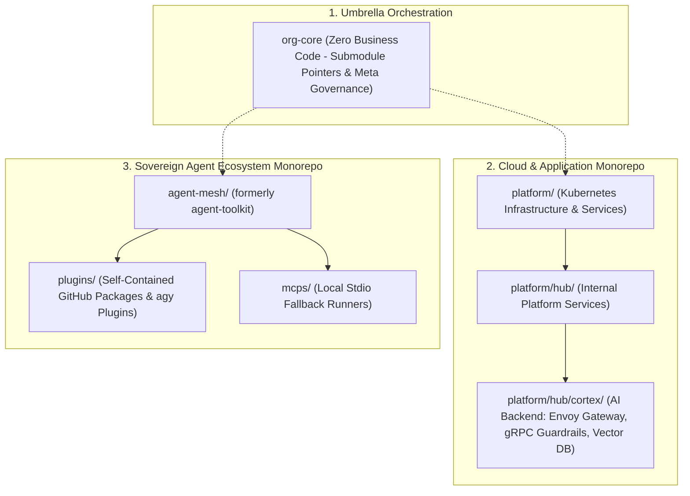
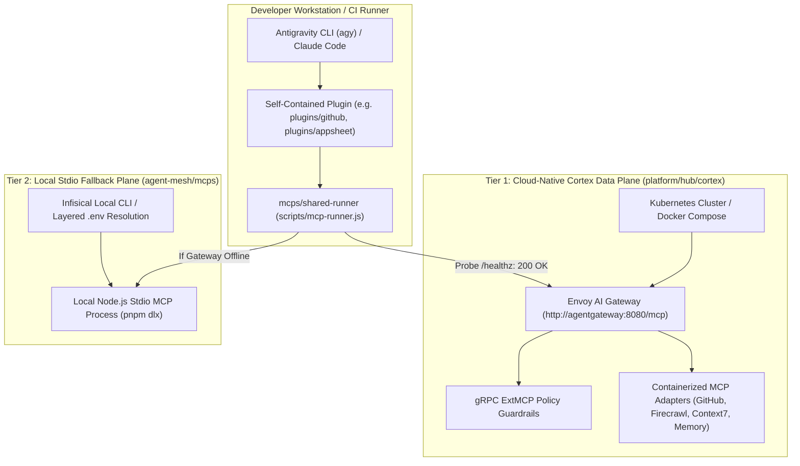

# Cortex Gateway, Self-Contained Agent Mesh & Dual-Tier Fallback Architecture

This architecture specification formalizes the systemic relationship between the **cloud-native Cortex
MCP runtime** in `platform/hub/cortex`, the **developer-facing agent ecosystem** (`agent-toolkit` / `agent-mesh`),
the **dual-tier gateway-to-local fallback protocol**, the **repository nomenclature resolution**, and the
**self-contained GitHub Packages plugin standard** installable via `agy plugin install`.

---

## 1. Executive Problem Statement & Architectural Context

An audit of the existing codebase reveals three structural architectural realities:
1. **The Cloud-Native Cortex Data Plane Already Exists**: Inside [platform/hub/cortex/mcp](file:///C:/Users/tupyn/projects/organizations/tupynambalucas-dev/org-core/platform/hub/cortex/mcp),
   an enterprise Kubernetes data plane is already deployed, featuring an Envoy-based AI Gateway (`agentgateway`),
   Traefik ingress routing, gRPC ExtMCP policy guardrails, and persistent MongoDB vector memory.
2. **Developers Work Outside the Cluster**: Human developers, CI/CD runners, and IDE agents often operate
   without the Kubernetes infrastructure running locally (`pnpm infra:dev` might be stopped, or the developer is
   offline/in a lightweight standalone clone).
3. **Naming Redundancy**: Naming the agent repository `agent-platform` collides with the existing `platform` monorepo.
   Naming it `cortex` collides with the backend microservices bounded context in `platform/hub/cortex`.
4. **Plugin Portability Requirement**: Plugins cannot be tightly coupled to an internal monorepo structure.
   Every plugin must be **100% self-contained**, capable of being published to **GitHub Packages**
   (`@tupynambalucas-dev/plugin-*`) and installed into any repository via `agy plugin install` or declared in
   `.agents/plugins.json`.

---

## 2. Resolving Repository Naming Redundancy

To eliminate semantic collisions across the organization, the enterprise naming hierarchy is codified as follows:



### Comparative Analysis of Candidate Names

| Candidate Name | Technical Assessment | Verdict |
| :--- | :--- | :--- |
| **`agent-platform`** | **Redundant**: Creates confusion with `platform/`. Developers cannot distinguish between platform services and agent tools. | **REJECTED** |
| **`cortex`** | **Redundant & Conflicting**: `cortex` is already the registered Kubernetes namespace and microservice suite in `platform/hub/cortex`. | **REJECTED** |
| **`agent-toolkit` (Current)** | **Functional but Constrained**: Accurately describes utilities, but understates the monorepo's expanded role as a plugin registry. | **ACCEPTABLE (Short Term)** |
| **`agent-mesh`** | **Optimal**: Represents the decentralized, interconnected network of self-contained plugins, local fallback MCPs, and autonomous skills. Zero naming collisions. | **RECOMMENDED TARGET** |
| **`agents`** | **Minimalist**: Direct parity with the root `.agents/` folder across all project workspaces. | **STRONG ALTERNATIVE** |

---

## 3. Dual-Tier MCP Topology: Remote Gateway vs. Local Fallback

The organization establishes a resilient, two-tier architecture that guarantees agents never experience downtime:



### 3.1 Tier 1: Cloud-Native Cortex Gateway (Primary When Active)
- **Deployment**: Runs inside the Kubernetes cluster (`platform/hub/cortex/mcp`).
- **Protocol**: Streamable HTTP and Server-Sent Events (SSE) exposed via `agentgateway`.
- **Capabilities**:
  - Enforces gRPC ExtMCP policy guardrails (validating payload schemas, transparent URL mutation).
  - Centralized rate-limiting, Prometheus metrics, and distributed OpenTelemetry tracing.
  - Native integration with the MongoDB semantic vector memory substrate (`cortex/memory`).

### 3.2 Tier 2: Local Stdio Fallback Plane (Secondary / Resilient)
- **Deployment**: Runs on the developer's local workstation via `mcps/shared-runner` (Node.js stdio).
- **Triggers**: Activates automatically whenever:
  1. The Kubernetes cluster is offline or stopped.
  2. The developer is working on a standalone repository clone.
  3. CI/CD runners execute isolated headless test suites.
- **Current Reference**: Exactly mirrors the current working behavior of `agent-toolkit/scripts/mcp-runner.js`,
  which boots `firecrawl-mcp`, `@upstash/context7-mcp`, and `github-mcp-server-js` directly via `pnpm dlx`.

### 3.3 Dynamic Failover Protocol
When an agent invokes an MCP tool, the client wrapper executes a deterministic 300ms probe:
1. `GET http://localhost:8080/healthz` (or configured `CORTEX_GATEWAY_URL`).
2. **If HTTP 200**: Routes request to Tier 1 Remote Gateway.
3. **If Connection Refused / Timeout**: Automatically spawns Tier 2 Local Stdio process without throwing an error to the user.

---

## 4. Self-Contained Plugin Packaging Standard

To allow plugins to be published as independent GitHub Packages (`npm.pkg.github.com/@tupynambalucas-dev/*`)
and installed via `agy plugin install` in any project, each plugin must adhere to strict **hermetic autonomy**.

### 4.1 Invariants for Self-Contained Plugins
1. **Zero Path Traversals**: Plugins must NEVER reference `cd ../..` or reach outside their own directory tree.
2. **Independent Manifest (`package.json`)**: Each plugin defines its own metadata, dependencies, and publishing coordinates.
3. **Independent Plugin Manifest (`plugin.json`)**: Declares plugin name, schema, description, and entrypoints.
4. **Scoped MCP Configuration (`mcp_config.json`)**: Declares only the MCP tools required for that specific plugin.
5. **Encapsulated Skills & Rules**: All skills and rules must reside strictly within `skills/` and `rules/` inside the plugin.

### 4.2 Standard Directory Layout for `plugins/<plugin-name>`

```plaintext
plugins/github/
├── package.json               # Defines @tupynambalucas-dev/plugin-github
├── plugin.json                # Antigravity manifest: name "github-operator"
├── mcp_config.json            # Connects to GitHub MCP (Tier 1 Gateway or Tier 2 Fallback)
├── tsconfig.json              # Scoped TypeScript configuration
│
├── skills/                    # Bundled Agent Skills
│   └── github-org-manager/
│       ├── SKILL.md           # Progressive disclosure instructions
│       └── scripts/           # Self-contained helper scripts
│
├── rules/                     # Bundled Behavioral Rules
│   └── git-governance.md      # Conventional commits & signature invariants
│
└── scripts/                   # Local execution shims
    └── mcp-runner.js          # Self-contained fallback runner
```

### 4.3 Manifest Specifications

#### `plugins/github/package.json`
```json
{
  "name": "@tupynambalucas-dev/plugin-github",
  "version": "1.0.0",
  "description": "Self-contained Antigravity plugin for GitHub organization operations, commit signing, and ruleset governance.",
  "type": "module",
  "publishConfig": {
    "registry": "https://npm.pkg.github.com"
  },
  "repository": {
    "type": "git",
    "url": "git+https://github.com/tupynambalucas-dev/agent-mesh.git",
    "directory": "plugins/github"
  },
  "scripts": {
    "build": "tsc",
    "test": "vitest run"
  },
  "dependencies": {
    "@octokit/auth-app": "^7.1.4",
    "octokit": "^4.1.0"
  },
  "files": [
    "plugin.json",
    "mcp_config.json",
    "skills",
    "rules",
    "scripts"
  ]
}
```

#### `plugins/github/plugin.json`
```json
{
  "$schema": "https://antigravity.google/schemas/v1/plugin.json",
  "name": "github-operator",
  "displayName": "Tupynamba Lucas GitHub Operator",
  "version": "1.0.0",
  "description": "Enterprise GitHub organization operator providing automated commit signing, PR workflows, and ruleset enforcement.",
  "author": {
    "name": "Tupynamba Lucas Development Team",
    "email": "contato@tupynambalucas.dev",
    "url": "https://tupynambalucas.dev"
  }
}
```

---

## 5. Plugin Distribution & Consumption Models

A self-contained plugin can be consumed across the ecosystem through three standard mechanisms:

### Model 1: Installation via Antigravity CLI (`agy plugin install`)
Developers or CI runners can install the plugin directly from GitHub without cloning the monorepo:
```bash
agy plugin install github:tupynambalucas-dev/agent-mesh/plugins/github
```
Or when published to the global registry:
```bash
agy plugin install @tupynambalucas-dev/plugin-github
```

### Model 2: Workspace Manifest Declaration (`.agents/plugins.json`)
Consuming repositories (such as `platform` or `docs`) declare the plugin in their project `.agents/plugins.json`:
```json
{
  "entries": [
    {
      "path": "node_modules/@tupynambalucas-dev/plugin-github"
    }
  ]
}
```
And add the dependency in their `package.json`:
```json
{
  "devDependencies": {
    "@tupynambalucas-dev/plugin-github": "github:tupynambalucas-dev/agent-mesh?path=plugins/github"
  }
}
```

### Model 3: Local Submodule Linking (Within `org-core`)
Inside the `org-core` umbrella meta-repository, `plugins.json` can link directly to the checked-out submodule:
```json
{
  "entries": [
    {
      "path": "agent-toolkit/plugins/github"
    },
    {
      "path": "agent-toolkit/plugins/secrets"
    }
  ]
}
```

---

## 6. Matrix of Self-Contained Plugins

| Plugin Name | Directory | Primary Skills & Rules | Underlying MCP Integration | Target Consumption |
| :--- | :--- | :--- | :--- | :--- |
| **`github-operator`** | `plugins/github/` | `github-org-manager`, `git-governance` | GitHub App (`@octokit/auth-app`) with Tier 1/Tier 2 fallback | All organizational repositories |
| **`google-workspace`**| `plugins/google-workspace/` | `workspace-automator`, `google-api-dev` | Google Drive, Docs, and Sheets REST APIs | Product & Content repositories |
| **`appsheet-architect`**| `plugins/appsheet/` | `appsheet-architect`, `prompt-to-app` | AppSheet Inbound REST API + Sheets Generator | Enterprise line-of-business applications |
| **`secrets-governance`**| `plugins/secrets/` | `secrets-expert`, `zero-disk-secrets` | Infisical Universal Auth MCP adapter | All organizational repositories |
| **`meta-governance`** | `plugins/meta/` | `agent-router-expert`, `markdown-expert`, `skill-expert` | Local filesystem & Diátaxis engine | All organizational repositories |

---

## 7. Implementation & Migration Runbook

1. **Step 1: Create Monorepo Root Configs**:
   - Add `pnpm-workspace.yaml` in `agent-toolkit` declaring `plugins/*`, `mcps/*`, `packages/*`.
2. **Step 2: Scaffold `plugins/github`**:
   - Extract `github-org-manager` skill and rules into `plugins/github/`.
   - Implement self-contained `package.json`, `plugin.json`, and local fallback runner.
3. **Step 3: Implement Dual-Tier Probing in `mcps/shared-runner`**:
   - Add health check probe to `mcp-runner.js` to dynamically connect to Cortex Gateway (`platform/hub/cortex`) when active, falling back to local Stdio.
4. **Step 4: Update Consuming Repositories**:
   - Update `platform/.agents/plugins.json` and `docs/.agents/plugins.json` to reference the modular plugin entrypoints.
5. **Step 5: Atomic Repository Rename (Optional)**:
   - When aligned, rename the GitHub repository from `agent-toolkit` to `agent-mesh`, updating `org-core/.gitmodules` pointers in a single cryptographically signed commit.
