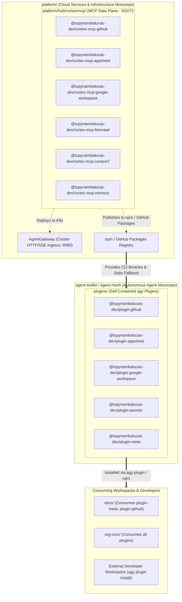
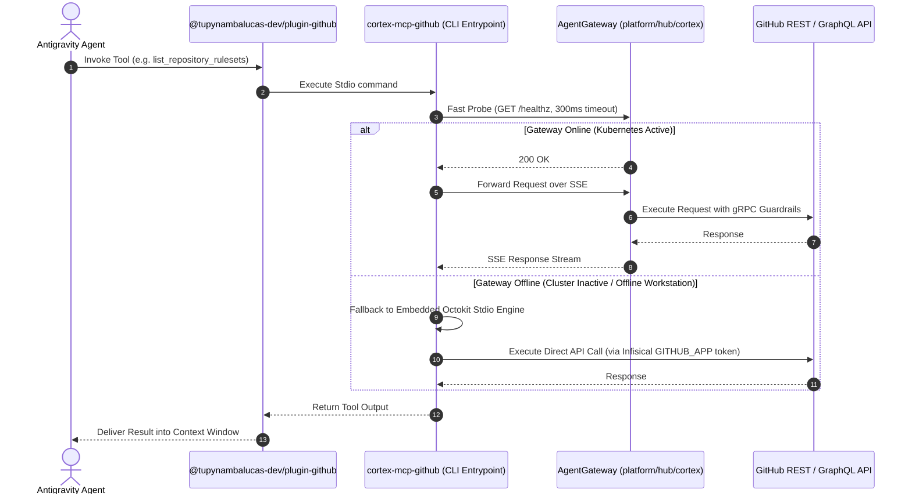

# Cortex MCP Engine & Self-Contained Agent Mesh Architecture

This specification defines the unified enterprise architecture linking the **Cortex MCP Engine** in
[platform/hub/cortex/mcp](file:///C:/Users/tupyn/projects/organizations/tupynambalucas-dev/org-core/platform/hub/cortex/mcp)
with the **Agent Mesh Workspace** in `agent-toolkit` (or `agent-mesh`).

It formalizes two foundational architectural decisions:
1. **SSOT for MCP Servers**: All Model Context Protocol servers reside exclusively in `platform/hub/cortex/mcp`
   and are published as standalone npm packages (`@tupynambalucas-dev/cortex-mcp-*`).
2. **Individual `package.json` for Every Plugin**: Each plugin in `plugins/<plugin-name>` is an autonomous
   pnpm workspace package (`@tupynambalucas-dev/plugin-*`) containing its own `package.json`, `plugin.json`,
   skills, rules, and scoped MCP configurations, enabling direct publishing to GitHub Packages and installation via
   `agy plugin install`.

---

## 1. High-Level Dependency Graph & Separation of Concerns



---

## 2. The MCP Engine in `platform/hub/cortex/mcp` (Single Source of Truth)

Rather than maintaining duplicate MCP tool code in the agent repository, all MCP server implementations
reside strictly in [platform/hub/cortex/mcp/services/](file:///C:/Users/tupyn/projects/organizations/tupynambalucas-dev/org-core/platform/hub/cortex/mcp/services).

### 2.1 Dual-Target Execution Architecture
Every MCP package in `platform` is engineered with a **Dual Target**:

```mermaid
flowchart LR
    MCPPkg["@tupynambalucas-dev/cortex-mcp-* (in platform/hub/cortex/mcp/services/*)"]
    
    TargetA["Mode A: Cluster Container (HTTP / SSE)"]
    TargetB["Mode B: Standalone Stdio CLI (npx / pnpm exec)"]
    
    MCPPkg -->|Docker Build + Skaffold| TargetA
    MCPPkg -->|pnpm publish (bin in package.json)| TargetB

    TargetA --> EnvoyGW["AgentGateway (Kubernetes Ingress: 8080)"]
    TargetB --> LocalStdio["Local Stdio Process in Developer IDE / CI"]
```

1. **Mode A (Cluster Microservice)**:
   - Packaged into Docker images and deployed into the `cortex` Kubernetes namespace behind `agentgateway` and Traefik.
   - Enforces gRPC ExtMCP policy guardrails, distributed OpenTelemetry tracing, and cluster rate-limits.
2. **Mode B (Standalone Stdio CLI)**:
   - Configured with a `"bin"` CLI entrypoint in `package.json` (e.g. `cortex-mcp-github`, `cortex-mcp-firecrawl`).
   - Packaged and published to GitHub Packages.
   - Can be executed directly via `npx @tupynambalucas-dev/cortex-mcp-github` or `pnpm exec cortex-mcp-github` over standard input/output (stdio) without requiring Docker or Kubernetes.

### 2.2 Canonical MCP Packages in `platform`

| Service Directory | Published Package Name | Stdio CLI Binary | Description |
| :--- | :--- | :--- | :--- |
| `cortex/mcp/services/github` | `@tupynambalucas-dev/cortex-mcp-github` | `cortex-mcp-github` | GitHub App-authenticated operator (PRs, commits, rulesets). |
| `cortex/mcp/services/firecrawl` | `@tupynambalucas-dev/cortex-mcp-firecrawl` | `cortex-mcp-firecrawl` | High-fidelity web scraping, crawling, and research tools. |
| `cortex/mcp/services/context7` | `@tupynambalucas-dev/cortex-mcp-context7` | `cortex-mcp-context7` | Real-time framework documentation and snippet retrieval. |
| `cortex/mcp/services/memory` | `@tupynambalucas-dev/cortex-mcp-memory` | `cortex-mcp-memory` | MongoDB semantic vector RAG memory queries. |
| `cortex/mcp/services/appsheet` | `@tupynambalucas-dev/cortex-mcp-appsheet` | `cortex-mcp-appsheet` | AppSheet REST API database querying and row mutations. |
| `cortex/mcp/services/google-workspace` | `@tupynambalucas-dev/cortex-mcp-gwork` | `cortex-mcp-gwork` | Google Drive, Docs, and Sheets programmatic manipulation. |

---

## 3. The Agent Mesh Workspace (`agent-toolkit` / `agent-mesh`)

With the MCP implementations safely housed in `platform`, the agent repository is liberated to focus strictly
on **Agent Behavioral Governance, Personas, Skills, Rules, and Plugin Bundling**.

### 3.1 Root `pnpm-workspace.yaml` in `agent-toolkit`
```yaml
packages:
  - 'plugins/*'
  - 'packages/*'
```

### 3.2 Individual `package.json` Standard for Every Plugin

Every plugin in `plugins/<plugin-name>` is an autonomous npm package with its own `package.json` alongside
its Antigravity `plugin.json` manifest:

```plaintext
agent-toolkit/ (or agent-mesh/)
├── pnpm-workspace.yaml
├── package.json (root orchestration)
│
├── plugins/
│   ├── github/
│   │   ├── package.json                   # Defines @tupynambalucas-dev/plugin-github
│   │   ├── plugin.json                    # Antigravity manifest: name "github-operator"
│   │   ├── mcp_config.json                # Connects to cortex-mcp-github
│   │   ├── skills/
│   │   │   └── github-org-manager/
│   │   │       ├── SKILL.md
│   │   │       └── scripts/
│   │   └── rules/
│   │       └── git-governance.md
│   │
│   ├── google-workspace/
│   │   ├── package.json                   # Defines @tupynambalucas-dev/plugin-google-workspace
│   │   ├── plugin.json                    # Antigravity manifest: name "google-workspace"
│   │   ├── mcp_config.json                # Connects to cortex-mcp-gwork
│   │   └── skills/
│   │       └── workspace-automator/
│   │
│   ├── appsheet/
│   │   ├── package.json                   # Defines @tupynambalucas-dev/plugin-appsheet
│   │   ├── plugin.json                    # Antigravity manifest: name "appsheet"
│   │   ├── mcp_config.json                # Connects to cortex-mcp-appsheet
│   │   └── skills/
│   │       └── appsheet-architect/
│   │
│   ├── secrets/
│   │   ├── package.json                   # Defines @tupynambalucas-dev/plugin-secrets
│   │   ├── plugin.json                    # Antigravity manifest: name "secrets-governance"
│   │   └── skills/
│   │       └── secrets-expert/
│   │
│   └── meta/
│       ├── package.json                   # Defines @tupynambalucas-dev/plugin-meta
│       ├── plugin.json                    # Antigravity manifest: name "meta-agent-skills"
│       └── skills/
│           ├── agent-router-expert/
│           ├── markdown-expert/
│           └── skill-expert/
│
└── packages/                              # Shared Plugin SDKs
    ├── core/                              # Base Zod schemas and IPC types
    └── runner/                            # Fallback health-checker and secret resolver
```

---

## 4. Anatomy of a Self-Contained Plugin (`plugins/github`)

### 4.1 `plugins/github/package.json`
```json
{
  "name": "@tupynambalucas-dev/plugin-github",
  "version": "1.0.0",
  "description": "Antigravity plugin for GitHub organization management, commit signing, and ruleset governance.",
  "type": "module",
  "publishConfig": {
    "registry": "https://npm.pkg.github.com",
    "access": "public"
  },
  "repository": {
    "type": "git",
    "url": "git+https://github.com/tupynambalucas-dev/agent-mesh.git",
    "directory": "plugins/github"
  },
  "dependencies": {
    "@tupynambalucas-dev/cortex-mcp-github": "^1.0.0"
  },
  "files": [
    "plugin.json",
    "mcp_config.json",
    "skills",
    "rules"
  ]
}
```

### 4.2 `plugins/github/plugin.json`
```json
{
  "$schema": "https://antigravity.google/schemas/v1/plugin.json",
  "name": "github-operator",
  "displayName": "Tupynamba Lucas GitHub Operator",
  "version": "1.0.0",
  "description": "Enterprise GitHub organization operator providing automated commit signing, PR workflows, and ruleset enforcement.",
  "author": {
    "name": "Tupynamba Lucas Development Team",
    "email": "contato@tupynambalucas.dev",
    "url": "https://tupynambalucas.dev"
  }
}
```

### 4.3 `plugins/github/mcp_config.json`
The plugin connects to the tool via the published `@tupynambalucas-dev/cortex-mcp-github` binary, falling back
automatically when the remote gateway is offline:
```json
{
  "mcpServers": {
    "github-mcp": {
      "command": "pnpm",
      "args": ["exec", "cortex-mcp-github"]
    }
  }
}
```

---

## 5. Dual-Tier Fallback Execution Flow

When an agent operates in any workspace, tool execution follows a resilient, layered strategy:



---

## 6. Distribution & Consumption Across Projects

This decoupled architecture allows effortless consumption across three distinct modes:

### Mode 1: Installation via Antigravity CLI (`agy plugin install`)
Any developer on any machine can install a plugin directly from GitHub Packages or git:
```bash
agy plugin install github:tupynambalucas-dev/agent-mesh/plugins/github
```
Antigravity automatically pulls the plugin, detects `plugin.json`, installs the declared dependency
`@tupynambalucas-dev/cortex-mcp-github`, and mounts the skills and rules instantly.

### Mode 2: Project Dependency via `package.json` & `.agents/plugins.json`
A monorepo service (like `platform` or `docs`) can declare the plugin in `package.json`:
```json
{
  "devDependencies": {
    "@tupynambalucas-dev/plugin-github": "workspace:*",
    "@tupynambalucas-dev/plugin-meta": "workspace:*"
  }
}
```
And declare it in `.agents/plugins.json`:
```json
{
  "entries": [
    { "path": "node_modules/@tupynambalucas-dev/plugin-github" },
    { "path": "node_modules/@tupynambalucas-dev/plugin-meta" }
  ]
}
```

### Mode 3: Umbrella Meta-Repository Discovery (`org-core`)
In `org-core/.agents/plugins.json`, the meta-repository links directly to the checked-out plugins in the
`agent-toolkit` (or `agent-mesh`) submodule:
```json
{
  "entries": [
    { "path": "agent-toolkit/plugins/github" },
    { "path": "agent-toolkit/plugins/secrets" },
    { "path": "agent-toolkit/plugins/meta" }
  ]
}
```

---

## 7. Strategic Synthesis: The Four Golden Rules

1. **Rule 1 (SSOT for MCPs)**: Never write or maintain MCP server code in `agent-toolkit`. All MCP tool servers
   belong in `platform/hub/cortex/mcp/services/` and are distributed as `@tupynambalucas-dev/cortex-mcp-*`.
2. **Rule 2 (Every Plugin is an npm Package)**: Every plugin in `plugins/*` must contain its own `package.json`
   defining `@tupynambalucas-dev/plugin-*` and its own `plugin.json`.
3. **Rule 3 (Dual Target for MCPs)**: Every MCP in `cortex/mcp` must support both containerized HTTP/SSE for
   Kubernetes and a standalone Stdio `"bin"` CLI for developer workstations.
4. **Rule 4 (No Naming Redundancy)**: Reject `agent-platform` and `cortex` as names for the agent repository.
   The canonical name is **`agent-mesh`** (or **`agents`**).
