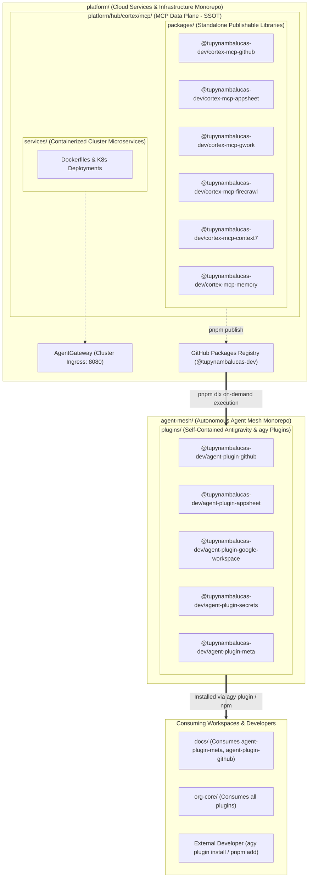
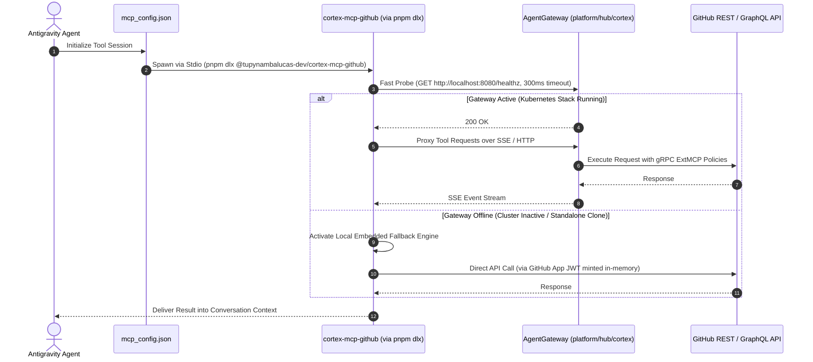

# Cortex MCP Engine & Self-Contained Agent Mesh Architecture

This specification establishes the authoritative enterprise architecture linking the **Cortex MCP Engine**
in [platform/hub/cortex/mcp](file:///C:/Users/tupyn/projects/organizations/tupynambalucas-dev/org-core/platform/hub/cortex/mcp)
with the **Agent Mesh Workspace** in `agent-mesh` (formerly `agent-toolkit`).

It codifies four foundational decisions:
1. **Renaming to `agent-mesh`**: Resolves naming redundancy with `platform` and `cortex`. The repository represents the decentralized, composable mesh of agent plugins, personas, and skills.
2. **SSOT for MCP Servers in `platform`**: All Model Context Protocol tool implementations reside strictly in `platform/hub/cortex/mcp/packages/` and are published as standalone npm packages (`@tupynambalucas-dev/cortex-mcp-*`).
3. **Dedicated `package.json` for Every Plugin with `agent-plugin-` Prefix**: Every plugin in `plugins/<plugin-name>` is an autonomous pnpm workspace package named `@tupynambalucas-dev/agent-plugin-<name>`, containing its own `package.json`, `plugin.json`, skills, rules, and scoped MCP configurations.
4. **Zero-Installation Tool Execution via `pnpm dlx`**: Plugins execute MCP servers on demand using `pnpm dlx @tupynambalucas-dev/cortex-mcp-*`, leveraging pnpm's global binary caching and GitHub Packages registry authentication.

---

## 1. High-Level Dependency Graph & Separation of Concerns



---

## 2. Resolving Repository Naming Redundancy

To maintain rigorous taxonomy across the organization, semantic collisions are permanently resolved:

| Candidate Name | Analysis | Final Decision |
| :--- | :--- | :--- |
| **`agent-platform`** | Redundant: Collides with the primary `platform/` monorepo. Developers cannot distinguish between cloud infrastructure and agent tooling. | **REJECTED** |
| **`cortex`** | Conflicting: `cortex` is already the internal microservice suite in `platform/hub/cortex` (Fastify API, AgentGateway, MongoDB vector DB). | **REJECTED** |
| **`agent-toolkit` (Current)** | Constrained: Understates the monorepo's expanded role as a multi-package plugin registry and agent mesh. | **TRANSITIONAL** |
| **`agent-mesh`** | **Optimal**: Represents the decentralized, composable network of autonomous plugins, skills, and fallback MCP tools. Zero collisions with `platform` or `cortex`. | **ADOPTED AS OFFICIAL TARGET** |

---

## 3. The Cortex MCP Engine in `platform` (Single Source of Truth)

All MCP server code belongs strictly to [platform/hub/cortex/mcp](file:///C:/Users/tupyn/projects/organizations/tupynambalucas-dev/org-core/platform/hub/cortex/mcp).
The agent mesh repository does **NOT** duplicate tool logic.

### 3.1 Directory Organization in `platform/hub/cortex/mcp/`
- **`packages/`**: Houses the TypeScript packages published to GitHub Packages. Each package contains the tool definitions, Zod validation schemas, API adapters, and a standalone `"bin"` CLI entrypoint.
- **`services/`**: Houses container configurations (Dockerfiles, Helm/Kustomize manifests) that wrap the packages into cluster microservices.
- **`guardrails/`**: gRPC ExtMCP policy processor for AgentGateway payload validation.

### 3.2 Canonical MCP Packages (`platform/hub/cortex/mcp/packages/*`)

| Package Directory | Published Package Name | Executable CLI Binary (`"bin"`) | Purpose |
| :--- | :--- | :--- | :--- |
| `packages/mcp-github` | `@tupynambalucas-dev/cortex-mcp-github` | `cortex-mcp-github` | GitHub App-authenticated operator (PRs, commits, rulesets). |
| `packages/mcp-firecrawl` | `@tupynambalucas-dev/cortex-mcp-firecrawl` | `cortex-mcp-firecrawl` | High-fidelity web scraping, crawling, and research tools. |
| `packages/mcp-context7` | `@tupynambalucas-dev/cortex-mcp-context7` | `cortex-mcp-context7` | Framework documentation and snippet retrieval. |
| `packages/mcp-memory` | `@tupynambalucas-dev/cortex-mcp-memory` | `cortex-mcp-memory` | MongoDB semantic vector RAG memory queries. |
| `packages/mcp-appsheet` | `@tupynambalucas-dev/cortex-mcp-appsheet` | `cortex-mcp-appsheet` | AppSheet REST API database querying and mutations. |
| `packages/mcp-google-workspace`| `@tupynambalucas-dev/cortex-mcp-gwork` | `cortex-mcp-gwork` | Google Drive, Docs, and Sheets automation. |

### 3.3 The `"bin"` Declaration in MCP `package.json`
To allow `pnpm dlx` to automatically identify and execute the binary without explicit flags:
```json
{
  "name": "@tupynambalucas-dev/cortex-mcp-github",
  "version": "1.0.0",
  "type": "module",
  "main": "dist/index.js",
  "bin": {
    "cortex-mcp-github": "./dist/bin.js"
  },
  "publishConfig": {
    "registry": "https://npm.pkg.github.com",
    "access": "public"
  },
  "files": [
    "dist"
  ]
}
```

---

## 4. The Agent Mesh Workspace (`agent-mesh`)

The `agent-mesh` repository is a dedicated **pnpm workspace** whose sole responsibility is managing
Antigravity plugins, personas, skills, and behavioral rules.

### 4.1 Root `pnpm-workspace.yaml` in `agent-mesh`
```yaml
packages:
  - 'plugins/*'
  - 'packages/*'
```

### 4.2 Standardized Plugin Naming Taxonomy (`@tupynambalucas-dev/agent-plugin-*`)

Every plugin in `plugins/<plugin-name>` has its own `package.json` and follows the mandatory prefix:
`@tupynambalucas-dev/agent-plugin-<domain>`

```plaintext
agent-mesh/
├── pnpm-workspace.yaml
├── package.json (root orchestration)
│
├── plugins/
│   ├── github/
│   │   ├── package.json               # @tupynambalucas-dev/agent-plugin-github
│   │   ├── plugin.json                # Antigravity manifest: name "github-operator"
│   │   ├── mcp_config.json            # Declares execution via pnpm dlx
│   │   ├── skills/
│   │   │   └── github-org-manager/
│   │   └── rules/
│   │       └── git-governance.md
│   │
│   ├── google-workspace/
│   │   ├── package.json               # @tupynambalucas-dev/agent-plugin-google-workspace
│   │   ├── plugin.json                # Antigravity manifest: name "google-workspace"
│   │   ├── mcp_config.json            # Declares execution via pnpm dlx
│   │   └── skills/
│   │       └── workspace-automator/
│   │
│   ├── appsheet/
│   │   ├── package.json               # @tupynambalucas-dev/agent-plugin-appsheet
│   │   ├── plugin.json                # Antigravity manifest: name "appsheet"
│   │   ├── mcp_config.json            # Declares execution via pnpm dlx
│   │   └── skills/
│   │       └── appsheet-architect/
│   │
│   ├── secrets/
│   │   ├── package.json               # @tupynambalucas-dev/agent-plugin-secrets
│   │   ├── plugin.json                # Antigravity manifest: name "secrets-governance"
│   │   └── skills/
│   │       └── secrets-expert/
│   │
│   └── meta/
│       ├── package.json               # @tupynambalucas-dev/agent-plugin-meta
│       ├── plugin.json                # Antigravity manifest: name "meta-agent-skills"
│       └── skills/
│           ├── agent-router-expert/
│           ├── markdown-expert/
│           └── skill-expert/
│
└── packages/                          # Shared Plugin Support Libraries
    ├── core/                          # Base Zod schemas and IPC types
    └── runner/                        # Gateway probing & environment resolver
```

---

## 5. Integrating MCPs via `pnpm dlx` in `mcp_config.json`

### 5.1 How `pnpm dlx` Operates with Scoped Packages
`pnpm dlx` fetches an npm package from the configured registry into an isolated, temporary global cache
and immediately executes its binary:
1. When passed `@tupynambalucas-dev/cortex-mcp-github`, `pnpm dlx` strips the `@tupynambalucas-dev/` scope.
2. It searches the package's `bin` map for an executable named `cortex-mcp-github`.
3. Finding the exact match, it invokes `node dist/bin.js` using stdio transport.
4. **Execution Caching**: `pnpm dlx` caches the binary locally in `%LOCALAPPDATA%\pnpm\dlx` (Windows) or
   `~/.pnpm/dlx` (Linux/macOS). After the initial download, subsequent invocations start in under **150 milliseconds**,
   providing native CLI performance without cluttering project `node_modules`.

### 5.2 Plugin Configuration (`plugins/github/mcp_config.json`)
```json
{
  "mcpServers": {
    "github-mcp": {
      "command": "pnpm",
      "args": [
        "dlx",
        "@tupynambalucas-dev/cortex-mcp-github"
      ],
      "env": {
        "GITHUB_APP_ID": "${GITHUB_APP_ID}",
        "GITHUB_APP_INSTALLATION_ID": "${GITHUB_APP_INSTALLATION_ID}",
        "GITHUB_APP_PRIVATE_KEY": "${GITHUB_APP_PRIVATE_KEY}"
      }
    }
  }
}
```

### 5.3 Registry Authentication (`.npmrc`)
To allow `pnpm dlx` to fetch `@tupynambalucas-dev/*` packages from GitHub Packages on any machine:
```ini
# ~/.npmrc or project .npmrc
@tupynambalucas-dev:registry=https://npm.pkg.github.com
//npm.pkg.github.com/:_authToken=${NODE_AUTH_TOKEN}
```
In developer workstations, `setup-workstation.mjs` configures this automatically using the authenticated
GitHub CLI token (`gh auth token`).

---

## 6. Dual-Tier Fallback Execution Logic

When `cortex-mcp-github` (or any cortex MCP) starts via `pnpm dlx`, it executes a resilient **Fast Probe**:



---

## 7. Plugin Distribution & Consumption Models

### Model 1: Installation via Antigravity CLI (`agy plugin install`)
Any developer can install a specific plugin into their workspace:
```bash
agy plugin install github:tupynambalucas-dev/agent-mesh/plugins/github
```
Antigravity clones the plugin, mounts its `skills/` and `rules/`, and uses `pnpm dlx` to run the underlying MCP tool.

### Model 2: Package Dependency via `.agents/plugins.json`
In consuming repositories (`platform`, `docs`):
```json
// .agents/plugins.json
{
  "entries": [
    { "path": "node_modules/@tupynambalucas-dev/agent-plugin-github" },
    { "path": "node_modules/@tupynambalucas-dev/agent-plugin-meta" }
  ]
}
```
And added to `devDependencies`:
```json
// package.json
{
  "devDependencies": {
    "@tupynambalucas-dev/agent-plugin-github": "^1.0.0",
    "@tupynambalucas-dev/agent-plugin-meta": "^1.0.0"
  }
}
```

---

## 8. Migration Checklist

1. [x] Create `platform/hub/cortex/mcp/packages/` for standalone publishable MCP packages.
2. [x] Update `platform/pnpm-workspace.yaml` to include `'hub/cortex/mcp/packages/*'`.
3. [ ] Scaffold `platform/hub/cortex/mcp/packages/mcp-github` as `@tupynambalucas-dev/cortex-mcp-github` with Stdio `"bin"`.
4. [ ] Restructure `agent-toolkit` into `plugins/*` where each plugin contains its own `package.json` (`@tupynambalucas-dev/agent-plugin-*`).
5. [ ] Update plugin `mcp_config.json` files to use `pnpm dlx @tupynambalucas-dev/cortex-mcp-*`.
6. [ ] Rename repository from `agent-toolkit` to `agent-mesh` and update `org-core/.gitmodules`.
