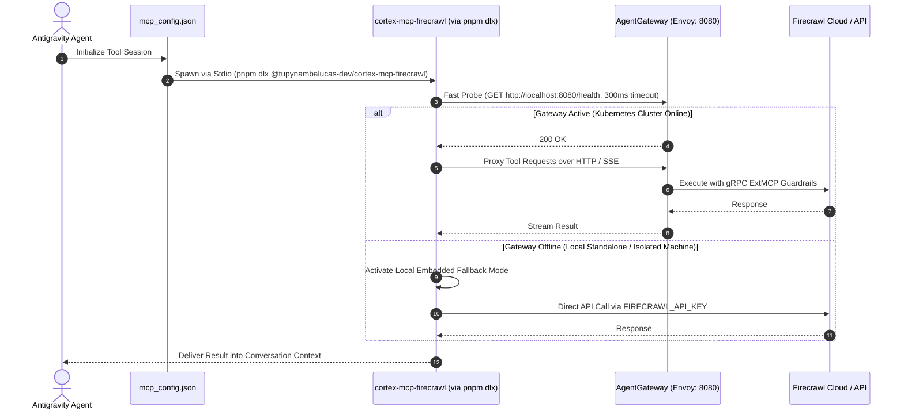

# Cortex MCP Engine & Self-Contained Agent Mesh Architecture

This specification establishes the authoritative enterprise architecture linking the **Cortex MCP Engine**
in [platform/hub/cortex/mcp](file:///C:/Users/tupyn/projects/organizations/tupynambalucas-dev/org-core/platform/hub/cortex/mcp)
with the **Agent Mesh Workspace** in `agent-mesh` (formerly `agent-toolkit`).

It codifies five foundational architectural decisions:
1. **Renaming to `agent-mesh`**: Resolves semantic collision with `platform` and `cortex`. The repository represents the decentralized, composable mesh of agent plugins, personas, rules, and skills.
2. **Canonical MCP Services in `platform/hub/cortex/mcp/services/*`**: Eliminates redundant `packages/` directory fragmentation. All MCP servers live in `services/*` as unified, dual-target components serving as both Kubernetes cluster microservices (HTTP/Streamable HTTP) and standalone publishable CLI tools (Stdio via `pnpm dlx`).
3. **Recursive In-House MCP Inventory**: Leverages custom-built MCP servers (`firecrawl` with deep web scraping/crawling, `memory` with MongoDB vector RAG) alongside wrapped infrastructure adapters (`context7`, `github`, `playwright`, `grafana`, `kubectl`).
4. **Autonomous Plugins with `agent-plugin-` Prefix**: Every plugin in `agent-mesh/plugins/<domain>` is an independent pnpm workspace package named `@tupynambalucas-dev/agent-plugin-<domain>`, containing its own `package.json`, `plugin.json`, skills, rules, and scoped MCP configurations.
5. **Zero-Installation Tool Execution via `pnpm dlx`**: Plugins execute MCP tools locally on demand using `pnpm dlx @tupynambalucas-dev/cortex-mcp-*` or upstream equivalents, providing instant cold-start execution without polluting repository `node_modules`.

---

## 1. High-Level Architecture & Component Boundaries

```mermaid
flowchart TD
    subgraph PlatformRepo ["platform/ (Cloud Services, GitOps & Infrastructure Monorepo)"]
        subgraph CortexMCP ["platform/hub/cortex/mcp/ (MCP Data Plane - SSOT)"]
            subgraph MCPServices ["services/ (Unified Dual-Target MCP Services)"]
                MCPFirecrawl["services/firecrawl (@tupynambalucas-dev/cortex-mcp-firecrawl)"]
                MCPMemory["services/memory (@tupynambalucas-dev/cortex-mcp-memory)"]
                MCPGitHub["services/github (@tupynambalucas-dev/cortex-mcp-github)"]
                MCPContext7["services/context7 (Framework Doc Engine)"]
                MCPPlaywright["services/playwright (Headless Browser)"]
                MCPGrafana["services/grafana (LGTM Observability)"]
                MCPKubectl["services/kubectl (K8s Diagnostics)"]
            end
            ExtMCPGuardrails["guardrails/ (gRPC ExtMCP Transparent Policy Proxy)"]
        end
        EnvoyGateway["AgentGateway (Envoy Ingress :8080)"]
        MCPServices -->|HTTP / Streamable HTTP :8080| EnvoyGateway
        ExtMCPGuardrails -.->|Request Mutation / Validation| EnvoyGateway
        MCPServices -. "pnpm publish (bin: Stdio)" .-> GitHubPackages["GitHub Packages Registry (@tupynambalucas-dev)"]
    end

    subgraph AgentMeshRepo ["agent-mesh/ (Autonomous Agent Mesh Monorepo)"]
        subgraph PluginsWorkspace ["plugins/ (Self-Contained Antigravity & agy Plugins)"]
            PluginGH["@tupynambalucas-dev/agent-plugin-github"]
            PluginWeb["@tupynambalucas-dev/agent-plugin-web (Firecrawl / Browser)"]
            PluginKnowledge["@tupynambalucas-dev/agent-plugin-knowledge (Memory / Context7)"]
            PluginSecrets["@tupynambalucas-dev/agent-plugin-secrets (Infisical)"]
            PluginMeta["@tupynambalucas-dev/agent-plugin-meta (Agent Router / Skills)"]
        end
    end

    subgraph ConsumingProjects ["Consuming Workspaces & Developers"]
        DocsApp["docs/ (Consumes agent-plugin-meta, agent-plugin-github)"]
        CoreUmbrella["org-core/ (Consumes all plugins)"]
        ExternalDev["External Developer (agy plugin install / pnpm add)"]
    end

    GitHubPackages ==>|pnpm dlx on-demand execution (Stdio fallback)| PluginsWorkspace
    EnvoyGateway ==>|Direct HTTP / SSE streaming (Cluster mode)| PluginsWorkspace
    PluginsWorkspace ==>|Installed via agy plugin / npm| ConsumingProjects
```

---

## 2. Resolving Repository Naming Redundancy

To eliminate architectural ambiguity across organizational repositories, nomenclature is strictly aligned:

| Candidate Name | Analysis | Final Decision |
| :--- | :--- | :--- |
| **`agent-platform`** | Ambiguous: Collides directly with the foundational `platform/` monorepo. Developers cannot distinguish between cloud infrastructure and agent tooling. | **REJECTED** |
| **`cortex`** | Conflicting: `cortex` is the internal AI microservice suite in `platform/hub/cortex` (Fastify API, AgentGateway, MongoDB vector RAG). | **REJECTED** |
| **`agent-toolkit` (Current)** | Constrained: Suggests a static collection of utility scripts rather than a multi-package plugin registry and decentralized mesh. | **TRANSITIONAL** |
| **`agent-mesh`** | **Optimal**: Represents the decentralized, composable network of autonomous plugins, skills, behavioral rules, and fallback MCP tools. Zero collisions with `platform` or `cortex`. | **ADOPTED AS OFFICIAL TARGET** |

---

## 3. Directory Taxonomy: Why `services/` is the Correct Standard

A critical architectural question is whether `platform/hub/cortex/mcp/services/` should be renamed or separated into `packages/`:

### 3.1 Why a Separate `packages/` Directory Was Discarded
1. **Elimination of Artificial Fragmentation**:
   Creating a parallel `packages/` directory inside `platform/hub/cortex/mcp/` introduces code duplication and mental overhead. Each tool implementation would exist either twice or as an artificial split where `packages/` has the TypeScript code and `services/` has only a Dockerfile.
2. **Prevention of Cluster vs CLI Drift**:
   By keeping the code in a single directory (`services/<name>`), the exact same tool handlers, Zod schemas, and business logic that run in Kubernetes also execute in the standalone CLI. There is zero drift between what the agent runs in production and what it runs locally.
3. **Workspace Package Capability**:
   In `pnpm` and `npm`, a package is defined by its `package.json`, not by the directory name containing it. Any directory under `services/*` is already a full-fledged workspace package that can be built, tested, and published to GitHub Packages or npm.

### 3.2 Why `services/` is the Architectural Standard in `platform`
- **Monorepo Uniformity**: Across all bounded contexts in `platform`, containerized workloads and domain services live in `services/`:
  - `platform/corporate/services/*`
  - `platform/hub/cortex/memory/services/*`
  - `platform/hub/cortex/mcp/services/*`
- **Kubernetes & GitOps Mapping**: Every folder in `services/` maps directly to a Kubernetes `Deployment` and `Service` in Helm charts and Skaffold pipeline manifests (`skaffold.yaml`). Renaming to `servers/` breaks Kubernetes taxonomy (Kubernetes manages *Services*, not *Servers*).
- **pnpm Workspace Configuration**: `platform/pnpm-workspace.yaml` cleanly includes `'hub/cortex/mcp/services/*'`, giving every MCP service full access to catalog dependencies and shared configs (`@tupynambalucas-dev/shared-config`).

---

## 4. Recursive Inventory of MCP Services in `platform/hub/cortex/mcp/services`

A deep inspection of `platform/hub/cortex/mcp/services` reveals two distinct classes of MCP implementations:

```plaintext
platform/hub/cortex/mcp/services/
├── firecrawl/               # IN-HOUSE: Custom Fastify + Firecrawl TypeScript MCP Server
├── memory/                  # IN-HOUSE: Custom Fastify + MongoDB Vector Search RAG Server
├── context7/                # WRAPPER: Containerized @upstash/context7-mcp adapter
├── github/                  # WRAPPER -> BOT: Containerized GitHub MCP (migrating to GitHub App)
├── playwright/              # WRAPPER: Containerized browser automation MCP
├── grafana/                 # WRAPPER: LGTM observability telemetry query server
└── kubectl/                 # WRAPPER: Kubernetes cluster inspection and diagnostics server
```

### 4.1 In-House Custom MCP Services
These services contain proprietary TypeScript implementations with custom tool definitions and domain logic:

#### A. `@tupynambalucas-dev/cortex-mcp-firecrawl` (`services/firecrawl`)
- **Core Technology**: Fastify, `@modelcontextprotocol/sdk`, `@firecrawl/sdk`, Zod.
- **Registered Tools**:
  - `scrape`: Scrapes single web pages into clean Markdown, HTML, or JSON.
  - `crawl`: Crawls complete web domains with depth controls and URL filtering.
  - `search`: High-precision web search with highlighted excerpts.
  - `map`: Fast sitemap discovery and URL graph mapping.
  - `extract`: Structured data extraction using schema-driven LLM parsing.
  - `batch_scrape`: Parallel asynchronous URL scraping with rate limiting.

#### B. `@tupynambalucas-dev/cortex-mcp-memory` (`services/memory`)
- **Core Technology**: Fastify, `@modelcontextprotocol/sdk`, `@tupynambalucas-dev/cortex-memory-core`, MongoDB Vector Search.
- **Registered Tools**:
  - `search_knowledge`: Semantic vector retrieval across indexed corporate documentation.
  - `store_episodic`: Persistent episodic interaction and conversation context storage.
  - `query_graph`: Entity-relationship graph traversal for organizational knowledge.
  - `ingest_document`: Triggers document parsing, chunking, and vector embedding into MongoDB.

### 4.2 Wrapped Third-Party & Upstream MCP Services
These services wrap existing upstream binaries or Docker images for deployment in the cluster:
- **`services/context7`**: Serves framework documentation and API references.
- **`services/github`**: Interacts with the GitHub API (currently standard MCP; planned upgrade to custom GitHub App bot `@tupynambalucas-org-manager[bot]`).
- **`services/playwright`**: Provides headless Chromium browser automation.
- **`services/grafana`**: Queries Loki logs, Tempo traces, and Prometheus metrics.
- **`services/kubectl`**: Cluster-level diagnostics and manifest inspection.

---

## 5. Dual-Target Execution Pattern: Microservice & Standalone CLI

To serve both Kubernetes cluster deployments and decentralized agent execution, each in-house MCP service implements the **Dual-Target Pattern**:

```
+-----------------------------------------------------------------------------------+
|                        services/<name>/src/tools/index.ts                         |
|                    Shared Tool Handlers & Business Logic                          |
+-----------------------------------------------------------------------------------+
                     /                                           \
                    /                                             \
  Target 1: Cluster HTTP / SSE                   Target 2: Standalone CLI (Stdio)
  Entrypoint: src/index.ts                       Entrypoint: src/bin.ts
  Build: dist/index.js                           Build: dist/bin.js
  Invoked via: Docker / K8s                      Invoked via: pnpm dlx
  Transport: StreamableHTTPServerTransport       Transport: StdioServerTransport
  Port: 8080 (behind Envoy AgentGateway)         Protocol: Stdio JSON-RPC over stdin/stdout
```

### 5.1 Mode 1: HTTP / Streamable HTTP Server (`src/index.ts`)
Used when running inside a Kubernetes Pod behind Envoy `agentgateway`:
```typescript
// src/index.ts
import { Server } from '@modelcontextprotocol/sdk/server/index.js';
import { StreamableHTTPServerTransport } from '@modelcontextprotocol/sdk/server/streamableHttp.js';
import Fastify from 'fastify';
import { config } from './config.js';
import { registerToolHandlers } from './tools/index.js';

const fastify = Fastify({ logger: true });

fastify.all('/mcp', async (req, reply) => {
  reply.hijack();
  const server = new Server({ name: 'cortex-firecrawl-mcp', version: '1.0.0' }, { capabilities: { tools: {} } });
  registerToolHandlers(server);
  const transport = new StreamableHTTPServerTransport({ sessionIdGenerator: undefined });
  await server.connect(transport);
  await transport.handleRequest(req.raw, reply.raw, req.body ?? undefined);
});

fastify.get('/health', () => ({ status: 'healthy', service: 'cortex-firecrawl-mcp' }));
fastify.listen({ port: config.PORT, host: '0.0.0.0' });
```

### 5.2 Mode 2: Standalone CLI Stdio Binary (`src/bin.ts`)
Used when executed via `pnpm dlx` by an Antigravity agent:
```typescript
#!/usr/bin/env node
// src/bin.ts
import { Server } from '@modelcontextprotocol/sdk/server/index.js';
import { StdioServerTransport } from '@modelcontextprotocol/sdk/server/stdio.js';
import { registerToolHandlers } from './tools/index.js';

const server = new Server(
  {
    name: 'cortex-mcp-firecrawl',
    version: '1.0.0',
  },
  {
    capabilities: {
      tools: {},
    },
  },
);

registerToolHandlers(server);
const transport = new StdioServerTransport();
await server.connect(transport);
```

### 5.3 Unified `package.json` Configuration
```json
{
  "name": "@tupynambalucas-dev/cortex-mcp-firecrawl",
  "version": "1.0.0",
  "type": "module",
  "main": "dist/index.js",
  "bin": {
    "cortex-mcp-firecrawl": "./dist/bin.js"
  },
  "publishConfig": {
    "registry": "https://npm.pkg.github.com",
    "access": "public"
  },
  "scripts": {
    "build": "tsc -p tsconfig.build.json",
    "start": "node dist/index.js"
  },
  "files": [
    "dist"
  ]
}
```

---

## 6. The Agent Mesh Workspace (`agent-mesh`)

The `agent-mesh` repository is a dedicated **pnpm workspace** whose sole responsibility is managing
Antigravity plugins, personas, skills, and behavioral rules.

### 6.1 Root `pnpm-workspace.yaml` in `agent-mesh`
```yaml
packages:
  - 'plugins/*'
  - 'packages/*'
```

### 6.2 Standardized Plugin Naming Taxonomy (`@tupynambalucas-dev/agent-plugin-*`)

Every plugin in `plugins/<plugin-name>` has its own `package.json` and follows the mandatory prefix:
`@tupynambalucas-dev/agent-plugin-<domain>`

```plaintext
agent-mesh/
├── pnpm-workspace.yaml
├── package.json (root orchestration)
│
├── plugins/
│   ├── github/
│   │   ├── package.json               # @tupynambalucas-dev/agent-plugin-github
│   │   ├── plugin.json                # Antigravity manifest: name "github-operator"
│   │   ├── mcp_config.json            # Connects to cortex-mcp-github or Gateway
│   │   ├── skills/
│   │   │   └── github-org-manager/
│   │   └── rules/
│   │       └── git-governance.md
│   │
│   ├── web/
│   │   ├── package.json               # @tupynambalucas-dev/agent-plugin-web
│   │   ├── plugin.json                # Antigravity manifest: name "web-researcher"
│   │   ├── mcp_config.json            # Executes cortex-mcp-firecrawl via pnpm dlx
│   │   └── skills/
│   │       ├── web-scraper/
│   │       └── crawler/
│   │
│   ├── knowledge/
│   │   ├── package.json               # @tupynambalucas-dev/agent-plugin-knowledge
│   │   ├── plugin.json                # Antigravity manifest: name "knowledge-retriever"
│   │   ├── mcp_config.json            # Executes cortex-mcp-memory & context7 via pnpm dlx
│   │   └── skills/
│   │       └── rag-retriever/
│   │
│   ├── google-workspace/
│   │   ├── package.json               # @tupynambalucas-dev/agent-plugin-google-workspace
│   │   ├── plugin.json                # Antigravity manifest: name "google-workspace"
│   │   └── skills/
│   │
│   ├── appsheet/
│   │   ├── package.json               # @tupynambalucas-dev/agent-plugin-appsheet
│   │   ├── plugin.json                # Antigravity manifest: name "appsheet"
│   │   └── skills/
│   │
│   ├── secrets/
│   │   ├── package.json               # @tupynambalucas-dev/agent-plugin-secrets
│   │   ├── plugin.json                # Antigravity manifest: name "secrets-governance"
│   │   └── skills/
│   │       └── secrets-expert/
│   │
│   └── meta/
│       ├── package.json               # @tupynambalucas-dev/agent-plugin-meta
│       ├── plugin.json                # Antigravity manifest: name "meta-agent-skills"
│       └── skills/
│           ├── agent-router-expert/
│           ├── markdown-expert/
│           └── skill-expert/
│
└── packages/                          # Shared Plugin Support Libraries
    ├── core/                          # Base Zod schemas and IPC types
    └── runner/                        # Gateway probing & environment resolver
```

---

## 7. Dual-Tier Fallback Execution Logic in `agent-mesh` Plugins

When an agent plugin needs to invoke an MCP tool (e.g. Firecrawl web scraping), it can operate in two modes:



### 7.1 Plugin MCP Configuration (`plugins/web/mcp_config.json`)
```json
{
  "mcpServers": {
    "firecrawl": {
      "command": "pnpm",
      "args": [
        "dlx",
        "@tupynambalucas-dev/cortex-mcp-firecrawl"
      ],
      "env": {
        "FIRECRAWL_API_KEY": "${FIRECRAWL_API_KEY}",
        "CORTEX_GATEWAY_URL": "http://localhost:8080"
      }
    }
  }
}
```

---

## 8. Migration & Implementation Checklist

1. [x] Audit `platform/hub/cortex/mcp/services/*` structure and eliminate redundant `packages/` directory.
2. [x] Revert `platform/pnpm-workspace.yaml` to track `hub/cortex/mcp/services/*` as canonical workspace packages.
3. [ ] Add `src/bin.ts` stdio entrypoint and `"bin"` map in `platform/hub/cortex/mcp/services/firecrawl/package.json`.
4. [ ] Add `src/bin.ts` stdio entrypoint and `"bin"` map in `platform/hub/cortex/mcp/services/memory/package.json`.
5. [ ] Restructure `agent-toolkit` (target `agent-mesh`) into `plugins/*` where each plugin contains its own `package.json` (`@tupynambalucas-dev/agent-plugin-*`).
6. [ ] Update plugin `mcp_config.json` files to use `pnpm dlx @tupynambalucas-dev/cortex-mcp-*` or upstream equivalents.
7. [ ] Rename repository from `agent-toolkit` to `agent-mesh` and update `org-core/.gitmodules`.
