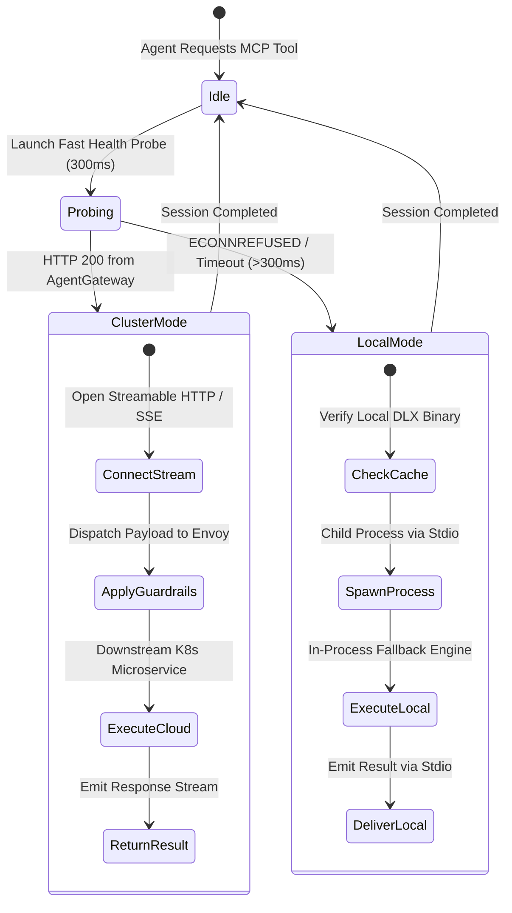

# Cortex MCP Infrastructure vs. Local Plugin Fallback Runtime Specification

This document defines the runtime semantics, security postures, networking topologies, and automated failover mechanics
governing Model Context Protocol (MCP) tool execution across the **tupynambalucas.dev** engineering substrate.

It provides the authoritative comparative analysis between running MCP servers as **Cloud-Native Microservices in Kubernetes**
behind Envoy [AgentGateway](file:///C:/Users/tupyn/projects/organizations/tupynambalucas-dev/org-core/platform/k8s/manifests/hub/cortex/gateway/agentgateway.yaml)
versus running them as **Decentralized Local Standalone Binaries** inside [agent-mesh](file:///C:/Users/tupyn/projects/organizations/tupynambalucas-dev/org-core/agent-toolkit) plugins.

---

## 1. Architectural Topology Overview

```mermaid
flowchart TD
    subgraph AgentClient ["Antigravity Agent Runtime (Workstation / CI)"]
        AgentCore["Antigravity Agent Process"]
        PluginConfig["Plugin mcp_config.json"]
        SmartRouter["Smart MCP Gateway Router (scripts/mcp-gateway-router.js)"]
    end

    subgraph ModeA ["Mode A: Kubernetes Infrastructure (Primary)"]
        EnvoyIngress["Traefik Ingress (agentgateway.tupynambalucas.dev:8080)"]
        AgentGateway["Envoy AgentGateway Pod (cortex/agentgateway:8080)"]
        ExtMCPGuardrails["ExtMCP Guardrails (mcp-guardrails:9001 gRPC)"]
        
        subgraph K8sServices ["Containerized Downstream Microservices (:8080)"]
            K8sFirecrawl["mcp-firecrawl (Fastify Streamable HTTP)"]
            K8sMemory["mcp-memory (MongoDB Vector RAG)"]
            K8sGoogleWorkspace["mcp-google-workspace (Workspace APIs)"]
            K8sAppSheet["mcp-appsheet (Inbound REST v2)"]
            K8sPlaywright["mcp-playwright (Headless Alpine Chromium)"]
            K8sContext7["mcp-context7 (Upstash Doc Search)"]
            K8sGitHub["mcp-github (GitHub App Operator)"]
        end

        InfisicalSecret["InfisicalSecret Operator (cortex-secrets)"]
        OTelCollector["OpenTelemetry Collector (:4317)"]
    end

    subgraph ModeB ["Mode B: Local Standalone Fallback (Offline / Standalone)"]
        subgraph LocalDLX ["pnpm dlx On-Demand Executables (Stdio)"]
            LocalFirecrawl["cortex-mcp-firecrawl (Stdio)"]
            LocalMemory["cortex-mcp-memory (Stdio)"]
            LocalGoogleWorkspace["cortex-mcp-gwork (Stdio)"]
            LocalAppSheet["cortex-mcp-appsheet (Stdio)"]
            LocalPlaywright["Local Chromium / Chrome DevTools (Port 9222)"]
            LocalContext7["@upstash/context7-mcp (Stdio)"]
        end
        LocalEnv[".env / Infisical CLI Local Token Store"]
    end

    AgentCore --> PluginConfig
    PluginConfig --> SmartRouter
    
    SmartRouter -->|1. Fast Health Probe: GET /health (300ms)| EnvoyIngress
    
    SmartRouter -.->|Probe Succeeded: Primary Streamable HTTP / SSE| EnvoyIngress
    EnvoyIngress --> AgentGateway
    AgentGateway <-->|gRPC Payload Mutation & Policy| ExtMCPGuardrails
    AgentGateway --> K8sServices
    InfisicalSecret -.->|Inject Env Vars| K8sServices
    AgentGateway -.->|Traces & Metrics| OTelCollector

    SmartRouter ==>|Probe Failed: Offline Fallback via Stdio| LocalDLX
    LocalEnv -.->|Layered Env Vars| LocalDLX
```

---

## 2. In-Depth Operational Comparison Matrix

| Architectural Dimension | Mode A: Kubernetes Infrastructure (`agentgateway`) | Mode B: Local Plugin Fallback (`pnpm dlx`) |
| :--- | :--- | :--- |
| **Primary Driver** | Centralized enterprise security, shared compute, zero client credential exposure. | Resilient, air-gapped developer agility, offline workstation capability. |
| **Transport Protocol** | **Streamable HTTP / Server-Sent Events (SSE)** over HTTP/2 or HTTP/1.1 on port `8080`. | **Standard I/O (Stdio)** exchanging line-delimited JSON-RPC messages. |
| **Ingress & Routing** | Traefik Ingress -> Envoy `agentgateway:8080` -> Service Discovery (`cortex.svc.cluster.local`). | In-process child process spawned via `child_process.spawn()`. |
| **Network Context & DNS** | Runs within the Kubernetes overlay network (`crd.cilium` or Calico). Uses Kubernetes CoreDNS. | Runs directly on the developer host network interface (`127.0.0.1`, `localhost`). |
| **Target Application Resolution** | **ExtMCP Guardrail Translation**: Automatically rewrites `localhost` URLs in tool arguments to `host.docker.internal`. | **Direct Loopback**: Connects directly to `localhost:3000`, `localhost:5173`, etc. without proxying. |
| **Secret Management & Hygiene** | **Zero Client Secrets**: Centralized in Infisical Cloud, synced via Infisical Kubernetes Operator into `cortex-secrets`. | **Decentralized Secrets**: Loaded via local `.env`, host environment, or `infisical run --env=dev`. |
| **Policy & Security Guardrails** | **Enforced gRPC ExtMCP**: `mcp-guardrails:9001` validates tools, detects malicious prompts, and rewrites network payloads. | **Unproxied Direct Execution**: Executes tool handlers directly without external guardrail inspection. |
| **Observability & Telemetry** | **Distributed Telemetry**: Automatically emits OpenTelemetry spans to `otel-collector:4317`, logs to Loki, metrics to Tempo. | **Local Stderr**: Basic unstructured log output written to process stderr. |
| **Resource Isolation** | Managed via Kubernetes CPU/Memory cgroups, Pod QoS, and Horizontal Pod Autoscalers (HPA). | Bound to workstation CPU/RAM; parallel batch tasks compete with desktop apps. |

---

## 3. Tool-Specific Runtime Divergence

### 3.1 Playwright MCP: Headless Container Daemon vs. Local DevTools

Browser automation diverges more significantly than any other MCP domain between cluster and local environments:

```
+-------------------------------------------------------------------------------------------------+
|                                 PLAYWRIGHT OPERATIONAL DIVERGENCE                                |
+-------------------------------------------------------------------------------------------------+
| Dimension               | Mode A: K8s Microservice (Daemon)     | Mode B: Local Plugin Fallback         |
+-------------------------+---------------------------------------+---------------------------------------+
| Container Runtime       | Alpine Linux (node:22-alpine)         | Windows 11 / macOS / Ubuntu Host      |
| Browser Binary          | /usr/bin/chromium-browser             | Installed Chrome / Playwright Cache   |
| Display Server          | Headless Only (No X11/Wayland)        | Headed (GUI) or Headless              |
| Sandbox Flags           | --no-sandbox --disable-dev-shm-usage  | Standard OS User Sandbox              |
| User Session / Cookies  | Pre-baked storageState.json mounted   | Interactive 2FA login; saves to disk  |
| DevTools MCP Connection | Disconnected from developer browser   | Can bind to Chrome Remote Debug 9222  |
| Network Origin          | Kubernetes Pod Cluster Egress IP      | Developer Workstation Public IP       |
+-------------------------+---------------------------------------+---------------------------------------+
```

#### Implications for Google AppSheet and Google Workspace Automation:
- In **Kubernetes Infra (Mode A)**: Playwright cannot prompt the user to complete Google 2FA or solve a CAPTCHA. All automated flows must use either Google APIs directly (via Service Account JWTs) or rely on a pre-authenticated session cookie file (`appsheet-session.json`) synced via Infisical.
- In **Local Workstation (Mode B)**: Playwright can launch a visible Chromium window (`headless: false`) when credentials expire, allowing the developer to complete single sign-on (SSO) interactively. Once completed, the session state is saved to `~/.gemini/auth/appsheet-session.json`.

---

### 3.2 Google Workspace & AppSheet MCP: Service Account Delegation vs. User OAuth

```
+-------------------------------------------------------------------------------------------------+
|                               WORKSPACE & APPSHEET AUTH DIVERGENCE                              |
+-------------------------------------------------------------------------------------------------+
| Trajectory              | Mode A: K8s Microservice (Daemon)     | Mode B: Local Plugin Fallback         |
+-------------------------+---------------------------------------+---------------------------------------+
| Authentication Method   | Google Service Account with Domain-   | Local Service Account JSON or         |
|                         | Wide Delegation (or Workload Identity)| OAuth 2.0 PKCE User Token             |
| Credential Location     | Mounted Secret at /secrets/gcp.json   | ~/.gemini/auth/google-oauth.json      |
| Prompt-to-App Ingestion | Automates Google Sheets API v4 and    | Launches browser callback to          |
|                         | invokes AppSheet Inbound REST API     | https://www.appsheet.com/start/init   |
| API Rate Limiting       | Centralized token bucket in Gateway   | Local client rate limits              |
+-------------------------+---------------------------------------+---------------------------------------+
```

---

## 4. The Smart Gateway Probe & Dynamic Failover Algorithm

Every Antigravity plugin in `agent-mesh` employs the **Smart Gateway Probe** before executing any tool. This guarantees that:
1. When the infrastructure is running, the agent automatically benefits from central guardrails, shared memory, and cluster secrets.
2. When the infrastructure is offline (e.g. laptop disconnected, cluster down for maintenance), tool calls fail over instantly and silently to local execution.

### 4.1 State Machine Diagram



### 4.2 Mathematical Timing Profile of the Probe
- **Target Endpoint**: `GET ${CORTEX_GATEWAY_URL:-http://localhost:8080}/health`
- **Socket Connect Timeout**: `150ms`
- **Total Probe Deadline**: `300ms`
- **Result**: Zero perceptible latency to the user. A failed probe resolves in 300ms, immediately triggering `pnpm dlx` (which loads from global cache in ~120ms), resulting in total initialization time under 450ms.

---

## 5. Reference Implementation: Smart MCP Gateway Router

This script is packaged into `@tupynambalucas-dev/cortex-mcp-runner` and distributed across `agent-mesh/scripts/mcp-gateway-router.js`:

```javascript
#!/usr/bin/env node

/**
 * Authoritative Smart MCP Gateway Router & Failover Engine
 * Enterprise Standard for tupynambalucas.dev
 */

const http = require("http");
const https = require("https");
const { spawn } = require("child_process");

const TARGET_SERVICE = process.argv[2]; // e.g., "firecrawl", "github", "google-workspace", "memory"
const GATEWAY_BASE_URL = process.env.CORTEX_GATEWAY_URL || "http://localhost:8080";
const PROBE_TIMEOUT_MS = parseInt(process.env.CORTEX_PROBE_TIMEOUT_MS || "300", 10);

/**
 * Fast non-blocking health probe on Envoy AgentGateway
 */
function probeGateway(baseUrl, timeoutMs) {
  return new Promise((resolve) => {
    try {
      const parsedUrl = new URL(baseUrl);
      const client = parsedUrl.protocol === "https:" ? https : http;
      
      const req = client.get(
        {
          hostname: parsedUrl.hostname,
          port: parsedUrl.port || (parsedUrl.protocol === "https:" ? 443 : 80),
          path: "/health",
          timeout: timeoutMs,
          headers: {
            "User-Agent": "cortex-mcp-smart-router/1.0.0",
          },
        },
        (res) => {
          resolve(res.statusCode >= 200 && res.statusCode < 400);
        }
      );

      req.on("error", () => resolve(false));
      req.on("timeout", () => {
        req.destroy();
        resolve(false);
      });
    } catch {
      resolve(false);
    }
  });
}

/**
 * Fallback command mapping for decentralized execution
 */
const FALLBACK_REGISTRY = {
  "firecrawl": {
    pkg: "@tupynambalucas-dev/cortex-mcp-firecrawl",
    upstream: "firecrawl-mcp"
  },
  "memory": {
    pkg: "@tupynambalucas-dev/cortex-mcp-memory",
    upstream: "@modelcontextprotocol/server-memory"
  },
  "github": {
    pkg: "@tupynambalucas-dev/cortex-mcp-github",
    upstream: "github-mcp-server-js"
  },
  "google-workspace": {
    pkg: "@tupynambalucas-dev/cortex-mcp-gwork",
    upstream: "@aaronsb/google-workspace-mcp"
  },
  "appsheet": {
    pkg: "@tupynambalucas-dev/cortex-mcp-appsheet",
    upstream: null
  },
  "context7": {
    pkg: "@upstash/context7-mcp",
    upstream: "@upstash/context7-mcp"
  },
  "playwright": {
    pkg: "@playwright/mcp",
    upstream: "@modelcontextprotocol/server-playwright"
  }
};

async function main() {
  if (!TARGET_SERVICE || !FALLBACK_REGISTRY[TARGET_SERVICE]) {
    process.stderr.write(`[cortex-router] Error: Unknown target service '${TARGET_SERVICE}'.\n`);
    process.exit(1);
  }

  const isGatewayHealthy = await probeGateway(GATEWAY_BASE_URL, PROBE_TIMEOUT_MS);

  if (isGatewayHealthy) {
    // Mode A: Cloud Gateway Ingress
    process.stderr.write(`[cortex-router] AgentGateway healthy. Routing '${TARGET_SERVICE}' via ${GATEWAY_BASE_URL}/mcp\n`);
    
    // Connect stdio transport to Envoy Streamable HTTP bridge
    const sseBridge = spawn("npx", [
      "-y",
      "mcp-remote",
      `${GATEWAY_BASE_URL}/mcp`
    ], {
      stdio: "inherit",
      shell: process.platform === "win32",
    });

    sseBridge.on("exit", (code) => process.exit(code || 0));
  } else {
    // Mode B: Local Standalone Fallback
    const targetConfig = FALLBACK_REGISTRY[TARGET_SERVICE];
    const executable = targetConfig.pkg;

    process.stderr.write(`[cortex-router] AgentGateway offline. Engaging local fallback: pnpm dlx ${executable}\n`);

    const fallbackProcess = spawn("pnpm", [
      "dlx",
      executable
    ], {
      stdio: "inherit",
      shell: process.platform === "win32",
    });

    fallbackProcess.on("exit", (code) => process.exit(code || 0));
  }
}

if (require.main === module) {
  main();
}
```

---

## 6. Antigravity Plugin Configuration Standard (`mcp_config.json`)

Plugins configure their MCP servers using the unified smart router rather than hardcoding static commands. This makes all plugins automatically resilient across both local and cluster environments:

### Example: Web Research Plugin (`plugins/web/mcp_config.json`)
```json
{
  "mcpServers": {
    "firecrawl": {
      "command": "node",
      "args": [
        "../../scripts/mcp-gateway-router.js",
        "firecrawl"
      ],
      "env": {
        "CORTEX_GATEWAY_URL": "http://localhost:8080",
        "FIRECRAWL_API_KEY": "${FIRECRAWL_API_KEY}"
      }
    },
    "playwright": {
      "command": "node",
      "args": [
        "../../scripts/mcp-gateway-router.js",
        "playwright"
      ],
      "env": {
        "CORTEX_GATEWAY_URL": "http://localhost:8080"
      }
    }
  }
}
```

### Example: Google Workspace & AppSheet Plugin (`plugins/google-workspace/mcp_config.json`)
```json
{
  "mcpServers": {
    "google-workspace": {
      "command": "node",
      "args": [
        "../../scripts/mcp-gateway-router.js",
        "google-workspace"
      ],
      "env": {
        "CORTEX_GATEWAY_URL": "http://localhost:8080",
        "GOOGLE_APPLICATION_CREDENTIALS": "${GOOGLE_APPLICATION_CREDENTIALS}"
      }
    },
    "appsheet": {
      "command": "node",
      "args": [
        "../../scripts/mcp-gateway-router.js",
        "appsheet"
      ],
      "env": {
        "CORTEX_GATEWAY_URL": "http://localhost:8080",
        "APPSHEET_APPLICATION_ACCESS_KEY": "${APPSHEET_APPLICATION_ACCESS_KEY}",
        "APPSHEET_APP_ID": "${APPSHEET_APP_ID}"
      }
    }
  }
}
```

---

## 7. Operational Runbook & Verification Steps

To verify that an agent operates correctly in both modes:

### Verification Test 1: Testing Cluster Mode (Mode A)
1. Start the local cluster or Docker Compose gateway stack:
   ```bash
   cd platform/hub/cortex/infrastructure/docker
   docker compose up -d agentgateway mcp-guardrails mcp-firecrawl
   ```
2. Run the smart router:
   ```bash
   node agent-toolkit/scripts/mcp-gateway-router.js firecrawl
   ```
3. **Expected Output**:
   ```text
   [cortex-router] AgentGateway healthy. Routing 'firecrawl' via http://localhost:8080/mcp
   ```

### Verification Test 2: Testing Local Fallback Mode (Mode B)
1. Stop the Docker Compose stack:
   ```bash
   docker compose down
   ```
2. Run the smart router again:
   ```bash
   node agent-toolkit/scripts/mcp-gateway-router.js firecrawl
   ```
3. **Expected Output**:
   ```text
   [cortex-router] AgentGateway offline. Engaging local fallback: pnpm dlx @tupynambalucas-dev/cortex-mcp-firecrawl
   ```
4. Tool session connects over Stdio immediately and executes without interruption.
