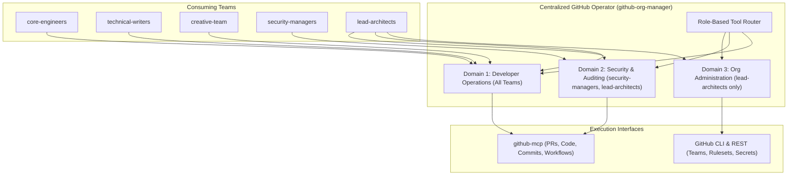
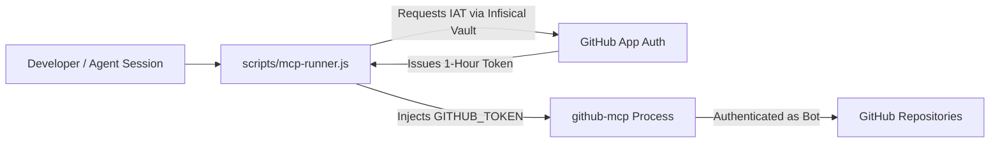
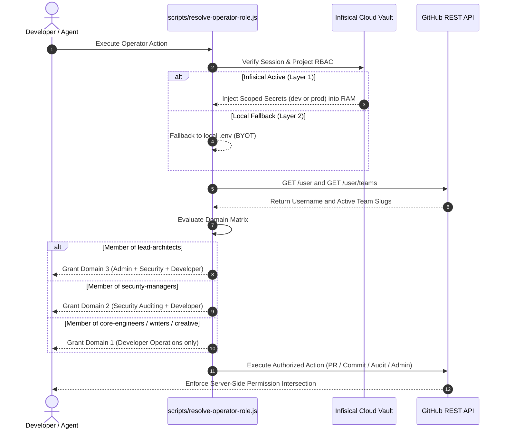

# Centralized GitHub Operator Architecture: Multi-Team Governance and GitHub App Integration

This document defines the architecture for transforming `github-org-manager` into a **Universal
Centralized Operator** serving all functional teams (`lead-architects`, `security-managers`,
`infra-ops`, `core-engineers`, `technical-writers`, and `creative-team`) across `tupynambalucas-dev`.

---

## 1. Executive Vision: The Hub-and-Spoke Operator Pattern

Instead of maintaining fragmented workflows where developers manually configure commit signing,
conventional commit formats, and PR rules, `github-org-manager` operates as an **Enterprise
Governance Operator**:



---

## 2. Dynamic Team Domains and Capabilities

The centralized operator dynamically routes requests based on the user's team context:

### Domain 1: Developer Operations (Accessible by All Teams)

Engineers across `core-engineers`, `technical-writers`, and `creative-team` use the operator to
automate routine GitHub actions while guaranteeing 100% compliance with organization rules:

| Operation | Operator Responsibilities | Enforced Organizational Guardrails |
| :--- | :--- | :--- |
| **Commit Creation** | Validates message syntax, stages changes, and executes commit. | Conventional Commits v1.0.0 (`feat`, `fix`, etc.), zero emojis, mandatory SSH signature (`-S`). |
| **Pull Request Creation**| Inspects branch delta, populates GFM template, targets correct base branch. | Blocks direct PRs to `main` for feature work; enforces `develop` base; auto-assigns CODEOWNERS. |
| **Submodule Synchronization**| Checks submodule HEADs and stages pointer commits in `org-core`. | Verifies clean working trees across all submodules before bumping pointers. |
| **CI/CD Status Verification** | Monitors workflow runs, CodeQL status, and mergeability. | Validates linear history and checks that required status checks pass before merge. |

### Domain 2: Security and Auditing (Accessible by `security-managers` and `lead-architects`)

| Operation | Operator Responsibilities | Enforced Organizational Guardrails |
| :--- | :--- | :--- |
| **Secret Scanning Audit** | Queries open secret scanning alerts across all repositories. | Enforces remediation SLAs and triggers immediate rotation in Infisical. |
| **Vulnerability Triage** | Reviews Dependabot and CodeQL alerts via `github-mcp`. | Identifies critical CVEs and opens scoped patch branches targeting `develop`. |
| **Signature Compliance** | Scans Git log history across branches. | Rejects unsigned commits and flags non-compliant author emails. |

### Domain 3: Organization Administration (Strictly Restricted to `lead-architects`)

| Operation | Operator Responsibilities | Enforced Organizational Guardrails |
| :--- | :--- | :--- |
| **Team Lifecycle** | Creates, updates, and deletes organization teams via REST API. | Idempotent slug naming (`kebab-case`), closed privacy, clear descriptions. |
| **Repository RBAC** | Binds team permissions (`admin`, `maintain`, `push`, `pull`). | Principle of Least Privilege across all monorepo workspaces. |
| **Branch Rulesets** | Configures branch protections and required checks via JSON schemas. | Mandatory signed commits, linear history, minimum 1 approval on `main`. |
| **Pipeline Secrets** | Encrypts and injects organization-level Actions secrets via `gh secret set`. | Zero plaintext storage; secret rotation synced with Infisical. |

---

## 3. GitHub App as the Universal Machine Identity

### A. Eliminating Developer PAT Dependency

In traditional setups, each developer must generate and manage their own Personal Access Token (PAT).
This introduces friction: developers may configure incorrect scopes, leave tokens in unencrypted
files, or exceed rate limits.

With the **Centralized GitHub App (`tupynambalucas-org-manager`)**:
- Developers and local agents interact with `github-mcp` using **ephemeral Installation Access Tokens (IAT)** issued by the GitHub App.
- The App provides a unified rate limit of 5,000 to 15,000 requests per hour.
- Developers do not need to configure personal tokens for MCP interactions.



### B. Automated Commit Signing via GitHub App

When the operator performs automated maintenance (e.g., dependency updates, documentation sync,
or submodule pointer bumps in CI):
- Commits generated via the GitHub Git Data API using the GitHub App's token are automatically
  **cryptographically signed by GitHub** and marked with the **Verified** badge.
- This satisfies the organization's mandatory signed commit ruleset without requiring individual
  developer private keys in headless CI/CD environments.

---

## 4. MCP Server Integration Architecture

The Model Context Protocol server (`github-mcp`) is the primary interface through which agents
in `agent-toolkit` inspect and operate on GitHub resources:

1. **Token Injection via `scripts/mcp-runner.js`**:
   - `mcp-runner.js` checks for GitHub App credentials in the environment or Infisical.
   - If present, it mints a short-lived token (1 hour) and passes it as `process.env.GITHUB_TOKEN`.
   - If absent, it falls back to a developer's local `.env` token.
2. **Read/Write Operations in `github-mcp`**:
   - Developers in `core-engineers` can use MCP tools (`create_pull_request`, `get_file_contents`, `list_workflow_runs`) without administrative rights.
   - Operations on teams and members (`list_teams`, `list_team_members`) work for all members, providing necessary context for CODEOWNERS review requests.
3. **Guardrailed Mutation Fallback**:
   - For mutations not supported natively by `github-mcp` (e.g., team creation, branch ruleset updates, Actions secrets), the operator falls back to the GitHub CLI (`gh`), restricting execution to authorized roles.
   - For an in-depth technical analysis comparing community and official GitHub MCP servers, consult [github-mcp-ecosystem-and-domain3-evaluation.md](./github-mcp-ecosystem-and-domain3-evaluation.md).

---

## 5. Caller Identity Resolution and Dynamic Team Router Implementation

To allow developers across all teams (`core-engineers`, `technical-writers`, `creative-team`, `security-managers`, `lead-architects`) to safely invoke `github-org-manager`, the operator deterministically resolves caller privileges through three defensive layers:



### 5.1 Automated Team Resolution via `resolve-operator-role.js`

The operator executes [`agent-toolkit/skills/github-org-manager/scripts/resolve-operator-role.js`](file:///C:/Users/tupyn/projects/organizations/tupynambalucas-dev/org-core/agent-toolkit/skills/github-org-manager/scripts/resolve-operator-role.js) to inspect the caller's active token:

```bash
# Human-readable status check
node agent-toolkit/skills/github-org-manager/scripts/resolve-operator-role.js

# Programmatic JSON consumption by agent skills
node agent-toolkit/skills/github-org-manager/scripts/resolve-operator-role.js --json
```

Output specification:
```json
{
  "organization": "tupynambalucas-dev",
  "username": "core-dev-01",
  "name": "Jane Developer",
  "teams": ["core-engineers"],
  "governanceDomain": "domain-1-developer",
  "privilegeLevel": "level-1",
  "infisicalProject": "tupynambalucas-dev-agent-toolkit",
  "infisicalEnvironment": "dev",
  "capabilities": {
    "developerOperations": true,
    "securityAuditing": false,
    "organizationAdmin": false
  }
}
```

If an engineer in `core-engineers` requests a Domain 3 operation (e.g., deleting a team or changing branch protection), the operator terminates before making destructive API calls:

```text
Access Denied: Organization Admin operations are restricted strictly to @lead-architects.
Caller identity: core-dev-01 (Teams: core-engineers)
Required Privilege Level: level-3 (Current: level-1)
```

---

## 6. Secret Storage Matrix: Infisical Vault vs. Local `.env` Fallback

Understanding the fundamental operational difference between Infisical and a local `.env` file is critical to enforcing least privilege across teams:

| Dimension | Enterprise Infisical Vault (Layer 1) | Local `.env` Hierarchy (Layer 2 - Fallback) |
| :--- | :--- | :--- |
| **Storage Model** | **Zero-Disk in RAM**: Injected via TLS directly into process memory (`process.env`). 0 bytes written to disk. | **Plaintext on Disk**: Stored unencrypted in workspace root (`.env`). High risk of accidental Git commits or leak. |
| **Team RBAC & Scoping** | **Strict Project & Environment Isolation**: Engineers only see the projects and environments (`dev`) they are assigned. | **Zero Access Control**: Anyone with filesystem access reads all keys. No concept of teams, roles, or environments. |
| **Secret Rotation & Drift**| **Instantaneous Centralized Rotation**: Updating a secret in Infisical propagates to all developer runs and K8s clusters instantly. | **Severe Configuration Drift**: Every engineer must manually edit local files when keys change. Outdated keys break workflows. |
| **Audit Trails** | **Tamper-Proof Audit Logs**: Every read, decryption, rotation, and API access is logged with timestamp, user identity, and IP. | **Zero Visibility**: Impossible to determine who read, copied, or leaked a secret from a local `.env`. |
| **Blast Radius** | **Granularly Partitioned**: Dedicated fallback pools for developers (`tupynambalucas-dev-agent-toolkit`) isolated from production platform secrets. | **Unbounded**: If an admin pastes a production token into `.env`, any script or agent in that workspace can access it. |
| **Lifecycle Purpose** | **Official Enterprise Standard**: Used by all internal team members and production Kubernetes clusters. | **Bring-Your-Own-Token (BYOT) Contingency**: Temporary contractors without Infisical accounts supply personal keys. |

### 6.1 How Infisical Enforces Team Segregation at the Runtime Boundary

Infisical prevents privilege escalation before code execution begins:

1. **Identity Authentication**: The engineer logs into Infisical using their organizational email via `infisical login`.
2. **Project Authorization**:
   - `core-engineers`: Granted access strictly to project `tupynambalucas-dev-agent-toolkit`, environment `dev`.
   - `lead-architects`: Granted access to project `tupynambalucas-dev-platform` (folders `/cluster`, `/corporate`, `/ci-cd`) and production credentials.
3. **Execution Isolation**: When `core-engineers` run `infisical run -- <command>`, the CLI only fetches developer fallback tokens (`FIRECRAWL_API_KEY`, `CONTEXT7_API_KEY`, developer PAT). It is mathematically impossible for the developer's runtime to possess the GitHub App private key (`.pem`) or cluster secrets.

---

## 7. Security Guardrails and Least Privilege Guarantees

Even when `github-org-manager` is available to all teams, security boundaries remain immutable:

1. **Privilege Ceiling (OAuth Mode)**: If an engineer uses the App in User-to-Server mode, GitHub's
   Permission Intersection guarantees that the developer cannot exceed their personal repository
   permissions.
2. **Private Key Protection (Bot Mode)**: The GitHub App private key (`.pem`) is vaulted in Infisical
   under the `lead-architects` environment. Developers in `core-engineers` have zero access to the
   underlying private key.
3. **Zero-Emoji & Conventional Commit Enforcement**: Built directly into the operator's execution
   logic. Any commit or PR authoring request that fails compliance is rejected prior to dispatch.

---

## 8. Implementation Runbook: Transitioning to the Centralized Operator

1. **Deploy GitHub App**: Register `tupynambalucas-org-manager` with the organization permissions specified in Section 6 of this reference guide.
2. **Configure Infisical Secret Injection**:
   - `GITHUB_APP_ID`: Application identifier.
   - `GITHUB_APP_INSTALLATION_ID`: Installation identifier for `tupynambalucas-dev`.
   - `GITHUB_APP_PRIVATE_KEY_BASE64`: Base64-encoded `.pem` private key.
3. **Enhance `mcp-runner.js`**: Add automated JWT exchange so that `github-mcp` launches with an ephemeral App token automatically when running under `infisical run`.
4. **Distribute Operator Skills**: Allow all teams to consume the developer workflow tools in `github-org-manager` for commit and PR standardization.
5. **Enforce Pre-flight Role Resolution**: Wire `resolve-operator-role.js` into operator pre-checks to gate administrative commands before dispatch.
