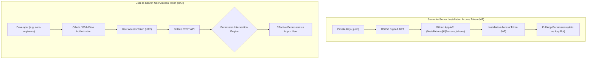
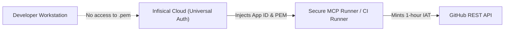

# GitHub App Architecture and Least-Privilege Governance

This document specifies the technical architecture, permission model, and security boundaries
for operating GitHub Apps within the `tupynambalucas-dev` organization.

---

## 1. Executive Summary

A GitHub App is the authoritative organizational identity mechanism for automated tooling, CI/CD
orchestration, and AI agent skills. Unlike Personal Access Tokens (PATs) which are anchored to
individual developer accounts, a GitHub App is owned directly by the organization, issues
time-bounded ephemeral credentials, and operates under strict least-privilege constraints.

---

## 2. Authentication Paradigms: IAT vs. UAT

GitHub Apps support two fundamentally different authentication workflows with contrasting
security models:



### A. Installation Access Tokens (Server-to-Server / IAT)

- **Identity**: The API call is attributed directly to the GitHub App bot (e.g., `tupynambalucas-bot[bot]`).
- **Authorization**: The token inherits the full scope of permissions granted during the app's installation on the organization.
- **Validity**: Maximum lifespan of 1 hour, generated on demand using a signed RS256 JSON Web Token (JWT).
- **Use Cases**: Scheduled CI/CD pipelines, autonomous agent routines, infrastructure GitOps operators, and organization management runbooks.

### B. User Access Tokens (User-to-Server / UAT)

- **Identity**: The action is attributed to the authenticating user, with the GitHub UI displaying the user's avatar with an overlaid app badge.
- **Authorization**: The token is strictly constrained by the **Permission Intersection Principle**.
- **Validity**: Up to 8 hours with optional refresh tokens.
- **Use Cases**: Interactive CLI sessions, developer-driven PR automations, and workstation-based tools.

---

## 3. Least Privilege Analysis: Core Engineers Delegation

### The Permission Intersection Principle

When an application acts on behalf of a user using a User Access Token (UAT), GitHub calculates
effective permissions as an intersection:

$$\text{Effective Permissions} = \text{App Granted Permissions} \cap \text{User Account Permissions}$$

According to official GitHub documentation:
> "A token has the same abilities to access resources and perform actions as the token owner,
> and is further limited by any scopes or permissions granted to the token. A token cannot grant
> additional access abilities to a user."

### Impact on the `core-engineers` Team

Suppose an internal GitHub App is registered with broad organization permissions:
- `Organization Administration: write`
- `Organization Members: write`
- `Organization Secrets: write`

If a developer belonging to the `core-engineers` team uses this app:

| Scenario | Execution Mode | Can Member Delete Org? | Can Member Alter Teams? | Can Member Push to Code? | Effective Authority |
| :--- | :--- | :---: | :---: | :---: | :--- |
| **UAT (OAuth)** | On behalf of user | **NO (HTTP 403)** | **NO (HTTP 403)** | **YES (Write)** | Strictly capped at user's personal `core-engineers` permissions |
| **IAT (Bot Key)** | Directly as App | **YES** | **YES** | **YES** | Unrestricted authority of the GitHub App installation |

### Security Invariant

A user from `core-engineers` **NEVER** acquires administrator permissions through an OAuth
user-to-server token. GitHub's permission engine intercepts the call and verifies whether the
human user possesses administrative rights in the target organization.

However, if a developer obtains the App's **Private Key (`.pem`)** or triggers an unprotected
backend service that mints IAT tokens without authorization checks, they can bypass their personal
limits by impersonating the bot.

---

## 4. Required Permissions for `github-org-manager`

To support organization governance runbooks (managing teams, syncing repository RBAC, and setting
Actions pipeline secrets), the GitHub App requires the following configuration:

### Organization Permissions

| Permission Name | Access Level | Operational Capabilities |
| :--- | :--- | :--- |
| **Administration** | `write` | Manage organization settings, audit log access, and IP allow lists. |
| **Members** | `write` | Create and delete teams, assign team memberships, configure team roles. |
| **Secrets** | `write` | Create and rotate organization-level GitHub Actions secrets. |
| **Custom Properties** | `write` | Assign metadata tags and repository schemas. |

### Repository Permissions

| Permission Name | Access Level | Operational Capabilities |
| :--- | :--- | :--- |
| **Administration** | `write` | Configure repository rulesets, branch protections, and collaborators. |
| **Contents** | `write` | Read and write code files, submodules, releases, and tags. |
| **Pull Requests** | `write` | Open, review, and merge pull requests. |
| **Secrets** | `write` | Manage environment and repository-scoped Actions secrets. |
| **Metadata** | `read` | Read basic repository directory listings and properties (mandatory). |

---

## 5. Secure Credential Lifecycle and Key Storage

To prevent privilege escalation while leveraging GitHub Apps for automation:



1. **Zero Private Keys in Repositories**: The `.pem` private key must NEVER be committed to Git or stored in unencrypted `.env` files.
2. **Infisical Cloud Vaulting**:
   - Store the key in Infisical under `tupynambalucas-dev-platform` / `tupynambalucas-dev-agent-toolkit`.
   - Variable names: `GITHUB_APP_ID`, `GITHUB_APP_INSTALLATION_ID`, `GITHUB_APP_PRIVATE_KEY_BASE64`.
   - Restrict access to `lead-architects` and automated machine identities.
3. **Short-Lived Token Exchange**:
   - Scripts mint a JSON Web Token (JWT) valid for 10 minutes.
   - The JWT is exchanged for an Installation Access Token (IAT) valid for exactly 1 hour.
   - Tokens expire automatically, minimizing the window of vulnerability.

---

## 6. Setup and Registration Runbook

1. Navigate to `https://github.com/organizations/tupynambalucas-dev/settings/apps`.
2. Click **New GitHub App**.
3. Set **GitHub App name**: `tupynambalucas-org-manager`.
4. Set **Homepage URL**: `https://tupynambalucas.dev`.
5. Deselect **Webhook Active** (unless listening to webhooks via Cortex gateway).
6. Configure the permissions specified in Section 4.
7. Select **Where can this GitHub App be installed?** -> `Only on this account`.
8. Click **Create GitHub App**.
9. In the App settings:
   - Note the **App ID** and **Client ID**.
   - Click **Generate a private key** and download the `.pem` file.
   - In the left sidebar, click **Install App** and install on `tupynambalucas-dev` selecting all repositories.
10. Store the base64-encoded private key in Infisical:
    ```bash
    base64 -w 0 tupynambalucas-org-manager.private-key.pem
    ```
