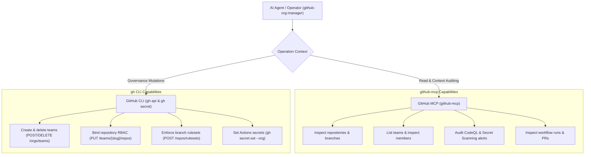
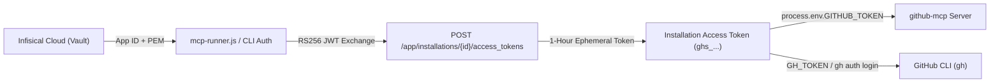

# GitHub Organization Manager Architecture: CLI, MCP, and GitHub App Governance

This document defines the operational architecture, authentication pipelines, team authorization
boundaries, and GitHub App integration for the `github-org-manager` skill within `tupynambalucas-dev`.

---

## 1. Operational Overview: GitHub CLI vs. GitHub MCP

The `github-org-manager` skill coordinates organizational governance, team lifecycles, repository
RBAC permissions, branch rulesets, and pipeline secrets. It utilizes a **hybrid execution model**
combining the Model Context Protocol (`github-mcp`) with the GitHub CLI (`gh`):



### Functional Capabilities Matrix

| Capability / Mutation | `github-mcp` Tooling | GitHub CLI (`gh`) | Primary Rationale |
| :--- | :---: | :---: | :--- |
| **List Organization Teams** | Supported (`list_teams`) | Supported (`gh api`) | MCP provides direct model-native querying. |
| **Inspect Team Members** | Supported (`list_team_members`) | Supported (`gh api`) | Read-only context retrieval via MCP stdio. |
| **Audit Security Alerts** | Supported (`list_secret_scanning_alerts`) | Supported (`gh api`) | MCP reads CodeQL, Dependabot, and Secret Scanning. |
| **Create or Delete Teams** | Not Available | Supported (`gh api -X POST`) | Organizational team creation requires REST mutation. |
| **Assign Repository RBAC** | Not Available | Supported (`gh api -X PUT`) | Team-to-repository permission bindings. |
| **Branch Ruleset CRUD** | Not Available | Supported (`gh api /rulesets`) | JSON-payload branch protection enforcement. |
| **Pipeline Secrets CRUD** | Not Available | Supported (`gh secret set`) | Asymmetric sodium encryption for Actions secrets. |

---

## 2. Team Authorization Matrix: Who Can Operate `github-org-manager`?

Because `github-org-manager` executes high-impact administrative mutations, access to its runbooks
and execution credentials is partitioned under the **Principle of Least Privilege**:

| Team Slug | Permission Level | Allowed Operations | Prohibited Operations |
| :--- | :---: | :--- | :--- |
| **`lead-architects`** | **Full Operator** | Team creation, repo RBAC, rulesets, org secrets, security audit. | None (Global CODEOWNERS and architecture leads). |
| **`security-managers`**| **Audit Only** | Read-only security audit, vulnerability inspection, team listing. | Cannot alter teams, rulesets, secrets, or repo RBAC. |
| **`infra-ops`** | **Scoped Operator**| Manage CI/CD runners, sync platform secrets (`gh secret set`). | Cannot alter engineering team topology or branch rulesets. |
| **`core-engineers`** | **Blocked** | None. Standard application development only. | Cannot execute `github-org-manager` or manage secrets. |
| **`technical-writers`**| **Blocked** | None. Documentation authoring in `docs` repository only. | Cannot execute `github-org-manager`. |
| **`creative-team`** | **Blocked** | None. Visual design assets and studio branding only. | Cannot execute `github-org-manager`. |
| **`contractors`** | **Blocked** | None. External scoped tasks only. | Cannot execute `github-org-manager`. |

---

## 3. GitHub App Architecture for `github-org-manager` and MCPs

### A. The Limitation of Personal Access Tokens (PATs)

Traditional PATs present significant enterprise operational risks:
1. Tied to an individual developer's personal GitHub account.
2. If the user account is rotated, suspended, or leaves the organization, all agent pipelines break.
3. Fine-Grained PATs cannot be issued directly by the organization.
4. Static tokens have long lifespans (up to 1 year) and lack automatic cryptographic rotation.

### B. The Sovereign Solution: GitHub App

A dedicated **GitHub App** (`tupynambalucas-org-manager`) serves as the official machine identity:



### C. How GitHub App Tokens Power MCP Servers

The `github-mcp` server natively accepts an **Installation Access Token (IAT)** passed via the
`GITHUB_TOKEN` environment variable. The token format (`ghs_...`) is recognized by the GitHub API
as an installation bearer token:

1. **Higher Rate Limits**: GitHub Apps receive an organizational rate limit of 5,000 to 15,000 requests per hour (scaling with organization seats), compared to 5,000 shared requests per hour for personal tokens.
2. **Deterministic Audit Attribution**: All mutations appear in the organization audit log attributed to `tupynambalucas-org-manager[bot]`.
3. **Automatic Ephemeral Expiration**: Tokens expire automatically after 60 minutes. Even if an agent runtime environment logs a token, the exposure window is minimal.

---

## 4. MCP Runner Token Minting Workflow

The following reference implementation illustrates how `scripts/mcp-runner.js` exchanges GitHub
App credentials stored in Infisical for an ephemeral Installation Access Token before launching
`github-mcp`:

```javascript
import { createAppAuth } from "@octokit/auth-app";

async function resolveGitHubAppToken() {
  const appId = process.env.GITHUB_APP_ID;
  const privateKey = Buffer.from(
    process.env.GITHUB_APP_PRIVATE_KEY_BASE64,
    "base64"
  ).toString("utf-8");
  const installationId = Number(process.env.GITHUB_APP_INSTALLATION_ID);

  if (!appId || !privateKey || !installationId) {
    return process.env.GITHUB_TOKEN; // Fallback to standard token if app credentials absent
  }

  const auth = createAppAuth({ appId, privateKey });
  const installationAuth = await auth({
    type: "installation",
    installationId,
  });

  return installationAuth.token; // Ephemeral token valid for 60 minutes
}
```

---

## 5. Least-Privilege Verification: Core Engineers Execution Boundary

### User Access Tokens (UAT) vs. Installation Access Tokens (IAT)

When evaluating what happens if a non-admin developer (e.g., from `core-engineers`) interacts
with the GitHub App or its MCP connectors:

$$\text{Effective Permissions (UAT)} = \text{App Permissions} \cap \text{User Permissions}$$

### The Privilege Ceiling

1. **If Authenticating on Behalf of User (OAuth / UAT Mode)**:
   - GitHub computes the mathematical intersection between the user's role and the app's scope.
   - A `core-engineers` member has `write` access on specific repos, but **no organizational admin rights**.
   - If that user invokes a tool calling `POST /orgs/{org}/teams` or modifying branch rulesets, GitHub returns **`403 Forbidden`**. The user's personal privilege acts as an unbreachable ceiling.
2. **If Authenticating as the Installation (Bot / IAT Mode)**:
   - The token acts as the bot itself, wielding full organizational permissions.
   - **Critical Security Invariant**: The GitHub App private key (`.pem`) must **NEVER** be distributed to developers or committed to local `.env` files. Access to the private key in Infisical must be restricted strictly to `lead-architects` and automated CI/CD runners.

---

## 6. Required GitHub App Permissions Specification

To fulfill the complete governance requirements of `github-org-manager` across both CLI and MCP
interfaces, configure the GitHub App with the following scopes:

### Organization Permissions

| Permission | Level | Justification |
| :--- | :--- | :--- |
| **Administration** | `write` | Required to manage repository rulesets, audit logs, and security policies. |
| **Members** | `write` | Required to create, delete, and synchronize teams and manage memberships. |
| **Secrets** | `write` | Required to set and rotate organization-level GitHub Actions secrets. |
| **Custom Properties**| `write` | Required to tag repositories and enforce metadata categorization. |

### Repository Permissions

| Permission | Level | Justification |
| :--- | :--- | :--- |
| **Administration** | `write` | Required to bind repository RBAC permissions to functional teams. |
| **Contents** | `write` | Required for autonomous code mutations, submodule updates, and tags. |
| **Pull Requests** | `write` | Required for agent pull request authoring, review, and merging. |
| **Secrets** | `write` | Required to set environment and repository-scoped Actions pipeline secrets. |
| **Metadata** | `read` | Mandatory base permission for repository discovery. |

---

## 7. Migration and Deployment Runbook

1. **Register the GitHub App**:
   - Navigate to `https://github.com/organizations/tupynambalucas-dev/settings/apps/new`.
   - Name: `tupynambalucas-org-manager`.
   - Homepage: `https://tupynambalucas.dev`.
   - Permissions: Select the scopes defined in Section 6.
   - Where to install: `Only on this account`.
2. **Generate Private Key**:
   - Download the generated `.pem` private key file.
   - Record `App ID` and `Client ID`.
3. **Install the App**:
   - Install the app on `tupynambalucas-dev` with `All repositories` selected.
   - Record the `Installation ID` from the installation URL (e.g., `.../installations/12345678`).
4. **Vault Credentials in Infisical**:
   - Encode the private key: `base64 -w 0 tupynambalucas-org-manager.private-key.pem`
   - Store in Infisical project `tupynambalucas-dev-agent-toolkit` (environment `dev` and `prod`):
     - `GITHUB_APP_ID`: `<App ID>`
     - `GITHUB_APP_INSTALLATION_ID`: `<Installation ID>`
     - `GITHUB_APP_PRIVATE_KEY_BASE64`: `<Base64 String>`
5. **Verify Local MCP Execution**:
   - Run `agy` or `mcp-runner.js` with Infisical injection:
     ```bash
     infisical run --projectId <AGENT_TOOLKIT_PROJECT_ID> --env dev -- agy
     ```
   - Verify that `github-mcp` connects using the ephemeral bot token without requiring personal PATs.
