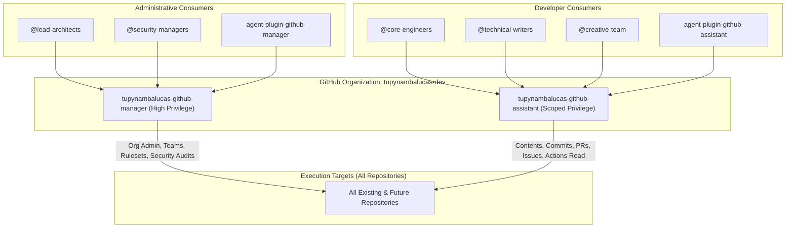

# GitHub Apps Authoritative Configuration Runbook

This document is the authoritative standard and step-by-step operational runbook for creating, configuring, installing, and enrolling the two sovereign GitHub Apps for `tupynambalucas-dev` via the official GitHub Web UI:
1. **`tupynambalucas-github-manager`** (for `@tupynambalucas-dev/agent-plugin-github-manager`)
2. **`tupynambalucas-github-assistant`** (for `@tupynambalucas-dev/agent-plugin-github-assistant`)

---

## 1. Architectural Strategy & Role Segregation

To guarantee the Principle of Least Privilege across the organization, high-privilege governance operations and everyday developer productivity operations are segregated into two dedicated machine identities:



### Authentication Model: Autonomous Machine Identity
Our AI agents, CLI scripts, and MCP servers authenticate using **Server-to-Server App Installation Authentication**:
- **No interactive human login** or browser redirect required.
- The agent takes the **App ID**, signs a short-lived JSON Web Token (JWT) using the **RSA private key (`.pem`)**, and calls the GitHub API (`POST /app/installations/{installation_id}/access_tokens`).
- GitHub responds with an **Installation Access Token (IAT)** valid for 1 hour.
- Because of this machine-to-machine architecture:
  - **OAuth callbacks are not needed**.
  - **Webhooks are disabled** (agents poll or query on demand via REST/GraphQL).

---

## 2. App 1: `tupynambalucas-github-manager`

Use this procedure to create the high-privilege management application.

### Step 2.1: Open Registration Page
Direct URL:
```
https://github.com/organizations/tupynambalucas-dev/settings/apps/new
```
*(Or navigate via: GitHub -> Organization tupynambalucas-dev -> Settings -> Developer settings -> GitHub Apps -> New GitHub App)*.

### Step 2.2: General Information
- **GitHub App name**: `tupynambalucas-github-manager`
- **Description**: `Authoritative governance and security operator for tupynambalucas-dev.`
- **Homepage URL**: `https://docs.tupynambalucas.dev`
- **Callback URL**: Leave empty (or enter `https://docs.tupynambalucas.dev` if required by browser validation).
- **Expire user authorization tokens**: Leave default.
- **Request user authorization (OAuth) during installation**: **Unchecked** (Crucial: do not request user OAuth).
- **Post installation**:
  - **Setup URL**: Leave empty.
  - **Redirect on update**: Unchecked.

### Step 2.3: Webhook Configuration
- **Active**: **Uncheck** (disable webhooks; webhook URL and secret will disappear or remain optional).

### Step 2.4: Repository Permissions
Scroll down to **Permissions** -> **Repository permissions** and set the following dropdowns:

| Permission Name in UI | Required Selection | Purpose |
| :--- | :--- | :--- |
| **Actions** | **Read and write** | Monitor CI/CD runs, diagnose workflow failures, trigger dispatches. |
| **Administration** | **Read and write** | Manage repository settings, branch protection rulesets, and collaborators. |
| **Commit statuses** | **Read and write** | Query and report build and check verification statuses. |
| **Contents** | **Read and write** | Read source code, manage branches, push signed commits. |
| **Issues** | **Read and write** | Create, label, and update operational issues. |
| **Metadata** | **Read-only** | Mandatory base permission (locked by GitHub). |
| **Pull requests** | **Read and write** | Inspect pull request diffs, post reviews, and merge PRs. |
| **Secret scanning alerts** | **Read and write** | Triage and audit exposed credentials across repos. |
| **Vulnerability alerts** | **Read and write** | Triage Dependabot security alerts and CVE notifications. |

*Note: All other Repository permissions remain at **No access**.*

### Step 2.5: Organization Permissions
Scroll down to **Organization permissions** and set:

| Permission Name in UI | Required Selection | Purpose |
| :--- | :--- | :--- |
| **Administration** | **Read and write** | Manage organization-level settings and repository inventory. |
| **Members** | **Read and write** | Create and manage teams, synchronize RBAC team assignments. |

*Note: All other Organization permissions remain at **No access**.*

### Step 2.6: Account Permissions
- Keep all Account permissions set to **No access**.

### Step 2.7: Installation Target and Creation
- **Where can this GitHub App be installed?**: Select **Only on this account**.
- Click the green button: **Create GitHub App**.

### Step 2.8: Capture Identifiers & Private Key
After clicking Create, GitHub redirects to the App's **General** settings page:
1. Under **About**, copy and save:
   - **App ID**: (e.g. `1234567`)
   - **Client ID**: (e.g. `Iv1.xxxxxxxxxxxx`)
2. Scroll down to **Private keys** section:
   - Click **Generate a private key**.
   - Your browser will download a file named `tupynambalucas-github-manager.<timestamp>.private-key.pem`.
   - Rename/keep this file securely.

### Step 2.9: Install App on the Organization
1. In the left navigation menu of the App settings, click **Install App**.
2. Click the green **Install** button next to the `tupynambalucas-dev` organization.
3. On the confirmation screen:
   - Choose: **All repositories** (Grants access to all current and future repositories automatically).
   - Click **Install**.
4. After installation, copy the **Installation ID** from your browser address bar:
   - URL format: `https://github.com/organizations/tupynambalucas-dev/settings/installations/<INSTALLATION_ID>`
   - The trailing number is your `GITHUB_APP_MANAGER_INSTALLATION_ID`.

---

## 3. App 2: `tupynambalucas-github-assistant`

Use this procedure to create the restricted developer assistant application.

### Step 3.1: Open Registration Page
Direct URL:
```
https://github.com/organizations/tupynambalucas-dev/settings/apps/new
```

### Step 3.2: General Information
- **GitHub App name**: `tupynambalucas-github-assistant`
- **Description**: `Developer productivity assistant for daily Git workflows and CI/CD triage in tupynambalucas-dev.`
- **Homepage URL**: `https://docs.tupynambalucas.dev`
- **Callback URL**: Leave empty (or enter `https://docs.tupynambalucas.dev`).
- **Request user authorization (OAuth) during installation**: **Unchecked**.
- **Post installation**: Leave Setup URL empty.

### Step 3.3: Webhook Configuration
- **Active**: **Uncheck**.

### Step 3.4: Repository Permissions
Set the following dropdowns:

| Permission Name in UI | Required Selection | Purpose |
| :--- | :--- | :--- |
| **Actions** | **Read-only** | Inspect CI/CD workflow logs and check statuses for debugging. |
| **Contents** | **Read and write** | Code exploration, Conventional Commit authoring, and feature branches. |
| **Issues** | **Read and write** | Assist with issue authoring and discussion. |
| **Metadata** | **Read-only** | Mandatory base permission. |
| **Pull requests** | **Read and write** | Open PRs, populate templates, and review code diffs. |

*Note: All other Repository permissions remain at **No access**.*

### Step 3.5: Organization Permissions
- Keep **ALL** Organization permissions set to **No access**.
  *(The assistant is strictly forbidden from administrative or member operations).*

### Step 3.6: Account Permissions
- Keep all Account permissions set to **No access**.

### Step 3.7: Installation Target and Creation
- **Where can this GitHub App be installed?**: Select **Only on this account**.
- Click the green button: **Create GitHub App**.

### Step 3.8: Capture Identifiers & Private Key
1. Under **About**, copy:
   - **App ID**
   - **Client ID**
2. Scroll down to **Private keys**:
   - Click **Generate a private key**.
   - Download and save `tupynambalucas-github-assistant.<timestamp>.private-key.pem`.

### Step 3.9: Install App on the Organization
1. Click **Install App** in the left menu.
2. Click **Install** next to `tupynambalucas-dev`.
3. Choose: **All repositories**.
4. Click **Install**.
5. Copy the **Installation ID** from the resulting URL.

---

## 4. Infisical Cloud Vault Secret Mapping

After generating both applications, enroll the credentials into the Infisical Cloud Vault (project: `tupynambalucas-dev-platform` / environment: `dev` or via MCP).

| Infisical Secret Name | Source from GitHub App | Required Value |
| :--- | :--- | :--- |
| `GITHUB_APP_MANAGER_ID` | `tupynambalucas-github-manager` | App ID integer |
| `GITHUB_APP_MANAGER_CLIENT_ID` | `tupynambalucas-github-manager` | Client ID string |
| `GITHUB_APP_MANAGER_INSTALLATION_ID` | `tupynambalucas-github-manager` | Installation ID integer |
| `GITHUB_APP_MANAGER_PRIVATE_KEY` | `tupynambalucas-github-manager` | Full plaintext content of the `.pem` file |
| `GITHUB_APP_ASSISTANT_ID` | `tupynambalucas-github-assistant` | App ID integer |
| `GITHUB_APP_ASSISTANT_CLIENT_ID` | `tupynambalucas-github-assistant` | Client ID string |
| `GITHUB_APP_ASSISTANT_INSTALLATION_ID`| `tupynambalucas-github-assistant` | Installation ID integer |
| `GITHUB_APP_ASSISTANT_PRIVATE_KEY` | `tupynambalucas-github-assistant` | Full plaintext content of the `.pem` file |

### Security Verification
- Never commit `.pem` files to Git. Both `agent-mesh/.gitignore` and `org-core/.gitignore` enforce `*.pem` exclusion.
- All runtime token minting occurs purely in RAM via JWT exchange (`RS256`, 10-minute validity) producing 1-hour Installation Access Tokens.
