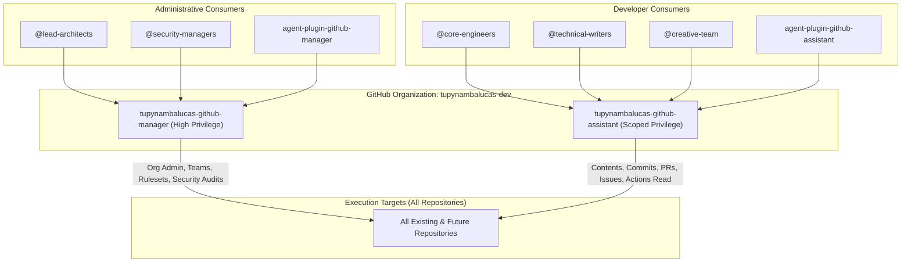

# GitHub Apps Authoritative Configuration Runbook

This document is the authoritative standard for creating, configuring, and enrolling the two sovereign GitHub Apps for the `tupynambalucas-dev` organization:
1. **`tupynambalucas-github-manager`** (for `@tupynambalucas-dev/agent-plugin-github-manager`)
2. **`tupynambalucas-github-assistant`** (for `@tupynambalucas-dev/agent-plugin-github-assistant`)

---

## 1. Architectural Strategy & Role Segregation

To guarantee the Principle of Least Privilege across the organization, high-privilege governance operations and everyday developer productivity operations are segregated into two dedicated machine identities:



---

## 2. Why GitHub App Manifests Fail with Validation Errors

When attempting to create a GitHub App via automated Manifests (`POST /settings/apps/new`), GitHub's internal validation engine (`DefaultPermissionRecord`) enforces strict, undocumented constraints:
- **`vulnerability_alerts` vs `dependabot_alerts`**: In the REST API and Manifest schema, Dependabot alerts must be declared as `vulnerability_alerts`, not `dependabot_alerts`.
- **`rulesets`**: Does not exist as an independent permission key. Branch protection rulesets are subsumed under repository `administration`.
- **`organization_custom_roles` & `team_discussions`**: Not recognized in manifest schemas and cause validation rejection.
- **`hook_attributes.url`**: Mandatory inside the manifest payload even if webhooks are inactive (`active: false`).

Due to these strict validation quirks, creating GitHub Apps directly in the GitHub Web UI is the **most deterministic, resilient, and verifiable method**. It provides full visual inspection of every granted privilege.

---

## 3. App 1: `tupynambalucas-github-manager`

### 3.1 Initial Setup
1. Navigate to: **GitHub Organization Settings** -> **Developer settings** -> **GitHub Apps** -> **New GitHub App**
   - Direct URL: `https://github.com/organizations/tupynambalucas-dev/settings/apps/new`
2. **GitHub App name**: `tupynambalucas-github-manager`
3. **Homepage URL**: `https://docs.tupynambalucas.dev`
4. **Callback URL**: `http://localhost:3333/callback`
5. **Webhook**:
   - Uncheck **Active** (Disable webhook delivery since agents operate on request-driven REST/GraphQL).

### 3.2 Permissions Matrix

#### A. Repository Permissions
| Resource | Access Level | Purpose |
| :--- | :--- | :--- |
| **Administration** | **Read and write** | Manage repository settings, branch protection rulesets, and collaborators. |
| **Contents** | **Read and write** | Inspect code, create branches, and push signed commits. |
| **Issues** | **Read and write** | Create, inspect, and label issues across repositories. |
| **Pull requests** | **Read and write** | Inspect pull request diffs, post reviews, and merge PRs. |
| **Actions** | **Read and write** | Trigger workflows, inspect pipeline statuses, and rerun failed jobs. |
| **Commit statuses** | **Read and write** | Inspect and update commit status checks. |
| **Secret scanning alerts** | **Read and write** | Triage and audit exposed credentials. |
| **Vulnerability alerts** | **Read and write** | Triage Dependabot alerts. |
| **Metadata** | **Read-only** | Mandatory base permission. |

#### B. Organization Permissions
| Resource | Access Level | Purpose |
| :--- | :--- | :--- |
| **Administration** | **Read and write** | Inspect and manage organization settings and repositories. |
| **Members** | **Read and write** | Create, manage, and assign teams and synchronize RBAC membership. |

### 3.3 Installation & Credentials
1. Under **Where can this GitHub App be installed?**, select: **Only on this account**.
2. Click **Create GitHub App**.
3. Under **General**, note the **App ID** and **Client ID**.
4. Scroll down to **Private keys** and click **Generate a private key**.
   - Save the downloaded `.pem` file as `tupynambalucas-github-manager.private-key.pem`.
5. Go to **Install App** in the left sidebar.
   - Click **Install** next to `tupynambalucas-dev`.
   - Select **All repositories**.
   - Click **Install**.
6. Note the **Installation ID** from the URL:
   `https://github.com/organizations/tupynambalucas-dev/settings/installations/<INSTALLATION_ID>`.

---

## 4. App 2: `tupynambalucas-github-assistant`

### 4.1 Initial Setup
1. Navigate to: `https://github.com/organizations/tupynambalucas-dev/settings/apps/new`
2. **GitHub App name**: `tupynambalucas-github-assistant`
3. **Homepage URL**: `https://docs.tupynambalucas.dev`
4. **Callback URL**: `http://localhost:3333/callback`
5. **Webhook**:
   - Uncheck **Active**.

### 4.2 Permissions Matrix

#### A. Repository Permissions
| Resource | Access Level | Purpose |
| :--- | :--- | :--- |
| **Contents** | **Read and write** | Code exploration, Conventional Commit authoring, and branch management. |
| **Pull requests** | **Read and write** | PR authoring, template population, and code review guidance. |
| **Issues** | **Read and write** | Issue triage and discussion assistance. |
| **Actions** | **Read-only** | Inspect workflow logs, check failures, and diagnose pipeline runs. |
| **Metadata** | **Read-only** | Mandatory base permission. |

#### B. Organization Permissions
- **All Organization Permissions**: Set to **No access**.
  *(The assistant has zero administrative power over members, teams, or org settings).*

### 4.3 Installation & Credentials
1. Under **Where can this GitHub App be installed?**, select: **Only on this account**.
2. Click **Create GitHub App**.
3. Under **General**, note the **App ID** and **Client ID**.
4. Scroll down to **Private keys** and click **Generate a private key**.
   - Save the downloaded `.pem` file as `tupynambalucas-github-assistant.private-key.pem`.
5. Go to **Install App** in the left sidebar.
   - Click **Install** next to `tupynambalucas-dev`.
   - Select **All repositories**.
   - Click **Install**.
6. Note the **Installation ID** from the URL.

---

## 5. Infisical Cloud Vault Enrollment

Once the credentials and `.pem` private keys are obtained, enroll them into the Infisical Vault using the `secrets_cortex-infisical` MCP tool or Infisical CLI.

### Secret Mapping Standard

| Secret Name | Value Description | Consumed By |
| :--- | :--- | :--- |
| `GITHUB_APP_MANAGER_ID` | Numeric App ID of `tupynambalucas-github-manager` | `@tupynambalucas-dev/agent-plugin-github-manager` |
| `GITHUB_APP_MANAGER_CLIENT_ID` | OAuth Client ID of manager app | `@tupynambalucas-dev/agent-plugin-github-manager` |
| `GITHUB_APP_MANAGER_INSTALLATION_ID` | Installation ID on `tupynambalucas-dev` | `@tupynambalucas-dev/agent-plugin-github-manager` |
| `GITHUB_APP_MANAGER_PRIVATE_KEY` | Plaintext RSA `.pem` private key content | `@tupynambalucas-dev/agent-plugin-github-manager` |
| `GITHUB_APP_ASSISTANT_ID` | Numeric App ID of `tupynambalucas-github-assistant` | `@tupynambalucas-dev/agent-plugin-github-assistant` |
| `GITHUB_APP_ASSISTANT_CLIENT_ID` | OAuth Client ID of assistant app | `@tupynambalucas-dev/agent-plugin-github-assistant` |
| `GITHUB_APP_ASSISTANT_INSTALLATION_ID` | Installation ID on `tupynambalucas-dev` | `@tupynambalucas-dev/agent-plugin-github-assistant` |
| `GITHUB_APP_ASSISTANT_PRIVATE_KEY` | Plaintext RSA `.pem` private key content | `@tupynambalucas-dev/agent-plugin-github-assistant` |

---

## 6. Runtime Minting and Ephemeral Token Generation

When an agent executes tools in either plugin:
1. The tool router (`scripts/mcp-gateway-router.js`) verifies whether the cluster Envoy gateway is reachable.
2. In standalone fallback mode, the router or skill signs a JSON Web Token (JWT) using the RSA `.pem` key (RS256, expires in 10 minutes).
3. Exchanges the JWT with GitHub API:
   ```http
   POST /app/installations/{installation_id}/access_tokens
   Authorization: Bearer <JWT>
   ```
4. Obtains an ephemeral **Installation Access Token (IAT)** valid for 1 hour.
5. Injects the IAT into the execution process memory (`process.env.GITHUB_TOKEN`).
6. Zero secrets or long-lived PATs are ever written to disk or logged.
