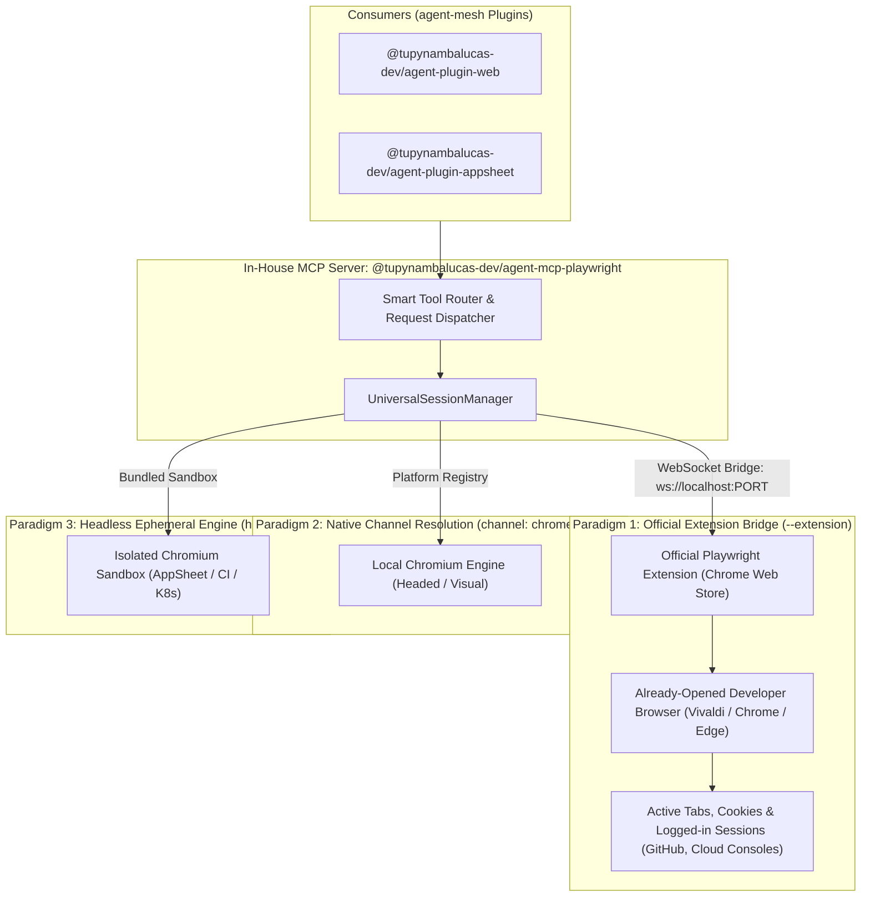

# In-House Playwright MCP Architecture & Universal Browser Engine Specification

This specification defines the architectural design, technical implementation, and monorepo integration plan for replacing the upstream third-party `@playwright/mcp` dependency with a sovereign in-house package: **`@tupynambalucas-dev/agent-mcp-playwright`** located in [`mcp/packages/playwright`](file:///C:/Users/tupyn/projects/organizations/tupynambalucas-dev/org-core/agent-mesh/mcp/packages).

It establishes the **Universal Browser Engine Architecture**, eliminating all operating-system-specific launch scripts and hardcoded absolute paths, ensuring any developer on any platform (Windows, macOS, Linux) can connect seamlessly to their already-opened browser or run automated headless workloads.

---

## 1. Architectural Mandate: Zero Hardcoded Paths & Cross-Platform Parity

In enterprise monorepo engineering, automation tooling must adhere to two non-negotiable principles:
1. **Zero Workstation-Specific Dependencies**: No absolute local filesystem paths (such as `C:\Users\<Name>\...` or `/home/<user>/...`), and no reliance on platform-bound shell scripts (PowerShell-only or Bash-only).
2. **Universal Developer Experience (DX)**: Every developer on the team—regardless of whether they run Windows, macOS, or Linux, and whether their daily browser is Vivaldi, Google Chrome, Microsoft Edge, or Brave—must have an identical, reliable, zero-friction connection to their active browsing session.

---

## 2. Universal Connection Paradigms



---

## 3. Deep Dive: Connecting to the Already-Opened Browser

### 3.1 Paradigm 1 (Primary Standard): The Official Playwright Extension Bridge (`--extension`)

The official, standard, and absolute method defined by Microsoft Playwright to interact directly with a developer's **already-opened browser** is the **Playwright Browser Extension**:

- **Distribution**: Available officially on the **Chrome Web Store** and **Edge Add-ons** (installable with one click in Google Chrome, Microsoft Edge, Vivaldi, Brave, and Opera GX).
- **Cross-Platform Mechanism**:
  1. The developer keeps their browser open normally throughout their workday.
  2. When an agent requires interaction with the active browser, `@tupynambalucas-dev/agent-mcp-playwright` runs with the `--extension` flag.
  3. The MCP server instantiates a local, authenticated WebSocket bridge server.
  4. The browser extension connects to the local WebSocket endpoint.
  5. The developer selects the active tab to share, or permits full tab access.
- **Why This Solves All Workstation Friction**:
  - **Zero Executable Flags**: Developers do not need to restart their browsers or pass command-line arguments like `--remote-debugging-port`.
  - **Zero Filesystem Paths**: There are no hardcoded paths to `exe` files or profile directories.
  - **Zero Profile Lock Conflicts**: Because the extension runs inside the existing browser process, there is no Chromium profile lock error.
  - **Identical on All OS**: Works identically on Windows, macOS, and Linux.

### 3.2 Paradigm 2: Native Channel Resolution (`channel: 'chrome' | 'msedge'`)

When the agent needs to spawn a visual browser window (`headless: false`) without attaching to existing open tabs:
- Playwright features a **built-in cross-platform registry** that dynamically locates the installed browser binary across platforms:
  - **Windows**: Reads registry keys (`HKEY_LOCAL_MACHINE\SOFTWARE\Clients\StartMenuInternet`) and default Program Files / AppData locations.
  - **macOS**: Queries `/Applications/Google Chrome.app` and System Application Bundles.
  - **Linux**: Resolves standard `$PATH` symlinks (`google-chrome`, `microsoft-edge`).
- **Code implementation requires zero absolute paths**:
  ```typescript
  // Dynamically resolves Google Chrome across Windows, macOS, and Linux
  const browser = await chromium.launch({
    channel: 'chrome',
    headless: false,
  });
  ```

### 3.3 Paradigm 3: Headless Standalone Engine (`headless: true`)

Used for automated background tasks, synthetic testing, AppSheet Studio generation, and Kubernetes pod execution:
- Spawns the isolated Chromium binary managed in the user's global Playwright cache (`~/.cache/ms-playwright`).
- 100% ephemeral and clean. Cookies and storage are destroyed upon session completion.
- Operates identically in local developer machines and containerized cloud environments (`agentgateway` / Kubernetes).

### 3.4 Paradigm 4: Network Loopback CDP Endpoint (`http://localhost:9222`)

Pure TCP network abstraction:
- Used when connecting to remote containerized browsers (such as Browserless or Dockerized Chromium) or local environments with remote debugging explicitly pre-configured.
- Relies strictly on `http://localhost:9222` or environment variable `PLAYWRIGHT_CDP_URL`, requiring zero filesystem paths.

---

## 4. Connection Method Comparison Matrix

| Dimension | Paradigm 1: Extension Bridge | Paradigm 2: Channel Resolution | Paradigm 3: Headless Engine | Paradigm 4: Network CDP |
| :--- | :--- | :--- | :--- | :--- |
| **Primary Intent** | Connect to **already-opened** browser tabs and active logins. | Spawn a new visual browser window. | Background automation, AppSheet, CI/CD, K8s. | Remote container / Dockerized browser. |
| **Target Browser** | Developer's active daily browser (Vivaldi, Chrome, Edge). | System-installed Chrome or Edge. | Bundled Playwright Chromium. | Remote or containerized Chromium instance. |
| **Developer Setup** | One-click install of official extension from Chrome Web Store. | Zero setup (reads OS channel). | Zero setup (downloaded by pnpm/npx). | External process on port 9222. |
| **Absolute Paths** | **None (Zero paths)**. | **None (Resolved by OS registry)**. | **None (Managed in user cache)**. | **None (Network loopback)**. |
| **Profile Lock Risk** | **None** (runs inside active process). | Isolated context by default. | Fully isolated. | Isolated profile recommended. |
| **OS Parity** | Windows, macOS, Linux. | Windows, macOS, Linux. | Windows, macOS, Linux. | Windows, macOS, Linux. |

---

## 5. Implementation Pattern: `UniversalSessionManager`

In `@tupynambalucas-dev/agent-mcp-playwright`, the session manager determines the connection mode dynamically without hardcoded paths:

```typescript
import { chromium, type Browser, type BrowserContext, type Page } from 'playwright';
import http from 'node:http';

export type SessionMode = 'extension' | 'channel' | 'cdp' | 'headless';

export interface SessionConfig {
  mode?: SessionMode;
  channel?: 'chrome' | 'msedge' | 'chrome-beta';
  cdpUrl?: string;
  headless?: boolean;
}

export class UniversalSessionManager {
  private activeBrowser: Browser | null = null;
  private activeContext: BrowserContext | null = null;
  private cdpUrl: string;

  constructor(cdpUrl = process.env.PLAYWRIGHT_CDP_URL || 'http://localhost:9222') {
    this.cdpUrl = cdpUrl;
  }

  /**
   * Fast 150ms probe to check if a local CDP port is listening
   */
  public async isCdpListening(): Promise<boolean> {
    return new Promise((resolve) => {
      try {
        const url = new URL(this.cdpUrl);
        const req = http.get(
          { hostname: url.hostname, port: url.port, path: '/json/version', timeout: 150 },
          (res) => resolve(res.statusCode === 200)
        );
        req.on('error', () => resolve(false));
        req.on('timeout', () => { req.destroy(); resolve(false); });
      } catch {
        resolve(false);
      }
    });
  }

  /**
   * Resolves the target page based on the requested paradigm
   */
  public async getPage(config: SessionConfig = {}): Promise<{ page: Page; mode: SessionMode }> {
    // 1. CDP Mode (if explicitly requested or if port 9222 is actively responding)
    if (config.mode === 'cdp' || (!config.mode && await this.isCdpListening())) {
      if (!this.activeBrowser) {
        this.activeBrowser = await chromium.connectOverCDP(this.cdpUrl, { noDefaults: true });
      }
      const context = this.activeBrowser.contexts()[0];
      const pages = context.pages();
      const page = pages[pages.length - 1] || await context.newPage();
      return { page, mode: 'cdp' };
    }

    // 2. Channel Mode: Launch system-installed browser via OS registry (No hardcoded paths)
    if (config.mode === 'channel') {
      const channel = config.channel || 'chrome';
      this.activeBrowser = await chromium.launch({
        channel,
        headless: config.headless ?? false,
      });
      this.activeContext = await this.activeBrowser.newContext();
      const page = await this.activeContext.newPage();
      return { page, mode: 'channel' };
    }

    // 3. Headless Standalone Mode: Default for background jobs, CI, and Kubernetes
    if (!this.activeBrowser) {
      this.activeBrowser = await chromium.launch({
        headless: true,
        args: ['--no-sandbox', '--disable-setuid-sandbox', '--disable-dev-shm-usage'],
      });
    }
    this.activeContext = await this.activeBrowser.newContext({
      viewport: { width: 1280, height: 720 },
    });
    const page = await this.activeContext.newPage();
    return { page, mode: 'headless' };
  }

  /**
   * Graceful cleanup: never sends termination signals to developer-owned browsers
   */
  public async closeAll(): Promise<void> {
    if (this.activeContext) {
      await this.activeContext.close();
      this.activeContext = null;
    }
    if (this.activeBrowser) {
      // If connected over CDP, closing drops the client connection without terminating the browser process
      await this.activeBrowser.close();
      this.activeBrowser = null;
    }
  }
}
```

---

## 6. Monorepo Package Structure: `mcp/packages/playwright`

The package `@tupynambalucas-dev/agent-mcp-playwright` conforms to all enterprise standards:

```
mcp/packages/playwright/
├── src/
│   ├── index.ts               # Fastify Streamable HTTP on :8080 (for cluster/network)
│   ├── bin.ts                 # Stdio CLI runner (for local agent invocation)
│   ├── config.ts              # Zod environment schema validation
│   ├── browser/
│   │   ├── session-manager.ts # UniversalSessionManager (Extension, Channel, CDP, Headless)
│   │   └── types.ts           # SessionMode types and accessibility models
│   └── tools/
│       ├── index.ts           # Tool registry and dispatcher
│       ├── navigation.tool.ts # browser_navigate, browser_tabs, browser_switch_tab
│       ├── inspect.tool.ts    # browser_snapshot, browser_take_screenshot, browser_find
│       ├── interaction.tool.ts# browser_click, browser_type, browser_fill_form, browser_hover
│       └── eval.tool.ts       # browser_evaluate, browser_wait_for
├── package.json               # Consumes catalog:mcp-stack and catalog:shared
├── tsconfig.json              # Extends monorepo root tsconfig
├── tsconfig.build.json        # Fast declaration compilation
└── README.md
```

### Dependencies in `package.json`
```json
{
  "name": "@tupynambalucas-dev/agent-mcp-playwright",
  "version": "1.0.0",
  "description": "Universal Model Context Protocol server for browser automation and developer desktop inspection.",
  "type": "module",
  "main": "dist/index.js",
  "bin": {
    "agent-mcp-playwright": "./dist/bin.js"
  },
  "scripts": {
    "clean": "rimraf dist tsconfig.tsbuildinfo",
    "dev": "tsx watch src/index.ts",
    "build": "tsc -p tsconfig.build.json",
    "start": "node dist/index.js",
    "typecheck": "tsc --noEmit"
  },
  "dependencies": {
    "@modelcontextprotocol/sdk": "catalog:mcp-stack",
    "dotenv": "catalog:shared",
    "fastify": "catalog:mcp-stack",
    "playwright": "catalog:mcp-stack",
    "ws": "^8.18.0",
    "zod": "catalog:shared"
  },
  "devDependencies": {
    "@types/node": "catalog:",
    "@types/ws": "^8.5.14",
    "rimraf": "catalog:",
    "tsx": "catalog:",
    "typescript": "catalog:"
  }
}
```

---

## 7. Domain Plugins Integration

[`plugins/packages/web`](file:///C:/Users/tupyn/projects/organizations/tupynambalucas-dev/org-core/agent-mesh/plugins/packages/web) ([`@tupynambalucas-dev/agent-plugin-web`](file:///C:/Users/tupyn/projects/organizations/tupynambalucas-dev/org-core/agent-mesh/plugins/packages/web)) exposes the two distinct operational skills:
1. **`browser-desktop-inspector`**: Focuses on interacting with the developer's live browser tabs via the Extension bridge or active CDP loopback.
2. **`browser-automator`**: Focuses on autonomous headless test execution, synthetic web navigation, and data verification.

In parallel, [`@tupynambalucas-dev/agent-plugin-appsheet`](file:///C:/Users/tupyn/projects/organizations/tupynambalucas-dev/org-core/agent-mesh/plugins/packages/appsheet) continues to utilize headless mode to drive AppSheet Studio schema regenerations without affecting developer desktop sessions.

---

## 8. Implementation Roadmap

1. **Phase 1: Catalog & Workspace Configuration**:
   - Register `playwright: ^1.51.0` in `pnpm-workspace.yaml` under `catalogs.mcp-stack`.
   - Run `pnpm install` to link dependencies.
2. **Phase 2: In-House Package Scaffolding (`mcp/packages/playwright`)**:
   - Create package layout, TypeScript configurations, and Fastify/Stdio entry points.
   - Implement `UniversalSessionManager` supporting Extension Bridge, Channel Resolution, CDP, and Headless modes.
   - Implement core 25+ browser tool catalog.
3. **Phase 3: Plugin Alignment (`plugins/packages/web`)**:
   - Author `browser-desktop-inspector` skill.
   - Update `plugins/packages/web` metadata and documentation.
4. **Phase 4: Monorepo Build & Validation**:
   - Verify build with `pnpm mcp:build`.
   - Validate plugin with `agy plugin validate plugins/packages/web --strict`.
