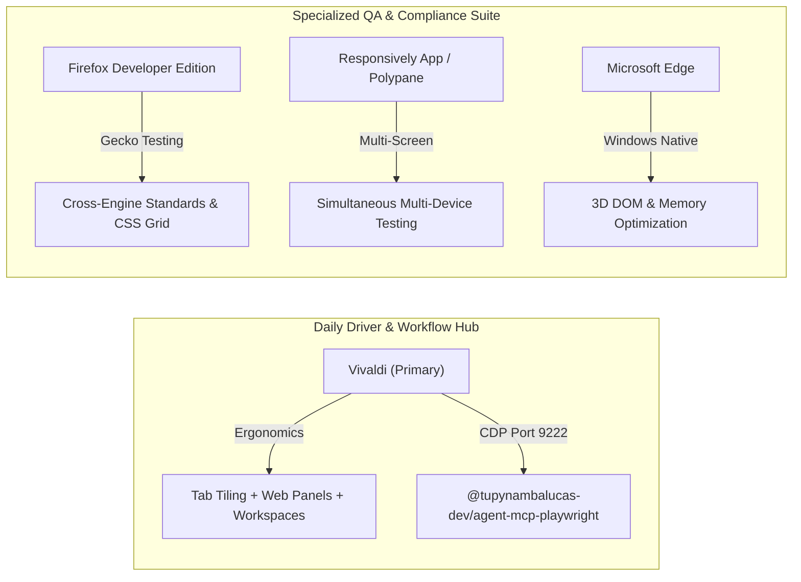

# In-House Playwright MCP Architecture & Dual-Mode Browser Engine Specification

This specification defines the architectural design, technical implementation, and monorepo integration plan for replacing the upstream third-party `@playwright/mcp` dependency with a sovereign in-house package: **`@tupynambalucas-dev/agent-mcp-playwright`** located in [`mcp/packages/playwright`](file:///C:/Users/tupyn/projects/organizations/tupynambalucas-dev/org-core/agent-mesh/mcp/packages).

It also specifies the **Dual-Mode Browser Engine**, which allows a single MCP server to operate seamlessly in two distinct paradigms:
1. **Developer Desktop Mode (CDP)**: Attaching non-intrusively to the developer's daily-driver browser (Vivaldi, Google Chrome, Microsoft Edge, or Brave) to inspect active tabs, evaluate live DOM, debug authenticated sessions, and provide real-time visual assistance.
2. **Headless Standalone Mode**: Spawning isolated, ephemeral Chromium browser instances for background automation, synthetic testing, AppSheet Studio generation, and Kubernetes cluster operations.

---

## 1. Executive Summary & Strategic Rationale

Currently, `agent-mesh` routes browser automation through the third-party upstream package `@playwright/mcp`. While functional for basic tasks, it introduces severe limitations:
- **No Access to Developer's Real Browser**: It strictly launches isolated headless browser instances. It cannot inspect the developer's open browser tabs, meaning agents cannot verify what the developer sees or assist with authenticated workflows (such as GitHub App creation).
- **Black-Box Architecture**: We cannot extend or customize tool schemas, error reporting, or session lifecycles to align with our enterprise logging and telemetry standards.
- **Inconsistent Monorepo Governance**: While all our other MCPs (`appsheet`, `github`, `firecrawl`, `google-workspace`, `infisical`, `memory`) are in-house compiled TypeScript packages consuming pnpm catalogs and Turborepo pipelines, Playwright remains an external outlier.

By authoring `@tupynambalucas-dev/agent-mcp-playwright`, we achieve full monorepo uniformity, zero external execution surprises, and native dual-mode capabilities.

---

## 2. Dual-Mode Browser Engine Architecture


---

## 3. Deep Dive: Mode 1 vs Mode 2 Comparison

| Architectural Dimension | Mode 1: Developer Desktop Mode (CDP) | Mode 2: Headless Standalone Mode |
| :--- | :--- | :--- |
| **Connection Method** | `playwright.chromium.connectOverCDP("http://localhost:9222", { noDefaults: true })` | `playwright.chromium.launch({ headless: true, args: [...] })` |
| **Target Browser** | Developer's daily-driver Vivaldi, Google Chrome, Microsoft Edge, or Brave. | Bundled Playwright Chromium binary. |
| **Session & Auth State** | Shares user's real cookies, active logins, GitHub credentials, local storage. | 100% ephemeral and clean. Cookies wiped upon session close. |
| **Viewport & Display** | Respects the user's real desktop window dimensions and theme. | Configurable virtual viewport (e.g., 1280x720, 1920x1080). |
| **Primary Use Cases** | Live visual troubleshooting ("see my screen"), checking errors in active tabs, assisting with form filling. | AppSheet UI automation, CI/CD automated test runs, deep web scraping, headless batch jobs. |
| **Environment Suitability** | Local developer workstation only (`localhost:9222`). | Local developer workstation AND Kubernetes cluster pods (`mcp-playwright`). |

---

## 4. Developer Workstation Requirements: Does the Developer Need to Install Anything?

### 4.1 The Invariant: Zero New Software Required
The developer **does NOT need to install any new software, browser extension, or third-party agent**.
- Modern Chromium-based browsers (Vivaldi, Google Chrome, Microsoft Edge, Brave) come with native **Chrome DevTools Protocol (CDP)** built-in.
- The only requirement is launching the browser with the native `--remote-debugging-port=9222` flag.

### 4.2 Connecting Vivaldi to MCP Playwright
Vivaldi is built on top of Chromium (Blink + V8), meaning its rendering pipeline, JavaScript runtime, and debugging interfaces are completely compatible with Playwright's `chromium.connectOverCDP()`.

On Windows, Vivaldi is installed by default in user space:
- **Executable Path**: `C:\Users\<User>\AppData\Local\Vivaldi\Application\vivaldi.exe` (or `C:\Program Files\Vivaldi\Application\vivaldi.exe`).
- **User Data Directory**: `C:\Users\<User>\AppData\Local\Vivaldi\User Data`.

#### Profile and Port Binding Dynamics in Chromium
Chromium enforces a single-instance profile lock. If Vivaldi is already running normally without the remote debugging flag, launching another window without specifying a profile will simply focus the existing process (which does not expose port 9222). Developers have two deterministic execution paths:

1. **Option A: Shared Session (Recommended for Agent Visual Pairing)**
   - Close any running Vivaldi windows.
   - Start Vivaldi with `--remote-debugging-port=9222`.
   - Result: Playwright attaches directly to the developer's live tabs, active GitHub sessions, cookies, and pinned web panels.
2. **Option B: Isolated Debug Profile (Parallel Session)**
   - Run Vivaldi with a dedicated debug profile directory without closing the existing daily browser:
     ```powershell
     & "$env:LOCALAPPDATA\Vivaldi\Application\vivaldi.exe" --remote-debugging-port=9222 --user-data-dir="$env:LOCALAPPDATA\Vivaldi\DebugProfile"
     ```
   - Result: An isolated Vivaldi window opens in parallel, exposing port 9222 without disturbing the primary profile.

### 4.3 Automated PowerShell Launch Helper: [`scripts/start-debug-browser.ps1`](file:///C:/Users/tupyn/projects/organizations/tupynambalucas-dev/org-core/agent-mesh/scripts/start-debug-browser.ps1)
To eliminate manual CLI invocation, `agent-mesh` provides [`scripts/start-debug-browser.ps1`](file:///C:/Users/tupyn/projects/organizations/tupynambalucas-dev/org-core/agent-mesh/scripts/start-debug-browser.ps1). It:
1. Probes if port 9222 is already open. If open, it confirms CDP is active and exits gracefully.
2. Auto-detects the installed Chromium browser prioritizing **Vivaldi**, followed by **Google Chrome**, **Microsoft Edge**, and **Brave**.
3. Launches the target browser with `--remote-debugging-port=9222`.

```powershell
# Auto-detects Vivaldi and attaches to the primary user session
.\scripts\start-debug-browser.ps1

# Explicitly launch Vivaldi in an isolated debug profile (side-by-side)
.\scripts\start-debug-browser.ps1 -Browser Vivaldi -Profile Isolated
```

### 4.4 Network & Security Isolation
- The port `9222` binds strictly to `127.0.0.1` (localhost).
- External network interfaces cannot access the debugging port.
- No third-party proxy, relay, or cloud tunneling is permitted.

### 4.5 Deep Dive: Why the `--remote-debugging-port` Flag is Mandatorily Required

A common inquiry is whether the `--remote-debugging-port` flag is strictly required, or if an active browser session can be attached to dynamically without any launch flags. 

Based on official Chromium core security specifications, Playwright upstream architecture, and web platform standards, the flag is **strictly, 100% mandatory**. The technical and architectural justifications are detailed below:

#### 1. Chromium Sandboxing & Security Boundaries
The Chrome DevTools Protocol (CDP) provides unconditional, unrestricted control over the browser:
- **Full Credential & Session Access**: Any client connecting to the CDP port can extract plaintext cookies, session tokens, and local storage across every origin, completely bypassing the Same-Origin Policy (SOP).
- **Arbitrary Script Execution**: Allows evaluating arbitrary JavaScript in any open tab with browser-level privileges.
- **Full Network Interception**: Permits snooping, modifying, or redirecting all HTTP/HTTPS and WebSocket traffic.
- **Zero Authentication by Design**: The CDP loopback socket does not perform cryptographic handshake authentication. Whoever connects to `127.0.0.1:9222` owns the browser.

Because of this immense power, Chromium's security architecture mandates that **CDP must never be active during standard user browsing**. If the debugging port could be opened dynamically by an internal script or running process, any malicious website or background malware could silently open port 9222, connect to it, and steal banking or GitHub sessions. The explicit command-line flag acts as an intentional, audited **security gate**.

#### 2. Absence of Runtime Flags or Settings
- There is **no toggle** in `vivaldi://settings`, `chrome://settings`, or `chrome://flags` to dynamically toggle the remote debugging server on or off in a running process.
- The remote debugging server component (`DevToolsHttpHandler`) in Chromium C++ source code is only initialized during the browser process startup sequence if the command line explicitly contains `--remote-debugging-port` or `--remote-debugging-pipe`.

#### 3. Evaluation of Theoretical Alternatives

| Alternative Mechanism | Feasibility | Why It Is Rejected in Enterprise Architecture |
| :--- | :--- | :--- |
| **Chrome Extension (`chrome.debugger` API)** | Feasible with caveats | Requires developing and packing a custom extension, enabling Developer Mode, and installing a Native Messaging Host. Displays an intrusive, permanent yellow banner (`"Browser is being debugged"`) on every tab. Violates our "zero software to install" invariant. |
| **Process Memory Injection (`chrome.dll`)** | High risk / Unstable | Injects shellcode into the running `vivaldi.exe` process to call `StartRemoteDebuggingServer`. Causes process instability, crashes, and immediately triggers Windows Defender and enterprise EDR heuristics. Completely unacceptable for production. |
| **Playwright `launchPersistentContext`** | Standard Playwright API | Launches a *new* browser process and internally injects the remote debugging flag anyway. Fails with a profile lock error if Vivaldi is already open with that profile. Does not attach to the developer's already-open window. |

#### 4. Practical Workflow Solution
To make working with the mandatory flag seamless and frictionless:
1. **One-Click Script**: Use [`scripts/start-debug-browser.ps1`](file:///C:/Users/tupyn/projects/organizations/tupynambalucas-dev/org-core/agent-mesh/scripts/start-debug-browser.ps1) to launch or verify the debugging browser.
2. **Dedicated Dev Shortcut**: Create a taskbar or desktop shortcut named `"Vivaldi (Dev Mode)"` with `--remote-debugging-port=9222` in the Target field. Because Vivaldi natively preserves and restores tabs across restarts, launching via this shortcut restores all active tabs and logins while activating CDP for the agent.

---

## 5. Developer Browser Ecosystem Evaluation: Vivaldi vs Alternatives

Web development workstations benefit significantly from selecting the right browser for the right operational phase. Below is a rigorous technical evaluation of Vivaldi against developer-oriented alternatives.

### 5.1 In-Depth Evaluation: Vivaldi
**Verdict**: **Outstanding Daily-Driver & Productivity Hub for Developers.**

| Strengths for Developers | Technical Rationale |
| :--- | :--- |
| **Chromium Core (Blink + V8)** | Identical rendering and JavaScript execution characteristics as Google Chrome. Zero compatibility divergence. |
| **Complete Chrome DevTools** | Pressing `F12` or `Ctrl+Shift+I` launches the native, full-featured Chrome DevTools suite (Elements, Network, Console, Application, Lighthouse, Profilers). |
| **Chrome Web Store Compatibility** | 100% support for development extensions: React DevTools, Redux DevTools, Vue.js devtools, Axe DevTools, GraphQL Network Inspector. |
| **Tab Tiling (Split-Screen View)** | Unique native feature: tiles 2 to 4 tabs side-by-side within a single window. Enables viewing a localhost web application alongside API Swagger documentation or GitHub PRs without dual monitors. |
| **Web Panels (Sidebar Integration)** | Allows pinning mobile viewport URLs or responsive views to a persistent collapsible sidebar (e.g. mobile view of the current app, Docusaurus references, or communication tools). |
| **Workspaces** | Logical separation of tab clusters per domain (e.g. Workspace for `agent-mesh`, Workspace for `platform`, Workspace for infrastructure). |
| **Command Palette (`F2`)** | Keyboard-centric navigation across tabs, commands, and settings, speeding up developer ergonomics. |

**Considerations**:
- Vivaldi's rich interface layer is built with web technologies (React/JS), which can slightly increase memory usage when maintaining hundreds of active tabs.
- It does not natively provide multi-device simultaneous viewport mirroring (which requires specialized tools like Polypane).

---

### 5.2 Comparative Analysis of Alternatives

#### 1. Firefox Developer Edition
- **Engine**: Gecko / SpiderMonkey (Non-Chromium).
- **Core Value for Developers**:
  - **Engine Diversity**: Essential for validating web applications outside the Chromium ecosystem, preventing CSS/JS regressions that affect Firefox and Safari users.
  - **Superior CSS Debugging**: Widely regarded as having the best CSS Grid, Flexbox, and Variable Font inspection tools in the industry.
  - **Network & WebSocket Inspection**: Exceptional visualization of WebSocket frame streams.
- **Role in Stack**: **Mandatory secondary browser** for cross-engine compliance testing.

#### 2. Polypane / Responsively App
- **Engine**: Chromium.
- **Core Value for Developers**:
  - **Simultaneous Multi-Viewport QA**: Displays a web application across mobile (iPhone, Pixel), tablet (iPad), laptop, and 4K desktop screens simultaneously in one window.
  - **Mirrored Interactions**: Clicking, typing, or scrolling in one viewport mirrors across all viewports in real time.
  - **Built-in A11y & Meta Auditing**: Automated WCAG contrast checkers, color-blindness simulation, and social card preview.
- **Distinction**: Polypane is commercial/subscription; Responsively App is free and open-source.
- **Role in Stack**: **Specialized responsive frontend QA tool**. Not suited as a daily-driver.

#### 3. Microsoft Edge
- **Engine**: Chromium.
- **Core Value for Developers**:
  - **Deep Windows Optimization**: Best memory efficiency on Windows with native Sleeping Tabs.
  - **Edge DevTools Innovations**: 3D DOM visualizer (inspecting z-index layering and DOM depth), Network Console for drafting synthetic REST queries, and advanced accessibility tree visualizers.
- **Role in Stack**: **Installed native fallback** (present by default on Windows workstations).

#### 4. Google Chrome / Chrome for Developers (Canary)
- **Engine**: Chromium.
- **Core Value for Developers**:
  - **Industry Market Baseline**: With ~65% global market share, it serves as the reference benchmark for customer experience.
  - **Lighthouse Standard**: Up-to-date Core Web Vitals (LCP, INP, CLS) reference measurements.
- **Role in Stack**: **Neutral reference browser**.

---

### 5.3 Workstation Architecture Recommendation Matrix



**Strategic Conclusion**:
The developer does **not** need to switch away from Vivaldi. Vivaldi is one of the most powerful daily-driver choices for power developers. The optimal strategy is:
1. **Primary Browser (Daily Coding & Agent Pairing)**: **Vivaldi** with CDP on port 9222.
2. **Cross-Browser Verification**: Keep **Firefox Developer Edition** installed to test layouts against Gecko.
3. **Responsive UI QA**: Use **Responsively App** (or Polypane) when designing complex multi-device layouts.

---

## 6. Mode Differentiation Strategy in Code

How does the MCP server determine whether to operate on the developer's desktop browser or in an isolated headless container?

### 6.1 Three-Tier Resolution Hierarchy


### 6.2 Implementation Pattern: `BrowserSessionManager`
To ensure the developer's Vivaldi/Chrome browser is **never prematurely killed or closed** when the agent finishes a task, the lifecycle manager distinguishes between closing headless sandboxes and detaching from CDP:

```typescript
import { chromium, type Browser, type BrowserContext, type Page } from 'playwright';
import http from 'node:http';

export type SessionType = 'auto' | 'developer' | 'isolated';

export class BrowserSessionManager {
  private cdpBrowser: Browser | null = null;
  private headlessBrowser: Browser | null = null;
  private cdpUrl: string;

  constructor(cdpUrl = process.env.PLAYWRIGHT_CDP_URL || 'http://localhost:9222') {
    this.cdpUrl = cdpUrl;
  }

  /**
   * Fast 150ms probe to check if developer browser is running with CDP enabled
   */
  public async isCdpAvailable(): Promise<boolean> {
    return new Promise((resolve) => {
      try {
        const url = new URL(this.cdpUrl);
        const req = http.get(
          { hostname: url.hostname, port: url.port, path: '/json/version', timeout: 150 },
          (res) => resolve(res.statusCode === 200)
        );
        req.on('error', () => resolve(false));
        req.on('timeout', () => { req.destroy(); resolve(false); });
      } catch {
        resolve(false);
      }
    });
  }

  /**
   * Resolves the target page based on desired mode and active tabs
   */
  public async getPage(mode: SessionType = 'auto'): Promise<{ page: Page; isDeveloper: boolean }> {
    if (mode === 'developer' || (mode === 'auto' && await this.isCdpAvailable())) {
      if (!this.cdpBrowser) {
        this.cdpBrowser = await chromium.connectOverCDP(this.cdpUrl, { noDefaults: true });
      }
      const context = this.cdpBrowser.contexts()[0];
      const pages = context.pages();
      // Return the current active tab or the most recently opened page
      const page = pages[pages.length - 1] || await context.newPage();
      return { page, isDeveloper: true };
    }

    // Isolated Headless Sandbox
    if (!this.headlessBrowser) {
      this.headlessBrowser = await chromium.launch({
        headless: true,
        args: ['--no-sandbox', '--disable-setuid-sandbox', '--disable-dev-shm-usage'],
      });
    }
    const context = await this.headlessBrowser.newContext({
      viewport: { width: 1280, height: 720 },
    });
    const page = await context.newPage();
    return { page, isDeveloper: false };
  }

  /**
   * Clean detachment: closes headless sandboxes but strictly preserves developer desktop browsers
   */
  public async closeAll(): Promise<void> {
    if (this.cdpBrowser) {
      // In CDP mode, only nullify the reference or close agent-created contexts.
      // Never call process-terminating signals against the developer's live browser.
      this.cdpBrowser = null;
    }
    if (this.headlessBrowser) {
      await this.headlessBrowser.close();
      this.headlessBrowser = null;
    }
  }
}
```

---

## 7. Monorepo Package Layout: `mcp/packages/playwright`

The new package `@tupynambalucas-dev/agent-mcp-playwright` follows the exact architectural structure of all enterprise MCP servers in `agent-mesh`:

```
mcp/packages/playwright/
├── src/
│   ├── index.ts               # Dual Transport: Fastify Streamable HTTP on :8080
│   ├── bin.ts                 # Dual Transport: Stdio for local agent CLI execution
│   ├── config.ts              # Zod schema environment validation
│   ├── browser/
│   │   ├── session-manager.ts # BrowserSessionManager (CDP + Headless engine)
│   │   └── types.ts           # Types, SessionType enums, element bounding box models
│   └── tools/
│       ├── index.ts           # Tool registry and dispatcher
│       ├── navigation.tool.ts # browser_navigate, browser_tabs, browser_switch_tab
│       ├── inspect.tool.ts    # browser_snapshot, browser_take_screenshot, browser_find
│       ├── interaction.tool.ts# browser_click, browser_type, browser_fill_form, browser_hover
│       ├── desktop.tool.ts    # browser_inspect_active_tab (dedicated desktop helper)
│       └── eval.tool.ts       # browser_evaluate, browser_wait_for
├── package.json               # Consumes catalog:mcp-stack and catalog:shared
├── tsconfig.json              # Extends monorepo root tsconfig
├── tsconfig.build.json        # Fast declaration compilation
└── README.md
```

### Dependencies in `package.json`
```json
{
  "name": "@tupynambalucas-dev/agent-mcp-playwright",
  "version": "1.0.0",
  "description": "Enterprise Model Context Protocol server for dual-mode browser automation and developer desktop inspection.",
  "type": "module",
  "main": "dist/index.js",
  "bin": {
    "agent-mcp-playwright": "./dist/bin.js"
  },
  "scripts": {
    "clean": "rimraf dist tsconfig.tsbuildinfo",
    "dev": "tsx watch src/index.ts",
    "build": "tsc -p tsconfig.build.json",
    "start": "node dist/index.js",
    "typecheck": "tsc --noEmit"
  },
  "dependencies": {
    "@modelcontextprotocol/sdk": "catalog:mcp-stack",
    "dotenv": "catalog:shared",
    "fastify": "catalog:mcp-stack",
    "playwright": "catalog:mcp-stack",
    "zod": "catalog:shared"
  },
  "devDependencies": {
    "@types/node": "catalog:",
    "rimraf": "catalog:",
    "tsx": "catalog:",
    "typescript": "catalog:"
  }
}
```

---

## 8. Domain Plugins Adaptation Strategy: New Plugin vs `web` Plugin

### Analysis
We evaluated whether to create a brand-new plugin (e.g. `agent-plugin-desktop`) or adapt the existing [`plugins/packages/web`](file:///C:/Users/tupyn/projects/organizations/tupynambalucas-dev/org-core/agent-mesh/plugins/packages/web).

### Verdict: Fortify `@tupynambalucas-dev/agent-plugin-web`
Creating a separate plugin would introduce domain redundancy, fragment browser tooling, and increase cognitive load for developers and agents. 

The optimal architectural solution is to expand [`plugins/packages/web`](file:///C:/Users/tupyn/projects/organizations/tupynambalucas-dev/org-core/agent-mesh/plugins/packages/web) into two specialized, single-responsibility skills:

1. **`browser-desktop-inspector`** (New Skill in `web`):
   - **Role**: Interactive pairing assistant for the developer's desktop browser (Vivaldi, Chrome, Edge).
   - **Capabilities**: Captures snapshots of what the developer is currently looking at, inspects error messages in forms, debugs live OAuth or GitHub App settings pages, and answers visual questions without requiring manual screenshots.
   - **Mode**: Automatically targets `sessionType: "developer"`.

2. **`browser-automator`** (Enhanced Existing Skill in `web`):
   - **Role**: Autonomous, headless browser operator.
   - **Capabilities**: Executes E2E test flows, batch form submissions, link verification, and automated web scraping.
   - **Mode**: Automatically targets `sessionType: "isolated"`.

3. **`appsheet-ui-designer`** in `plugins/packages/appsheet`:
   - Continues consuming the same Playwright MCP server, explicitly requesting `sessionType: "isolated"` to manipulate AppSheet Studio views headlessly without interfering with the developer's personal browser.

---

## 9. Smart Router & Cluster Fallback Integration

Updating [`scripts/mcp-gateway-router.js`](file:///C:/Users/tupyn/projects/organizations/tupynambalucas-dev/org-core/agent-mesh/scripts/mcp-gateway-router.js):
```javascript
const FALLBACK_REGISTRY = {
  // ...
  "playwright": {
    pkg: "@tupynambalucas-dev/agent-mcp-playwright",
    upstream: null // Fully sovereign in-house package
  }
};
```

- When running locally, the router spawns `node mcp/packages/playwright/dist/bin.js`.
- In the Kubernetes cluster, the `agentgateway` forwards requests to `http://mcp-playwright:8080/mcp`.
- Full Turborepo pipeline caching applies (`pnpm mcp:build` compiles Playwright in parallel with all other servers).

---

## 10. Implementation Roadmap

1. **Phase 1: Catalog & Workspace Preparation**:
   - Add `playwright: ^1.51.0` to `pnpm-workspace.yaml` under `catalogs.mcp-stack`.
   - Update monorepo dependencies.
2. **Phase 2: In-House MCP Package Creation**:
   - Scaffold `mcp/packages/playwright`.
   - Implement `BrowserSessionManager` with CDP attachment and headless fallback.
   - Implement Fastify Streamable HTTP (`index.ts`) and Stdio (`bin.ts`) transports.
   - Implement standard 25+ browser tools plus `browser_inspect_active_tab`.
3. **Phase 3: Domain Plugin Fortification**:
   - Author `plugins/packages/web/skills/browser-desktop-inspector/SKILL.md`.
   - Update `plugins/packages/web/rules/AGENTS.md` and `README.md`.
   - Utilize [`scripts/start-debug-browser.ps1`](file:///C:/Users/tupyn/projects/organizations/tupynambalucas-dev/org-core/agent-mesh/scripts/start-debug-browser.ps1) for one-click developer convenience.
4. **Phase 4: Monorepo Build & Validation**:
   - Run `pnpm mcp:build` (Turborepo Full Turbo verification).
   - Validate with `agy plugin validate plugins/packages/web --strict`.
   - Test CDP attachment against a live Vivaldi or Chrome session on port 9222.
