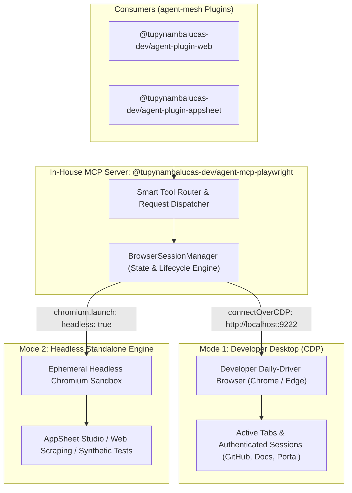
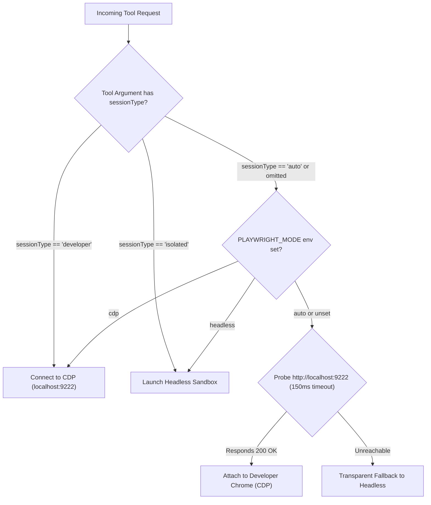

# In-House Playwright MCP Architecture & Dual-Mode Browser Engine Specification

This specification defines the architectural design, technical implementation, and monorepo integration plan for replacing the upstream third-party `@playwright/mcp` dependency with a sovereign in-house package: **`@tupynambalucas-dev/agent-mcp-playwright`** located in [`mcp/packages/playwright`](file:///C:/Users/tupyn/projects/organizations/tupynambalucas-dev/org-core/agent-mesh/mcp/packages).

It also specifies the **Dual-Mode Browser Engine**, which allows a single MCP server to operate seamlessly in two distinct paradigms:
1. **Developer Desktop Mode (CDP)**: Attaching non-intrusively to the developer's daily-driver Google Chrome or Microsoft Edge browser to see active tabs, inspect live DOM, debug authenticated sessions, and provide real-time visual assistance.
2. **Headless Standalone Mode**: Spawning isolated, ephemeral browser instances for background automation, synthetic testing, AppSheet Studio generation, and Kubernetes cluster operations.

---

## 1. Executive Summary & Strategic Rationale

Currently, `agent-mesh` routes browser automation through the third-party upstream package `@playwright/mcp`. While functional for basic tasks, it introduces severe limitations:
- **No Access to Developer's Real Browser**: It strictly launches isolated headless browser instances. It cannot inspect the developer's open browser tabs, meaning agents cannot verify what the developer sees or assist with authenticated workflows (such as GitHub App creation).
- **Black-Box Architecture**: We cannot extend or customize tool schemas, error reporting, or session lifecycles to align with our enterprise logging and telemetry standards.
- **Inconsistent Monorepo Governance**: While all our other MCPs (`appsheet`, `github`, `firecrawl`, `google-workspace`, `infisical`, `memory`) are in-house compiled TypeScript packages consuming pnpm catalogs and Turborepo pipelines, Playwright remains an external outlier.

By authoring `@tupynambalucas-dev/agent-mcp-playwright`, we achieve full monorepo uniformity, zero external execution surprises, and native dual-mode capabilities.

---

## 2. Dual-Mode Browser Engine Architecture



---

## 3. Deep Dive: Mode 1 vs Mode 2 Comparison

| Architectural Dimension | Mode 1: Developer Desktop Mode (CDP) | Mode 2: Headless Standalone Mode |
| :--- | :--- | :--- |
| **Connection Method** | `playwright.chromium.connectOverCDP("http://localhost:9222", { noDefaults: true })` | `playwright.chromium.launch({ headless: true, args: [...] })` |
| **Target Browser** | Developer's daily-driver Google Chrome or Microsoft Edge. | Bundled Playwright Chromium binary. |
| **Session & Auth State** | Shares user's real cookies, active logins, GitHub credentials, local storage. | 100% ephemeral and clean. Cookies wiped upon session close. |
| **Viewport & Display** | Respects the user's real desktop window dimensions and theme. | Configurable virtual viewport (e.g., 1280x720, 1920x1080). |
| **Primary Use Cases** | Live visual troubleshooting ("see my screen"), checking errors in active tabs, assisting with form filling. | AppSheet UI automation, CI/CD automated test runs, deep web scraping, headless batch jobs. |
| **Environment Suitability** | Local developer workstation only (`localhost:9222`). | Local developer workstation AND Kubernetes cluster pods (`mcp-playwright`). |

---

## 4. Developer Workstation Requirements: Does the Developer Need to Install Anything?

### The Invariant: Zero New Software Required
The developer **does NOT need to install any new software, browser extension, or third-party agent**.
- Modern Chromium-based browsers (Google Chrome, Microsoft Edge, Brave) come with native **Chrome DevTools Protocol (CDP)** built-in.
- The only requirement is launching the browser with the native `--remote-debugging-port=9222` flag.

### How to Start Chrome / Edge in Remote Debugging Mode

#### A. Automated PowerShell Launch Helper (`scripts/start-debug-browser.ps1`)
We provide a simple helper script in `agent-mesh/scripts/start-debug-browser.ps1`:
```powershell
# Launch Google Chrome with remote debugging enabled
$chromePath = "${env:ProgramFiles}\Google\Chrome\Application\chrome.exe"
if (-not (Test-Path $chromePath)) {
    $chromePath = "${env:ProgramFiles(x86)}\Google\Chrome\Application\chrome.exe"
}

# If Chrome is not found, fallback to Microsoft Edge
if (-not (Test-Path $chromePath)) {
    $chromePath = "${env:ProgramFiles(x86)}\Microsoft\Edge\Application\msedge.exe"
}

Start-Process -FilePath $chromePath -ArgumentList "--remote-debugging-port=9222", "--user-data-dir=$env:LOCALAPPDATA\Google\Chrome\User Data"
```

#### B. Permanent Desktop Shortcut
Alternatively, the developer can clone their existing Chrome or Edge shortcut and append `--remote-debugging-port=9222` to the Target field.

#### C. Network & Security Isolation
- The port `9222` binds exclusively to `127.0.0.1` (localhost).
- External network interfaces cannot access the debugging port.
- No third-party proxy or browser extension is permitted.

---

## 5. Mode Differentiation Strategy in Code

How does the MCP server determine whether to operate on the developer's desktop browser or in an isolated headless container?

### 5.1 Three-Tier Resolution Hierarchy



### 5.2 Implementation Pattern: `BrowserSessionManager`

```typescript
import { chromium, type Browser, type BrowserContext, type Page } from 'playwright';
import http from 'node:http';

export type SessionType = 'auto' | 'developer' | 'isolated';

export class BrowserSessionManager {
  private cdpBrowser: Browser | null = null;
  private headlessBrowser: Browser | null = null;
  private cdpUrl: string;

  constructor(cdpUrl = process.env.PLAYWRIGHT_CDP_URL || 'http://localhost:9222') {
    this.cdpUrl = cdpUrl;
  }

  /**
   * Fast 150ms probe to check if developer Chrome is running with CDP enabled
   */
  public async isCdpAvailable(): Promise<boolean> {
    return new Promise((resolve) => {
      try {
        const url = new URL(this.cdpUrl);
        const req = http.get(
          { hostname: url.hostname, port: url.port, path: '/json/version', timeout: 150 },
          (res) => resolve(res.statusCode === 200)
        );
        req.on('error', () => resolve(false));
        req.on('timeout', () => { req.destroy(); resolve(false); });
      } catch {
        resolve(false);
      }
    });
  }

  /**
   * Resolves the target page based on desired mode and active tabs
   */
  public async getPage(mode: SessionType = 'auto'): Promise<{ page: Page; isDeveloper: boolean }> {
    if (mode === 'developer' || (mode === 'auto' && await this.isCdpAvailable())) {
      if (!this.cdpBrowser) {
        this.cdpBrowser = await chromium.connectOverCDP(this.cdpUrl, { noDefaults: true });
      }
      const context = this.cdpBrowser.contexts()[0];
      const pages = context.pages();
      // Return the current active tab or the most recently opened page
      const page = pages[pages.length - 1] || await context.newPage();
      return { page, isDeveloper: true };
    }

    // Isolated Headless Sandbox
    if (!this.headlessBrowser) {
      this.headlessBrowser = await chromium.launch({
        headless: true,
        args: ['--no-sandbox', '--disable-setuid-sandbox', '--disable-dev-shm-usage'],
      });
    }
    const context = await this.headlessBrowser.newContext({
      viewport: { width: 1280, height: 720 },
    });
    const page = await context.newPage();
    return { page, isDeveloper: false };
  }

  public async closeAll(): Promise<void> {
    if (this.cdpBrowser) {
      // Disconnecting from CDP does NOT close the developer's browser window
      await this.cdpBrowser.close();
      this.cdpBrowser = null;
    }
    if (this.headlessBrowser) {
      await this.headlessBrowser.close();
      this.headlessBrowser = null;
    }
  }
}
```

---

## 6. Monorepo Package Layout: `mcp/packages/playwright`

The new package `@tupynambalucas-dev/agent-mcp-playwright` follows the exact architectural structure of all enterprise MCP servers in `agent-mesh`:

```
mcp/packages/playwright/
├── src/
│   ├── index.ts               # Dual Transport: Fastify Streamable HTTP on :8080
│   ├── bin.ts                 # Dual Transport: Stdio for local agent CLI execution
│   ├── config.ts              # Zod schema environment validation
│   ├── browser/
│   │   ├── session-manager.ts # BrowserSessionManager (CDP + Headless engine)
│   │   └── types.ts           # Types, SessionType enums, element bounding box models
│   └── tools/
│       ├── index.ts           # Tool registry and dispatcher
│       ├── navigation.tool.ts # browser_navigate, browser_tabs, browser_switch_tab
│       ├── inspect.tool.ts    # browser_snapshot, browser_take_screenshot, browser_find
│       ├── interaction.tool.ts# browser_click, browser_type, browser_fill_form, browser_hover
│       ├── desktop.tool.ts    # browser_inspect_active_tab (dedicated desktop helper)
│       └── eval.tool.ts       # browser_evaluate, browser_wait_for
├── package.json               # Consumes catalog:mcp-stack and catalog:shared
├── tsconfig.json              # Extends monorepo root tsconfig
├── tsconfig.build.json        # Fast declaration compilation
└── README.md
```

### Dependencies in `package.json`
```json
{
  "name": "@tupynambalucas-dev/agent-mcp-playwright",
  "version": "1.0.0",
  "description": "Enterprise Model Context Protocol server for dual-mode browser automation and developer desktop inspection.",
  "type": "module",
  "main": "dist/index.js",
  "bin": {
    "agent-mcp-playwright": "./dist/bin.js"
  },
  "scripts": {
    "clean": "rimraf dist tsconfig.tsbuildinfo",
    "dev": "tsx watch src/index.ts",
    "build": "tsc -p tsconfig.build.json",
    "start": "node dist/index.js",
    "typecheck": "tsc --noEmit"
  },
  "dependencies": {
    "@modelcontextprotocol/sdk": "catalog:mcp-stack",
    "dotenv": "catalog:shared",
    "fastify": "catalog:mcp-stack",
    "playwright": "catalog:mcp-stack",
    "zod": "catalog:shared"
  },
  "devDependencies": {
    "@types/node": "catalog:",
    "rimraf": "catalog:",
    "tsx": "catalog:",
    "typescript": "catalog:"
  }
}
```

---

## 7. Domain Plugins Adaptation Strategy: New Plugin vs `web` Plugin

### Analysis
We evaluated whether to create a brand-new plugin (e.g. `agent-plugin-desktop`) or adapt the existing [`plugins/packages/web`](file:///C:/Users/tupyn/projects/organizations/tupynambalucas-dev/org-core/agent-mesh/plugins/packages/web).

### Verdict: Fortify `@tupynambalucas-dev/agent-plugin-web`
Creating a separate plugin would introduce domain redundancy, fragment browser tooling, and increase cognitive load for developers and agents. 

The optimal architectural solution is to expand [`plugins/packages/web`](file:///C:/Users/tupyn/projects/organizations/tupynambalucas-dev/org-core/agent-mesh/plugins/packages/web) into two specialized, single-responsibility skills:

1. **`browser-desktop-inspector`** (New Skill in `web`):
   - **Role**: Interactive pairing assistant for the developer's desktop browser.
   - **Capabilities**: Captures snapshots of what the developer is currently looking at, inspects error messages in forms, debugs live OAuth or GitHub App settings pages, and answers visual questions without requiring the user to take manual screenshots.
   - **Mode**: Automatically targets `sessionType: "developer"`.

2. **`browser-automator`** (Enhanced Existing Skill in `web`):
   - **Role**: Autonomous, headless browser operator.
   - **Capabilities**: Executes E2E test flows, batch form submissions, link verification, and automated web scraping.
   - **Mode**: Automatically targets `sessionType: "isolated"`.

3. **`appsheet-ui-designer`** in `plugins/packages/appsheet`:
   - Continues consuming the same Playwright MCP server, explicitly requesting `sessionType: "isolated"` to manipulate AppSheet Studio views headlessly without interfering with the developer's personal browser.

---

## 8. Smart Router & Cluster Fallback Integration

Updating [`scripts/mcp-gateway-router.js`](file:///C:/Users/tupyn/projects/organizations/tupynambalucas-dev/org-core/agent-mesh/scripts/mcp-gateway-router.js):
```javascript
const FALLBACK_REGISTRY = {
  // ...
  "playwright": {
    pkg: "@tupynambalucas-dev/agent-mcp-playwright",
    upstream: null // Fully sovereign in-house package
  }
};
```

- When running locally, the router spawns `node mcp/packages/playwright/dist/bin.js`.
- In the Kubernetes cluster, the `agentgateway` forwards requests to `http://mcp-playwright:8080/mcp`.
- Full Turborepo pipeline caching applies (`pnpm mcp:build` compiles Playwright in parallel with all other servers).

---

## 9. Implementation Roadmap

1. **Phase 1: Catalog & Workspace Preparation**:
   - Add `playwright: ^1.51.0` to `pnpm-workspace.yaml` under `catalogs.mcp-stack`.
   - Update monorepo dependencies.
2. **Phase 2: In-House MCP Package Creation**:
   - Scaffold `mcp/packages/playwright`.
   - Implement `BrowserSessionManager` with CDP attachment and headless fallback.
   - Implement Fastify Streamable HTTP (`index.ts`) and Stdio (`bin.ts`) transports.
   - Implement standard 25+ browser tools plus `browser_inspect_active_tab`.
3. **Phase 3: Domain Plugin Fortification**:
   - Author `plugins/packages/web/skills/browser-desktop-inspector/SKILL.md`.
   - Update `plugins/packages/web/rules/AGENTS.md` and `README.md`.
   - Add `scripts/start-debug-browser.ps1` for one-click developer convenience.
4. **Phase 4: Monorepo Build & Validation**:
   - Run `pnpm mcp:build` (Turborepo Full Turbo verification).
   - Validate with `agy plugin validate plugins/packages/web --strict`.
   - Test CDP attachment against a live Chrome session on port 9222.
