# Developer Onboarding: GitHub CLI Setup, Team Matrix, and Machine Identity Governance

This document establishes the official onboarding runbook for developers across all functional
teams in `tupynambalucas-dev`, detailing GitHub CLI (`gh`) requirements, authentication mechanisms,
and token versus GitHub App machine identity segregation.

---

## 1. Team-by-Team GitHub CLI (`gh`) Requirement Matrix

Not every team member requires the full administrative capabilities of `gh`. Tool requirements are
calibrated strictly by role and responsibility:

| Functional Team | `gh` CLI Requirement | Primary Use Cases | Required Authentication Scopes |
| :--- | :--- | :--- | :--- |
| **`lead-architects`** | **Mandatory** | Domain 3 administration: team provisioning (`bootstrap-teams.sh`), repository RBAC binding (`sync-team-permissions.sh`), branch rulesets (`configure-rulesets.sh`), Actions secrets (`gh secret set`). | Personal OAuth / PAT with `admin:org`, `repo`, `workflow`. |
| **`infra-ops`** | **Mandatory** | CI/CD workflow monitoring (`gh run watch`, `gh workflow run`), environment secret management, release deployments. | Personal OAuth with `repo`, `workflow`, `read:org`. |
| **`security-managers`** | **Recommended** | Domain 2 security auditing: secret scanning alerts (`gh api .../secret-scanning/alerts`), Dependabot triage, compliance verification. | Personal OAuth with `security_events`, `read:org`, `repo`. |
| **`core-engineers`** | **Recommended / Optional** | Everyday Git operations, PR creation (`gh pr create`), checkout (`gh pr checkout`), issue tracking. Optional if using IDE/MCP exclusively. | Personal OAuth with `repo`, `read:org`. |
| **`technical-writers`** | **Recommended / Optional** | PR authoring on `docs`, documentation preview deployments, issue tracking. | Personal OAuth with `repo`, `read:org`. |
| **`creative-team`** | **Optional** | Brand vector asset staging, PR authoring for media and logos. | Personal OAuth with `repo`. |
| **`contractors`** | **Optional** | Git clone and push on specifically delegated engagement repositories. | Scoped Fine-Grained PAT or SSH key only. |

---

## 2. New Developer Step-by-Step Onboarding Runbook

When a new engineer joins a team in `tupynambalucas-dev`, they complete the following 4-step
onboarding sequence on their local development workstation:

### Step 1: Install the GitHub CLI

- **Windows** (via WinGet or Scoop):
  ```powershell
  winget install --id GitHub.cli
  ```
- **macOS** (via Homebrew):
  ```bash
  brew install gh
  ```
- **Linux** (Debian/Ubuntu):
  ```bash
  sudo apt install gh
  ```

### Step 2: Authenticate via Browser OAuth (Zero-Disk Plaintext)

Developers authenticate using their personal GitHub account. Personal credentials must **never**
be stored in plaintext `.env` files:

```bash
gh auth login
```

Interactive selection protocol:
1. **What account do you want to log into?** -> `GitHub.com`
2. **What is your preferred protocol for Git operations?** -> `SSH` (preferred for signing) or `HTTPS`
3. **Generate a new SSH key or upload existing?** -> Select as needed
4. **How would you like to authenticate GitHub CLI?** -> `Login with a web browser`

> [!NOTE]
> The resulting access token is automatically stored inside the operating system's native secure vault
> (**Windows Credential Manager**, macOS Keychain, or Linux Secret Service). Zero bytes are written to disk.

### Step 3: Configure Git Credential Helper

To ensure that standard Git commands (`git fetch`, `git pull`, `git push`) reuse the authenticated
`gh` session without requesting passwords:

```bash
gh auth setup-git
```

### Step 4: Verify Identity and Permitted Governance Domains

Run the pre-flight operator script to confirm organization membership and domain authorization:

```bash
node agent-toolkit/skills/github-org-manager/scripts/resolve-operator-role.js
```

Example verified output for a core engineer:
```text
Caller Identity Verification:
  User:                jane-engineer (Jane Developer)
  Organization:        tupynambalucas-dev
  Teams:               core-engineers
  Governance Domain:   domain-1-developer
  Privilege Level:     level-1
  Infisical Target:    tupynambalucas-dev-agent-toolkit [dev]

Permitted Operations:
  [x] Domain 1: Developer Operations (PRs, signed commits, submodule bumps)
  [ ] Domain 2: Security & Auditing (Blocked: Requires security-managers or lead-architects)
  [ ] Domain 3: Organization Admin (Blocked: Restricted strictly to lead-architects)
```

---

## 3. Human Identity vs. Machine Identity (GitHub App & Tokens)

To maintain accountability, auditability, and defense-in-depth, `tupynambalucas-dev` enforces a strict
separation between human developers and machine identities:

```mermaid
graph TD
  subgraph Humans ["Human Identities (Developers & Architects)"]
    DevUser["Personal GitHub User Account<br/>(jane-engineer, john-architect)"]
    DevUser -->|Interactive Web OAuth| GhAuth["gh auth login<br/>(Stored in OS Credential Manager)"]
    GhAuth -->|Enforces Personal RBAC Ceiling| GitOps["Personal Git Commits & PRs"]
  end

  subgraph Machine ["Machine Identities (Bot & Headless CI/CD)"]
    GhApp["GitHub App: tupynambalucas-org-manager<br/>(App ID, Installation ID, .pem Private Key)"]
    GhApp -->|Stored in Infisical Vault| Infisical["Infisical Cloud (Folder: /cluster)"]
    Infisical -->|Generates 1-Hour Ephemeral IAT| PipeRunner["CI/CD Runner / Background Operator"]
    PipeRunner -->|Cryptographically Verified Signature| AutoCommits["Automated Commits & PR Merges"]
  end
```



### 3.1 Human Developers
- **Rule**: Human developers **never** receive the GitHub App private key (`.pem`) or organization owner tokens.
- **Mechanism**: Every developer uses their personal account authenticated through `gh auth login` or a Fine-Grained PAT.
- **Auditability**: Every commit, pull request review, and comment is cryptographically tied to the individual's verified identity.

### 3.2 Centralized GitHub App (`tupynambalucas-org-manager`)
- **Rule**: Machine identity reserved exclusively for headless background automation and CI/CD pipelines.
- **Mechanism**:
  - The App's private key (`.pem`) is vaulted in Infisical under `tupynambalucas-dev-platform` (`/cluster` or `/ci-cd`).
  - Automated jobs mint short-lived (1-hour) **Installation Access Tokens (IAT)** on demand.
  - Commits authored by the App are automatically marked with GitHub's **Verified** badge without requiring developer SSH keys on headless servers.

### 3.3 Local Agent Sessions and MCP
- Developers running agent sessions locally consume MCP tools using their personal session or fallback tokens injected dynamically via `infisical run --env=dev -- ...`.
- If an agent requires high-rate-limit operations (e.g. bulk repo scanning), the local runner script (`mcp-runner.js`) can mint an ephemeral App token via Infisical without exposing the underlying private key to the developer.
